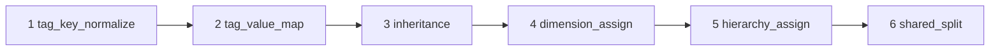

# Allocation Engine

Status: **DRAFT design**. No code exists. Delivered in Phase 15 (tag allocation, shared-cost distribution), building on allocation dimensions from Phase 11. Requirements: FR-ALC-001…007, FR-NRM-005, FR-IAM-006, UJ-04. Decisions: [ADR-0007](adr/0007-fixed-point-decimal-money-end-to.md) (decimals, deterministic residuals).

Inputs: the live `cost_focus` partitions ([FOCUS_NORMALIZATION.md](FOCUS_NORMALIZATION.md)), the published hierarchy version, custom dimensions, published allocation rule sets, and, for metric-driven splits, `unit_metric_values`. Output: `cost_allocated` plus an allocation run record and invariant report.

## 1. Rule kinds

The kinds match `allocation_rules.kind` in [DATABASE_SCHEMA.md](DATABASE_SCHEMA.md) §2.4.

| Kind | Purpose | Example |
|---|---|---|
| `tag_key_normalize` | Alias raw/normalized tag keys to a canonical key | `CostCenter`, `cost-center`, `costcentre` → `cost_center` |
| `tag_value_map` | Map values of a canonical key | `prod`, `production`, `PRD` → `production`; regex capture allowed |
| `inheritance` | Fill missing tags from a parent scope when the provider doesn't propagate | AWS account tags → resources; Azure resource-group tags → resources; GCP project labels → resources |
| `dimension_assign` | Conditions → value of a custom dimension | `ServiceName in (EKS, GKE, AKS)` → `dim:platform = kubernetes` |
| `hierarchy_assign` | Conditions → hierarchy node | `tag:cost_center = 'CC-1042'` → node `cc-1042` |
| `shared_split` | Split a shared cost pool across targets | Support fees split proportional to effective cost across business units |

## 2. Condition and action AST

Rules are stored as validated JSON (`allocation_rules.condition`, `.action`). JSON Schema files: `schemas/allocation/condition.v1.json` and `action.v1.json` (to be delivered in Phase 15).

### 2.1 Condition

```json
{
  "and": [
    {"field": "ProviderName", "op": "eq", "value": "AWS"},
    {"or": [
      {"field": "tag:env", "op": "in", "values": ["production", "prod"]},
      {"field": "SubAccountId", "op": "prefix", "value": "1234"}
    ]},
    {"not": {"field": "tag:cost_center", "op": "exists"}}
  ]
}
```

| Element | Allowed |
|---|---|
| Combinators | `and` (≥1), `or` (≥1), `not` (1). Max depth 8, max 64 leaves. |
| Fields | an allow-list of FOCUS dimension columns (§3.1 of FOCUS_NORMALIZATION, non-cost), registered `x_` extensions, `tag:<key>` (canonical key after earlier stages), `rawtag:<key>` (as delivered), `dim:<custom>`, `hierarchy:<node_type>` (only in stages after `hierarchy_assign`), `resource_type` |
| Operators | `eq`, `ne`, `in`, `not_in` (≤ 1 000 values), `exists`, `not_exists`, `prefix`, `suffix`, `contains`, `regex` (RE2 syntax, ≤ 256 chars, linear time), `eq_ci` (case-insensitive) |
| Literal `true` | `{"always": true}`: matches everything (used for catch-all rules) |

Cost columns are **not** allowed in conditions. Allocation must not depend on amounts except via `shared_split` drivers, which keeps assignment stable under restatement-driven amount changes.

### 2.2 Actions by kind

```json
{"kind":"tag_key_normalize","action":{"target_key":"cost_center","source_keys":["CostCenter","cost-center","costcentre"],"match":"normalized"}}
{"kind":"tag_value_map","action":{"key":"env","map":{"prod":"production","PRD":"production"},"regex":[{"pattern":"^prod-(.*)$","replace":"production"}],"default":null}}
{"kind":"inheritance","action":{"keys":["cost_center","owner"],"from":["azure_resource_group","azure_subscription"],"mode":"fill_missing"}}
{"kind":"dimension_assign","action":{"dimension":"platform","value":"kubernetes"}}
{"kind":"hierarchy_assign","action":{"node_type":"cost_center","node_key":"{{tag:cost_center}}","on_unknown_node":"unallocated"}}
{"kind":"shared_split","action":{"pool":"support-fees","targets":{"node_type":"business_unit","filter":null},"driver":{"type":"proportional_cost","metric":"effective_cost","basis":"same_period"},"metrics":["billed_cost","effective_cost","list_cost","contracted_cost"],"on_zero_driver":"even"}}
```

- `node_key` templates only interpolate `tag:`/`dim:`/FOCUS dimension values and resolve to an existing node key in the hierarchy version. Unknown keys follow `on_unknown_node` (`unallocated` default, or `node:<key>` fallback).
- `inheritance.from` uses the provider scope chain: AWS resource → account → OU → root; GCP resource → project → folder(s) → organization; Azure resource → resource group → subscription → management group(s). Scope tags come from `cloud_scopes.tags` (snapshot as of the charge date if SCD history exists, otherwise current, flagged in lineage).
- `mode`: `fill_missing` (default, resource tag wins) or `override` (parent wins).

## 3. Evaluation order and precedence

The stage order is fixed and not configurable. Within a stage, rules run in ascending `position`.



| Stage | Precedence semantics |
|---|---|
| 1 key normalize | All rules apply. If two rules alias different raw keys to the same target key on one row, the rule with the lower `position` wins; the loser is recorded as a conflict in the run report. |
| 2 value map | First matching rule per key wins. |
| 3 inheritance | For each key, `fill_missing` never overwrites; among multiple inheritance rules for one key, lowest `position` wins. Nearest ancestor scope wins within one rule. |
| 4 dimension assign | **First match wins per dimension.** Later rules for the same dimension are shadowed on that row. |
| 5 hierarchy assign | **First match wins per node type.** A row without a match for the allocation node type is **unallocated** (never hidden; glossary). |
| 6 shared split | Pools are evaluated in `position` order. A pool's source rows are selected by its condition from rows *after* stage 5, including outputs of earlier splits (cascade). The pool → target graph must be acyclic (checked at publish). |

There is no implicit "most specific wins". Precedence is always explicit by `position`, which makes the outcome explainable: every allocated row records the IDs of the rules that produced it (`cost_allocated.rule_ids`).

## 4. Effective dating and versioning

- A rule set version (`allocation_rule_sets`) has `effective_from` (date, UTC). The version that applies to a cost row is the published version with the greatest `effective_from ≤ date(ChargePeriodStart)`. A billing period may therefore be allocated by two versions split at a day boundary. Every row records `rule_set_version`.
- Publishing a version whose `effective_from` falls into a **closed** accounting period is rejected unless the publisher sets `restate_closed: true`, which (a) needs `finance.period.adjust` permission, (b) never changes closed snapshots, and (c) produces post-close adjustments ([FINANCE_RECONCILIATION.md](FINANCE_RECONCILIATION.md) §8).
- The hierarchy version used is the published `hierarchy_versions` row effective on the charge date. Rule sets reference node **keys**, not node IDs, so they survive hierarchy re-versioning. Publish validation fails if a referenced key doesn't exist in any hierarchy version overlapping the rule set's effective range.
- **Re-run history**: each allocation run is recorded with `(period, data_version, rule_set_version(s), hierarchy_version(s), checksum, invariant report)`. This needs an `allocation_runs` table, which is not yet in DATABASE_SCHEMA.md (gap, see §11).

## 5. Shared-cost algorithms (exact decimal)

### 5.1 Common definitions

- **Pool**: the shared rows selected by a `shared_split` rule, grouped by `(billing_period, charge_date, BillingCurrency, ChargeCategory, pool_id)`. Splitting is done per group and **per cost metric** (Billed, Effective, List, Contracted), so every metric's invariant holds independently. Currencies are never mixed. Splitting happens in billing currency, before FX.
- **Quantum** `q`: the smallest unit the split works in. Default `q = 10^-12` (storage scale), so the stored allocation is exact. Chargeback presentation applies a second, presentation-level largest-remainder pass at the currency's minor unit (§5.5).
- **Integer form**: amount `A` (decimal) → `a = A / q` as an arbitrary-precision integer. Weights `w_i ≥ 0` are scaled to integers by multiplying by `10^s`, where `s` is the maximum fractional digit count among the weights. `W = Σ w_i`.
- Negative amounts (credits): split `|a|`, then re-apply the sign to every share. This keeps residual assignment symmetric.

### 5.2 Largest-remainder method (LRM)

```
for each target i (n targets, W > 0):
    num_i   = |a| × w_i
    base_i  = floor(num_i / W)          // integer division
    rem_i   = num_i mod W               // 0 ≤ rem_i < W
R = |a| − Σ base_i                      // residual quanta
order targets by (rem_i desc, target_key asc)   // stable tie-break
give +1 quantum to the first R targets
alloc_i = sign(a) × (base_i + bonus_i) × q
```

`target_key` is the hierarchy node key or dimension value (byte-wise UTF-8 compare). Using keys rather than UUIDs keeps tie-breaks stable across re-versioned hierarchies and environments.

### 5.3 Drivers

| Driver | Weights `w_i` | Zero/edge handling |
|---|---|---|
| `even` | `1` for each target | n = 0 → whole pool stays unallocated |
| `fixed_percent` | configured percentages, decimal, must sum to exactly 100 (publish-time check) | targets with 0% are allowed and get 0 |
| `proportional_cost` | target's direct (post-stage-5, pre-split) cost of the chosen metric in the basis window (`same_period` default, `same_day`, or `trailing_30d`) | negative target totals are clamped to 0 and reported; W = 0 → `on_zero_driver` (`even` \| `unallocated` \| `node:<key>`) |
| `proportional_metric` | `unit_metric_values` for metric key `m`, summed over the basis window, joined on `dimension_key` = target key | missing values = 0 (reported as driver coverage); W = 0 → `on_zero_driver` |

### 5.4 Worked examples (q = 0.01 for readability; the algorithm is identical at 10^-12)

**Even, 100.00 across A, B, C.** `a = 10000`, `w = (1,1,1)`, `W = 3`. base = 3333 each, rem = 1 each, R = 10000 − 9999 = 1. All remainders tie → tie-break by key → A gets +1.
Result: A 33.34, B 33.33, C 33.33. Σ = 100.00 ✓

**Proportional, 10.00 by driver A = 3, B = 3, C = 1.** `a = 1000`, `W = 7`.

| Target | num = a × w | base | rem |
|---|---|---|---|
| A | 3000 | 428 | 4 |
| B | 3000 | 428 | 4 |
| C | 1000 | 142 | 6 |

Σ base = 998 → R = 2. Order by rem desc, key asc: C (6), A (4), B (4). C and A get +1.
Result: A 4.29, B 4.28, C 1.43. Σ = 10.00 ✓

**Fixed percent, 1 234.57 at 40 / 35 / 25 %.** `a = 123457`, `w = (40, 35, 25)`, `W = 100`.

| Target | num | base | rem |
|---|---|---|---|
| A (40%) | 4 938 280 | 49 382 | 80 |
| B (35%) | 4 320 995 | 43 209 | 95 |
| C (25%) | 3 086 425 | 30 864 | 25 |

Σ base = 123 455 → R = 2 → B (95), A (80).
Result: A 493.83, B 432.10, C 308.64. Σ = 1 234.57 ✓

**Credit, −10.00 even across A, B, C** → split 10.00 → (3.34, 3.33, 3.33) → negate → A −3.34, B −3.33, C −3.33.

### 5.5 Presentation-level rounding

Stored allocations at 10^-12 sum exactly to the source. A chargeback report rendered at minor units (e.g. 0.01) re-applies LRM per report total: round each line's stored amount by flooring to the minor unit, then distribute the residual by largest remainder with the same tie-break. Lines therefore always sum to the report total exactly. Simple half-even rounding of each line is not used for chargeback totals, because it can drift by up to n/2 minor units.

> FR-ALC-005 says the invariant holds "to the smallest currency unit". This design holds it **exactly at storage scale** (stronger), and at minor-unit scale in presentation via §5.5. Confirm this interpretation in Phase 15 requirements review.

## 6. Allocation invariants and proof obligations

Each run checks the following invariants (fail-closed: the previous allocation stays live, as with normalization). Each also has a written proof sketch kept in the Phase 15 DESIGN.md, plus a property-based test.

| ID | Invariant | Proof obligation |
|---|---|---|
| AI-1 Conservation | For each `(billing_period, BillingAccountId, BillingCurrency, ChargeCategory)` and each cost metric: Σ `cost_allocated` (allocated + unallocated) = Σ `cost_focus`. Exact. | Stages 1–5 only label rows (a bijection on rows). For stage 6, LRM: since Σ_i num_i = |a| × W, we get Σ_i num_i / W = |a|. So Σ base_i = |a| − Σ rem_i / W, and because Σ rem_i ≡ 0 (mod W) and 0 ≤ rem_i < W, R = Σ rem_i / W is an integer with 0 ≤ R < n. Adding exactly R quanta gives Σ = |a|. |
| AI-2 Bounded error | `|alloc_i − a × w_i / W| < q` for every target | base_i ≤ exact_i < base_i + 1, and the bonus is 0 or 1. |
| AI-3 Even fairness | For `even`, `max − min ≤ q` | All exact shares are equal, combined with AI-2. |
| AI-4 Sign | Non-negative pool ⇒ all shares ≥ 0; negative pool ⇒ all shares ≤ 0 | Construction (§5.1). |
| AI-5 Determinism | Same inputs ⇒ identical output rows and checksum, regardless of input row order, worker count or engine | LRM depends only on multiset of (key, weight). Tie-break is a total order on keys. Evaluation is over sorted distinct tuples (§9). |
| AI-6 Unallocated visibility | Unallocated rows exist as explicit rows with `hierarchy_node_id = NULL` and are counted | Construction. |
| AI-7 No orphan pool | Every pool group either is fully distributed or is explicitly unallocated with a reason | Zero-driver policy is total. |

## 7. Preview and diff (FR-ALC-006)

1. A draft rule set is validated (JSON Schema, field allow-list, regex safety, DAG of pools, node-key resolution, percentage sums).
2. **Preview run**: evaluates the draft against chosen periods (default: last closed month + current month) into a scratch area keyed by `preview_id` (never visible to dashboards; TTL 7 days).
3. **Diff** versus the live allocation of the same periods and data version:
   - per hierarchy node and per custom dimension: before, after, Δ, Δ%
   - unallocated before/after
   - rows (and cost) that changed target, with a sample of tuples and responsible rule IDs
   - **shadowed rules**: rules with zero first-match hits because an earlier rule always matches first
   - **conflicts**: stage-1 alias collisions, unknown node keys, zero-driver fallbacks, negative drivers clamped
4. The diff is attached to the draft and must be at most 24 h old (or newer than the latest data version) to publish.

## 8. Publish

- Requires `allocation.rules.publish` (and, by tenant policy, a second approver).
- On publish: compute `checksum = SHA-256(RFC 8785 canonical JSON of the rule set + referenced hierarchy version IDs)`, set `status = published`, set the overlapped prior version to `superseded` for the overlapping effective range, write an audit event, and emit `allocation.published.v1`. That event enqueues re-allocation jobs for every **open** period at or after `effective_from`.
- Re-allocation writes a new allocation output per period, swaps atomically, bumps the tenant `data_version` (cache invalidation), and emits `cost.period.allocated.v1`.

## 9. Performance on large data

Reference scale: up to 3 B+ cost rows per month in HA Enterprise (PRD §8).

1. **Evaluate on distinct attribute tuples, not rows.** Stages 1–5 depend only on non-cost attributes. The engine computes `SELECT DISTINCT tuple_hash, <condition fields>` per period. That is typically 10²–10⁴× fewer tuples than rows. The Go engine evaluates the rule set on each distinct tuple (deterministic, engine-independent), producing `tuple_hash → (canonical tags, dims, node, rule_ids)`. The engine then joins this mapping back to the rows.
2. **Splits on aggregates.** Pool groups (§5.1) are aggregated in the engine; LRM runs in Go on the small aggregate set. Split results are written as allocated rows at pool-group grain with `cost_row_ref` pointing to the pool group, not one row per (source row × target). Lineage to source rows is through the pool group's selection, which is reproducible.
3. **Driver totals** come from one aggregate query per pool basis.
4. **Parallelism**: per `(tenant, billing_period)`. Partitions are independent. Within a period, tuple evaluation shards by `tuple_hash` range.
5. **Writes** go to a staging partition and swap atomically (same adapter `Stage` API as normalization). Invariant AI-1 is computed in the engine by `GROUP BY` and compared exactly.
6. **Incrementality**: when only the data version changes (restatement) but rules do not, the tuple → assignment mapping is reused for tuples already seen (cache keyed by `rule_set checksum + tuple_hash`).

Targets (to be validated in Phase 34): a full re-allocation of 300 M rows/month on the Standard reference hardware within 30 minutes.

## 10. Property-based tests (Phase 15)

Library: `pgregory.net/rapid` (or equivalent; decided in Phase 03). Generators produce random hierarchies, tag sets (including unicode and collisions), rule sets (valid ASTs), pools with positive/negative/zero amounts at scale 12, and drivers including zeros.

| Property | Assertion |
|---|---|
| P1 conservation | AI-1 for every metric and group |
| P2 bounded error | AI-2 for each share |
| P3 permutation invariance | shuffling input rows, targets and tuple order → identical output (checksum) |
| P4 idempotence | run twice → identical output; publish identical rule set → no diff |
| P5 neutral rule | adding a rule whose condition matches nothing → no change |
| P6 catch-all | appending `{"always":true}` → unallocated becomes 0 for the affected node type, and conservation still holds |
| P7 sign | AI-4 |
| P8 even fairness | AI-3 |
| P9 scale invariance | LRM at q = 10^-12 then presentation LRM at 0.01 equals direct LRM at 0.01 in total (lines may differ by ≤ 1 minor unit; totals exact) |
| P10 engine parity | the same fixture allocated with PG, DuckDB and ClickHouse join paths → identical decimal strings |
| P11 effective dating | rows before `effective_from` are unchanged by publishing a new version |

Golden fixtures cover UJ-04 end to end (normalize keys → split platform cost by usage → chargeback per cost center).

## 11. Gaps and open points

- `allocation_runs` table (re-run history, invariant report) and a `preview` scratch area are not in DATABASE_SCHEMA.md.
- `cost_allocated` grain in DATABASE_SCHEMA.md is "cost row × allocation target". This design writes split results at pool-group grain (§9.2). The schema doc needs alignment.
- Scope-tag history for inheritance (charge-date tags vs. current tags) depends on SCD support for `cloud_scopes` (currently not versioned).
