# Database Schema

Status: **DRAFT**. Real migrations are delivered per phase in `database/postgres/migrations` (Phase 04 onward). This document is the design-level source of truth. Changes require a PR that updates this file and the migration together.

Conventions:
- IDs are `uuid` (UUIDv7, app-generated). Timestamps are `timestamptz` (UTC). Money is `numeric(38,12)`. Currency is `char(3)` (ISO 4217).
- Every tenant-owned table has `tenant_id uuid NOT NULL`, `PRIMARY KEY (tenant_id, id)`, composite FKs, RLS enabled and forced.
- Every mutable table has `created_at`, `updated_at` and `version bigint` (optimistic concurrency → ETag).
- Soft delete only where business-required (`deleted_at`). Financial and audit records are never deleted (except tenant purge).
- Naming: snake_case, plural table names, `fk_`, `ix_`, `uq_`, `ck_` prefixes.
- Migrations: `golang-migrate` or `atlas` (decided in Phase 03). Forward-only, with the expand → migrate → contract pattern for zero-downtime.

## 1. Control-plane ERD (PostgreSQL)

```mermaid
erDiagram
  tenants ||--o{ tenant_settings : has
  tenants ||--o{ memberships : has
  users ||--o{ memberships : in
  users ||--o{ identities : "linked IdP subjects"
  tenants ||--o{ idp_configs : has
  tenants ||--o{ roles : defines
  roles ||--o{ role_permissions : grants
  memberships ||--o{ role_bindings : has
  groups ||--o{ role_bindings : has
  role_bindings }o--o| data_scopes : restricts
  tenants ||--o{ api_tokens : issues
  tenants ||--o{ hierarchy_versions : versions
  hierarchy_versions ||--o{ hierarchy_nodes : contains
  tenants ||--o{ connectors : has
  connectors ||--o{ connector_capabilities : declares
  connectors ||--o{ cloud_scopes : discovers
  connectors ||--o{ credentials_refs : uses
  connectors ||--o{ sync_checkpoints : tracks
  connectors ||--o{ ingestion_runs : runs
  ingestion_runs ||--o{ source_objects : produces
  ingestion_runs ||--o{ data_quality_reports : yields
  tenants ||--o{ mapping_definitions : has
  tenants ||--o{ allocation_rule_sets : has
  allocation_rule_sets ||--o{ allocation_rules : contains
  tenants ||--o{ custom_dimensions : defines
  tenants ||--o{ dashboards : owns
  dashboards ||--o{ widgets : contains
  tenants ||--o{ saved_views : owns
  tenants ||--o{ budgets : has
  budgets ||--o{ budget_alert_rules : has
  tenants ||--o{ anomalies : detects
  tenants ||--o{ alert_channels : config
  alert_channels ||--o{ notification_deliveries : logs
  tenants ||--o{ fx_rate_sets : uses
  tenants ||--o{ commitments : tracks
  tenants ||--o{ invoices : imports
  invoices ||--o{ invoice_lines : contains
  invoices ||--o{ reconciliation_results : reconciled_by
  reconciliation_results ||--o{ reconciliation_variances : has
  tenants ||--o{ accounting_periods : has
  accounting_periods ||--o{ period_snapshots : closes_with
  tenants ||--o{ report_definitions : defines
  report_definitions ||--o{ report_runs : runs
  report_runs ||--|| report_manifests : produces
  tenants ||--o{ recommendations : has
  recommendations ||--o{ recommendation_evidence : backed_by
  recommendations ||--o{ recommendation_events : lifecycle
  recommendations ||--o{ realized_savings : measured
  tenants ||--o{ ai_conversations : has
  ai_conversations ||--o{ ai_messages : contains
  ai_messages ||--o{ ai_tool_calls : invokes
  tenants ||--o{ audit_events : logs
  tenants ||--o{ plugins_installed : enables
  outbox_events }o--|| tenants : for
  jobs }o--o| tenants : for
```



## 2. DDL by module (abbreviated; full DDL in migrations)

### 2.1 Tenancy and identity (Phase 04, 05)

```sql
CREATE TABLE tenants (
  id                uuid PRIMARY KEY,
  slug              text NOT NULL UNIQUE CHECK (slug ~ '^[a-z0-9][a-z0-9-]{1,62}$'),
  display_name      text NOT NULL,
  kind              text NOT NULL CHECK (kind IN ('individual','organization')),
  parent_tenant_id  uuid REFERENCES tenants(id),
  status            text NOT NULL CHECK (status IN ('provisioning','active','suspended','pending_deletion','deleted')),
  data_region       text,                       -- informational/region pinning
  created_at timestamptz NOT NULL DEFAULT now(), updated_at timestamptz NOT NULL DEFAULT now(), version bigint NOT NULL DEFAULT 1
);  -- not RLS'd by tenant_id; access restricted to platform role + self via view

CREATE TABLE tenant_settings (
  tenant_id uuid PRIMARY KEY REFERENCES tenants(id),
  reporting_currency char(3) NOT NULL DEFAULT 'USD',
  fx_policy text NOT NULL DEFAULT 'charge_date' CHECK (fx_policy IN ('charge_date','month_end','month_average','provider')),
  accounting_calendar jsonb NOT NULL DEFAULT '{"type":"gregorian","fiscal_year_start_month":1}',
  timezone text NOT NULL DEFAULT 'UTC',
  retention jsonb NOT NULL DEFAULT '{}',
  ai_settings jsonb NOT NULL DEFAULT '{"enabled":false}',
  updated_at timestamptz NOT NULL DEFAULT now(), version bigint NOT NULL DEFAULT 1
);

CREATE TABLE users (
  id uuid PRIMARY KEY, email citext NOT NULL UNIQUE, display_name text,
  status text NOT NULL CHECK (status IN ('active','disabled')),
  is_platform_admin boolean NOT NULL DEFAULT false,
  created_at timestamptz NOT NULL DEFAULT now(), updated_at timestamptz NOT NULL DEFAULT now()
);
CREATE TABLE identities (            -- external subjects linked to a user
  id uuid PRIMARY KEY, user_id uuid NOT NULL REFERENCES users(id),
  idp_config_id uuid NOT NULL, issuer text NOT NULL, subject text NOT NULL,
  UNIQUE (issuer, subject)
);
CREATE TABLE idp_configs (
  tenant_id uuid NOT NULL REFERENCES tenants(id), id uuid NOT NULL,
  protocol text NOT NULL CHECK (protocol IN ('oidc','saml')),
  issuer text NOT NULL, client_id text, client_secret_ref text,   -- secret reference, never raw
  saml_metadata xml, group_claim text, domain_hints text[],
  scim_enabled boolean NOT NULL DEFAULT false, scim_token_hash bytea,
  PRIMARY KEY (tenant_id, id)
);
CREATE TABLE memberships (
  tenant_id uuid NOT NULL REFERENCES tenants(id), id uuid NOT NULL,
  user_id uuid NOT NULL REFERENCES users(id),
  status text NOT NULL CHECK (status IN ('invited','active','suspended')),
  source text NOT NULL CHECK (source IN ('manual','jit','scim')),
  PRIMARY KEY (tenant_id, id), UNIQUE (tenant_id, user_id)
);
CREATE TABLE groups (tenant_id uuid NOT NULL, id uuid NOT NULL, external_id text, name text NOT NULL, PRIMARY KEY (tenant_id,id));
CREATE TABLE group_members (tenant_id uuid NOT NULL, group_id uuid NOT NULL, membership_id uuid NOT NULL, PRIMARY KEY (tenant_id, group_id, membership_id));

CREATE TABLE roles (
  tenant_id uuid,                -- NULL = built-in role (global, read-only)
  id uuid NOT NULL, key text NOT NULL, name text NOT NULL, builtin boolean NOT NULL DEFAULT false,
  PRIMARY KEY (id), UNIQUE (tenant_id, key)
);
CREATE TABLE role_permissions (role_id uuid NOT NULL REFERENCES roles(id), permission text NOT NULL, PRIMARY KEY (role_id, permission));
CREATE TABLE data_scopes (       -- ABAC predicate (validated JSON AST)
  tenant_id uuid NOT NULL, id uuid NOT NULL, name text NOT NULL, predicate jsonb NOT NULL,
  PRIMARY KEY (tenant_id, id)
);
CREATE TABLE role_bindings (
  tenant_id uuid NOT NULL, id uuid NOT NULL,
  subject_type text NOT NULL CHECK (subject_type IN ('membership','group','service_account')),
  subject_id uuid NOT NULL, role_id uuid NOT NULL REFERENCES roles(id),
  data_scope_id uuid, expires_at timestamptz,
  PRIMARY KEY (tenant_id, id),
  FOREIGN KEY (tenant_id, data_scope_id) REFERENCES data_scopes(tenant_id, id)
);
CREATE TABLE api_tokens (
  tenant_id uuid NOT NULL, id uuid NOT NULL, owner_type text NOT NULL, owner_id uuid NOT NULL,
  name text NOT NULL, prefix text NOT NULL, secret_hash bytea NOT NULL,   -- argon2id/HMAC-SHA256 of token
  scopes text[] NOT NULL, expires_at timestamptz NOT NULL, last_used_at timestamptz, revoked_at timestamptz,
  PRIMARY KEY (tenant_id, id), UNIQUE (prefix)
);
CREATE TABLE sessions (id uuid PRIMARY KEY, user_id uuid NOT NULL, tenant_id uuid, created_at timestamptz NOT NULL,
  idle_expires_at timestamptz NOT NULL, absolute_expires_at timestamptz NOT NULL, revoked_at timestamptz, user_agent text, ip inet);

CREATE TABLE hierarchy_versions (tenant_id uuid NOT NULL, id uuid NOT NULL, effective_from date NOT NULL, status text NOT NULL CHECK (status IN ('draft','published','retired')), PRIMARY KEY (tenant_id,id));
CREATE TABLE hierarchy_nodes (
  tenant_id uuid NOT NULL, id uuid NOT NULL, version_id uuid NOT NULL, parent_id uuid,
  key text NOT NULL, name text NOT NULL, node_type text NOT NULL,   -- e.g. business_unit, cost_center, team
  path ltree NOT NULL, attributes jsonb NOT NULL DEFAULT '{}',
  PRIMARY KEY (tenant_id, id), UNIQUE (tenant_id, version_id, key)
);
```

RLS template (applied by a migration helper to every tenant table):

```sql
ALTER TABLE <t> ENABLE ROW LEVEL SECURITY;
ALTER TABLE <t> FORCE ROW LEVEL SECURITY;
CREATE POLICY tenant_isolation ON <t>
  USING (tenant_id = current_setting('app.tenant_id', true)::uuid)
  WITH CHECK (tenant_id = current_setting('app.tenant_id', true)::uuid);
```

### 2.2 Audit and outbox (Phase 04)

```sql
CREATE TABLE audit_events (
  tenant_id uuid NOT NULL,            -- platform events use the reserved platform tenant UUID
  seq bigint NOT NULL,                -- per-tenant monotonic
  id uuid NOT NULL, occurred_at timestamptz NOT NULL,
  actor_type text NOT NULL, actor_id uuid, actor_ip inet, user_agent text,
  action text NOT NULL,               -- e.g. connector.create, period.close, authz.denied
  target_type text, target_id text, outcome text NOT NULL CHECK (outcome IN ('success','denied','error')),
  request_id text, trace_id text, details jsonb NOT NULL DEFAULT '{}',
  prev_hash bytea NOT NULL, hash bytea NOT NULL,
  PRIMARY KEY (tenant_id, seq)
) PARTITION BY RANGE (occurred_at);
-- app role: INSERT, SELECT only; trigger rejects UPDATE/DELETE even for owner except purge role.

CREATE TABLE outbox_events (
  id uuid PRIMARY KEY, tenant_id uuid NOT NULL, type text NOT NULL, subject text,
  payload jsonb NOT NULL, created_at timestamptz NOT NULL DEFAULT now(), published_at timestamptz, attempts int NOT NULL DEFAULT 0
);
CREATE INDEX ix_outbox_unpublished ON outbox_events (created_at) WHERE published_at IS NULL;

CREATE TABLE jobs (
  id uuid PRIMARY KEY, tenant_id uuid, queue text NOT NULL, kind text NOT NULL,
  unique_key text, payload jsonb NOT NULL, priority smallint NOT NULL DEFAULT 2,
  state text NOT NULL CHECK (state IN ('available','scheduled','running','retryable','completed','discarded','cancelled')),
  attempt int NOT NULL DEFAULT 0, max_attempts int NOT NULL DEFAULT 10,
  scheduled_at timestamptz NOT NULL DEFAULT now(), leased_until timestamptz, last_error jsonb,
  created_at timestamptz NOT NULL DEFAULT now(), finalized_at timestamptz
);
CREATE UNIQUE INDEX uq_jobs_unique_active ON jobs (unique_key) WHERE unique_key IS NOT NULL AND state IN ('available','scheduled','running','retryable');
CREATE INDEX ix_jobs_fetch ON jobs (queue, priority, scheduled_at) WHERE state IN ('available','retryable');
```

### 2.3 Connectors and ingestion (Phase 06–12)

```sql
CREATE TABLE connectors (
  tenant_id uuid NOT NULL, id uuid NOT NULL,
  provider text NOT NULL,                 -- aws | gcp | azure | generic | <plugin id>
  provider_version text NOT NULL,         -- plugin/SDK version used
  name text NOT NULL,
  root_scope jsonb NOT NULL,              -- e.g. {"type":"aws_organization","management_account_id":"…"}
  auth jsonb NOT NULL,                    -- method + non-secret params (role ARN, external ID ref, WIF pool…)
  credential_ref text,                    -- secret reference (optional)
  config jsonb NOT NULL DEFAULT '{}',     -- export locations, schedules
  status text NOT NULL CHECK (status IN ('pending_verification','active','degraded','error','disabled')),
  PRIMARY KEY (tenant_id, id)
);
CREATE TABLE connector_capabilities (
  tenant_id uuid NOT NULL, connector_id uuid NOT NULL, capability text NOT NULL,
  declared boolean NOT NULL, verified_status text NOT NULL CHECK (verified_status IN ('pass','fail','unknown','not_applicable')),
  permission_report jsonb NOT NULL DEFAULT '[]', verified_at timestamptz,
  PRIMARY KEY (tenant_id, connector_id, capability)
);
CREATE TABLE cloud_scopes (
  tenant_id uuid NOT NULL, id uuid NOT NULL, connector_id uuid NOT NULL,
  provider text NOT NULL, scope_type text NOT NULL, native_id text NOT NULL, name text,
  parent_scope_id uuid, tags jsonb NOT NULL DEFAULT '{}', status text NOT NULL,
  first_seen_at timestamptz NOT NULL, last_seen_at timestamptz NOT NULL,
  PRIMARY KEY (tenant_id, id), UNIQUE (tenant_id, connector_id, scope_type, native_id)
);
CREATE TABLE sync_checkpoints (
  tenant_id uuid NOT NULL, connector_id uuid NOT NULL, capability text NOT NULL, scope_key text NOT NULL,
  cursor jsonb NOT NULL, updated_at timestamptz NOT NULL, version bigint NOT NULL,
  PRIMARY KEY (tenant_id, connector_id, capability, scope_key)
);
CREATE TABLE ingestion_runs (
  tenant_id uuid NOT NULL, id uuid NOT NULL, connector_id uuid NOT NULL, capability text NOT NULL,
  scope_key text NOT NULL, window_start timestamptz, window_end timestamptz, billing_period date,
  trigger text NOT NULL CHECK (trigger IN ('schedule','backfill','manual','restatement','replay')),
  status text NOT NULL CHECK (status IN ('queued','discovering','downloading','normalizing','validating','swapping','succeeded','failed','failed_validation','quarantined','cancelled')),
  mapping_version text, stats jsonb NOT NULL DEFAULT '{}', error jsonb,
  started_at timestamptz, finished_at timestamptz,
  PRIMARY KEY (tenant_id, id)
);
CREATE TABLE source_objects (
  tenant_id uuid NOT NULL, id uuid NOT NULL, ingestion_run_id uuid NOT NULL,
  provider_object_uri text NOT NULL, provider_etag text, provider_version text,
  storage_uri text NOT NULL, sha256 bytea NOT NULL, size_bytes bigint NOT NULL,
  format text NOT NULL, schema_fingerprint text NOT NULL, schema_version text,
  billing_period date, row_count bigint, retained_until date,
  PRIMARY KEY (tenant_id, id), UNIQUE (tenant_id, sha256)
);
CREATE TABLE billing_period_versions (      -- which run is "live" for a period (restatements)
  tenant_id uuid NOT NULL, connector_id uuid NOT NULL, billing_period date NOT NULL, version int NOT NULL,
  ingestion_run_id uuid NOT NULL, is_live boolean NOT NULL, provider_final boolean NOT NULL DEFAULT false,
  totals jsonb NOT NULL,    -- validated control totals by (account, currency, charge_category)
  swapped_at timestamptz NOT NULL,
  PRIMARY KEY (tenant_id, connector_id, billing_period, version)
);
CREATE UNIQUE INDEX uq_live_period ON billing_period_versions (tenant_id, connector_id, billing_period) WHERE is_live;
CREATE TABLE data_quality_reports (tenant_id uuid NOT NULL, id uuid NOT NULL, ingestion_run_id uuid NOT NULL, checks jsonb NOT NULL, rejected_rows bigint NOT NULL, rejected_sample_uri text, PRIMARY KEY (tenant_id,id));
CREATE TABLE mapping_definitions (          -- provider→FOCUS and generic-import column mappings
  tenant_id uuid,  id uuid NOT NULL, key text NOT NULL, version int NOT NULL, focus_version text NOT NULL,
  definition jsonb NOT NULL, status text NOT NULL, PRIMARY KEY (id), UNIQUE (tenant_id, key, version)
);
```

### 2.4 Allocation, dashboards (Phase 15–16)

```sql
CREATE TABLE custom_dimensions (tenant_id uuid NOT NULL, id uuid NOT NULL, key text NOT NULL, name text NOT NULL, allowed_values text[], PRIMARY KEY (tenant_id,id), UNIQUE (tenant_id,key));
CREATE TABLE allocation_rule_sets (
  tenant_id uuid NOT NULL, id uuid NOT NULL, version int NOT NULL,
  status text NOT NULL CHECK (status IN ('draft','published','superseded')),
  effective_from date NOT NULL, published_by uuid, published_at timestamptz, checksum bytea,
  PRIMARY KEY (tenant_id, id), UNIQUE (tenant_id, version)
);
CREATE TABLE allocation_rules (
  tenant_id uuid NOT NULL, id uuid NOT NULL, rule_set_id uuid NOT NULL, position int NOT NULL,
  kind text NOT NULL CHECK (kind IN ('tag_key_normalize','tag_value_map','inheritance','dimension_assign','hierarchy_assign','shared_split')),
  condition jsonb NOT NULL, action jsonb NOT NULL,    -- validated ASTs
  PRIMARY KEY (tenant_id, id), UNIQUE (tenant_id, rule_set_id, position)
);
CREATE TABLE dashboards (tenant_id uuid NOT NULL, id uuid NOT NULL, name text NOT NULL, owner_id uuid NOT NULL, visibility text NOT NULL CHECK (visibility IN ('private','shared','tenant')), layout jsonb NOT NULL, template_key text, version bigint NOT NULL, PRIMARY KEY (tenant_id,id));
CREATE TABLE widgets (tenant_id uuid NOT NULL, id uuid NOT NULL, dashboard_id uuid NOT NULL, type text NOT NULL, query jsonb NOT NULL, options jsonb NOT NULL, PRIMARY KEY (tenant_id,id));
CREATE TABLE dashboard_shares (tenant_id uuid NOT NULL, dashboard_id uuid NOT NULL, subject_type text NOT NULL, subject_id uuid NOT NULL, permission text NOT NULL CHECK (permission IN ('view','edit')), PRIMARY KEY (tenant_id, dashboard_id, subject_type, subject_id));
CREATE TABLE saved_views (tenant_id uuid NOT NULL, id uuid NOT NULL, owner_id uuid NOT NULL, name text NOT NULL, query jsonb NOT NULL, PRIMARY KEY (tenant_id,id));
```

### 2.5 Budgets, anomalies, alerts (Phase 17, 32)

```sql
CREATE TABLE budgets (tenant_id uuid NOT NULL, id uuid NOT NULL, name text NOT NULL, scope jsonb NOT NULL, cost_metric text NOT NULL, currency char(3) NOT NULL,
  period_type text NOT NULL CHECK (period_type IN ('month','quarter','year','custom')), amounts jsonb NOT NULL, owner_id uuid, PRIMARY KEY (tenant_id,id));
CREATE TABLE budget_alert_rules (tenant_id uuid NOT NULL, id uuid NOT NULL, budget_id uuid NOT NULL, basis text NOT NULL CHECK (basis IN ('actual','forecast')), threshold_pct numeric(7,3) NOT NULL, channel_ids uuid[] NOT NULL, PRIMARY KEY (tenant_id,id));
CREATE TABLE forecasts (tenant_id uuid NOT NULL, id uuid NOT NULL, scope_hash bytea NOT NULL, model text NOT NULL, model_version text NOT NULL, generated_at timestamptz NOT NULL, data_version bigint NOT NULL, series jsonb NOT NULL, backtest jsonb, PRIMARY KEY (tenant_id,id));
CREATE TABLE anomalies (tenant_id uuid NOT NULL, id uuid NOT NULL, scope jsonb NOT NULL, detected_at timestamptz NOT NULL, usage_date date NOT NULL,
  expected numeric(38,12) NOT NULL, actual numeric(38,12) NOT NULL, currency char(3) NOT NULL, score numeric(10,4) NOT NULL,
  contributors jsonb NOT NULL, status text NOT NULL CHECK (status IN ('open','acknowledged','resolved','false_positive','suppressed')), detector_version text NOT NULL, PRIMARY KEY (tenant_id,id));
CREATE TABLE alert_channels (tenant_id uuid NOT NULL, id uuid NOT NULL, type text NOT NULL CHECK (type IN ('email','slack','teams','webhook','jira','servicenow','github')), config jsonb NOT NULL, secret_ref text, verified_at timestamptz, PRIMARY KEY (tenant_id,id));
CREATE TABLE notification_deliveries (tenant_id uuid NOT NULL, id uuid NOT NULL, channel_id uuid NOT NULL, dedup_key text NOT NULL, event_type text NOT NULL,
  status text NOT NULL CHECK (status IN ('pending','sent','failed','dead_lettered','suppressed')), attempts int NOT NULL, last_error text, sent_at timestamptz,
  PRIMARY KEY (tenant_id,id), UNIQUE (tenant_id, channel_id, dedup_key));
```

### 2.6 Finance (Phase 10, 18, 29, 30)

```sql
CREATE TABLE fx_rate_sets (tenant_id uuid, id uuid NOT NULL, source text NOT NULL, version int NOT NULL, retrieved_at timestamptz NOT NULL, checksum bytea NOT NULL, PRIMARY KEY (id));
CREATE TABLE fx_rates (rate_set_id uuid NOT NULL, rate_date date NOT NULL, base char(3) NOT NULL, quote char(3) NOT NULL, rate numeric(38,18) NOT NULL, PRIMARY KEY (rate_set_id, rate_date, base, quote));
CREATE TABLE commitments (tenant_id uuid NOT NULL, id uuid NOT NULL, provider text NOT NULL, native_id text NOT NULL,
  type text NOT NULL,  -- aws_ri, aws_sp_compute, aws_sp_ec2, gcp_cud_resource, gcp_cud_spend, azure_reservation, azure_savings_plan
  scope jsonb NOT NULL, term_months int NOT NULL, payment_option text, start_at timestamptz NOT NULL, end_at timestamptz NOT NULL,
  commitment_amount numeric(38,12), currency char(3), attributes jsonb NOT NULL, PRIMARY KEY (tenant_id,id), UNIQUE (tenant_id, provider, native_id));
CREATE TABLE unit_metrics (tenant_id uuid NOT NULL, id uuid NOT NULL, key text NOT NULL, name text NOT NULL, unit text NOT NULL, PRIMARY KEY (tenant_id,id));
CREATE TABLE unit_metric_values (tenant_id uuid NOT NULL, metric_id uuid NOT NULL, ts date NOT NULL, dimension_key text NOT NULL DEFAULT '', value numeric(38,12) NOT NULL, source text NOT NULL, PRIMARY KEY (tenant_id, metric_id, ts, dimension_key));
CREATE TABLE invoices (tenant_id uuid NOT NULL, id uuid NOT NULL, provider text NOT NULL, invoice_number text NOT NULL, issuer_entity text, billing_account text NOT NULL,
  invoice_date date NOT NULL, period_start date NOT NULL, period_end date NOT NULL, currency char(3) NOT NULL,
  subtotal numeric(38,12) NOT NULL, tax numeric(38,12) NOT NULL, total numeric(38,12) NOT NULL,
  source text NOT NULL CHECK (source IN ('api','upload','export')), source_object_id uuid, status text NOT NULL,
  PRIMARY KEY (tenant_id,id), UNIQUE (tenant_id, provider, billing_account, invoice_number));
CREATE TABLE invoice_lines (tenant_id uuid NOT NULL, id uuid NOT NULL, invoice_id uuid NOT NULL, line_no int NOT NULL, description text, category text,
  account_ref text, service text, amount numeric(38,12) NOT NULL, tax numeric(38,12), PRIMARY KEY (tenant_id,id));
CREATE TABLE reconciliation_results (tenant_id uuid NOT NULL, id uuid NOT NULL, invoice_id uuid NOT NULL, data_version bigint NOT NULL, run_at timestamptz NOT NULL,
  invoice_total numeric(38,12) NOT NULL, computed_total numeric(38,12) NOT NULL, tolerance numeric(38,12) NOT NULL,
  status text NOT NULL CHECK (status IN ('matched','within_tolerance','variance','acknowledged')), PRIMARY KEY (tenant_id,id));
CREATE TABLE reconciliation_variances (tenant_id uuid NOT NULL, id uuid NOT NULL, result_id uuid NOT NULL,
  category text NOT NULL CHECK (category IN ('tax','credit','rounding','timing','late_correction','fx','marketplace','support','missing_data','unexplained')),
  amount numeric(38,12) NOT NULL, details jsonb NOT NULL, acknowledged_by uuid, acknowledged_at timestamptz, note text, PRIMARY KEY (tenant_id,id));
CREATE TABLE accounting_periods (tenant_id uuid NOT NULL, id uuid NOT NULL, period_key text NOT NULL, start_date date NOT NULL, end_date date NOT NULL,
  status text NOT NULL CHECK (status IN ('open','closing','closed','reopened')), closed_by uuid, closed_at timestamptz, PRIMARY KEY (tenant_id,id), UNIQUE (tenant_id, period_key));
CREATE TABLE period_snapshots (tenant_id uuid NOT NULL, id uuid NOT NULL, period_id uuid NOT NULL, data_version bigint NOT NULL,
  rule_set_version int NOT NULL, fx_rate_set_id uuid, storage_uri text NOT NULL, manifest_sha256 bytea NOT NULL, worm_locked_until date, PRIMARY KEY (tenant_id,id));
CREATE TABLE period_adjustments (tenant_id uuid NOT NULL, id uuid NOT NULL, closed_period_id uuid NOT NULL, booked_in_period_id uuid NOT NULL, reason text NOT NULL, delta jsonb NOT NULL, created_at timestamptz NOT NULL, PRIMARY KEY (tenant_id,id));
CREATE TABLE report_definitions (tenant_id uuid NOT NULL, id uuid NOT NULL, name text NOT NULL, query jsonb NOT NULL, formats text[] NOT NULL, schedule text, recipients jsonb, PRIMARY KEY (tenant_id,id));
CREATE TABLE report_runs (tenant_id uuid NOT NULL, id uuid NOT NULL, definition_id uuid, requested_by uuid, status text NOT NULL, started_at timestamptz, finished_at timestamptz, PRIMARY KEY (tenant_id,id));
CREATE TABLE report_manifests (tenant_id uuid NOT NULL, report_run_id uuid NOT NULL, manifest jsonb NOT NULL, sha256 bytea NOT NULL, signed_by text, PRIMARY KEY (tenant_id, report_run_id));
```

### 2.7 Inventory pointers, recommendations (Phase 19–26)
Bulk inventory and metrics live in the analytics store (§3). The control plane keeps recommendation state.

```sql
CREATE TABLE recommendations (
  tenant_id uuid NOT NULL, id uuid NOT NULL, fingerprint bytea NOT NULL,       -- stable identity: rule_id + target + action
  rule_id text NOT NULL, rule_version text NOT NULL, source text NOT NULL CHECK (source IN ('native','provider')),
  category text NOT NULL, provider text NOT NULL, target_type text NOT NULL, target_native_id text NOT NULL, scope jsonb NOT NULL,
  title text NOT NULL, action jsonb NOT NULL,
  currency char(3) NOT NULL, gross_monthly_savings numeric(38,12) NOT NULL, net_monthly_savings numeric(38,12) NOT NULL,
  overlap_group text, confidence numeric(5,4) NOT NULL, confidence_factors jsonb NOT NULL, risk text NOT NULL CHECK (risk IN ('low','medium','high')),
  effort text NOT NULL, inputs_freshness jsonb NOT NULL,
  state text NOT NULL CHECK (state IN ('open','acknowledged','in_review','approved','rejected','implemented','verified','snoozed','dismissed','expired','superseded')),
  snoozed_until timestamptz, assignee_id uuid, first_seen_at timestamptz NOT NULL, last_evaluated_at timestamptz NOT NULL, version bigint NOT NULL,
  PRIMARY KEY (tenant_id, id), UNIQUE (tenant_id, fingerprint)
);
CREATE TABLE recommendation_evidence (tenant_id uuid NOT NULL, id uuid NOT NULL, recommendation_id uuid NOT NULL, evaluated_at timestamptz NOT NULL, kind text NOT NULL, data jsonb NOT NULL, data_refs jsonb NOT NULL, PRIMARY KEY (tenant_id,id));
CREATE TABLE recommendation_events (tenant_id uuid NOT NULL, id uuid NOT NULL, recommendation_id uuid NOT NULL, from_state text, to_state text NOT NULL, actor_id uuid, comment text, external_ref text, occurred_at timestamptz NOT NULL, PRIMARY KEY (tenant_id,id));
CREATE TABLE realized_savings (tenant_id uuid NOT NULL, id uuid NOT NULL, recommendation_id uuid NOT NULL, baseline_window daterange NOT NULL, measure_window daterange NOT NULL,
  method text NOT NULL, baseline_cost numeric(38,12) NOT NULL, observed_cost numeric(38,12) NOT NULL, realized_monthly numeric(38,12) NOT NULL, confidence numeric(5,4) NOT NULL, notes jsonb, PRIMARY KEY (tenant_id,id));
CREATE TABLE provider_recommendations (tenant_id uuid NOT NULL, id uuid NOT NULL, connector_id uuid NOT NULL, native_id text NOT NULL, source text NOT NULL, raw jsonb NOT NULL, fetched_at timestamptz NOT NULL, mapped_recommendation_id uuid, PRIMARY KEY (tenant_id,id), UNIQUE (tenant_id, connector_id, native_id));
```

### 2.8 AI and plugins (Phase 27, 28, 35)

```sql
CREATE TABLE ai_conversations (tenant_id uuid NOT NULL, id uuid NOT NULL, user_id uuid NOT NULL, title text, model_ref text NOT NULL, created_at timestamptz NOT NULL, expires_at timestamptz NOT NULL, PRIMARY KEY (tenant_id,id));
CREATE TABLE ai_messages (tenant_id uuid NOT NULL, id uuid NOT NULL, conversation_id uuid NOT NULL, role text NOT NULL, content text NOT NULL, citations jsonb, tokens_in int, tokens_out int, created_at timestamptz NOT NULL, PRIMARY KEY (tenant_id,id));
CREATE TABLE ai_tool_calls (tenant_id uuid NOT NULL, id uuid NOT NULL, message_id uuid NOT NULL, tool text NOT NULL, arguments jsonb NOT NULL, authz_decision text NOT NULL, result_ref jsonb, duration_ms int, PRIMARY KEY (tenant_id,id));
CREATE TABLE plugins_installed (id uuid PRIMARY KEY, plugin_key text NOT NULL, version text NOT NULL, kind text NOT NULL, manifest jsonb NOT NULL, license_spdx text, checksum bytea NOT NULL, enabled boolean NOT NULL, installed_at timestamptz NOT NULL);
```

## 3. Analytics store schema (engine-neutral logical model)

Physical DDL per engine is in [ANALYTICS_ADAPTERS.md](ANALYTICS_ADAPTERS.md). All tables lead with `tenant_id`.

| Table | Grain | Partition | Key columns |
|---|---|---|---|
| `cost_focus` | one normalized charge row | `(tenant_id, connector_id, billing_period)` | FOCUS 1.2 columns (BilledCost, EffectiveCost, ListCost, ContractedCost, ConsumedQuantity, PricingQuantity, ChargeCategory, ChargeClass, ChargePeriodStart/End, BillingPeriodStart/End, BillingAccountId, SubAccountId, ServiceName, ServiceCategory, RegionId, ResourceId, SkuId, CommitmentDiscountId, InvoiceId, BillingCurrency, Tags…), plus lineage (`ingestion_run_id`, `source_object_id`, `source_row`, `mapping_version`, `dedup_key`) and `x_` extensions + `x_raw` (JSON) |
| `cost_allocated` | cost row × allocation target (after splits) | `(tenant_id, billing_period)` | `cost_row_ref`, `hierarchy_node_id`, custom dimensions, `allocation_share` (decimal), allocated amounts per cost metric, `rule_set_version`, `rule_ids` |
| `cost_daily_agg` | day × common dims | `(tenant_id, month)` | materialized rollups for dashboards. Rebuilt on data version bump. |
| `fx_applied` | (date, from, to) | — | rates used for each rate set (copied for engine-local joins) |
| `resources` | resource version (SCD2) | `(tenant_id)` | provider, native id, type, region, tags, relationships, `valid_from`, `valid_to` |
| `metrics_rollup` | resource × metric × hour/day | `(tenant_id, month)` | min/avg/p50/p95/p99/max, sample_count, coverage |
| `price_catalog` | SKU × region × price version | `(provider)` | unit price, currency, effective dates (not tenant-scoped; public data) |
| `commitment_utilization` | commitment × day | `(tenant_id, month)` | used, unused, covered cost |
| `unit_metric_values` | metric × day × dim | `(tenant_id)` | replicated from control plane for joins |

## 4. Retention defaults (OQ-09)
Raw objects 25 months · `cost_focus` 37 months · metrics hourly 90 days and daily 25 months · audit 7 years · AI conversations 30 days · closed-period snapshots: per tenant policy (default 7 years, WORM).
