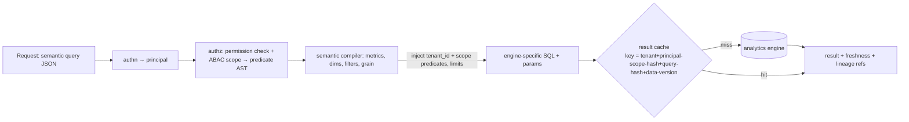
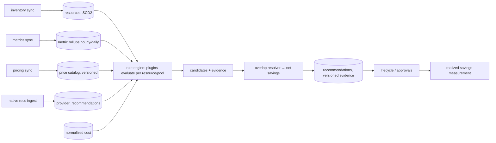
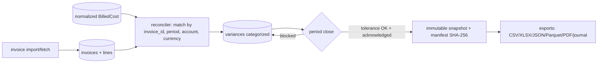

# Data Flows

All flows carry `tenant_id`, `trace_id` and, for data-producing work, an `ingestion_run_id` or `job_id` that later appears in lineage.

## 1. Billing ingestion → analytics (end-to-end)

```mermaid
sequenceDiagram
  autonumber
  participant SCH as Scheduler
  participant Q as Job queue (PG)
  participant W as Worker (ingest)
  participant P as Provider plugin
  participant C as Cloud (S3/BQ/Blob)
  participant OBJ as Object storage (raw)
  participant N as Worker (normalize)
  participant A as Analytics store
  participant AL as Worker (allocate)
  participant OB as Outbox/events

  SCH->>Q: enqueue ingest.billing(connector, scope, window)
  W->>Q: lease job (SKIP LOCKED, visibility timeout)
  W->>P: DiscoverBillingArtifacts(scope, checkpoint)
  P->>C: list manifests / query partitions (read-only creds via STS/WIF)
  P-->>W: artifacts[] (id, period, version, etag, size, schema)
  loop each new/changed artifact
    W->>C: stream download (checksummed)
    W->>OBJ: put raw/{tenant}/{connector}/{period}/{sha256} (immutable)
    W->>PG: source_object row (hash, schema_version, period, version)
  end
  W->>Q: enqueue normalize(run_id) ; checkpoint advanced in same tx
  N->>OBJ: read raw objects
  N->>N: parse → validate → map (mapping_version) → dedup key → FOCUS rows
  N->>A: write to staging partition (run_id)
  N->>N: invariants: Σ source == Σ staged per (period, account, currency, charge_category)
  N->>A: atomic partition swap for (tenant, connector, billing_period)  // restatement-safe
  N->>OB: event cost.period.normalized
  OB-->>AL: allocate(tenant, period)
  AL->>A: write allocated_cost (rule_version) + verify allocation invariant
  AL->>OB: event cost.period.allocated → triggers aggregates, budgets, anomalies, recs refresh
```

Key properties:
- **Idempotent**: raw objects are content-addressed. A normalized partition is a pure function of (raw objects, mapping_version). Re-running produces identical rows and swaps an identical partition.
- **Restatement-safe**: the unit of replacement is `(tenant, connector, billing_period)`. The new version is fully staged and validated before an atomic swap. The prior version is retained for N days for audit diffing.
- **Fail-closed**: an invariant failure leaves the previous partition live, marks the run `failed_validation` and raises an ingestion-health alert.

## 2. Query path (dashboards, API, AI)



- The cache key includes the **data version** (a monotonically increasing counter per tenant, bumped on partition swap or allocation publish). Stale results are therefore never served after a restatement.
- The cache key includes the **scope hash** of the principal, so two users with different ABAC scopes never share entries.

## 3. Inventory, telemetry and recommendations



## 4. Finance flow



## 5. Event bus

The transactional **outbox** in PostgreSQL is the source of truth for domain events. A relay publishes them to in-process subscribers and enqueues dependent jobs, and optionally publishes to NATS or Kafka for external consumers (HA profile). Events use the CloudEvents 1.0 envelope. See [../contracts/EVENTS.md](../contracts/EVENTS.md).
