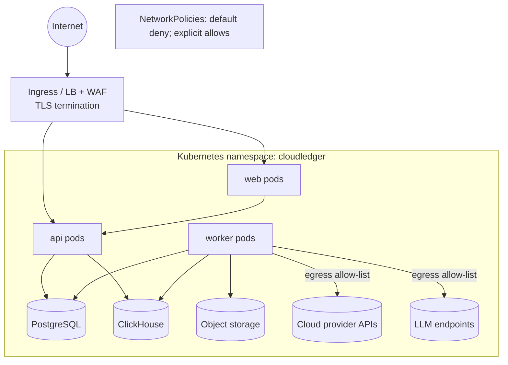

# Deployment Profiles

| Aspect | **Lite** | **Standard** | **HA Enterprise** |
|---|---|---|---|
| Target | individuals, PoCs, small teams | most organizations, MSPs | large enterprises, SaaS operators |
| Packaging | Docker Compose (`deploy/docker`) | Helm chart (`deploy/helm/cloudledger`) | Helm + Terraform/Bicep samples for managed services |
| Processes | `api`, `worker` (with embedded scheduler), `web` | `api`×2+, `worker` pools, `scheduler`×2 (leader election), `web`×2+ | same as Standard with HPA/KEDA autoscaling and PodDisruptionBudgets, multi-AZ |
| Control plane DB | PostgreSQL container (single) | PostgreSQL (operator, e.g. CloudNativePG) or managed | managed PG (RDS/Aurora, Cloud SQL, Azure Flexible Server) with HA + PITR |
| Analytics | PostgreSQL schema `analytics` (default) or embedded DuckDB file | ClickHouse single node (or PG for small) | ClickHouse cluster (replicated, sharded) via operator or ClickHouse Cloud |
| Object storage | MinIO container or local FS adapter (dev only) | S3/GCS/Blob/MinIO | S3/GCS/Blob with versioning, object lock (WORM) for close snapshots |
| Queue | PG queue | PG queue | PG queue or Temporal (optional); NATS/Kafka optional for external events |
| Secrets | env-injected KEK file + DB-encrypted secrets | Kubernetes Secrets + external secret store (ESO) | Vault/cloud KMS-backed KEK, external secret refs only |
| Identity | bootstrap local admin + optional OIDC (Dex example) | OIDC required | OIDC/SAML + SCIM |
| Observability | logs to stdout, optional Prometheus | OTel Collector, Prometheus, Grafana dashboards | + Tempo/Loki or vendor APM, SLO alerting |
| Backups | `cloudledger admin backup` to object storage | scheduled pgBackRest/operator backups + ClickHouse backups | PITR, cross-region copies, quarterly restore drills |
| Target RPO / RTO | 24 h / best effort | 1 h / 4 h | 15 min / 1 h (control plane) |
| Min resources | 4 vCPU / 8 GiB | ~ 16 vCPU / 64 GiB total | sized per reference scale (PRD §8) |

## Network topology (Standard / HA)

- **Egress control**: worker egress is restricted to provider API endpoints, configured LLM endpoints and notification endpoints. An allow-list is provided per profile. Webhook destinations are validated against SSRF rules (no private IP ranges unless explicitly allowed).
- **Container hardening**: distroless or `scratch`-based images, non-root, read-only root FS, `seccompProfile: RuntimeDefault`, dropped capabilities.
- **Configuration**: 12-factor environment variables + optional YAML file. All config keys documented in `docs/operations/CONFIGURATION.md` (Phase 03).

## Profile selection rules
- Choose **Lite** if you have ≤ 5 M cost rows per month and accept single-node downtime.
- Choose **Standard** for production in a single region.
- Choose **HA** for ≥ 99.9% availability targets, multi-AZ, or > 300 M rows per month.
