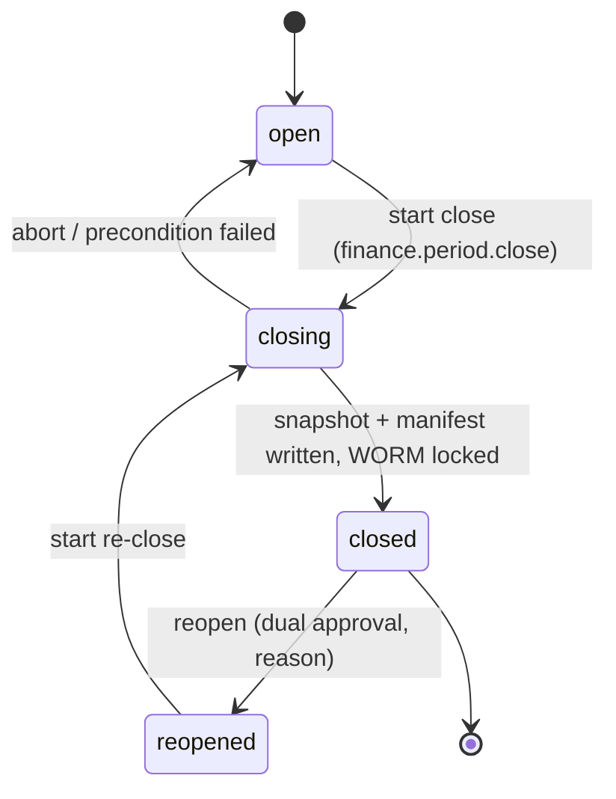

# Finance: FX, Commitments, Reconciliation, Period Close and Exports

Status: **DRAFT design**. No code exists. Phases: 10 (invoice import and reconciliation), 18 (FX, commitments, unit economics, accounting calendars), 29 (finance exports and reconciliation), 30 (scheduled reports, period close, audit evidence). Requirements: FR-FIN-001…008, FR-ALC-007, NFR-ACC-001…003, UJ-07…UJ-09, AC-01. Decisions: ADR-0007 (decimals), ADR-0010 (immutable raw + swap), ADR-0014 (hash-chained audit), ADR-0016 (UUIDv7 + UTC).

Finance-user-facing explanations with worked examples: [docs/finance/COST_SEMANTICS.md](../finance/COST_SEMANTICS.md).

## 1. Principles

1. **Billing currency is the truth.** Normalized cost and reconciliation are in the provider's `BillingCurrency`. FX only produces *reporting* views and snapshots ([FOCUS_NORMALIZATION.md](FOCUS_NORMALIZATION.md) §5).
2. **Reconcile BilledCost, report EffectiveCost.** Invoices match `BilledCost`. Showback/chargeback default to `EffectiveCost`.
3. **Nothing closed is mutated.** Corrections to closed periods become adjustments in the next open period.
4. **Every number is reproducible.** A manifest pins every input version and hash.
5. **CloudLedger is not a tax engine** (OQ-10). Tax is provider-reported charge lines.

## 2. FX (FR-FIN-001, OQ-11)

### 2.1 Rate sources

| Source (`fx_rate_sets.source`) | Content | Notes |
|---|---|---|
| `provider` | Rates on billing rows (GCP `currency_conversion_rate`, Azure `ExchangeRatePricingToBilling`, verify P07/P08) and invoice-stated rates | Pricing→billing conversion only. Not a general reporting rate. |
| `ecb` | ECB euro foreign exchange reference rates (daily, EUR base, business days) | Bundled fetcher; read-only HTTP fetch, checksum of the payload stored. |
| `tenant_table` | Uploaded CSV/XLSX (`rate_date, base, quote, rate`) | Validated, versioned; e.g. corporate treasury month-end rates. |
| `custom_plugin` | `PricingSource`-style plugin (Phase 36) | Optional. |

A rate set is immutable once published (`version`, `checksum` = SHA-256 of canonical rows). Corrections publish a new version. Rates are stored as `numeric(38,18)`.

### 2.2 Policies (`tenant_settings.fx_policy`)

| Policy | Rate date for a charge | Typical use |
|---|---|---|
| `charge_date` (default) | `date(ChargePeriodStart)`; if no rate that day (weekend/holiday), the **most recent prior** published date, max look-back 7 days, else error | Management reporting |
| `month_end` | Last rate date ≤ the last day of the accounting period | Accrual-style close |
| `month_average` | Arithmetic mean of the period's daily rates, computed at 18 dp half-even | Budget comparisons |
| `provider` | Provider-supplied rate on the row or invoice; falls back to `charge_date` with a lineage flag | Matching what the provider charged |

### 2.3 Triangulation

If no direct `base→quote` rate exists, a cross rate is derived through a pivot (`EUR` for ECB sets, otherwise the rate set's declared pivot):

`rate(X→Y) = rate(P→Y) / rate(P→X)`, computed with ≥ 34 significant digits, then rounded **half-even to 18 decimal places**. Inverse rates are derived the same way (`1 / rate`). Both legs are recorded in provenance.

Example (ECB, same date): EUR→USD 1.0834, EUR→JPY 162.45.
USD→JPY = 162.45 / 1.0834 = 149.944618792689680635 (18 dp).

### 2.4 Conversion and rounding

`reporting_amount = round_half_even(billing_amount × rate, 12)`. The converted amount is kept at storage scale and rounded to the currency's minor unit only at presentation, using the largest-remainder pass for totals ([ALLOCATION_ENGINE.md](ALLOCATION_ENGINE.md) §5.5).

Example: 1 234.56 EUR × 1.0834 = **1 337.522304 USD** (exact; no rounding needed at 12 dp). Presented as 1 337.52 USD.

Conversion is applied to each row (or each daily aggregate per currency) **before** summing, never to totals of mixed dates, so `charge_date` results don't depend on the grouping.

### 2.5 Provenance

Each converted value is traceable to `(fx_rate_set_id, version, rate_date, base, quote, rate, derivation: direct|inverse|cross(pivot, leg1, leg2), policy)`. The semantic layer returns the rate-set ID with every reporting-currency result, and period snapshots record it (`period_snapshots.fx_rate_set_id`).

## 3. Commitments (FR-FIN-002, UJ-07)

### 3.1 Inventory

`commitments` rows come from the provider `CommitmentSource` capability plus FOCUS purchase rows. Types: `aws_ri`, `aws_sp_compute`, `aws_sp_ec2`, `gcp_cud_resource`, `gcp_cud_spend`, `azure_reservation`, `azure_savings_plan`.

### 3.2 Amortization

FOCUS `EffectiveCost` already carries provider amortization ([FOCUS_NORMALIZATION.md](FOCUS_NORMALIZATION.md) §4.4). CloudLedger **does not re-amortize** provider data. It verifies it and uses its own schedule only where the provider gives no amortized view:

- Schedule: `upfront / term_hours` per hour (or per day for daily-grain providers), with the residual from the last division put on the **final** hour/day of the term so that Σ schedule = upfront exactly.
- Example: AWS 1-year all-upfront RI, 8 760.00 USD, 365-day term → 24.00/day, 1.00/hour. Partial upfront 4 380.00 + 0.50/h recurring → amortized 0.50/h + recurring 0.50/h = 1.00/h effective.
- Check (Phase 18 report, per commitment, per closed term month): Σ amortized (used + unused) = Σ fees billed attributable to that month, within provider rounding.

### 3.3 Utilization and coverage

| Measure | Formula | Per provider |
|---|---|---|
| Utilization | used commitment / total commitment in the window | AWS RI: normalized units used ÷ purchased (size flexibility); AWS SP and Azure SP: committed $/h used ÷ committed $/h; GCP resource CUD: vCPU/GB-hours used ÷ committed; GCP spend CUD: eligible spend covered ÷ commitment; Azure reservation: reserved hours used ÷ purchased (instance size flexibility ratios) |
| Coverage | eligible usage covered by commitments (on-demand-equivalent cost) ÷ total eligible usage (on-demand-equivalent cost) | eligibility per type: SP compute covers EC2/Fargate/Lambda; EC2 SP covers one family + region; RIs cover matching attributes; Azure SP covers eligible compute; GCP spend CUD covers eligible services (verify lists in Phase 18) |
| Unused cost | Σ `EffectiveCost` where `CommitmentDiscountStatus = Unused` | all |
| Realized commitment savings | Σ (`ContractedCost` − `EffectiveCost`) on covered rows − unused cost | all |

Example (Savings Plan, 30-day month = 720 h): commitment 10.00/h → 7 200.00. Used 6 120.00 → utilization 6 120.00 / 7 200.00 = **0.85**; unused 1 080.00.

Daily results go to `commitment_utilization` (analytics store). Ratios are stored as decimals at 12 dp, presented as percentages at 2 dp half-even.

## 4. Unit economics (FR-FIN-003)

`unit_cost(metric m, scope s, window w) = Σ allocated EffectiveCost(s, w) / Σ unit_metric_values(m, s, w)`.

- Computed in decimal at 12 dp, half-even. A zero or missing denominator → `null` with reason `no_volume` (never infinity, never 0).
- Unit metric values are uploaded (CSV/API) with `source` recorded. A late upload bumps the data version.
- Example: 42 000.00 USD / 1 250 000 orders = **0.0336 USD/order**. Next month 45 150.00 / 1 400 000 = 0.03225 → unit cost fell 4.0% although spend rose 7.5%.

## 5. Accounting calendars (FR-FIN-008, FR-TEN-007)

`tenant_settings.accounting_calendar` (JSON):

```json
{"type":"retail_445","pattern":[4,4,5],"fiscal_year_start":"2026-02-01","week_start":"sunday","year_end_rule":"last_saturday_of_january","week53_placement":"last_period"}
```

| Type | Periods |
|---|---|
| `gregorian` | calendar months; `fiscal_year_start_month` sets the fiscal year |
| `retail_445` / `retail_454` / `retail_544` | 12 periods per 52-week year, quarters of 13 weeks; 53-week years add the extra week to the period named by `week53_placement` (default last) |
| `custom` | explicit list of `(period_key, start_date, end_date)`, validated contiguous and non-overlapping |

Example FY starting Sunday 2026-02-01 (4-4-5): P1 02-01…02-28, P2 03-01…03-28, P3 03-29…05-02, P4 05-03…05-30, P5 05-31…06-27, P6 06-28…08-01, P7 08-02…08-29, P8 08-30…09-26, P9 09-27…10-31, P10 11-01…11-28, P11 11-29…12-26, P12 12-27…2027-01-30.

Cost rows are assigned to accounting periods by `date(ChargePeriodStart)` in **UTC**. Hourly rows never straddle a day boundary in UTC; daily rows are provider-day aligned (verify Azure daily boundary timezone in P08). The `tenant_settings.timezone` affects display only, not period assignment (open point §12). `accounting_periods` rows are generated from the calendar; a calendar change applies only to periods not yet closed.

Note: provider **billing periods** (calendar months) and tenant **accounting periods** differ under 4-4-5. Reconciliation runs per billing period/invoice. Close runs per accounting period and uses only reconciliations of the billing periods it overlaps.

## 6. Invoice model and matching (FR-FIN-004, UJ-08)

### 6.1 Model

`invoices` (header: provider, invoice_number, issuer entity, billing account, period, currency, subtotal, tax, total, source) and `invoice_lines` (line_no, description, category, account_ref, service, amount, tax). Sources: provider API where entitled, uploaded PDF/CSV (PDF: header metadata extracted and confirmed by a user, no OCR of line amounts at v1.0), or export files. The raw invoice file is stored as a content-addressed source object.

**Invoice line group**: the unit of tolerance (NFR-ACC-002). It is a set of invoice lines and a matching set of FOCUS rows that share a group key (default: `account_ref × category`; configurable per provider mapping, e.g. AWS per linked account × service, Azure per invoice section × service family).

### 6.2 Matching algorithm

```
1. Candidate FOCUS rows for invoice I:
     if FOCUS InvoiceId populated:  rows WHERE InvoiceId = I.invoice_number
     else:                          rows WHERE BillingAccountId = I.billing_account
                                         AND billing_period ∈ I.period
                                         AND BillingCurrency = I.currency
                                         AND InvoiceIssuerName ≈ I.issuer_entity (mapping table)
2. Classify rows into line groups using the provider's group-key mapping
   (ChargeCategory, ServiceName, SubAccountId → invoice category/account_ref).
3. For each group g:  variance_g = invoice_amount_g − Σ BilledCost_g    (exact decimal)
4. Header check:      invoice.total − Σ computed (incl. tax) = Σ variance_g + unmatched
5. Categorize each non-zero variance (§7). Persist reconciliation_results + reconciliation_variances.
6. Status: matched (all 0) | within_tolerance (all |v| ≤ tol and categorized) | variance.
```

Determinism: the result records `data_version`, so re-running on the same data gives the same result. A new data version (restatement) triggers re-reconciliation (`cost.period.restated.v1`).

## 7. Variance categories and tolerance

Categories match `reconciliation_variances.category`. Classification is rule-based and ordered. The first matching rule wins, and every rule records its evidence in `details`.

| Order | Category | Rule (evidence) |
|---|---|---|
| 1 | `tax` | variance located in tax lines; or tax present on invoice but absent from export |
| 2 | `credit` | variance equals the sum of credit rows/lines missing on one side |
| 3 | `marketplace` | variance in lines whose issuer/publisher is a marketplace seller |
| 4 | `support` | variance in support-fee lines |
| 5 | `fx` | invoice currency ≠ export currency, or variance explained by the invoice-stated rate within rounding |
| 6 | `late_correction` | rows with `ChargeClass = Correction` that reference this billing period but arrived after `provider_final`, or arrived in a later period's data |
| 7 | `timing` | charges dated at a period boundary in different periods on each side (e.g. daily-timezone shift) |
| 8 | `rounding` | `|v| ≤ 0.5 × 10^-e × n_lines(g)` where `e` = currency minor-unit exponent and `n_lines(g)` = invoice lines in the group (each line is rounded once by the provider) |
| 9 | `missing_data` | ingestion completeness < 100% for the group's scope/period |
| 10 | `unexplained` | none of the above |

**Tolerance** (NFR-ACC-002): default `0.01` in invoice currency per line group, configurable per tenant and provider (stored on `reconciliation_results.tolerance`). A group is within tolerance if `|v| ≤ tolerance` **and** its category ≠ `unexplained`. Categories `missing_data` and `unexplained` always need acknowledgement, regardless of amount.

### 7.1 Worked example (AWS, USD, October)

| Group | Invoice | Σ BilledCost (12 dp) | Variance | Category |
|---|---|---|---|---|
| EC2 – acct 1111 | 8 412.37 | 8 412.368712345678 | 0.001287654322 | rounding (bound 0.005) |
| S3 – acct 1111 | 1 203.55 | 1 203.551200000000 | −0.001200000000 | rounding |
| Credits | −150.00 | −150.000000000000 | 0 | — |
| Data transfer | 412.90 | 400.500000000000 | 12.400000000000 | late_correction (correction row arrived in November data) |
| Tax | 1 756.06 | 1 756.060000000000 | 0 | — |
| **Total** | **11 634.88** | **11 622.479912345678** | **12.400087654322** | |

Status `variance`: the late correction exceeds tolerance and must be acknowledged before close (UJ-08). After acknowledgement the result becomes `acknowledged`.

## 8. Period close (FR-FIN-005, UJ-09)

### 8.1 State machine

States match `accounting_periods.status`.



**Preconditions for `closing → closed`** (re-evaluated inside the close job):
1. Ingestion completeness = 100% for all in-scope connectors and billing periods overlapping the period, or explicit acknowledgement per missing scope.
2. Every reconciliation result for overlapping billing periods is `matched`, `within_tolerance` or `acknowledged`.
3. Allocation of each overlapping period is current: allocation data version = cost data version, and no unpublished draft is pinned to the period.
4. FX rate set for the period's policy dates is complete (no missing dates for currencies in use).
5. Prior period is `closed` (sequential close; configurable).

While `closing`, publishes of rule sets or FX rate sets effective in the period are blocked (`409 period_closing`).

**Reopen** creates a new snapshot version on re-close. The previous snapshot is retained and marked superseded. It is never deleted or modified. Reopen is rare and audited (`period.reopen`). The default is to use adjustments instead (§8.3).

### 8.2 Snapshot and report manifest

On close, CloudLedger materializes the period's allocated cost (all cost metrics, billing and reporting currency) to Parquet under `snapshots/{tenant}/{period_key}/{snapshot_id}/` in object storage with object lock (WORM, retention per tenant policy, default 7 years). It also writes a manifest. The manifest hash is stored in `period_snapshots.manifest_sha256` and anchored in the hash-chained audit log (`period.closed.v1`).

Manifest (`report_manifests.manifest` uses the same schema for every report run):

```json
{
  "manifest_version": "1",
  "kind": "period_close_snapshot",
  "tenant_id": "0193a1c2-…",
  "period": {"key": "FY2027-P09", "start": "2026-09-27", "end": "2026-10-31", "calendar": "retail_445"},
  "created_at": "2026-11-16T09:30:12Z",
  "created_by": "0193b7…",
  "software": {"cloudledger_version": "0.7.0", "git_commit": "…"},
  "inputs": {
    "data_version": 4812,
    "billing_period_versions": [
      {"connector_id": "0193…", "billing_period": "2026-10-01", "version": 3, "ingestion_run_id": "0193…", "provider_final": true,
       "control_totals_sha256": "9f2c…"}
    ],
    "source_objects_merkle_root": "b41e…",
    "mapping_versions": ["aws-cur2-focus@3", "gcp-bq-focus@2"],
    "focus_version": "1.2",
    "allocation": {"rule_set_versions": [12], "rule_set_checksums": ["5d0a…"], "hierarchy_version_ids": ["0193…"]},
    "fx": {"policy": "month_end", "rate_set_id": "0193…", "rate_set_version": 2, "rate_set_sha256": "c77e…"},
    "reconciliations": [{"result_id": "0193…", "status": "acknowledged"}],
    "query": {"semantic_query_sha256": "…"}
  },
  "outputs": [
    {"path": "allocated_cost.parquet", "media_type": "application/vnd.apache.parquet", "bytes": 48213377, "rows": 1820044, "sha256": "e3b0…"},
    {"path": "summary.csv", "media_type": "text/csv", "bytes": 8211, "rows": 141, "sha256": "4a5d…"}
  ],
  "control_totals": [
    {"billing_currency": "USD", "charge_category": "Usage", "billed_cost": "1022931.881200000000", "effective_cost": "998410.120044000000"}
  ],
  "previous_snapshot_id": null,
  "manifest_sha256": "…"
}
```

Hashing rules:
- `manifest_sha256` = SHA-256 of the RFC 8785 (JCS) canonical JSON of the manifest **with `manifest_sha256` omitted**. Money values are strings.
- `source_objects_merkle_root`: binary Merkle tree (SHA-256) over sorted source-object `sha256` values.
- Output hashes are over the exact stored bytes. Parquet writers are configured deterministically (fixed row-group size, sorted rows, no timestamps in metadata), so re-materializing the same inputs yields identical hashes. This is a Phase 30 test (snapshot immutability and reproducibility).
- Auditors verify with `cloudledger admin verify-manifest <uri>` (offline; needs only the files) and against the audit-log anchor.
- `signed_by`: optional detached signature (Cosign/Sigstore-style or tenant KMS key), decided in Phase 30.

### 8.3 Post-close adjustments

When data for a closed period changes (restatement, late correction, re-normalization, `restate_closed` allocation publish):
1. CloudLedger recomputes the period virtually and diffs it against the snapshot by `(hierarchy node, GL mapping key, charge category, currency, cost metric)`.
2. Non-zero deltas are written to `period_adjustments` (`closed_period_id`, `booked_in_period_id` = earliest open period, `reason`, `delta` JSON with exact decimals, source event).
3. Adjustments appear as separate, labeled lines in the open period's reports and journal export ("Prior-period adjustment: FY2027-P09"). The closed snapshot is untouched.
4. The adjustment's lineage points to the restatement's `billing_period_versions` row.

## 9. Journal / GL export (FR-FIN-006)

GL mapping: tenant rules (same condition AST as allocation) map `(hierarchy node, dimension, ServiceCategory, ChargeCategory)` → `gl_account`, `cost_center`, `entity`. The first match wins, and a catch-all suspense account is required at publish.

Format (CSV/XLSX/JSON, one row per journal line):

| Column | Example | Notes |
|---|---|---|
| `journal_id` | `CL-FY2027-P09-0001` | stable per export run |
| `line_no` | 1 | |
| `posting_date` | 2026-10-31 | period end |
| `period_key` | FY2027-P09 | |
| `entity` | `IN01` | |
| `gl_account` | `610200` | expense account |
| `cost_center` | `CC-1042` | |
| `currency` | USD | reporting or billing currency, per export option |
| `debit` / `credit` | `1234.57` / `` | minor units, LRM-rounded per journal (§5.5 of ALLOCATION_ENGINE) |
| `description` | `Cloud cost AWS – Compute` | formula-safe (§10.2) |
| `cost_metric` | `effective_cost` | |
| `adjustment_of` | `FY2027-P08` or empty | post-close adjustments |
| `source_ref` | manifest ID + row group | lineage |

Invariant: Σ debit = Σ credit per `(journal_id, currency)`. The balancing credit goes to the configured accrual/clearing account. Export validation (Phase 29 "export-to-ledger validation") re-reads the file and checks balance and totals against the snapshot.

## 10. Exports (FR-FIN-006, FR-FIN-007, FR-DSH-006)

### 10.1 Formats

| Format | Notes |
|---|---|
| CSV | RFC 4180, UTF-8 (BOM optional for Excel), `\r\n`; money as plain decimal strings with `.` separator, no thousands separators |
| XLSX | streaming writer; money as numeric cells with explicit number format only when the value is exactly representable at the displayed scale, otherwise as text plus a note (Excel uses binary doubles: 15–17 significant digits). Default: money cells at minor-unit scale (LRM-rounded) as numbers, plus full-precision text columns optional |
| JSON | money as strings (ADR-0007), NDJSON for large exports |
| Parquet | `DECIMAL(38,12)` logical type, deterministic writer settings |
| PDF | rendered from the same data (server-side HTML → PDF), header with manifest ID and hash, page footers with period and generation time |

Every export run produces a `report_manifests` entry (same schema as §8.2, `kind: "report_export"`). Scheduled reports (FR-FIN-007) archive artifacts immutably with their manifests.

### 10.2 Formula-injection safety

Applies to CSV and XLSX (and to text cells generally):
- Any **text** cell whose first character is one of `=`, `+`, `-`, `@`, TAB (0x09), CR (0x0D), or LF (0x0A), or their full-width forms (`＝`, `＋`, `－`, `＠`), is prefixed with a single quote `'`. Leading whitespace is evaluated after trimming for this check.
- **Typed numeric columns are never prefixed.** Money and quantities are emitted from decimal values by the formatter, so `-25.00` stays numeric. Only string-typed columns (tag values, resource names, descriptions, ChargeDescription, user-entered notes) go through the escaper. This prevents both injection and corruption of negative amounts.
- XLSX: text is written as inline/shared strings, never as formulas. No external links, no macros (`.xlsx`, never `.xlsm`).
- CSV/XLSX fixtures in the export test suite include the injection corpus shared with the analytics contract suite (`=HYPERLINK(...)`, `@SUM(...)`, `+cmd|' /C calc'!A0`, `-2+3`).

## 11. Events

Uses `invoice.imported.v1`, `reconciliation.completed.v1`, `period.closed.v1`, `report.run.completed.v1` ([EVENTS.md](../contracts/EVENTS.md)). Proposed additions (not yet in the catalog): `period.reopened.v1`, `period.adjustment.recorded.v1`, `fx.rate_set.published.v1`.

## 12. Gaps and open points

- `period_snapshots` lacks `version` / `superseded_by` columns needed for reopen (§8.1).
- `accounting_periods.status` has no state for "close blocked"; this design keeps the period in `closing` with a blocking report, or returns it to `open`.
- Timezone of accounting-period boundaries: UTC (this design) vs. `tenant_settings.timezone`. Decide in Phase 18.
- XLSX numeric precision policy for money cells: confirm with finance SME in Phase 29.
- Invoice PDF parsing scope (metadata only at v1.0).
