# FOCUS Normalization

Status: **DRAFT design**. No code exists. Delivered in Phase 11 (normalization, golden datasets), with provider mappings drafted in Phases 06–08 and generic import mappings in Phase 09. Decisions: [ADR-0006](adr/0006-focus-1-2-as-normalization-baseline.md) (FOCUS baseline), [ADR-0007](adr/0007-fixed-point-decimal-money-end-to.md) (decimals), [ADR-0010](adr/0010-immutable-content-addressed-raw-storage-and.md) (raw storage, partition swap). Requirements: FR-NRM-001…006, NFR-ACC-001, AC-01.

> **Field-name certainty.** Every provider column name in §6 is a *design-level* mapping written from public documentation. Each one is marked with the phase in which it must be verified against recorded fixtures (P06 = AWS, P07 = GCP, P08 = Azure). The mapping is not authoritative until that verification is recorded in the phase's `TEST_RESULTS.md`.

## 1. Pinned baseline

| Item | Value |
|---|---|
| Baseline | **FOCUS 1.2** (57 columns; names checked against the published 1.2 column index while drafting this document) |
| Re-confirmation | **OQ-02** must be re-opened at the start of Phase 11. If a newer FOCUS release is ratified by then (a 1.3 release is expected to rename some provider-identity columns and add contract-commitment data), the maintainers decide whether to (a) keep 1.2 as baseline and add 1.3 later as a new mapping version, or (b) move the baseline. Option (a) is the default, because ADR-0006 makes FOCUS versions additive mapping versions, not schema rewrites. |
| Storage of version | `mapping_definitions.focus_version`, and on each row `mapping_version` (e.g. `aws-cur2-focus@3`), which implies the FOCUS version |
| Normative source | The FOCUS 1.2 specification text. Where this document paraphrases a normative rule it says "per FOCUS 1.2 (verify normative text in Phase 11)". |

What 1.2 adds that CloudLedger relies on: `InvoiceId` (invoice matching, see [FINANCE_RECONCILIATION.md](FINANCE_RECONCILIATION.md)), `PricingCurrency` and the `PricingCurrency*` price/cost columns (multi-currency), `BillingAccountType` / `SubAccountType` (scope typing across clouds), and `ServiceSubcategory`.

## 2. Pipeline position

```mermaid
flowchart LR
  RAW[raw object<br/>content-addressed] --> PARSE[parse + schema fingerprint]
  PARSE --> VAL[row validation]
  VAL --> MAP["map(mapping_version)<br/>FOCUS columns + x_ + x_raw"]
  MAP --> TAG[tag normalization<br/>deterministic, mapping-level]
  TAG --> KEY[identity key + content hash<br/>dedup]
  KEY --> CONF[conformance validator]
  CONF --> STAGE[staging partition]
  STAGE --> INV[control-total invariants]
  INV --> SWAP[atomic swap]
```

Normalization is a **pure function** of `(raw objects of the period version, mapping_version)`. It never reads tenant allocation rules, FX rates, or the clock. Tenant-specific tag aliasing, inheritance and business mapping happen later, in the [allocation engine](ALLOCATION_ENGINE.md). Currency conversion to the reporting currency happens at query/snapshot time (§5).

## 3. Normalized column set (`cost_focus`)

Types are logical. Physical types per engine follow [ANALYTICS_ADAPTERS.md](ANALYTICS_ADAPTERS.md) §3: `Decimal` = `NUMERIC(38,12)` / `Decimal(38,12)` / `DECIMAL(38,12)`; `Timestamp` = UTC; `String` = UTF-8 (NFC); `Map` = string→string map (`jsonb` / `MAP` / `Map(...)`).

"FOCUS req." is the column's FOCUS feature level as CloudLedger reads it (M = mandatory, C = conditional, R = recommended, O = optional); verify every level against the 1.2 text in Phase 11. "CL null" is CloudLedger's **storage contract**, which may be stricter than FOCUS: a `NOT NULL` column that a provider cannot populate fails conformance (§9) rather than being silently filled.

### 3.1 FOCUS 1.2 columns

| Column | Type | FOCUS req. | CL null | Notes |
|---|---|---|---|---|
| `BilledCost` | Decimal | M | NOT NULL | Invoice basis. `0` allowed. |
| `EffectiveCost` | Decimal | M | NOT NULL | Amortized. See §4. |
| `ListCost` | Decimal | M | NOT NULL | If the provider has no list price for a row, the mapping uses the documented rule in §4.3 and sets `x_ListCostDerivation`. |
| `ContractedCost` | Decimal | M | NOT NULL | Same as above with `x_ContractedCostDerivation`. |
| `ListUnitPrice` | Decimal | C | NULL | Null for non-usage rows (tax, credit). |
| `ContractedUnitPrice` | Decimal | C | NULL | |
| `PricingQuantity` | Decimal | M | NULL | Null when not applicable (e.g. tax). |
| `PricingUnit` | String | M | NULL | |
| `ConsumedQuantity` | Decimal | C | NULL | Usage rows only. |
| `ConsumedUnit` | String | C | NULL | |
| `BillingCurrency` | String(3) | M | NOT NULL | ISO 4217. |
| `PricingCurrency` | String(3) | C | NULL | 1.2. Null if equal to billing currency and provider omits it. |
| `PricingCurrencyListUnitPrice` | Decimal | C | NULL | 1.2. |
| `PricingCurrencyContractedUnitPrice` | Decimal | C | NULL | 1.2. |
| `PricingCurrencyEffectiveCost` | Decimal | C | NULL | 1.2. |
| `BillingAccountId` | String | M | NOT NULL | Partition-level control-total key. |
| `BillingAccountName` | String | M | NULL | |
| `BillingAccountType` | String | C | NULL | 1.2. Provider-specific label (e.g. "Billing Profile"). |
| `SubAccountId` | String | C | NULL | AWS linked account, GCP project, Azure subscription. |
| `SubAccountName` | String | C | NULL | |
| `SubAccountType` | String | C | NULL | 1.2. |
| `BillingPeriodStart` / `BillingPeriodEnd` | Timestamp | M | NOT NULL | End exclusive. |
| `ChargePeriodStart` / `ChargePeriodEnd` | Timestamp | M | NOT NULL | End exclusive. `Start < End` except documented point-in-time charges, where `Start == End` is rejected and the mapping widens to the provider's day boundary (verify per provider). |
| `ChargeCategory` | Enum | M | NOT NULL | `Usage`, `Purchase`, `Tax`, `Credit`, `Adjustment`. |
| `ChargeClass` | Enum | M | NULL | `Correction` or null. |
| `ChargeFrequency` | Enum | R | NOT NULL | `One-Time`, `Recurring`, `Usage-Based`. CL requires it (derivable for all three providers). |
| `ChargeDescription` | String | M | NULL | Untrusted text. |
| `PricingCategory` | Enum | C | NULL | `Standard`, `Dynamic`, `Committed`, `Other`. |
| `CommitmentDiscountId` | String | C | NULL | §4.4. |
| `CommitmentDiscountName` | String | C | NULL | |
| `CommitmentDiscountCategory` | Enum | C | NULL | `Spend`, `Usage`. |
| `CommitmentDiscountType` | String | C | NULL | Provider label (e.g. "Savings Plan"). |
| `CommitmentDiscountStatus` | Enum | C | NULL | `Used`, `Unused`. Only on `Usage` rows with a commitment. |
| `CommitmentDiscountQuantity` | Decimal | C | NULL | |
| `CommitmentDiscountUnit` | String | C | NULL | |
| `CapacityReservationId` | String | C | NULL | |
| `CapacityReservationStatus` | Enum | C | NULL | `Used`, `Unused`. |
| `InvoiceId` | String | C | NULL | 1.2. Null until the provider assigns it (current month). |
| `InvoiceIssuerName` | String | M | NOT NULL | E.g. AWS EMEA SARL, marketplace reseller. |
| `ProviderName` | String | M | NOT NULL | |
| `PublisherName` | String | M | NOT NULL | Marketplace publisher or provider. |
| `ServiceName` | String | M | NOT NULL | |
| `ServiceCategory` | Enum | M | NOT NULL | FOCUS service-category domain. |
| `ServiceSubcategory` | Enum | C | NULL | 1.2. |
| `RegionId` / `RegionName` | String | C | NULL | Global services are null. |
| `AvailabilityZone` | String | R | NULL | |
| `ResourceId` | String | C | NULL | Provider-native ID, used for inventory join (FR-RES-002). |
| `ResourceName` | String | C | NULL | Untrusted text. |
| `ResourceType` | String | C | NULL | |
| `SkuId` / `SkuPriceId` | String | C | NULL | |
| `SkuMeter` | String | C | NULL | |
| `SkuPriceDetails` | Map/JSON | C | NULL | Stored as JSON. |
| `Tags` | Map | C | NOT NULL (`{}` if none) | Raw key/value as delivered, after FOCUS prefixing rules (§7). |

### 3.2 CloudLedger columns (lineage, identity, extensions)

| Column | Type | Null | Purpose |
|---|---|---|---|
| `tenant_id`, `connector_id` | UUID | NOT NULL | Partition and isolation. |
| `billing_period` | Date | NOT NULL | Partition key (first day of provider billing month). |
| `ingestion_run_id`, `source_object_id` | UUID | NOT NULL | Lineage (FR-NRM-002). |
| `source_row` | Int64 | NOT NULL | Row ordinal within the source object (or row-group + offset). |
| `mapping_version` | String | NOT NULL | `"<mapping key>@<version>"`. |
| `dedup_key` | Bytes(32) | NOT NULL | Identity key (§8). Unique within a live partition. |
| `content_hash` | Bytes(32) | NOT NULL | Hash of the canonical raw row (§8). |
| `tags_normalized` | Map | NOT NULL | Deterministic key normalization (§7). |
| `x_<Provider-specific>` | various | NULL | Extension columns, e.g. `x_AwsLineItemType`, `x_GcpCostType`, `x_AzureChargeType`, `x_ProviderExchangeRate`. |
| `x_raw` | JSON | NOT NULL | The full raw source row, column names as delivered. |
| `x_ListCostDerivation`, `x_ContractedCostDerivation` | Enum | NULL | `provider`, `equals_contracted`, `equals_billed`, `price_catalog` (§4.3). |
| `x_TagConflicts` | JSON | NULL | §7. |

Extension rules: the `x_` prefix is mandatory, names are `PascalCase` after the prefix with a provider token (`x_Aws…`, `x_Gcp…`, `x_Azure…`, `x_Generic…`), extensions are declared in the mapping definition (undeclared extensions fail conformance), and the semantic layer exposes only registered extensions as dimensions.

## 4. Cost metric semantics

### 4.1 Definitions

| Metric | Meaning | Used for |
|---|---|---|
| `ListCost` | `PricingQuantity × ListUnitPrice` at public rates, before any discount. | Savings-vs-list, rate-negotiation analysis. |
| `ContractedCost` | Cost at negotiated rates (enterprise discounts, private pricing), **before** commitment discounts and amortization. | Measuring negotiated discounts separately from commitments. |
| `BilledCost` | What appears on the invoice for this charge, in `BillingCurrency`. Upfront commitment fees appear here in the month they are billed. | Invoice reconciliation (always). |
| `EffectiveCost` | Amortized cost: usage cost after commitment discounts, plus the prorated share of upfront/recurring commitment fees. | Default dashboard metric, allocation, showback/chargeback, recommendations. |

Key identities (per FOCUS 1.2 guidance; verify normative wording in Phase 11), checked by the conformance validator as *warnings* unless marked *error*:

1. Over a commitment's full term, `Σ EffectiveCost` of its covered usage rows plus its unused rows equals `Σ BilledCost` of its purchase and recurring-fee rows (up to provider rounding). Checked at term level by Phase 18 reports, not per partition.
2. Prepaid commitment purchase rows (`ChargeCategory = Purchase`, `CommitmentDiscountId` set, amortized): `EffectiveCost = 0` (*error* if not, because amortized value would be counted twice).
3. Usage covered by a fully prepaid commitment: `BilledCost = 0`, `EffectiveCost > 0`.
4. `Tax` rows: `EffectiveCost = BilledCost`.
5. `Credit` rows: costs ≤ 0 (*warning*; providers occasionally reverse credits with positive amounts, and those rows must carry `ChargeClass = Correction`).

### 4.2 Worked example (exact decimals)

One AWS instance-month, 720 hours, list 0.192/h, negotiated 5% private-rate discount → contracted 0.1824/h. A reservation covers 500 h at an amortized 0.12/h. The other 220 h are on-demand.

| Row | ChargeCategory | ListCost | ContractedCost | BilledCost | EffectiveCost |
|---|---|---|---|---|---|
| 500 h covered | Usage (`CommitmentDiscountStatus=Used`) | 96.000 | 91.200 | 0.000 | 60.000 |
| 220 h on-demand | Usage | 42.240 | 40.128 | 40.128 | 40.128 |
| **Total** | | **138.240** | **131.328** | **40.128** | **100.128** |

The reservation's upfront fee appears once, as a `Purchase` row in the purchase month with `BilledCost` = fee and `EffectiveCost` = 0 (identity 2).

### 4.3 Missing list or contracted cost

| Situation | Rule | Derivation flag |
|---|---|---|
| Provider gives list cost | use it | `provider` |
| No list, contracted known, no negotiated discount on the account | `ListCost = ContractedCost` | `equals_contracted` |
| Tax, credit, adjustment, support fee | `ListCost = ContractedCost = BilledCost` | `equals_billed` |
| List known only from the price catalog | **not** applied at normalization (it would make normalization depend on mutable catalog data). Left as `equals_contracted`; the semantic layer can compute a catalog-based list view separately. | — |

### 4.4 Commitment discount columns

| Row type | `CommitmentDiscountId` | `Status` | `ChargeCategory` | `ChargeFrequency` | Costs |
|---|---|---|---|---|---|
| Upfront purchase | set | null | Purchase | One-Time | Billed = fee, Effective = 0 |
| Recurring commitment fee | set | null | Purchase | Recurring | Billed = fee, Effective = 0 (amortized into usage/unused rows) |
| Covered usage | set | `Used` | Usage | Usage-Based | Billed = recurring portion or 0, Effective = amortized rate × quantity |
| Unused commitment | set | `Unused` | Usage | Recurring | Billed = 0 or recurring portion, Effective = unused amortized amount |
| Uncovered usage | null | null | Usage | Usage-Based | Billed = Effective = contracted |

Provider specifics (AWS RI/SP negation rows, GCP CUD fee + credit pairs, Azure `UnusedReservation`/`UnusedSavingsPlan` charge types) are handled per mapping (§6). The `commitments` control-plane table and `commitment_utilization` are derived from these rows plus the provider commitment APIs; see [FINANCE_RECONCILIATION.md](FINANCE_RECONCILIATION.md) §3.

## 5. Multi-currency

- `cost_focus` stores costs **only in `BillingCurrency`** (plus `PricingCurrency*` columns when the provider supplies them). It never stores reporting-currency amounts. That keeps normalization independent of FX policy, so changing a tenant's FX policy needs no re-normalization.
- Provider-supplied rates are captured as extensions (`x_ProviderExchangeRate`, `x_ProviderExchangeRateDirection`), for example GCP `currency_conversion_rate` and Azure `ExchangeRatePricingToBilling` (verify P07/P08). Phase 18 turns them into an FX rate set with `source = 'provider'`.
- Reporting-currency conversion happens in the semantic compiler (join to `fx_applied`) and is **materialized** in period-close snapshots. See [FINANCE_RECONCILIATION.md](FINANCE_RECONCILIATION.md) §2.
- Control totals and NFR-ACC-001 are always evaluated **per `BillingCurrency`**, before FX.

## 6. Provider mapping tables (design level)

Strategy per provider:
1. **Native FOCUS export available and conformance-valid** → a thin pass-through mapping (column rename, `x_` extensions for provider-only columns, version-specific fixes). AWS Data Exports, GCP and Azure each publish a FOCUS-format export, but the FOCUS version they emit and its completeness vary (verify P06/P07/P08). If an export targets an older FOCUS version (e.g. 1.0), the mapping upgrades it to 1.2 and marks the 1.2-only columns as derived or null.
2. **Otherwise** → map from the native detailed schema (tables below).

A connector records which path is used in `ingestion_runs.mapping_version`. Both paths must produce identical control totals for the same period. This is a Phase 11 cross-check whenever both exports are available.

### 6.1 AWS CUR 2.0 (Data Exports, Parquet) → FOCUS — verify all names in **Phase 06** against fixtures

| FOCUS column | CUR 2.0 source (design) | Notes |
|---|---|---|
| `BillingAccountId` | `bill_payer_account_id` | |
| `SubAccountId` / `SubAccountName` | `line_item_usage_account_id` / `line_item_usage_account_name` | |
| `BillingPeriodStart/End` | `bill_billing_period_start_date` / `bill_billing_period_end_date` | |
| `ChargePeriodStart/End` | `line_item_usage_start_date` / `line_item_usage_end_date` | |
| `BillingCurrency` | `line_item_currency_code` | Verify whether non-USD billing appears here or only on the invoice. |
| `BilledCost` | `line_item_unblended_cost` (or `line_item_net_unblended_cost` when discounts are present) | Decision: Billed = net unblended when the export includes net columns. Verify in P06 with an EDP fixture. |
| `EffectiveCost` | `reservation_effective_cost` (RI-covered), `savings_plan_savings_plan_effective_cost` (SP-covered), else Billed; `net_` variants when present | Negation rows are handled below. |
| `ListCost` / `ListUnitPrice` | `pricing_public_on_demand_cost` / `pricing_public_on_demand_rate` | |
| `ContractedCost` | Billed for non-commitment rows; for covered rows `pricing_public_on_demand_cost` minus private-rate discount when present | Verify derivation with private-pricing fixture. |
| `ChargeCategory` | from `line_item_line_item_type`: `Usage`/`DiscountedUsage`/`SavingsPlanCoveredUsage` → Usage; `RIFee`/`SavingsPlanRecurringFee`/`SavingsPlanUpfrontFee`/`Fee` → Purchase; `Tax` → Tax; `Credit`/`Refund`* → Credit; `BundledDiscount`/`EdpDiscount`/`PrivateRateDiscount`/`SavingsPlanNegation` → see notes | *Refund maps to Credit with `ChargeClass = Correction` when it reverses a prior charge. |
| `ChargeClass` | `Correction` for refunds and prior-period line items (`line_item_usage_start_date < bill_billing_period_start_date`) | Verify. |
| `ChargeFrequency` | Purchase rows: `One-Time` (upfront) / `Recurring`; else `Usage-Based` | |
| `CommitmentDiscountId` | `reservation_reservation_a_r_n` or `savings_plan_savings_plan_a_r_n` | |
| `CommitmentDiscountStatus` | `Used` for covered usage; `Unused` from RI unused rows / SP recurring-fee unused portion | AWS represents unused RI/SP capacity inside fee rows. The mapping **splits** such a fee row into a Purchase row plus a synthetic `Unused` row (with `x_SyntheticSplit = true`), preserving Σ BilledCost. Verify in P06. |
| `SavingsPlanNegation` | Excluded from FOCUS costs (offsets on-demand cost already captured as effective) and kept in `x_raw` + `x_AwsLineItemType` | Must preserve Σ BilledCost: the control-total invariant is computed on the same rule (documented exclusion). |
| `InvoiceId` | `bill_invoice_id` | Null for open months. |
| `InvoiceIssuerName` | `bill_billing_entity` (e.g. AWS, AWS Marketplace) | |
| `PublisherName` | `product_..._publisher` / `line_item_legal_entity` | Verify. |
| `ServiceName` / `ServiceCategory` | `line_item_product_code` / `product_servicecode` → lookup table `aws_service_category.v1` | Lookup table is part of the mapping version. |
| `RegionId` | `product_region_code` (or `product['region']` from the `product` map) | CUR 2.0 nests many product attributes in a map column. Verify. |
| `AvailabilityZone` | `line_item_availability_zone` | |
| `ResourceId` | `line_item_resource_id` | |
| `SkuId` / `SkuPriceId` | `product_sku` / `pricing_rate_code` or `pricing_rate_id` | Verify. |
| `PricingQuantity` / `PricingUnit` | `line_item_usage_amount` / `pricing_unit` | |
| `ConsumedQuantity` / `ConsumedUnit` | `line_item_usage_amount` / `pricing_unit` (Usage rows only) | |
| `Tags` | `resource_tags` (map) | Key prefix convention (`user_…`, `aws_…`) to verify; AWS-generated tags become provider-prefixed per FOCUS. |
| Line identity | `identity_line_item_id` + `identity_time_interval` | Uniqueness across files to verify (§8). |

### 6.2 GCP Cloud Billing detailed BigQuery export → FOCUS — verify all names in **Phase 07**

| FOCUS column | BigQuery export source (design) | Notes |
|---|---|---|
| `BillingAccountId` | `billing_account_id` | |
| `SubAccountId` / `SubAccountName` | `project.id` / `project.name` | `project.ancestors` kept in `x_GcpProjectAncestors` (used for inheritance). |
| `BillingPeriodStart/End` | derived from `invoice.month` (YYYYMM) | |
| `ChargePeriodStart/End` | `usage_start_time` / `usage_end_time` | |
| `BillingCurrency` | `currency` | |
| `BilledCost` | `cost` + Σ `credits[].amount` *exploded* (§ below) | GCP puts credits as an array on the usage row. The mapping **explodes** each credit into its own FOCUS row (`ChargeCategory = Credit`) so FOCUS rows remain one-charge-per-row. Σ BilledCost is preserved. |
| `ListCost` | `cost_at_list` (where present) | Verify availability per export version. |
| `ContractedCost` | `cost` (pre-credit) | Negotiated pricing is already in `cost`. |
| `EffectiveCost` | usage row: `cost`; CUD credit rows: credit amount; CUD fee rows: 0 with amortization into usage | Resource-based CUD = fee SKU + `COMMITTED_USAGE_DISCOUNT` credit; spend-based CUD = fee + `COMMITTED_USAGE_DISCOUNT_DOLLAR_BASE` credit. Google has changed the spend-based CUD model; verify the current representation in P07. |
| `ChargeCategory` | `cost_type`: `regular` → Usage (or Purchase for commitment-fee SKUs); `tax` → Tax; `adjustment` → Adjustment (`ChargeClass = Correction` when it references a prior period); `rounding_error` → Adjustment; exploded credits → Credit | |
| `CommitmentDiscountId` | from credit `id`/`full_name` or commitment fee SKU + `subscription.instance_id` | Verify. |
| `InvoiceId` | not in the export (`invoice.month` only) → null; filled from invoice data in Phase 10 via `x_GcpInvoiceMonth` | Reconciliation matches on (billing account, invoice month, currency). |
| `ServiceName` / `ServiceCategory` | `service.description` / lookup on `service.id` | |
| `SkuId` | `sku.id` | |
| `RegionId` / `AvailabilityZone` | `location.region` / `location.zone` | |
| `ResourceId` / `ResourceName` | `resource.global_name` / `resource.name` | Detailed export only. |
| `PricingQuantity` / `PricingUnit` | `usage.amount_in_pricing_units` / `usage.pricing_unit` | |
| `ConsumedQuantity` / `ConsumedUnit` | `usage.amount` / `usage.unit` | |
| `ListUnitPrice` / `ContractedUnitPrice` | `price.*` (detailed export) | Verify. |
| `Tags` | `labels[]` (key/value array) → map; `system_labels[]` → provider-prefixed; `tags[]` (resource-manager tags) → prefixed per §7 | |
| `x_GcpExportTime` | `export_time` | Late-row watermark (INGESTION_PIPELINE §4). |
| `x_ProviderExchangeRate` | `currency_conversion_rate` | |
| `PublisherName` / `InvoiceIssuerName` | `seller_name` (marketplace) else "Google" | Verify. |
| Line identity | no native line ID → composite natural key (§8) | |

### 6.3 Azure Cost Management exports (actual + amortized, EA/MCA) → FOCUS — verify all names in **Phase 08**

Azure delivers "actual" and "amortized" datasets separately. The mapping **joins them** on a composite line key to fill both `BilledCost` (actual) and `EffectiveCost` (amortized). If only one dataset is available, the missing metric is derived (amortized-only: Billed derived from `ChargeType` rules; actual-only: Effective = Billed with `x_EffectiveCostDerivation = 'unamortized'`, raised as a data-quality warning). EA and MCA column names differ; the mapping is versioned per agreement type (`azure-ea-focus@n`, `azure-mca-focus@n`).

| FOCUS column | Export source (design, MCA naming) | Notes |
|---|---|---|
| `BillingAccountId` / `BillingAccountName` | `BillingAccountId` / `BillingAccountName` | |
| `BillingAccountType` | "Billing Profile" (MCA) or "Enrollment" (EA) | Decision: for MCA, FOCUS billing account = billing profile (the invoice scope). Verify. |
| `SubAccountId` / `SubAccountName` | `SubscriptionId` / `SubscriptionName` | |
| `BillingPeriodStart/End` | `BillingPeriodStartDate` / `BillingPeriodEndDate` | |
| `ChargePeriodStart/End` | `Date` (daily) → [Date, Date+1d) | |
| `BillingCurrency` | `BillingCurrency` / `BillingCurrencyCode` | |
| `PricingCurrency` | `PricingCurrency` | |
| `BilledCost` | `CostInBillingCurrency` (actual dataset) | |
| `EffectiveCost` | `CostInBillingCurrency` (amortized dataset) | |
| `PricingCurrencyEffectiveCost` | `CostInPricingCurrency` (amortized) | |
| `ListCost` / `ListUnitPrice` | `PayGPrice` × `Quantity` / `PayGPrice` | Verify `PayGPrice` units vs. `UnitOfMeasure` (e.g. "10 Hours"). |
| `ContractedUnitPrice` | `UnitPrice` | |
| `ChargeCategory` | `ChargeType`: `Usage` → Usage; `Purchase` → Purchase; `UnusedReservation`/`UnusedSavingsPlan` → Usage + `Status=Unused`; `Refund` → Credit + `Correction`; `Tax` → Tax; `RoundingAdjustment` → Adjustment | Verify full domain. |
| `ChargeFrequency` | `Frequency`: `OneTime`/`Recurring`/`UsageBased` | |
| `PricingCategory` | `PricingModel`: `OnDemand` → Standard, `Spot` → Dynamic, `Reservation`/`SavingsPlan` → Committed | |
| `CommitmentDiscountId` / `Name` | `BenefitId` / `BenefitName` (or `ReservationId` / `ReservationName` on older schemas) | |
| `InvoiceId` | `InvoiceId` | |
| `ServiceName` / `ServiceCategory` | `ServiceFamily` / `MeterCategory` → lookup | |
| `SkuId` / `SkuMeter` | `ProductId` or `MeterId` / `MeterName` | Verify. |
| `RegionId` | `ResourceLocation` normalized (e.g. "EU West" → `westeurope`) via lookup | |
| `ResourceId` | `ResourceId` (lower-cased for joins; raw preserved in `x_raw`) | Azure IDs are case-insensitive. |
| `PricingQuantity` / `PricingUnit` | `Quantity` / `UnitOfMeasure` | |
| `PublisherName` / `InvoiceIssuerName` | `PublisherName` / "Microsoft" or reseller | |
| `Tags` | `Tags` (JSON string, possibly without outer braces in older exports) | Azure tag keys are case-insensitive; §7. |
| `x_ProviderExchangeRate` | `ExchangeRatePricingToBilling` | |
| `x_AzureAdditionalInfo` | `AdditionalInfo` (JSON) | |
| `x_AzureResourceGroup` | `ResourceGroup` / `ResourceGroupName` | Inheritance source. |

## 7. Tag normalization (normalization-stage, deterministic)

This stage only applies **syntactic** normalization that is identical for all tenants. Semantic aliasing (`CostCenter`, `cost-center` → `cost_center`) is a tenant rule (`tag_key_normalize`) in the [allocation engine](ALLOCATION_ENGINE.md).

1. **Raw preservation.** `Tags` holds keys and values as delivered (after Unicode NFC). Provider-defined tags are prefixed per FOCUS guidance (e.g. `aws:`, `goog-` system labels kept with their native prefix; verify convention in Phase 11).
2. **Normalized key** (`tags_normalized`): NFC → trim → lower-case (Unicode simple case folding) → replace each run of characters outside `[a-z0-9]` with `_` → trim leading/trailing `_` → truncate to 128 bytes on a UTF-8 boundary. Empty result → key `_empty`.
3. **Values** are NFC + trimmed only (no case change). Empty string ≠ null: an empty value is stored as `""`; a missing key is absent. The semantic layer maps "absent" to the `(untagged)` bucket (ANALYTICS_ADAPTERS contract).
4. **Collisions.** If two raw keys on one row normalize to the same key with different values, the value of the lexicographically smallest raw key (byte order of NFC UTF-8) wins, and all colliding pairs go to `x_TagConflicts`. This happens commonly in Azure (case-insensitive keys) and AWS (`Env` vs `env`).
5. **Arrays to maps.** GCP `labels[]` and `tags[]` arrays are folded into maps. A duplicate key inside an array is treated as a collision.
6. **Untrusted data.** Tag strings are never interpreted. Length caps: key 512 bytes, value 2 048 bytes raw; longer values are truncated in `Tags` with the full value kept in `x_raw`.

## 8. Identity key and deduplication (FR-NRM-006)

Two hashes per row, both SHA-256 over a canonical, length-prefixed binary encoding (not string concatenation):

| Hash | Inputs | Purpose |
|---|---|---|
| `dedup_key` (identity) | `provider`, `BillingAccountId`, `billing_period`, `line_identity`, `occurrence` | "Is this the same charge line?" |
| `content_hash` | canonical encoding of the **raw** row (sorted column names, typed values, decimals as canonical strings) | "Is it byte-for-byte the same content?" |

`line_identity`:
- AWS: `identity_line_item_id` ‖ `identity_time_interval` (verify uniqueness in P06).
- Azure: native line identifier if the export carries one (verify in P08), else composite natural key.
- GCP and generic: composite natural key = all dimension columns of the raw row (account, project, service, SKU, usage start/end, resource, labels hash, credit identity, cost type, invoice month), **excluding** cost and quantity columns.

`occurrence`: ordinal (0, 1, 2…) among rows of the **same source object** that share the same `line_identity`, assigned in source order. This keeps legitimately repeated lines (identical natural keys in one file) distinct, while a re-delivery of the same file collapses.

Decision table, within one staged period version:

| Same `dedup_key`? | Same `content_hash`? | Action |
|---|---|---|
| no | — | keep |
| yes | yes | **duplicate** (e.g. overlapping files, GCP 72 h lookback re-read): keep the occurrence from the source object with the smallest `sha256`, record the drop in `data_quality_reports` |
| yes | no | **conflict**: the run fails validation (`failed_validation`), old partition stays live, alert. Providers express changes as new correction rows or a full restatement, never as in-place edits of a line within one period version. |

Control-total invariant (INGESTION_PIPELINE §1): `Σ source` is computed **after** documented duplicate drops and documented exclusions (e.g. `SavingsPlanNegation`), and each exclusion class has its own control total so it remains auditable.

> Note: [INGESTION_PIPELINE.md](INGESTION_PIPELINE.md) currently defines the dedup key as including the row content hash. This document separates identity from content so that conflicting content can be detected; the pipeline doc should be aligned in Phase 11.

## 9. Mapping versioning and re-normalization (FR-NRM-004)

- A mapping is a row in `mapping_definitions` (`key`, `version`, `focus_version`, `definition`, `status`). `definition` is declarative JSON: column expressions in a small, total, side-effect-free expression language (field refs, literals, `coalesce`, `case`, decimal arithmetic, lookup tables by name@version), plus optional named Go transforms (`explode_gcp_credits@1`, `split_aws_fee_unused@1`) that are versioned in the provider module. The mapping checksum is SHA-256 of the RFC 8785 canonical JSON plus the versions of referenced transforms and lookup tables.
- Versions are immutable once `status = published`. Fixes produce a new version.
- **Re-normalization** after publishing a mapping version: a job per `(connector, billing_period)` in the affected horizon (configurable, default all periods within retention whose raw objects still exist) runs the normal pipeline with `trigger = 'replay'`. It produces a new `billing_period_versions` row and swaps atomically. Previous versions are kept for the retention window and remain diffable.
- **Closed periods** are never altered: their snapshots are immutable. If re-normalization changes a closed period's totals, the delta is surfaced as a post-close adjustment candidate ([FINANCE_RECONCILIATION.md](FINANCE_RECONCILIATION.md) §8).
- Raw objects past retention cannot be re-normalized. The UI shows those periods as "pinned to mapping version N".

## 10. Conformance validator

Runs on every staged partition and in the Provider SDK testkit. `E` = error (blocks swap), `W` = warning (data-quality report).

| ID | Sev | Rule |
|---|---|---|
| CV-001 | E | All FOCUS 1.2 columns present with the logical types of §3.1. |
| CV-002 | E | CL `NOT NULL` columns are non-null. |
| CV-003 | E | `ChargeCategory` ∈ {Usage, Purchase, Tax, Credit, Adjustment}; `ChargeClass` ∈ {Correction, null}; `ChargeFrequency` ∈ {One-Time, Recurring, Usage-Based}; `PricingCategory` ∈ {Standard, Dynamic, Committed, Other, null}; `CommitmentDiscountStatus`, `CapacityReservationStatus` ∈ {Used, Unused, null}; `CommitmentDiscountCategory` ∈ {Spend, Usage, null}. |
| CV-004 | E | Currency codes are ISO 4217; `BillingCurrency` is constant within (BillingAccountId, billing_period) unless the mapping declares multi-currency billing. |
| CV-005 | E | `ChargePeriodStart < ChargePeriodEnd`; `BillingPeriodStart < BillingPeriodEnd`; all UTC. |
| CV-006 | E | `ChargePeriodStart` ∈ [BillingPeriodStart, BillingPeriodEnd) unless `ChargeClass = Correction`. |
| CV-007 | E | `CommitmentDiscountStatus` non-null ⇒ `CommitmentDiscountId` non-null and `ChargeCategory = Usage`. |
| CV-008 | E | `CommitmentDiscount{Name,Category,Type}` non-null ⇒ `CommitmentDiscountId` non-null. |
| CV-009 | E | Prepaid commitment Purchase rows have `EffectiveCost = 0` (§4.1 identity 2). |
| CV-010 | E | `dedup_key` unique within the partition; no identity/content conflicts (§8). |
| CV-011 | E | Every non-FOCUS column is `x_`-prefixed and declared in the mapping. |
| CV-012 | E | `Tags` and `tags_normalized` are maps with string keys/values; no duplicate keys. |
| CV-013 | E | Decimal values fit `(38,12)` without rounding. If a provider value has more than 12 fractional digits, the run fails rather than silently rounding; the mapping must declare an explicit, documented rounding step. |
| CV-014 | W | `Tax` rows: `EffectiveCost = BilledCost`. |
| CV-015 | W | `Credit` rows: costs ≤ 0 unless `ChargeClass = Correction`. |
| CV-016 | W | `PricingQuantity × ContractedUnitPrice` equals `ContractedCost` within 0.5 × 10^-(currency minor units) × max(1, |PricingQuantity|) (providers round). |
| CV-017 | W | `ListCost ≥ ContractedCost ≥ 0` for Usage rows without commitments. |
| CV-018 | W | `ResourceId` present for ≥ the configured share of Usage cost (default 80%) on detailed exports (inventory-join quality, FR-RES-002). |
| CV-019 | W | `ServiceCategory` lookup hit; unknown services go to `Other` and are listed. |
| CV-020 | W | `x_TagConflicts` count reported. |

Control totals (INGESTION_PIPELINE invariants) run after the validator.

## 11. Golden datasets (Phase 11)

Location: `tests/fixtures/focus/<provider>/<scenario>/` with `raw/` (provider-format files), `expected_rows.csv` (canonical sorted FOCUS rows), `expected_totals.json` (by billing period × account × charge category × currency, per cost metric), `expected_rowset.sha256`, and `README.md` (scenario, provenance, anonymization).

Scenario matrix (every provider unless noted):

| Scenario | Exercises |
|---|---|
| on-demand baseline | basic mapping, list = contracted |
| negotiated discount (AWS EDP/private rate, GCP contract price, Azure EA price) | List vs Contracted |
| AWS RI all/partial/no upfront; AWS SP compute/EC2 | negation rows, fee split, Used/Unused |
| GCP resource CUD and spend-based CUD | fee + credit pairs, credit explosion |
| Azure reservation and savings plan, actual + amortized join | dual dataset |
| credits: promotional, free tier, GCP sustained-use discount | Credit rows |
| refunds and prior-period corrections | `ChargeClass = Correction`, CV-006 |
| tax lines; marketplace; support fees | Tax, PublisherName, InvoiceIssuerName |
| multi-currency (EUR billing, USD pricing) | `PricingCurrency*`, provider FX extension |
| restatement v1 → v2 | partition swap, diff |
| duplicate overlapping files; repeated identical lines | §8 decision table |
| identity conflict | must fail validation |
| unicode, emoji, RTL and injection-payload tags; key collisions | §7 |
| zero-cost rows, negative quantities | domain edges |
| > 12 fractional digits | CV-013 |

Data provenance: fixtures are synthetic or anonymized (account IDs, resource IDs and tag values replaced by stable pseudonyms; amounts preserved exactly). Tests assert **exact decimal equality** of totals (NFR-ACC-001, AC-01), the row-set hash, and identical results on all three analytics engines (FR-ANL-003).

## 12. Open points

- OQ-02 re-confirmation at Phase 11 start (§1).
- AWS fee-row split into Purchase + synthetic Unused (§6.1) needs validation against AWS's own FOCUS export output for the same period.
- Azure MCA "billing account" choice (billing profile vs. billing account) affects reconciliation scope. Decide in Phase 08.
- Whether to keep provider-native FOCUS exports as the primary path once all three emit FOCUS 1.2+ (reduces mapping maintenance).
