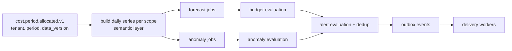

# Budgets, Forecasting, Anomalies and Alerts

Status: **DRAFT design**. No code exists. Delivered in Phase 17 (budgets, forecasting, anomalies, alert evaluation), with delivery hardening (retries, DLQ, digests, more channels) in Phase 32. Requirements: FR-BUD-001…006, UJ-03. Tables: `budgets`, `budget_alert_rules`, `forecasts`, `anomalies`, `alert_channels`, `notification_deliveries` ([DATABASE_SCHEMA.md](DATABASE_SCHEMA.md) §2.5). Events: `budget.threshold.crossed.v1`, `anomaly.detected.v1` ([EVENTS.md](../contracts/EVENTS.md)).

## 1. Triggering and data inputs



- Series are **daily** sums of a cost metric (default `EffectiveCost`, configurable per budget) in the scope's currency, built only through semantic queries. Tenant/ABAC predicates are injected as usual, so scopes never leak.
- Every job is keyed by `(tenant, scope_hash, data_version)` and is idempotent. Re-running for the same data version is a no-op, and outputs record `data_version`.
- The most recent 1–2 days are **provisional** (provider latency, NG7). They are excluded from model fitting and from anomaly detection until `completeness ≥ 0.99` for the scope, or until 72 h have passed (configurable).

## 2. Budgets (FR-BUD-001, FR-BUD-002)

- Scope: hierarchy node, dimension filter, or any semantic filter (stored as `budgets.scope`, validated like a saved view).
- Periods: `month`, `quarter`, `year` aligned to the tenant's **accounting calendar** (4-4-5 included; see [FINANCE_RECONCILIATION.md](FINANCE_RECONCILIATION.md) §5) or `custom` ranges. `amounts` holds the per-period amounts as decimal strings. Currency is fixed per budget; values are converted with the tenant FX policy.
- Alert rules: `basis ∈ {actual, forecast}` × `threshold_pct` (e.g. 50, 80, 100, 120).

Evaluation per budget period:

```
actual_to_date   = Σ metric over [period_start, last_complete_day]
forecast_total   = actual_to_date + Σ point forecast over (last_complete_day, period_end]
ratio_actual     = actual_to_date / amount         (12 dp, half-even)
ratio_forecast   = forecast_total / amount
crossed(rule)    = ratio_basis × 100 ≥ threshold_pct
```

Example (October, budget 50 000.00 USD, data complete through day 20): actual 34 100.00, forecast for days 21–31 is 19 250.00 → forecast total 53 350.00 → ratio 1.067 → **106.7 %**. The `forecast ≥ 100%` rule fires, with the 80% prediction interval [52 100.00, 54 900.00] included in the alert.

Hysteresis: a crossed threshold re-arms only if the ratio falls below `threshold − 5` percentage points (configurable) in a later evaluation. A later restatement that un-crosses a threshold produces a "resolved" notice, never a silent change.

## 3. Forecasting (FR-BUD-003)

### 3.1 Models

| Model | Description | Arithmetic | Status |
|---|---|---|---|
| `seasonal_naive_7` | `ŷ(t+h) = y(t+h−7k)`, with k the smallest integer such that the source day is observed | decimal | **baseline, always run** |
| `seasonal_naive_7_drift` | seasonal naive plus the mean daily drift of the last 28 days | decimal | default candidate |
| `ets_aan_damped` / `ets_ana` | Holt-Winters additive (damped trend, additive weekly seasonality); parameters chosen by deterministic grid search (α, β, γ, φ on a fixed grid, step 0.05) minimizing in-sample SSE; ties broken by grid order | decimal (apd, 34-digit context) | default candidate |
| `decomposable_trend_seasonal` | Prophet-like: piecewise-linear trend with fixed changepoint grid + Fourier weekly/yearly terms + tenant holiday calendar, fit by ridge least squares | float64 (see §3.5) | optional (`C`), opt-in per tenant |

No external forecasting service and no data leave the deployment.

### 3.2 Model selection and back-testing

- Rolling-origin back-test: origins every 7 days over the last 91 days (≥ 8 origins), horizons 7, 30 and 90 days (90 only with ≥ 365 days of history).
- Metrics per model and horizon:
  - `MAPE = mean(|y − ŷ| / |y|)`, skipping days where `y = 0`, with the count of skipped days reported
  - `sMAPE = mean(2|y − ŷ| / (|y| + |ŷ|))`, defined as 0 where both are 0
  - `MASE` relative to `seasonal_naive_7`, used as a tie-breaker
- Selection: lowest sMAPE at the budget-relevant horizon. A model is chosen over the baseline only if it beats it by ≥ 5% relative sMAPE; otherwise the baseline wins (stability over marginal accuracy). Ties go to the simpler model.
- Results are stored in `forecasts.backtest` (per model × horizon metrics, origins, data_version) and shown in the UI ("why this model").

### 3.3 Prediction intervals

Empirical, model-agnostic (split-conformal style). For horizon h, take the absolute back-test errors at that horizon across origins; the interval half-width at level L is the ⌈(n+1)·L⌉-th smallest error. Intervals are reported at 80% and 95%. For period totals, errors of **period-sum** forecasts are used directly (not summed per-day intervals, which would be too narrow). With fewer than 8 origins, intervals are widened by a factor of 1.5 and labeled `low_confidence`.

### 3.4 Cold start

| History | Behavior |
|---|---|
| < 14 days | No statistical forecast. Run-rate projection `mean(last 7 complete days) × remaining days`, labeled `run_rate`, intervals ±50% |
| 14–55 days | seasonal naive variants only |
| ≥ 56 days | all candidates |

### 3.5 Determinism

- Decimal models are deterministic across `amd64`/`arm64` by construction.
- The optional float64 model uses explicit `float64(...)` conversions on every product. The Go spec says an explicit conversion rounds to the target precision, which prevents fused multiply-add from changing results across architectures. Fixed iteration order and fixed solver tolerances apply. The output is quantized to 12 dp half-even. CI runs the golden series on both architectures and asserts identical quantized output.
- Any randomness (e.g. bootstrap, should it be added) uses a PCG generator seeded with `first 8 bytes of SHA-256(tenant_id ‖ scope_hash ‖ data_version ‖ model_version)`. No `math/rand` global, no time-based seeds.
- `forecasts.model_version` changes on any model code or grid change. Golden time-series fixtures (Phase 17 "deterministic time series") pin the expected outputs.

> Tension with ADR-0007: forecasts are statistical estimates, not booked money. This design keeps baseline models in decimal and isolates float64 to one opt-in model package exempt from the finance float lint. This exemption needs an explicit ADR amendment in Phase 17.

## 4. Anomaly detection (FR-BUD-004, UJ-03)

### 4.1 Scopes and series

Default monitored scopes: tenant total, each provider, each `SubAccountId`, each `ServiceName` within provider, and each hierarchy node of the allocation node type. Scopes with mean daily cost below a floor (default 10.00 in reporting currency) are skipped. Tenants can add custom scopes (any semantic filter). Each series is daily `EffectiveCost`.

### 4.2 Method (detector `robust_seasonal_v1`)

1. Expected value `ê(t)` = the selected forecast model's one-step-ahead prediction (fit up to t−1), defaulting to `seasonal_naive_7_drift`.
2. Residuals over the trailing 56 days: `r = y − ê`. Robust scale `σ̂ = 1.4826 × MAD(r)`, with floor `σ̂ ≥ max(0.01 × median(y), minor unit)`.
3. Score `z = (y(t) − ê(t)) / σ̂`, computed in decimal.
4. An anomaly fires when **all** hold: `|z| ≥ k` (default k = 4, per-scope adaptive §4.4), `|y − ê| ≥ abs_min` (default 50.00), and `|y − ê| / max(ê, minor unit) ≥ rel_min` (default 0.20). Drops are flagged as `direction = down` (useful for broken pipelines and lost workloads), on by default with k = 5.
5. Additional rule-based detectors: **new spend** (a service/account/SKU with no cost in the previous 30 days and ≥ abs_min today), and **step change** (CUSUM on residuals, for sustained shifts that daily z-scores miss).

Example: ê = 1 200.00, y = 1 980.00, MAD = 40.00 → σ̂ = 59.304 → z = 780.00 / 59.304 = 13.1526 (stored as `numeric(10,4)` half-even). Relative deviation 65%, absolute 780.00 → anomaly.

### 4.3 Explainability (contributing dimensions)

For an anomalous scope-day, CloudLedger computes the expected value per child dimension member with the same model (or a proportional share of `ê` using the trailing 28-day mix when the child series is too short). It then ranks contributors by `Δ_m = y_m − ê_m`:

- Dimension order tried: `ServiceName` → `SubAccountId` → `RegionId` → `ResourceId` → `tag:<keys configured as explanatory>` → `ChargeCategory`/`PricingCategory`.
- For each dimension, report the top members until ≥ 80% of total Δ is covered (max 5 per dimension), with `share = Δ_m / Δ_total`. Also report whether the change is **rate** or **volume** driven, using `PricingQuantity` vs. effective unit cost: `Δcost ≈ Δq × p₀ + q₁ × Δp`.
- Stored in `anomalies.contributors` (decimal strings). The UI drill-down links each contributor to a pre-filtered semantic query (UJ-03 "drill to root cause").

### 4.4 Feedback and adaptive sensitivity

- Users mark `false_positive`, `acknowledged` (true positive) or `resolved`.
- Per scope and direction, `k` adapts within [3, 8]: each false positive raises it by 0.5, each confirmed true positive lowers it by 0.25, with a decay back toward the default over 90 days. All adjustments are logged with `detector_version`, so they are reproducible.
- Feedback labels are exported for offline evaluation (precision per detector version). The project does not train models on tenant data across tenants.

### 4.5 Suppression

- Suppression rules: `(scope filter, direction, window [from, to] or recurring cron, reason, created_by)`. Matching anomalies are stored with `status = suppressed` (kept for audit) and not alerted.
- Built-in suppressions: commitment purchase days (large `Purchase` rows are expected; they're shown as events, not anomalies, when `EffectiveCost` is used), and the first 3 days after a restatement for the restated period (anomalies are recomputed instead).
- Restatements: anomalies are recomputed for the affected days at the new `data_version`. An existing anomaly that no longer qualifies is moved to `resolved` with reason `restated`.

## 5. Alert evaluation and de-duplication (FR-BUD-005, FR-BUD-006)

### 5.1 Pipeline

1. Budget and anomaly evaluators emit domain events through the outbox, with idempotency keys from EVENTS.md: budget `budget + period + threshold + basis`, anomaly `anomaly id`.
2. The alert router matches events to subscriptions (budget alert rules' `channel_ids`, anomaly subscriptions per scope) and applies **ABAC**: a recipient only receives alerts for scopes they can see. Channel-level recipients (e.g. a Slack channel) are bound to a data scope at configuration time.
3. For each (event, channel), the router computes `dedup_key = SHA-256(event_type ‖ idempotency_key ‖ channel_id)` and inserts into `notification_deliveries` (`UNIQUE (tenant_id, channel_id, dedup_key)`). A conflict means the alert was already queued, so nothing is sent twice even with at-least-once event delivery.
4. Delivery workers send with retries (exponential backoff + jitter, max 8 attempts over ~24 h), then `dead_lettered`. Webhooks are HMAC-SHA256 signed (`X-CloudLedger-Signature: t=<unix>,v1=<hex>` over `t.body`) with a 5-minute replay window.

### 5.2 Noise controls

- **Digest mode** (per channel): non-critical alerts within a window (default 1 h, or daily at a set time) are batched into one message. The digest has its own dedup key over the sorted member keys.
- **Re-notification**: an open anomaly isn't re-sent unless its score grows by ≥ 50% or it persists into a new day with a new Δ ≥ 2× the original.
- **Rate limit** per channel (default 30 messages/h) with overflow rolled into a digest.
- Message content: amounts as formatted decimals, the scope, freshness ("data complete through …"), and a link. Untrusted strings (tag values, resource names) are escaped for the channel's markup.

## 6. Test plan highlights (Phase 17)

- Golden daily series (synthetic: weekly seasonality, trend, step, spike, drop, zero days, sparse history) with expected forecasts, intervals, back-test metrics and anomalies pinned to exact decimal strings.
- Property tests: forecasts invariant to input row order; `seasonal_naive_7` reproduces the seasonal pattern exactly; anomaly detection is monotone in `k`.
- Budget threshold tests on 4-4-5 periods, quarter boundaries and restatements (cross → resolve).
- Dedup tests: duplicate events, concurrent routers, digest coalescing; delivery failure → DLQ.

## 7. Open points

- ADR-0007 exemption for the optional float64 model (§3.5).
- Whether anomaly scopes should include tag keys by default (cardinality vs. usefulness).
- Weekly vs. daily seasonality for accounting-calendar-aligned tenants with 4-4-5 month-end effects.
