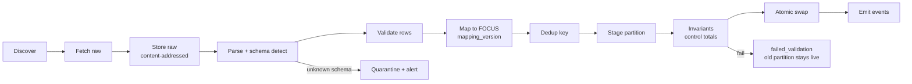

# Ingestion Pipeline

Phases: 06–12 (connectors 06–09, invoices 10, normalization 11, operations 12). Decisions: [ADR-0005](adr/0005-postgresql-backed-durable-job-queue-and.md), [ADR-0010](adr/0010-immutable-content-addressed-raw-storage-and.md).

## 1. Stages

| Stage | Responsibility | Idempotency mechanism |
|---|---|---|
| Discover | List provider artifacts since the checkpoint (CUR manifests, BigQuery partitions by `export_time`, Azure export runs or blob manifests, uploaded files) | deterministic artifact IDs (provider URI + version/etag) |
| Fetch | Stream download with checksum verification, resumable and bounded memory | skip if `(tenant, sha256)` already exists |
| Store raw | `raw/{tenant}/{connector}/{capability}/{period}/{sha256}.{ext}` | content address |
| Parse | Streaming Parquet/CSV/JSON readers. Schema fingerprint = hash of sorted (column, type). | pure function |
| Validate | Required columns, types, value domains, currency codes, date windows, numeric parse. Rejected rows are written to a sample file with reasons. | pure function |
| Map | Provider mapping (versioned) → FOCUS row + `x_` extensions + `x_raw` | `(raw objects, mapping_version)` → same rows |
| Dedup key | line identity key `sha256(provider, provider_line_id or composite natural key, billing_period, charge_period)` plus a separate `content_hash` of the mapped row. Same key with a different content hash in one run fails validation. See [FOCUS_NORMALIZATION.md](FOCUS_NORMALIZATION.md). | stable |
| Stage | Write to staging partition `(tenant, connector, billing_period, run_id)` | staging dropped on retry |
| Invariants | (1) Σ source cost columns = Σ staged per (account, currency, charge_category); (2) row count parity minus documented rejections; (3) no duplicate dedup keys; (4) currency consistency; (5) period bounds | — |
| Swap | Adapter `Commit()`: atomic replace; `billing_period_versions` updated in the same logical step; tenant `data_version++` | live pointer swap |
| Emit | outbox `cost.period.normalized` → allocation, aggregates, budgets, anomalies, recs | consumers idempotent by `(period, data_version)` |

## 2. Work units, concurrency and back-pressure
- Work unit = `(tenant, connector, capability, scope, billing_period)`. Unique job key prevents concurrent duplicates.
- Per-provider rate limiters (token bucket per credential and API family), adaptive to `429`/`Throttling`/`RESOURCE_EXHAUSTED`/`Retry-After`.
- Per-tenant concurrency quotas. Global worker pool sizes per queue.
- Large files processed in row groups or chunks. Memory budget per job enforced.

## 3. Retries and errors

| Error class | Examples | Policy |
|---|---|---|
| `transient` | network, 5xx, throttling | retry with exponential backoff + full jitter (base 2 s, cap 15 min, max 10 attempts) |
| `auth` | AssumeRole denied, expired federation | no retry loop; connector → `error`; alert owner; remediation text |
| `permission_partial` | one capability or scope denied | mark capability or scope `fail`; continue others; health `degraded` |
| `data` | unknown schema, invariant failure | quarantine; no retry until mapping or schema support is updated; alert |
| `not_ready` | export not yet delivered | reschedule at the next poll; not an error until the SLA is exceeded |
| `bug` | panic, unexpected | discard after max attempts → DLQ; Sentry-style error report via OTel |

Circuit breaker per (connector, API family): opens after 5 consecutive transient failures and half-opens after 5 min.

## 4. Checkpoints, backfill, restatements
- Checkpoint cursor per capability. Examples: AWS `{last_manifest_assembly_id per period}`, GCP `{max_export_time}` with a 72 h lookback overlap for late rows, Azure `{last_run_id, blob etags}`.
- Checkpoints advance **in the same transaction** that enqueues normalize jobs (exactly-once enqueue).
- Backfill: creates one job per period from the horizon to now, oldest-first or newest-first (configurable, default newest-first for faster value), at low priority.
- Restatement: re-delivery of a period creates a new `billing_period_versions` row. The previous version is kept for diffing (`GET /api/v1/ingestion/periods/{period}/diff`).
- Provider finality: periods flagged `provider_final` when the provider signals finalization (e.g. invoice issued). Corrections after finality are still accepted but flagged as `late_correction` and surfaced in reconciliation and period close.

## 5. Ingestion health (FR-CON-005)
Per connector × capability × scope: `last_success_at`, `last_attempt_at`, `freshness_lag`, `completeness` (expected vs. received periods and scopes), `error_class`, `next_run_at`, `rows_last_run`, `rejected_rows_last_run`. These are exposed in the API, UI and Prometheus (`cloudledger_ingestion_freshness_seconds{provider,capability}` with no tenant label at high cardinality; per-tenant detail via API only).

## 6. Security in the pipeline
- Credentials resolved just in time and held in memory only. STS sessions ≤ 1 h.
- File parsing hardening: size caps, decompression ratio caps (zip bomb), XLSX via a streaming reader with external entity resolution disabled, CSV formula characters preserved as data and escaped on export.
- Untrusted strings (tags, resource names) are stored as data and never interpreted (relevant for AI; see LLM_SECURITY.md).
