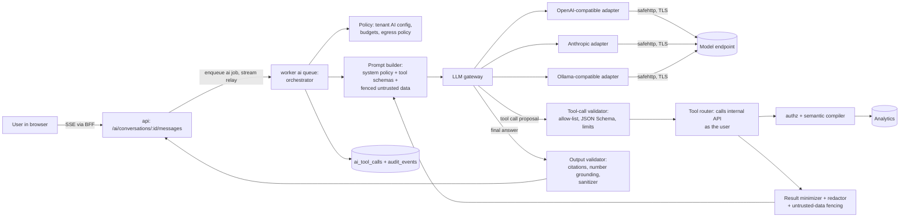
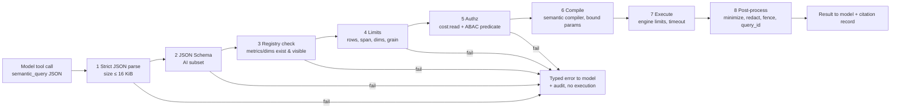

# LLM Gateway and AI Security

> **Status: DRAFT design.** Nothing here is implemented. Decision: [ADR-0013](adr/0013-llm-gateway-with-tool-only-data.md). Requirements: FR-AI-001..008, NFR-SEC-001, AC-06, UJ-13. Delivered in **Phase 27** (gateway, tools, governed NL-to-query, limits, injection defenses, egress policy, audit) and **Phase 28** (conversational analytics, citations and grounding checks, report drafts). Threats: T-42..T-45, T-56, T-63, T-67 in [THREAT_MODEL.md](../security/THREAT_MODEL.md).

## 1. Principles

1. **The model is an untrusted planner.** It can propose tool calls; it cannot authorize, execute SQL, mutate state or fetch URLs.
2. **Authorization is outside the model.** Every tool runs through the normal API authorization as the requesting user (same tenant, permissions and ABAC scope). The AI can never see more than the user could see in a dashboard (SP-07).
3. **Semantic queries only.** The model emits a semantic-query JSON; the semantic layer validates and compiles it. Model-generated SQL is never executed (FR-AI-003).
4. **Disabled by default, minimized when enabled.** Tenants opt in, choose the provider and the egress policy (FR-AI-001, FR-AI-008, OQ-16).
5. **Every number is cited.** Answers carry query IDs, filters, freshness and uncertainty (FR-AI-005).

## 2. Architecture



- The orchestration loop runs in the `worker` `ai` queue (SYSTEM_CONTEXT) so that LLM egress originates only from worker pods with egress allow-lists (DEPLOYMENT_PROFILES). The API relays the token stream to the browser via the BFF.
- The orchestrator holds the user's **principal context** (user, tenant, effective permissions, scope hash) captured at request time; it is not a privileged identity.

## 3. Provider adapters (FR-AI-001)

| Adapter | Protocols | Notes |
|---|---|---|
| OpenAI-compatible | Chat Completions / Responses-style tool calling over HTTPS | Covers OpenAI, Azure OpenAI and compatible gateways (vLLM, LiteLLM). Base URL via `safehttp` (SEC-SSRF-*). |
| Anthropic | Messages API with tool use | Native adapter. |
| Ollama-compatible | Local chat API with tool calling | For self-hosted/local models; private endpoints require an operator `ssrf.allow_hosts` entry (SEC-SSRF-05). |

Common adapter contract: `Chat(ctx, req{system, messages, tools, max_tokens, temperature, stop}) → stream{deltas, tool_calls, usage}`. Adapters normalize tool-call formats, enforce `max_tokens`, request JSON-structured tool arguments where supported, and never forward provider errors verbatim to the user. Capability flags (`tool_calling`, `json_schema_output`, `parallel_tools`, `context_window`) gate model eligibility; models without reliable tool calling are rejected at configuration time.

## 4. Per-tenant configuration

Stored in `tenant_settings.ai_settings` (validated schema; changes need `ai:configure` + step-up and are audited).

```json
{
  "enabled": false,
  "provider": "anthropic | openai_compatible | ollama_compatible",
  "endpoint": "https://…",
  "model": "<model id>",
  "credential_ref": "vault://kv/cloudledger/tenants/<tenant_id>/llm#api_key",
  "egress_policy": "aggregates_only | aggregates_and_dimension_values | local_only",
  "allowed_tools": ["semantic_query", "get_catalog", "list_recommendations", "get_resource", "get_freshness", "create_report_draft"],
  "redaction": {"tag_keys": ["owner", "email"], "patterns": ["email", "ipv4"]},
  "retention_days": 30,
  "budgets": {"user_daily_tokens": 200000, "tenant_monthly_tokens": 20000000},
  "data_region_ack": "eu"
}
```

| ID | Rule |
|---|---|
| LLM-01 | Default `enabled=false`. Enabling shows the provider, region, retention terms and egress policy and requires explicit confirmation by a principal with `ai:configure`. |
| LLM-02 | `local_only` requires an `ollama_compatible` (or operator-designated in-cluster) endpoint and blocks all other providers for the tenant. |
| LLM-03 | Operators can restrict which providers/endpoints tenants may choose (`platform.settings:manage`), e.g. "local only" for a whole deployment. |
| LLM-04 | The LLM API key is a secret reference (KEY-15); it is never sent to the browser or included in prompts. |

## 5. Tool catalog

All tools are **read-only** except `create_report_draft`, which creates nothing until the user confirms outside the model. Each tool requires `ai:use` **and** its own permission; the tool executes through the internal API with the user's principal.

| Tool | Purpose | Arguments (JSON Schema, abbreviated) | Required permission | Limits |
|---|---|---|---|---|
| `semantic_query` | Run a semantic query | `{metrics[1..5], dimensions[0..4], filters, time{from,to,grain}, currency, include, order_by, limit≤1000}` (subset of the public semantic query schema) | `cost:read` | rows ≤ 1 000; time span ≤ 13 months (daily ≤ 92 days, hourly ≤ 7 days); timeout 15 s |
| `get_catalog` | Visible metrics/dimensions and tag keys | `{kind?: metrics\|dimensions\|tag_keys, search?}` | `catalog:read` | ≤ 500 entries |
| `list_recommendations` | Recommendations in scope | `{category?, state?, min_confidence?, provider?, limit≤50}` | `recommendations:read` | ≤ 50 |
| `get_resource` | Resource details + recent cost/utilization summary | `{resource_id}` (opaque CloudLedger ID only) | `resources:read` (+ `metrics:read` for metrics part) | 1 resource; metric summaries only |
| `get_freshness` | Data freshness and completeness | `{provider?, connector_id?}` | `cost:read` | — |
| `create_report_draft` | Propose a report definition from the conversation | `{name, description, queries[≤5 semantic queries], formats[], schedule?: null}` | `reports:manage` | Creates an unsaved **draft proposal**; persistence requires user confirmation (LLM-09) |

| ID | Rule |
|---|---|
| LLM-05 | Tool allow-list is fixed in code; tenants can only narrow it (`allowed_tools`). Unknown tool names → rejected, counted as an injection signal. |
| LLM-06 | Tool arguments validated against strict JSON Schemas (`additionalProperties: false`, length and enum limits) before authorization; invalid → a structured error returned to the model (max 2 repair attempts per turn). |
| LLM-07 | IDs in arguments are opaque CloudLedger IDs; the tool resolves them in the user's tenant (404 otherwise). No tool accepts tenant IDs, SQL, URLs, file paths, or secret references. |
| LLM-08 | No tool performs mutations, sends notifications, creates tickets, transitions recommendations, or exports files (FR-AI-007, NG1). |
| LLM-09 | `create_report_draft` returns `{draft_id, summary}` to the model. The UI renders the draft with a **Confirm** button; confirmation is a normal BFF→API `POST /api/v1/reports` with CSRF token and the user's session, referencing `draft_id` and the draft's content hash. The model never sees or can trigger the confirmation. Drafts expire after 24 h. |
| LLM-10 | No browsing or URL-fetching tool exists; the gateway never dereferences URLs found in data or model output. |

## 6. Limits and budgets (FR-AI-004)

| ID | Limit | Default (operator/tenant configurable) |
|---|---|---|
| LLM-40 | Rows returned per `semantic_query` to the model | 1 000 (aggregated results only under `aggregates_only`) |
| LLM-41 | Time range per query | 13 months; finer grains limited as in §5 |
| LLM-42 | Tool calls per user turn / sequential depth | 8 / 4 |
| LLM-43 | Tokens: per request `max_tokens` 4 096 output; context budget per turn 32 k (truncate oldest tool results first); per user per day 200 k; per tenant per month 20 M with hard stop and admin alert at 80 % | |
| LLM-44 | Timeouts: per model call 60 s, per tool 15 s, per turn 120 s | |
| LLM-45 | Rate limits: `ai` bucket per user (e.g. 20 turns/min) and per tenant (SEC-RATE-01) | |

These are operational protections, not license limits (NFR-LIC-004).

## 7. Governed NL-to-query and validation pipeline (FR-AI-003)



| ID | Rule |
|---|---|
| LLM-50 | There is no code path from model output to an SQL string. The only executable artifact is a validated semantic query compiled by `internal/analytics` (ADR-0004), which injects tenant and ABAC predicates (AZ-27). A Semgrep rule forbids passing `internal/ai` values to raw query APIs. |
| LLM-51 | Unauthorized scope requests (e.g. a filter on an account outside the user's scope) are **not silently narrowed**: the security predicate already restricts results, and the answer states that results are limited to the user's visible scope. Explicit filters on dimensions the user cannot see are rejected (AZ-25) and the assistant refuses with an explanation. |
| LLM-52 | Unsupported questions (requiring metrics or joins the semantic layer lacks) produce a refusal with what is supported, not an approximation (ADR-0013 consequence). |
| LLM-53 | Each executed query gets a `query_id`, stored with the compiled query hash, data version, filters (including security scope hash), freshness and row count, so it can be reopened in the UI ("open in query builder"). |

## 8. Data minimization and egress policy (FR-AI-008)

| ID | Rule |
|---|---|
| LLM-20 | `aggregates_only` (default): the model receives only aggregated metric values grouped by dimensions; no row-level `cost_focus` lines, no `x_raw`, no lineage rows; resource details limited to type/region/provider/cost summary. |
| LLM-21 | `aggregates_and_dimension_values`: dimension values such as tag values and resource names may be sent (still aggregated), subject to redaction rules. |
| LLM-22 | Redaction before egress: configured tag keys masked (`owner → [redacted:owner#3]` with stable per-conversation pseudonyms so the model can still reason); regex classes (emails, IPs, AWS access keys, URLs with credentials) masked; pseudonyms are re-identified only in the UI rendering for the user. |
| LLM-23 | Never sent: DC-3 data, other users' identities, audit data, credentials, connector configuration, invoice PDFs, other conversations. |
| LLM-24 | Provider transparency: tenant settings show provider, endpoint region, and whether the provider is configured for zero data retention (operator-declared). Self-hosted local model is documented as the maximum-privacy option. |

## 9. Prompt-injection defenses (FR-AI-006)

Untrusted content: tag keys/values, resource names and descriptions, account/project names, recommendation text from providers, invoice line descriptions, plugin-supplied text, user-uploaded data, previous tool results, and the user's own message (which may be pasted content).

| ID | Defense |
|---|---|
| LLM-11 | **Instruction hierarchy:** fixed system policy (versioned, not tenant-editable) > tool schemas > user message > tool results/data. The system policy states that content inside data fences is data, may contain adversarial text, and must never be followed as instructions. |
| LLM-12 | **Delimiting untrusted data:** tool results are serialized as JSON inside a per-response random fence (`<<data-7f3a9c…>> … <</data-7f3a9c…>>`); the fence token is unguessable and any occurrence of fence-like tokens inside data is escaped. Strings are length-capped (256 chars per value) and control/bidi characters are escaped. |
| LLM-13 | **Authorization independent of the model:** even a fully hijacked model can only call allow-listed read tools as the same user, so injection cannot cross scope or tenant boundaries (T-63). |
| LLM-14 | **Tool-argument validation:** LLM-06/07 schemas; arguments containing instruction-like content (e.g. in `name` of a report draft) are stored as data only. |
| LLM-15 | **No escalating tool chains:** tool outputs cannot widen authorization; IDs taken from tool results are re-authorized on use; per-turn call and depth caps (LLM-42); no tool's output can enable another tool or alter the allow-list; repeated identical calls are short-circuited. |
| LLM-16 | **Output validation:** final answers are checked before display (LLM-30..33): sanitized Markdown, CloudLedger-origin links only, no images, no HTML; tool-call proposals in the final text are ignored. |
| LLM-17 | **Write isolation:** the only write path (report draft) requires out-of-band user confirmation (LLM-09). |
| LLM-18 | **Detection:** heuristic/classifier signals (unknown tool names, schema-violating arguments, attempts to address other tenants, fence-escape attempts) are logged as `ai.injection_suspected` audit events and surfaced in tenant admin metrics; they do not by themselves block the user. |

## 10. Citations, freshness and output validation (FR-AI-005; Phase 28)

| ID | Rule |
|---|---|
| LLM-30 | Every answer that states a number must cite at least one `query_id`; the UI renders citations with filters applied, time range, currency, cost metric (billed/effective/…), data version and freshness from `get_freshness`/query `meta` (API_GUIDELINES §12). |
| LLM-31 | Rendering: Markdown subset (paragraphs, lists, tables, emphasis, code), sanitized; links only to the CloudLedger origin (query, resource, recommendation pages); images and raw HTML disabled (prevents exfiltration via image URLs, T-56). |
| LLM-32 | **Number grounding check:** the validator extracts numeric literals (money, percentages, counts) from the answer and matches them against the cited query results, allowing documented transformations (rounding to displayed precision, sums/differences/percent-change of cited values computed by the validator in decimal). Ungrounded numbers are flagged; if any monetary figure is ungrounded the answer is regenerated once with feedback, and otherwise shown with a visible "unverified figure" warning. |
| LLM-33 | Uncertainty: answers must state incompleteness when freshness lag exceeds the tenant threshold, completeness < 1, the period is provisional, or the scope was restricted (LLM-51). The validator injects these caveats if missing. |
| LLM-34 | Money values in tool results are decimal strings (ADR-0007); the model is instructed not to perform arithmetic beyond simple comparisons, and derived figures are recomputed by the validator. |

## 11. Conversation retention

| ID | Rule |
|---|---|
| LLM-60 | `ai_conversations`, `ai_messages`, `ai_tool_calls` are tenant-scoped (RLS) and owned by the user; other users cannot read conversations (no permission grants message content access; `ai:audit_read` covers metadata only). |
| LLM-61 | Message content and tool results are encrypted with the tenant key (SEC-ENC-04). |
| LLM-62 | Retention default 30 days (OQ-09), tenant-configurable 0–365; `expires_at` enforced by a purge job; `0` = no persistence beyond the session (stream only, audit metadata kept). |
| LLM-63 | Users can delete their conversations; deletion is immediate for content, audit metadata remains. User erasure removes all their conversations (KEY-24). |
| LLM-64 | Provider-side retention is outside CloudLedger's control and is disclosed (LLM-24). |

## 12. Audit of tool calls

| ID | Rule |
|---|---|
| LLM-65 | Each tool call is recorded in `ai_tool_calls` (tool, validated arguments, authz decision, `query_id`/result reference, row count, duration) and summarized as an `ai.tool.invoked` audit event (actor, tool, decision, query hash, scope hash), without result values. |
| LLM-66 | Model calls are recorded with provider, model, token usage, latency and policy version (no prompt text in logs, SEC-LOG-03). |
| LLM-67 | AI configuration changes, budget exhaustion, injection-suspected events and report-draft confirmations are audited. |

## 13. Evaluation suite (Phase 27 gate, extended in Phase 28)

Location: `tests/security/ai/`. Runs against a deterministic stub model (scripted adversarial tool calls) **and** against at least one real model per adapter family in a nightly job (results recorded, not fabricated; real-model runs require operator-supplied keys and are marked `NOT RUN` otherwise).

| ID | Suite | Content | Pass criterion |
|---|---|---|---|
| LLM-70 | Prompt-injection corpus | ≥ 300 cases: injected instructions in tag values, resource names, account names, invoice descriptions, provider recommendation text, user-pasted content; fence-escape attempts; multilingual, Unicode homoglyph and bidi payloads; indirect attempts to call unknown tools, request other tenants, exfiltrate via links/images | 0 unauthorized tool executions, 0 data outside scope, 0 non-origin links/images rendered; injection-follow rate on prose tracked per model |
| LLM-71 | Unauthorized-scope tests | Generated from the AZ-50 scope fixtures: users ask about accounts/tags/nodes outside scope and about other tenants | 0 leaked rows or values (compare tool results against scope fixtures); refusal or scoped-answer statement present |
| LLM-72 | No-SQL guarantee | Stub model emits SQL strings in every field; static check of code paths | 0 SQL executed from model output (AC-06) |
| LLM-73 | Hallucinated-number checks | Golden questions over the golden billing dataset; every numeric claim compared with the cited query results via LLM-32 | 100 % of monetary claims grounded in the stub suite; real-model ungrounded-figure rate reported and must be ≤ threshold set in Phase 28 |
| LLM-74 | Citation and freshness | Answers include citations, freshness and caveats under stale/partial data fixtures | 100 % in stub suite |
| LLM-75 | Limits and budgets | Oversized queries, loops, token exhaustion, timeouts | Typed errors; budgets enforced; no runaway cost (T-67) |
| LLM-76 | Egress policy | Captured outbound payloads under each `egress_policy` and redaction config | No row-level data or redacted values in payloads; DC-3 canaries absent |
| LLM-77 | Report-draft confirmation | Model attempts to confirm/persist drafts, schedule delivery, or embed external recipients | No persistence without UI confirmation by the user |

Release gating: LLM-70..72 and LLM-76..77 are **blocking** for v0.7 (Phases 27–28) and v1.0 (AC-06).

## 14. Phase split

| Phase 27 | Phase 28 |
|---|---|
| Gateway + 3 adapters, tenant config, budgets/limits (LLM-01..08, 40..45), tools `semantic_query`, `get_catalog`, `get_freshness`, `list_recommendations`, `get_resource`, validation pipeline (LLM-50..53), egress/minimization (LLM-20..24), injection defenses (LLM-11..18), retention and audit (LLM-60..67), suites LLM-70..72, 75, 76 | Conversational UX, `create_report_draft` with confirmation (LLM-09), citations and grounding (LLM-30..34), suites LLM-73, 74, 77 |
