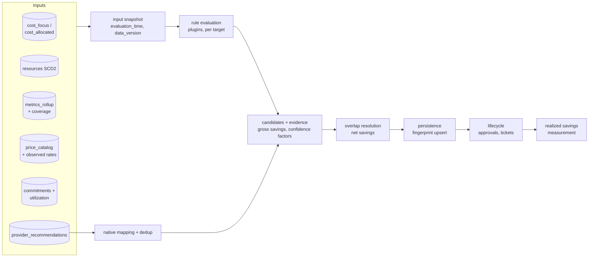
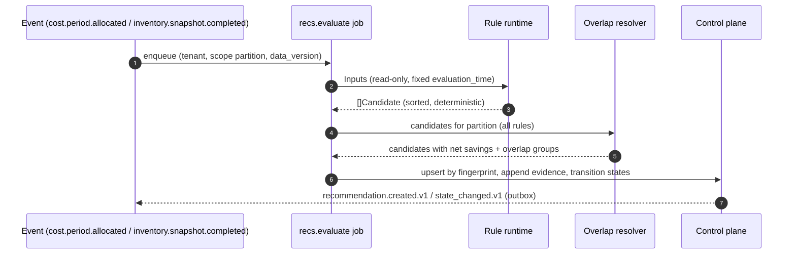
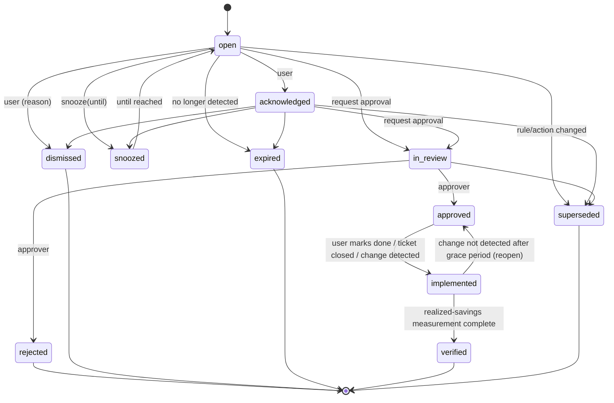

# Recommendation Engine

Status: **DRAFT design**. No code exists. Phases: 21 (SDK, rule runtime, evidence, native-rec ingestion), 22 (compute, Kubernetes, serverless), 23 (storage, backup, database), 24 (network, egress, load balancers), 25 (commitments, regions, architecture, overlap resolution), 26 (review/approval, lifecycle, realized savings), 36 (external recommendation SDK and compatibility). Requirements: FR-REC-001…008, FR-TEL-002, UJ-05…UJ-07, AC-05, risk R-03. Plugin contract: [RECOMMENDATION_SDK.md](../contracts/RECOMMENDATION_SDK.md).

> **No auto-remediation.** CloudLedger never changes customer cloud resources (NG1, FR-REC-008, FR-CON-004). Recommendations produce evidence, guidance, rollback steps, optional IaC snippets and optional tickets. The rule SDK exposes no mutating API, and connectors hold read-only credentials. Any future remediation capability needs a separate opt-in workflow and ADR.

## 1. Pipeline





- **Evaluation unit**: `(tenant, provider, scope partition)`, e.g. one AWS account or GCP project. Commitment rules evaluate per **commitment pool** (§5.3).
- **Triggers**: `cost.period.allocated.v1`, `inventory.snapshot.completed.v1`, metrics sync completion, daily schedule. Deduplicated per `(tenant, partition, data_version, inventory_snapshot, rule_set_version)`.
- **Inputs snapshot**: `evaluation_time` is fixed at job start and passed to rules. Rules never read the clock.

## 2. Rule catalog

Conventions:
- **Monthly** = 730 hours. `C_m(r)` = trailing-30-day `EffectiveCost` of resource r normalized to 730 h. `price(x)` = tenant effective unit price for x when observable in billing data, else the catalog price adjusted by the tenant's observed discount ratio for that service (lower pricing certainty, §3).
- Utilization percentiles come from `metrics_rollup` over the lookback window. Defaults are overridable per tenant and per rule (manifest `default_thresholds`).
- Providers: A = AWS, G = GCP, Z = Azure. Risk is the default before modifiers (§4).

| ID | Category | Prov. | Inputs | Default thresholds | Gross monthly savings | Risk | Phase |
|---|---|---|---|---|---|---|---|
| REC-IDLE-001 VM idle | idle | A G Z | inventory, CPU, network, cost | lookback 14 d; p95 CPU < 5%; net in+out < 5 MB/day; coverage ≥ 0.8 | `C_m(vm)` (stop/terminate) | medium | 22 |
| REC-IDLE-002 stopped VM with disks | stale | A G Z | inventory state history, disk cost | stopped ≥ 30 d | Σ attached disk `C_m` − snapshot cost estimate | medium | 23 |
| REC-IDLE-003 unattached disk | orphaned | A G Z | inventory attachment state | unattached ≥ 7 d | `C_m(disk)` − snapshot estimate (if snapshot advised) | low | 23 |
| REC-IDLE-004 orphaned snapshot | orphaned | A G Z | snapshots, source volume existence | age ≥ 90 d; source deleted; not referenced by an image/AMI | `C_m(snapshot)` | medium | 23 |
| REC-IDLE-005 unused machine image | stale | A G Z | images, launch references | not used ≥ 180 d | storage cost of backing snapshots | low | 23 |
| REC-IDLE-006 unassociated public IP | orphaned | A G Z | inventory, IP cost | unassociated ≥ 7 d | `C_m(ip)` | low | 24 |
| REC-IDLE-007 idle load balancer | idle | A G Z | LB metrics (requests, healthy targets) | 0 healthy targets or < 100 req/day over 14 d | `C_m(lb)` | medium | 24 |
| REC-IDLE-008 idle NAT gateway | idle | A G Z | NAT bytes processed | < 1 GB over 14 d | hourly charge × 730 | medium | 24 |
| REC-IDLE-009 idle database | idle | A G Z | connections, IOPS | 0 connections over 14 d | `C_m(db)` (snapshot then delete or stop) | high | 23 |
| REC-IDLE-010 idle Kubernetes cluster | idle | A G Z | cluster fee, workload pods | no non-system pods for 14 d | cluster fee + node cost | medium | 22 |
| REC-CMP-001 VM rightsizing | rightsizing | A G Z | CPU, memory (if available), instance catalog | p95 CPU < 40% and p95 mem < 50%, lookback 14 d (30 d preferred); target keeps p95 projected ≤ 70% | `(price(cur) − price(target)) × hours_m` | medium | 22 |
| REC-CMP-002 previous generation | rightsizing | A G Z | instance family, catalog | older gen with equivalent current-gen size | `(price(cur) − price(next_gen)) × hours_m` | low | 22 |
| REC-CMP-003 non-prod scheduling | rightsizing | A G Z | tag env, hourly CPU profile | env ∈ {dev,test,staging}; running ≥ 160 h/week | `C_m × (1 − scheduled_hours / 730)` (default schedule 60 h/week ≈ 260 h/month) | low | 22 |
| REC-CMP-004 spot/preemptible candidate | rightsizing | A G Z | autoscaling group membership, stateless markers | stateless group, ≥ 2 instances, interruption-tolerant tag | `C_m × spot_discount(region, type)` (trailing 30-d avg) | high | 22 |
| REC-CMP-005 autoscaling min too high | rightsizing | A G Z | ASG/MIG/VMSS min/desired, utilization | min ≥ 2 and p95 group CPU < 30% | `(min − proposed_min) × price × 730` | medium | 22 |
| REC-K8S-001 container requests rightsizing | k8s | A G Z | requests/limits, usage (OpenCost/Prometheus) | requests > 2× p95 usage over 14 d; headroom 20% | `Δrequested_resources × node_cost_per_unit` (only realizable if nodes are removed; §5.2) | medium | 22 |
| REC-K8S-002 underutilized node pool | k8s | A G Z | allocatable vs. requested | requested/allocatable < 50% over 14 d | removable nodes × node price × 730 | medium | 22 |
| REC-K8S-003 missing HPA | k8s | A G Z | deployment replicas, usage variability | CV of hourly usage > 0.5, no HPA | `(replicas − avg_needed) × pod_cost` | medium | 22 |
| REC-K8S-004 idle namespace | k8s | A G Z | namespace cost, request traffic | cost > 0, CPU p95 < 2% of requests for 14 d | namespace allocated cost | medium | 22 |
| REC-SLS-001 function memory oversized | serverless | A G Z | configured memory, max memory used, duration | max used < 50% of configured over 14 d | `GB-s_cost × (1 − proposed/current)`, adjusted for duration change (measured where available, else assumed unchanged → lower confidence) | low | 22 |
| REC-SLS-002 unused provisioned concurrency | serverless | A Z | provisioned concurrency utilization | utilization < 30% over 14 d | unused provisioned capacity cost | low | 22 |
| REC-SLS-003 function on arm64 | regions/ARM | A G | architecture, runtime compatibility | x86, runtime supports arm64 | `C_m × arm_price_delta` (AWS ≈ 20%, from catalog) | medium | 22 |
| REC-STO-001 object storage tiering | storage | A G Z | bucket size, access metrics / inventory reports | ≥ 50% objects not accessed 30 d; size ≥ 100 GB | `GB_cold × (price_std − price_ia) − retrieval_est − transition_cost/12` | low | 23 |
| REC-STO-002 block storage type upgrade | storage | A G Z | volume type, IOPS/throughput | AWS gp2→gp3; GCP pd-ssd→pd-balanced when p95 IOPS fits; Azure Premium→Standard SSD when p95 IOPS < tier | `C_m − price(new_type, size, iops)` | low | 23 |
| REC-STO-003 over-provisioned IOPS | storage | A Z | provisioned IOPS vs. used | p99 IOPS < 50% provisioned | `(prov − proposed) × iops_price` | medium | 23 |
| REC-STO-004 incomplete uploads / noncurrent versions | storage | A G Z | bucket lifecycle config, storage-class metrics | no lifecycle rule; noncurrent ≥ 20% | `GB_noncurrent × price_std` | low | 23 |
| REC-DB-001 database rightsizing | databases | A G Z | CPU, memory, connections | p95 CPU < 30%, memory headroom ≥ 50%, 30 d | `price(cur) − price(target)` × 730 | high | 23 |
| REC-DB-002 non-prod HA/multi-AZ | databases | A G Z | HA flag, env tag | env non-prod and HA enabled | HA premium × 730 | medium | 23 |
| REC-DB-003 capacity mode | databases | A Z | DynamoDB provisioned vs. consumed; Cosmos DB RU | consumed < 30% provisioned (→ on-demand/autoscale) or steady > 80% (→ provisioned) | `cost_cur − cost_alt` | medium | 23 |
| REC-DB-004 over-allocated database storage | databases | A G Z | allocated vs. used storage | free > 70% | **informational** (storage often cannot shrink in place); savings counted only for migration path | high | 23 |
| REC-NET-001 NAT traffic to provider services | network | A G | NAT bytes by destination (flow logs where available) | ≥ 100 GB/month to object storage/DB endpoints | `GB × nat_processing_price` (gateway endpoint / Private Google Access) | low | 24 |
| REC-NET-002 cross-AZ transfer | egress | A G Z | inter-AZ transfer cost by resource | ≥ 500 GB/month | **informational estimate** `GB × inter_az_price × reducible_share` | medium | 24 |
| REC-NET-003 internet egress → CDN | egress | A G Z | egress cost, request patterns | egress ≥ 5 TB/month, cacheable content | `egress_cost − (cdn_cost + origin_fill)` | medium | 24 |
| REC-NET-004 load balancer consolidation | network | A G Z | LB inventory, traffic | ≥ 3 LBs < 1 000 req/day each in one VPC/VNet | `(n − 1) × lb_fixed_price × 730` | medium | 24 |
| REC-LOG-001 log retention | logging | A G Z | log group retention, stored GB | retention = never/over policy (default 90 d) | `GB_beyond_policy × storage_price` | low | 23 |
| REC-LOG-002 log analytics commitment tier | logging | Z G | daily ingestion volume | steady ingestion above tier break-even for 30 d | `pay_as_you_go − tier_price` | low | 23 |
| REC-BKP-001 backup retention excess | backups | A G Z | backup plans, recovery points | retention > tenant policy | `GB_excess × backup_storage_price` | medium | 23 |
| REC-BKP-002 orphaned recovery points | backups | A G Z | recovery points, source existence | source deleted ≥ 30 d | `C_m(recovery points)` | medium | 23 |
| REC-COM-001 savings plan / spend commitment purchase | commitments | A G Z | hourly eligible on-demand spend, existing commitments | lookback 30 d (60 d preferred); commit at p10 of post-action hourly eligible spend; term 1 y no-upfront default | `commit × (1/(1−d) − 1)` where d = discount rate; i.e. on-demand-equivalent covered − commitment cost (§5.3) | medium | 25 |
| REC-COM-002 resource commitment purchase (RI, resource CUD, Azure reservation) | commitments | A G Z | steady instance/DB counts, existing RIs | ≥ 30 d steady usage ≥ 95% of hours | `units × (od_rate − effective_commit_rate) × 730` | medium | 25 |
| REC-COM-003 underutilized commitment | commitments | A Z | utilization | utilization < 90% for 14 d | unused cost recoverable via exchange/scope change (no purchase): `unused × recoverable_share` | low | 25 |
| REC-COM-004 expiring commitment | commitments | A G Z | end dates, coverage | expires ≤ 60 d, covered usage steady | cost avoidance: `covered_od_equiv − renewal_cost` (labeled avoidance) | low | 25 |
| REC-REG-001 cheaper region | regions | A G Z | region price deltas, data-residency tags | Δ ≥ 15% and no residency tag | **informational**: `C_m × Δ%` | high | 25 |
| REC-REG-002 ARM VM migration | regions/ARM | A G Z | instance family, OS/arch, catalog | ARM-equivalent exists | `(price(x86) − price(arm)) × hours_m` | medium | 25 |
| REC-LIC-001 hybrid benefit / BYOL unused | licensing | Z A | OS/SQL license meters, tenant license declarations | Windows/SQL meters billed and tenant has declared eligible licenses | license meter cost | low | 25 |
| REC-LIC-002 SQL edition downgrade | licensing | A Z G | edition, feature usage (if observable), cores | Enterprise edition with ≤ 16 cores/no EE features detected | `edition_delta × cores × 730` | high | 25 |
| REC-GOV-001 untagged spend | tagging | A G Z | allocated cost, required tag policy | required keys missing on ≥ 5% of scope cost | none (governance; savings = 0) | low | 25 |
| REC-GOV-002 unallocated cost | tagging | A G Z | allocation output | unallocated > 5% of node-type total | none | low | 25 |
| REC-GOV-003 high-spend scope without budget | governance | A G Z | budgets, spend | top-20 scopes by spend with no budget | none | low | 25 |

Notes:
- Rules marked **informational** emit savings ranges in evidence but `gross_monthly_savings = 0` for aggregate totals, because topology changes (cross-AZ design, region moves, storage migration) cannot be estimated reliably from billing data.
- Where memory metrics are unavailable (e.g. AWS without the CloudWatch agent), REC-CMP-001 still evaluates on CPU and network but caps confidence (§3) and never proposes a smaller memory size than the current one.
- Phase 21 ships REC-IDLE-003 and REC-GOV-001 as reference implementations of the SDK. Their production-hardened versions land in the phases listed.

## 3. Confidence model

`confidence ∈ [0, 1]` (stored `numeric(5,4)`, half-even) = `base(rule) × f_cov × f_look × f_fresh × f_price × f_vol`. All factors and the base are stored in `confidence_factors` with their raw inputs.

| Factor | Definition | Examples |
|---|---|---|
| `base` | Rule's intrinsic reliability (manifest; reviewed by maintainers) | idle IP 0.95; VM rightsizing 0.85; spot 0.6 |
| `f_cov` metric coverage | `min(1, observed_samples / expected_samples)` over the lookback for each required metric; the minimum across required metrics. Optional metrics missing → factor 0.85 each (e.g. memory) | 1 300 / 1 344 hourly samples → 0.9673 |
| `f_look` lookback | `min(1, days_observed / preferred_days)`; below `min_days` → **no candidate** | 10 / 14 days → 0.7143 |
| `f_fresh` freshness | 1 if input age ≤ SLA (cost 48 h, metrics 6 h, inventory 24 h); linear down to 0.5 at 3× SLA; beyond 7 days → no candidate | |
| `f_price` pricing certainty | 1.0 observed tenant effective rate; 0.9 catalog × observed discount ratio; 0.75 public list only; 0.6 estimated (e.g. spot average) | |
| `f_vol` workload volatility | `1 − min(0.5, CV / 2)` where CV = coefficient of variation of daily usage in the lookback | CV 0.3 → 0.85 |

Rules:
- Required metric coverage < 0.5 or `f_look` below minimum → **the rule must not emit a candidate**. It may emit a `data_gap` note in the evaluation report instead (UJ-05: "reduced confidence, not a fabricated recommendation"; FR-TEL-002).
- Bands for UI filtering: high ≥ 0.80, medium 0.50–0.7999, low < 0.50.

## 4. Risk model

Risk (`low | medium | high`) = max(rule default, modifiers):

| Modifier | Effect |
|---|---|
| Irreversible action (delete without snapshot/backup path) | ≥ high |
| Target tagged production (tenant's env key/value mapping) | +1 level |
| Stateful resource (DB, volume with data, stateful set) | ≥ medium |
| Dependencies detected (resource referenced by others in inventory relationships) | +1 level |
| Action reversible within minutes with no data loss (e.g. schedule, gp2→gp3) | cap at medium unless production |

Ranking score for UI and overlap tie-breaks: `net_savings × confidence × risk_weight` (low 1.0, medium 0.8, high 0.5). Recommendations are never hidden by low scores. They are only sorted.

## 5. Net savings and overlap resolution (FR-REC-004, AC-05)

### 5.1 Concepts

- **Achievable savings** `S*(r)` for resource r = its current monthly `EffectiveCost` `C_m(r)` (you cannot save more than you spend). For a commitment pool p: `S*(p)` = the pool's eligible on-demand-equivalent spend × the maximum discount rate of the available commitment products.
- **Overlap keys** (declared in each rule's manifest `overlap_keys`): `resource:<id>`, `resource_shape:<id>` (instance type/size/arch decisions), `resource_schedule:<id>`, `pool:<provider>:<pool_id>`, `k8s_nodepool:<id>`.
- **Action classes** with fixed precedence: `eliminate` (terminate/delete) > `reshape` (rightsize, generation, ARM, storage type) > `schedule` > `purchase_option` (spot) > `pricing` (commitments) > `informational`.

### 5.2 Algorithm (per evaluation partition, deterministic)

```
input: candidates[] with gross savings g_i, overlap keys, action class, score
1. Group candidates by resource (connected components over shared overlap keys).
2. Within each group:
   a. If any 'eliminate' candidate exists: choose the highest-score eliminate.
      net(chosen) = C_m(r); all other candidates in the group get net = 0,
      overlap_group = group id, role = 'alternative'.
   b. Else, for each mutually exclusive key (e.g. resource_shape): choose the
      highest-score candidate; others become alternatives with net = 0.
   c. Apply surviving candidates sequentially in action-class precedence order,
      each on the post-previous projected cost:
        cost_0 = C_m(r)
        net_k  = cost_{k-1} − projected_cost_k(cost_{k-1})
        cost_k = cost_{k-1} − net_k
   d. Commitment coverage on r: if r's usage is covered by a commitment that
      would become unused after the action (no other uncovered eligible usage in
      the commitment's scope/flexibility group), the covered portion of net_k is
      reduced to the on-demand portion only (freed commitment remains billed).
3. Commitment pools (REC-COM-*) are evaluated after step 2, on the projected
   post-action baseline: eligible spend minus Σ net of accepted resource
   candidates in the pool. Commitment sizing uses that baseline.
4. Assert invariants; persist net_monthly_savings and overlap_group.
Tie-breaks: score desc, then rule_id asc, then fingerprint asc.
```

Invariants (property-tested, Phase 25):
- **INV-1** For every resource r: `Σ_i net_i(r) ≤ S*(r)`.
- **INV-2** For every pool p: `Σ net(commitment recs in p) ≤ S*(p)`, and commitment sizing never exceeds p10 of the projected post-action eligible hourly spend.
- **INV-3** `0 ≤ net_i ≤ g_i` for all i.
- **INV-4** Determinism: same candidates (in any order) → same nets and groups.
- **INV-5** Tenant-level total savings = Σ net (never Σ gross). The UI shows gross only per recommendation, labeled.

### 5.3 Worked example

Resource `i-0abc` (AWS, non-prod), m5.2xlarge, 730 h at 0.384/h → `C_m = 280.32`. No commitment coverage.

| Candidate | Class | Overlap keys | Gross | Confidence | Risk weight | Score |
|---|---|---|---|---|---|---|
| R1 REC-CMP-001 → m5.xlarge (0.192/h) | reshape | resource_shape | 140.16 | 0.85 | 0.8 | 95.3088 |
| R2 REC-REG-002 → m7g.xlarge (0.1632/h) | reshape | resource_shape | 161.184 | 0.60 | 0.8 | 77.36832 |
| R3 REC-CMP-003 schedule 260 h/month | schedule | resource_schedule | 180.48 | 0.90 | 1.0 | 162.432 |

Naive sum of gross = 482.784 > 280.32, which would double-count.

Resolution:
1. No eliminate candidate.
2. `resource_shape`: R1 (95.3088) beats R2 (77.36832) → R2 is an alternative, net 0.00.
3. Sequential application: R1 first (reshape precedes schedule): net(R1) = 280.32 − 140.16 = **140.16**; cost₁ = 140.16. R3 on cost₁: projected = 140.16 × 260/730 = 49.92 → net(R3) = 140.16 − 49.92 = **90.24**.
4. Σ net = 230.40 ≤ 280.32 ✓ (INV-1).

Commitment interaction: the account's Compute Savings Plan pool had projected eligible on-demand spend of 10 000.00/month. Accepted resource nets in the pool total 230.40 → projected baseline 9 769.60. REC-COM-001 sizes the commitment on the hourly p10 of the **projected** series, not the historical one, so its savings are net of the rightsizing and scheduling actions (UJ-07).

If instead `i-0abc` were fully covered by a non-flexible RI with no other matching usage, R1's net would be 0.00 for the covered hours (step 2d): the RI keeps billing, so rightsizing alone saves nothing until the RI expires or is exchanged. The evidence states this and links to REC-COM-003.

## 6. Provider-native recommendations (FR-REC-005)

- Ingested via the provider `RecommendationSource` capability into `provider_recommendations` (raw JSON kept, `fetched_at`). Sources: AWS Compute Optimizer and Trusted Advisor, GCP Recommender, Azure Advisor (entitlement dependent).
- **Mapping table** (versioned per provider plugin): native recommender type → CloudLedger `rule_id`, action class and overlap keys. Example (verify identifiers in Phase 21): GCP `google.compute.instance.MachineTypeRecommender` → REC-CMP-001; Azure Advisor "right-size or shutdown underutilized VMs" → REC-CMP-001 / REC-IDLE-001; AWS Compute Optimizer EC2 instance finding `Overprovisioned` → REC-CMP-001.
- **Fingerprint** = `SHA-256(rule_id ‖ provider ‖ normalized target id ‖ canonical action)`, the same for native and CloudLedger rules.
- **Dedup**:
  - same fingerprint as a CloudLedger candidate → one recommendation (`source = 'native'`), with the provider recommendation attached as corroborating evidence (`kind = provider_corroboration`) and a confidence uplift `min(1, c × 1.05)`;
  - same target and overlap key but different action (e.g. different target size) → both kept as alternatives in the overlap group;
  - no CloudLedger equivalent → `source = 'provider'` recommendation. Savings are **recomputed** with tenant effective prices where possible (`f_price` reflects whether this was possible), and the provider's own figure is kept in evidence.
- Provider recommendations go through the same overlap resolver.

## 7. Persistence

- Upsert by `(tenant_id, fingerprint)`. On re-evaluation: update savings, confidence, `last_evaluated_at`, and `version++`. Append a `recommendation_evidence` row when the evidence hash changes (evidence is versioned, never overwritten).
- A candidate absent from a complete evaluation (all inputs fresh) moves `open/acknowledged → expired`. If inputs were incomplete, the state is left unchanged.
- A new rule version that changes the action for the same target creates a new fingerprint. The old recommendation becomes `superseded`.

## 8. Lifecycle

States match `recommendations.state` in [DATABASE_SCHEMA.md](DATABASE_SCHEMA.md) §2.7. Every transition writes `recommendation_events` and an audit event, and emits `recommendation.state_changed.v1`.



- "Change detected": the inventory shows the target changed as recommended (e.g. instance type, volume deleted). This is detected read-only from inventory. CloudLedger never performs the change.
- Approvals honor RBAC/ABAC on the target's scope. Tickets (Jira, ServiceNow, GitHub Issues) are created only on explicit user action (FR-REC-008, Phase 26/32).
- `rejected` and `dismissed` recommendations are not re-opened by re-evaluation unless gross savings increase by ≥ 50% (configurable). A new fingerprint is not created for that.

## 9. Realized savings (FR-REC-007)

Measured after `implemented`, with a settle period (default 3 days) and a measurement window (default 30 days; minimum 14).

| Method (`realized_savings.method`) | When | Computation |
|---|---|---|
| `eliminated_cost` | resource deleted/terminated | baseline monthly `C_m` from the pre-change window (excluding settle days); realized = baseline − observed residual cost (e.g. remaining snapshot) |
| `unit_rate_delta` | rate changes (rightsizing, gen/ARM, storage type, commitments) | `(baseline unit cost − observed unit cost) × observed usage`, normalized to 730 h. This **normalizes for usage changes**: if the workload runs fewer hours, the realized savings don't over-credit the recommendation |
| `schedule_hours` | scheduling | `baseline hourly cost × (baseline hours − observed hours)` normalized |
| `counterfactual_forecast` | aggregate or K8s changes where unit rates aren't separable | forecast of the scope's cost from the pre-change window (FORECASTING_ANOMALIES §3) vs. observed; realized = forecast − observed, with the 80% interval reported |

Example (`unit_rate_delta`): R1 above. Baseline 0.384/h; observed 0.192/h; observed usage 702 h in the window → window savings 0.192 × 702 = 134.784; normalized monthly 0.192 × 730 = **140.16**.

Confidence of realized savings (0–1) = `f_cov(cost data completeness) × f_match(target matched in inventory and cost: 1 or 0.7) × f_confound`. `f_confound` = 0.6 if another recommendation on the same overlap group was implemented within the window, or a commitment covering the target changed; otherwise 1.0. Overlapping implementations split realized savings in the same precedence order as §5.2. Results are reported per category as realized-to-projected ratios (PRD §11).

## 10. Evidence

Each candidate carries typed evidence ([RECOMMENDATION_SDK.md](../contracts/RECOMMENDATION_SDK.md) §3): metric summaries with percentiles and coverage, cost rows (semantic query references, not copies), inventory attributes, price points with source and version, commitment context, and provider corroboration. Evidence references `data_version`, inventory snapshot and price-catalog version, so a recommendation can be re-derived exactly.

## 11. Open points

- `recommendations.source` CHECK allows `native | provider`. Recommendations merged from both are `native` with corroboration evidence; confirm this is acceptable for reporting.
- Lifecycle `superseded` exists in the schema but not in FR-REC-006; add to PRD.
- `price_catalog` is not tenant-scoped; tenant negotiated rates come from observed billing data. A tenant-private price overlay may be needed for `f_price = 1.0` on resources not yet running (target sizes).
- Approval policies (single vs. dual approval by savings/risk) to be defined in Phase 26.
