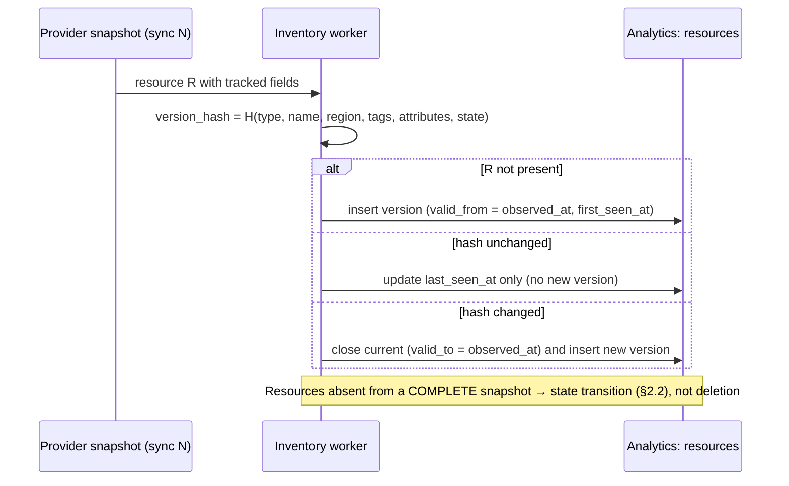
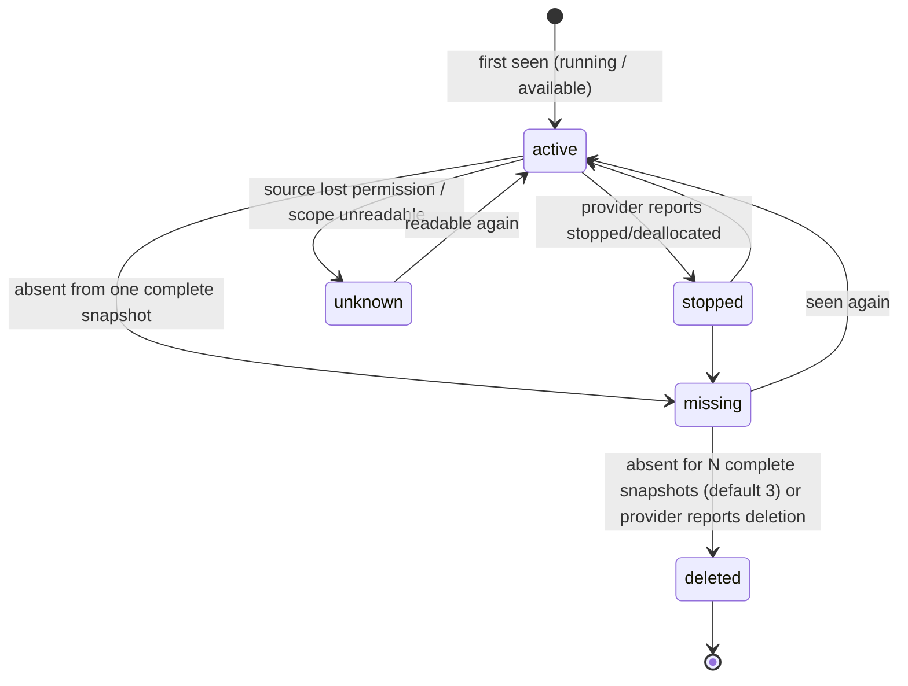
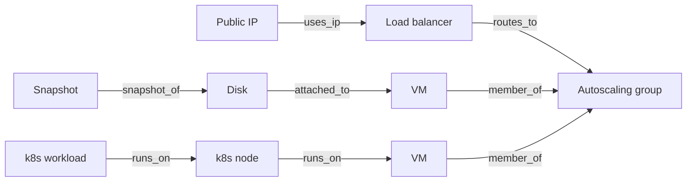
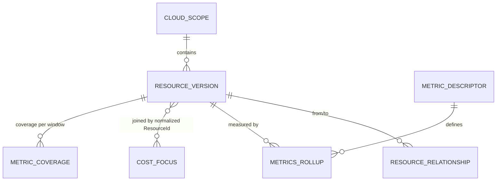
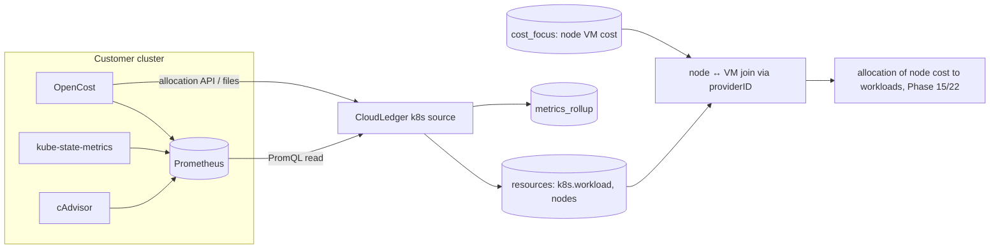
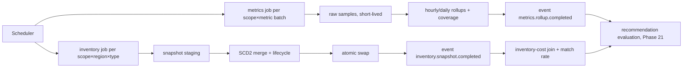

# Resource Inventory and Telemetry

Status: **DRAFT**. No code exists. Phases: **19** (inventory, inventory-to-cost join) and **20** (telemetry, Kubernetes input). Consumers: Phase 21–26 (recommendations), Phase 14/16 (dashboards), Phase 27 (AI tools).
Requirements: FR-RES-001…003, FR-TEL-001…003, FR-AWS-006, FR-GCP-005, FR-AZR-005. Related: [DATABASE_SCHEMA.md §3](DATABASE_SCHEMA.md) (`resources`, `metrics_rollup`), [DATA_FLOW.md §3](DATA_FLOW.md), [PROVIDER_SDK.md](../contracts/PROVIDER_SDK.md) (`InventorySource`, `MetricsSource`), provider docs in [../providers/](../providers/README.md).

## 1. Goals and non-goals

Goals: one resource model across AWS, GCP and Azure; history of changes (SCD2); a relationship graph; a measured join between inventory and cost; utilization rollups with explicit coverage, so that recommendations can state their confidence.

Non-goals (v1.0): real-time inventory (sub-hourly), configuration compliance scanning, mutating resources (NG1), a custom in-cluster Kubernetes agent (OQ-18).

## 2. Unified resource model (FR-RES-001)

Bulk inventory lives in the **analytics store** (`resources`), tenant-partitioned. The control plane holds only connector state and checkpoints.

| Field | Type | Description |
|---|---|---|
| `tenant_id` | uuid | Isolation key (first in every sort/partition key) |
| `resource_key` | text | CloudLedger stable key = `provider:normalized_native_id` (§5.1) |
| `provider` | text | `aws`, `gcp`, `azure`, `kubernetes`, plugin ID |
| `native_id` | text | ID exactly as returned by the provider (ARN, full resource name, ARM ID) |
| `connector_id` | uuid | Source connector |
| `scope_id` | uuid | `cloud_scopes` row (account / project / subscription) |
| `resource_type` | text | CloudLedger canonical type (for example `compute.vm`, `storage.block_volume`, `storage.object_bucket`, `db.managed_instance`, `network.load_balancer`, `network.public_ip`, `k8s.workload`) |
| `native_type` | text | Provider type (`AWS::EC2::Instance`, `compute.googleapis.com/Instance`, `microsoft.compute/virtualmachines`) |
| `name` | text | Display name (untrusted string) |
| `region` / `zone` | text | Normalized region codes per provider |
| `tags` | map | Raw tags/labels (keys preserved). Normalized keys are derived by allocation rules (Phase 15). |
| `attributes` | json | Type-specific attributes (size, SKU, vCPU, memory, storage class, engine, state) using a per-type schema |
| `attr_source` | json | Which provider API supplied each attribute (for example Config vs. Resource Explorer) and its observation time |
| `lifecycle_state` | enum | §2.2 |
| `created_at_provider` | timestamptz | Creation time if the provider reports it |
| `first_seen_at` / `last_seen_at` | timestamptz | Observed by CloudLedger |
| `valid_from` / `valid_to` | timestamptz | SCD2 version interval (`valid_to = NULL` for current) |
| `version_hash` | bytea | Hash of tracked fields; a new version is created only when it changes |
| `ingestion_run_id` | uuid | Lineage |

### 2.1 SCD2 history (FR-RES-003)



- Tracked fields are configurable per type. Volatile fields (for example "last reported time") are excluded from the hash to avoid version churn.
- Versions are written through the same stage-and-swap mechanism per `(tenant, connector, snapshot)`, so a failed sync never leaves half-updated history.
- A snapshot is **complete** only if every scope × region × type partition succeeded. Absence is only interpreted from complete snapshots. Partial snapshots update seen resources only.
- Point-in-time queries: `valid_from <= t AND (valid_to IS NULL OR valid_to > t)`.
- Retention follows tenant policy (proposed default: 25 months of versions, OQ-09 extension; decide in Phase 19).

### 2.2 Lifecycle states



`unknown` is distinct from `missing`: losing access to a scope must never be interpreted as resource deletion ("detect, don't assume"; [providers README §4](../providers/README.md#4-principle-detect-dont-assume)).

### 2.3 Relationships graph

Edges are stored in `resource_relationships` (analytics store; SCD2 like resources): `(tenant_id, from_key, to_key, relation, valid_from, valid_to, source)`.

| Relation | Examples |
|---|---|
| `attached_to` | EBS volume → EC2 instance; managed disk → VM; persistent disk → GCE instance |
| `snapshot_of` | snapshot → volume/disk |
| `member_of` | instance → autoscaling group / managed instance group / VM scale set; pod → node |
| `contained_in` | resource → resource group / project / account (also via `scope_id`) |
| `routes_to` | load balancer → target group / backend service; NAT gateway → subnet |
| `uses_ip` | VM / LB → public IP / elastic IP |
| `runs_on` | k8s workload → node → VM |



The graph supports recommendations (orphaned disk = volume with no `attached_to` edge for N days; unattached IP), cost roll-up (workload cost includes its disks and IPs) and blast-radius context in evidence.

## 3. Provider sources

| Provider | Breadth | Depth / history | Details |
|---|---|---|---|
| AWS | Resource Explorer | Config aggregator; targeted `Describe*` | [AWS.md §8](../providers/AWS.md) |
| GCP | Cloud Asset Inventory `searchAllResources` | `ListAssets` (resource content); `batchGetAssetsHistory` (short window) | [GCP.md §5](../providers/GCP.md) |
| Azure | Resource Graph `resources`, `resourcecontainers` | `resourcechanges` (short window) | [AZURE.md §7](../providers/AZURE.md) |
| Kubernetes | OpenCost-compatible allocation data, Prometheus | — | §7 |

Sync cadence (proposed): full snapshot daily per scope, plus an optional lighter incremental sync every 6 h for types where the provider supports change queries. Decided in Phase 19.

## 4. Data model overview



## 5. Inventory-to-cost join (FR-RES-002)

### 5.1 Resource ID normalization

Cost rows (`cost_focus.ResourceId`) and inventory (`native_id`) often use different ID forms. Both sides are normalized with the same versioned function `normalize_resource_id(provider, id, context)` → `resource_key`. The function is pure, unit-tested per provider, and its version is stored with join results.

| Provider | Cost-side forms | Inventory-side forms | Normalization rule (draft) |
|---|---|---|---|
| AWS | `line_item_resource_id`: instance ID (`i-…`), volume ID, ARN, bucket name, Lambda ARN with or without version, sometimes empty | ARN (Resource Explorer, Config), resource ID (Config) | Expand short IDs to ARNs using account and region from the cost row (`arn:aws:ec2:{region}:{account}:instance/{id}`); strip Lambda version/alias qualifiers; S3 bucket name → `arn:aws:s3:::{name}`; lower-case only where AWS treats IDs case-insensitively (**verify per service in Phase 19**) |
| GCP | `resource.global_name` (`//compute.googleapis.com/projects/{p}/zones/{z}/instances/{id-or-name}`), `resource.name` | CAI `name` (`//compute.googleapis.com/projects/…/instances/{name}`) | Prefer full resource names; map numeric IDs ↔ names using the inventory's `attributes.id`; project number ↔ project ID mapping from discovery (**verify (Phase 19)** which form the export uses per service) |
| Azure | `ResourceId` (ARM ID) | ARM ID | Lower-case the entire ARM ID (ARM IDs are case-insensitive); trim trailing slashes; normalize provider namespace casing; child resources (for example VM extensions, disks of a scale set instance) mapped to the parent when the cost row refers to the parent |
| Kubernetes | allocation input namespace/workload/pod | same | `k8s:{cluster}/{namespace}/{kind}/{name}` |

### 5.2 Join semantics
- Join on `(tenant_id, resource_key)` and time: a cost row matches the resource version valid at `ChargePeriodStart` (falling back to any version within the billing period, flagged `time_fallback`).
- Rows without `ResourceId` (taxes, support, many data-transfer and shared charges) are **not join-eligible** and are excluded from the match-rate denominator.
- The join is materialized per billing period after normalization (event `cost.period.normalized`) and after inventory snapshots. It is never computed in user queries ad hoc at large scale.

### 5.3 Match-rate metric
Defined per tenant × provider × billing period (and per service for diagnostics):

```
eligible_cost   = Σ EffectiveCost of rows with non-empty ResourceId
matched_cost    = Σ EffectiveCost of eligible rows whose resource_key matches an inventory resource
match_rate_cost = matched_cost / eligible_cost
match_rate_rows = matched_rows / eligible_rows
```

- Reported in the UI and API (`GET /api/v1/inventory/match-rate`, shape decided in Phase 19), with the top unmatched services and ID patterns.
- Expected reasons for non-matches are categorized: `resource_deleted_before_first_snapshot`, `scope_not_inventoried`, `type_not_supported`, `id_form_unknown`, `inventory_permission_missing`.
- Target (proposed, not a commitment): ≥ 90% `match_rate_cost` for compute, block storage and databases when inventory covers all scopes. Calibrated in Phase 19 against fixtures, never asserted without measurement.

## 6. Telemetry model (FR-TEL-001, FR-TEL-002)

### 6.1 Metric descriptors
Provider plugins map native metrics to canonical descriptors (`MetricsSource.SupportedMetrics()`):

| Canonical metric | Unit | AWS | GCP | Azure |
|---|---|---|---|---|
| `cpu.utilization` | ratio 0–1 | `AWS/EC2 CPUUtilization` (%) | `compute.googleapis.com/instance/cpu/utilization` | `Percentage CPU` |
| `memory.utilization` | ratio | CloudWatch agent `mem_used_percent` (agent required) | Ops Agent `agent.googleapis.com/memory/percent_used` (agent required) | Azure Monitor Agent / VM insights (agent required) |
| `network.in.bytes` / `network.out.bytes` | bytes | `NetworkIn` / `NetworkOut` | `instance/network/received_bytes_count` / `sent_bytes_count` | `Network In Total` / `Network Out Total` |
| `disk.read.ops` / `disk.write.ops` | ops/s | `EBSReadOps` / `EBSWriteOps` (or `DiskReadOps`) | `instance/disk/read_ops_count` / `write_ops_count` | `Disk Read Operations/Sec` / `Disk Write Operations/Sec` |
| `disk.read.bytes` / `disk.write.bytes` | bytes/s | `EBSReadBytes` / `EBSWriteBytes` | `instance/disk/read_bytes_count` / `write_bytes_count` | `Disk Read Bytes` / `Disk Write Bytes` |
| `requests.count` | count | ELB/ALB `RequestCount` | LB `request_count` | Application Gateway `TotalRequests` |
| `db.connections` | count | RDS `DatabaseConnections` | Cloud SQL `database/network/connections` | SQL DB `connection_successful` |

Exact metric names and units are **verify (Phase 20)** items per provider. Descriptors carry `{canonical_name, unit, native_name, native_unit, conversion, resource_types, default_period, aggregation_semantics (gauge|counter|rate)}`.

### 6.2 Rollups
Stored in `metrics_rollup` ([DATABASE_SCHEMA.md §3](DATABASE_SCHEMA.md)) at two grains:

| Grain | Retention (OQ-09) | Columns |
|---|---|---|
| hour | 90 days | `min`, `avg`, `p50`, `p95`, `p99`, `max`, `sample_count`, `expected_samples`, `coverage` |
| day | 25 months | same, computed from hourly data |

- Source resolution: CloudLedger requests the finest affordable provider period (typically 5 min or 1 min for 1 h windows; 1 h for history). Percentiles are computed from raw samples within the window when available. When the provider returns only pre-aggregated statistics, CloudLedger stores what it received and marks `percentile_method = provider|approx|exact`.
- Daily percentiles are **not** averages of hourly percentiles. They are computed from samples, or approximated with a mergeable sketch (t-digest or DDSketch), and flagged `approx`. Decided in Phase 20.
- Counters are converted to rates before aggregation. Unit conversions are applied once at ingest.

### 6.3 Coverage and missing-data semantics (FR-TEL-002)

```
coverage(resource, metric, window) = received_samples / expected_samples
expected_samples = (time the resource was active in the window) / source period
```

| Situation | Stored as | Effect on recommendations |
|---|---|---|
| No samples, resource active | rollup row with `sample_count = 0`, all statistics `NULL`, `coverage = 0` | Rule input marked missing. Confidence reduced or recommendation suppressed. **Never treated as zero utilization.** |
| Partial samples | statistics over received samples, `coverage < 1` | Confidence factor `coverage` (rule-defined threshold, for example ≥ 0.8 for rightsizing) |
| Metric not available for type (for example memory without agent) | descriptor-level `availability = requires_agent` | Evidence states "memory not measured"; rules that need memory degrade or skip |
| Resource stopped | not expected (excluded from `expected_samples`) | Not counted as missing |
| Permission denied for scope | coverage `unknown` (not 0) | Recommendation blocked for scope; connector health `degraded` |
| Provider retention exceeded during backfill | coverage `unavailable_before = <date>` | Lookback windows shortened, stated in evidence |

`NULL` is always "unknown", and `0` is always "measured zero". The analytics contract suite ([ANALYTICS_ADAPTERS.md §4](ANALYTICS_ADAPTERS.md)) adds tests that no engine coalesces missing metrics to zero.

Collection budget: metric APIs that charge per request (CloudWatch `GetMetricData`) have per-connector budgets. When a budget limits collection, coverage drops, and the reason `budget_limited` is recorded.

## 7. Kubernetes (FR-TEL-003, OQ-18)

CloudLedger does not ship its own in-cluster agent in v1.0. It ingests **OpenCost-compatible input**:

| Input | Mechanism | Data |
|---|---|---|
| OpenCost allocation API / export | Poll the OpenCost `/allocation` API (via an in-cluster URL the customer exposes) or read its exported files from object storage | Per-namespace / controller / pod cost and allocation (CPU, RAM, GPU, PV, network, shared) per window |
| Prometheus | Query the customer's Prometheus (PromQL over HTTP, read-only) | `kube_pod_container_resource_requests`, `…_limits`, `container_cpu_usage_seconds_total`, `container_memory_working_set_bytes`, node capacity (kube-state-metrics and cAdvisor). **verify (Phase 20)** metric names per version |

Mapping:
- Workloads become resources of type `k8s.workload` (`k8s:{cluster}/{namespace}/{kind}/{name}`) with `runs_on` edges to nodes, and nodes map to cloud VMs by provider ID (`spec.providerID`, for example `aws:///us-east-1a/i-…`, `gce://project/zone/name`, `azure:///subscriptions/…`).
- Requests, limits and usage are stored as metrics (`k8s.cpu.request`, `k8s.cpu.limit`, `k8s.cpu.usage`, and memory equivalents) with the same rollups and coverage.
- **Cost:** node cost comes from cloud billing (joined via node → VM). OpenCost's own pricing is used only for clusters without a billing match (on-prem), and is marked `x_cost_source = opencost`. Workload cost allocation shares (requests vs. usage-weighted, idle handling) are an allocation rule decision in Phases 15 and 22, so that cluster totals always reconcile to billed node cost.
- Authentication: bearer token or mTLS stored as a secret reference. CloudLedger never needs cluster write access.



## 8. Pipeline and operations



- Work units, retries and throttling follow [INGESTION_PIPELINE.md](INGESTION_PIPELINE.md). Raw metric samples are kept only until rollups are verified (default 7 days) to limit storage.
- Health (FR-CON-005) adds `inventory_completeness` (complete snapshots / expected) and `metric_coverage_p50` per connector.
- Events `inventory.snapshot.completed` and `metrics.rollup.completed` must be added to [EVENTS.md](../contracts/EVENTS.md) in Phase 19/20.

## 9. Security and isolation
- All tables lead with `tenant_id` and use the engine isolation mechanisms in [TENANCY.md §2](TENANCY.md).
- Names, tags and attributes are untrusted strings: stored as data, escaped in UI, delimited for AI tools (FR-AI-006).
- Inventory may reveal sensitive topology. ABAC data scopes apply to resources the same way as to cost (by provider, account/project/subscription, tags, hierarchy node).

## 10. Test plan outline (Phases 19–20)
- ID normalization: table-driven tests per provider with fixtures from AWS-FX-08, GCP and Azure equivalents ([provider fixture plans](../providers/README.md)).
- SCD2: property tests (random snapshot sequences → no overlapping versions, no gaps for continuously present resources, partial snapshots never cause `missing`).
- Match rate: golden datasets with known matched/unmatched cost.
- Telemetry: missing-data scenarios (no agent, gaps, stopped resources, denied scope, retention limit) → expected coverage and `NULL` semantics across all three analytics engines.
- Kubernetes: OpenCost allocation fixtures and recorded PromQL responses; node-to-VM join; cluster totals reconcile to node billed cost.
