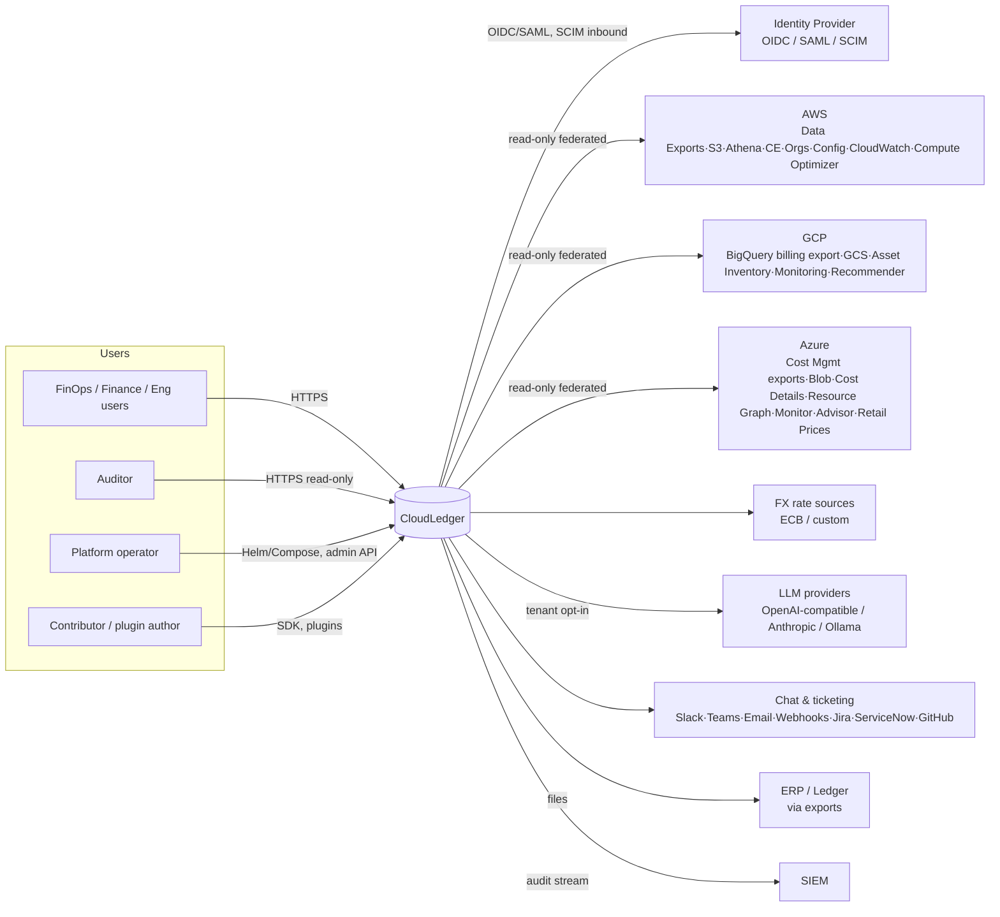
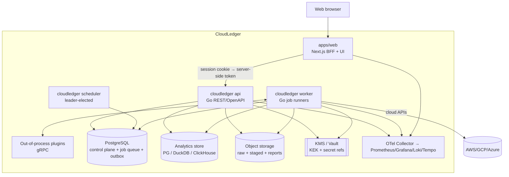
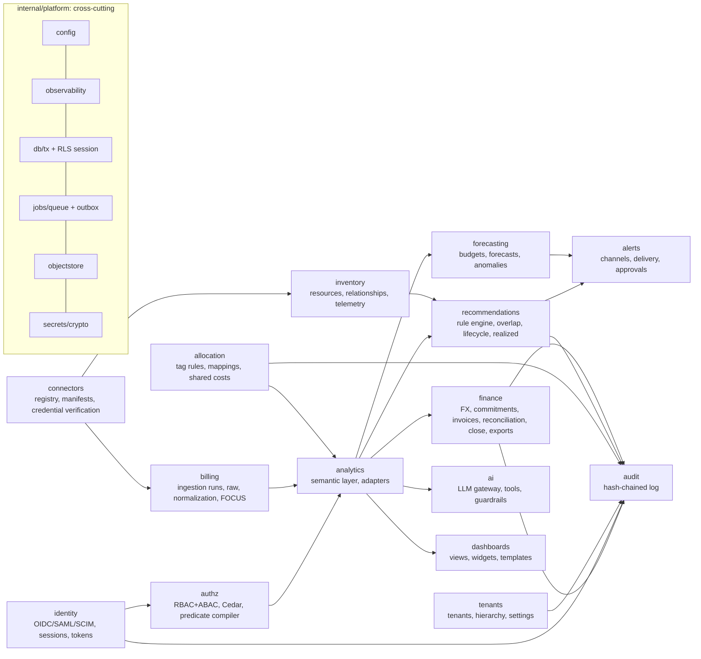

# System Context, Containers and Components (C4)

## Level 1: System context

## Level 2: Containers

Container responsibilities:

| Container | Responsibility | Scaling |
|---|---|---|
| `apps/web` | UI, server components, BFF that holds the session and calls the API with a server-side access token (no tokens in browser storage) | stateless, N replicas |
| `api` | authn/z, REST endpoints, semantic query compilation, read paths, command validation, enqueue jobs | stateless, N replicas |
| `worker` | job execution by queue (`ingest`, `normalize`, `allocate`, `inventory`, `metrics`, `recommend`, `alerts`, `reports`, `ai`) | per-queue pools, N replicas |
| `scheduler` | cron and interval job creation, leader election via PG advisory lock | 1 active (+ standby) |
| plugins | third-party providers and recommendation rules, isolated process with a capability-scoped gRPC API | per worker |

## Level 3: Components (Go modules under `internal/`)

Note: README's proposed `internal/` list is extended with `connectors`, `analytics`, `dashboards`, `authz` and `platform`. `identity` covers authentication only. See ADR-0001.

### Module dependency rules
1. `platform` depends on nothing internal.
2. Domain modules may depend on `platform`, `authz` (interfaces) and `audit` (interface). They never import another domain module's internals, only its exported `api.go` interface.
3. Cycles are forbidden (enforced by `go-arch-lint` or `depguard` in CI from Phase 03).
4. Providers (`providers/*`) depend only on `sdk/provider`, never on `internal/*`.
