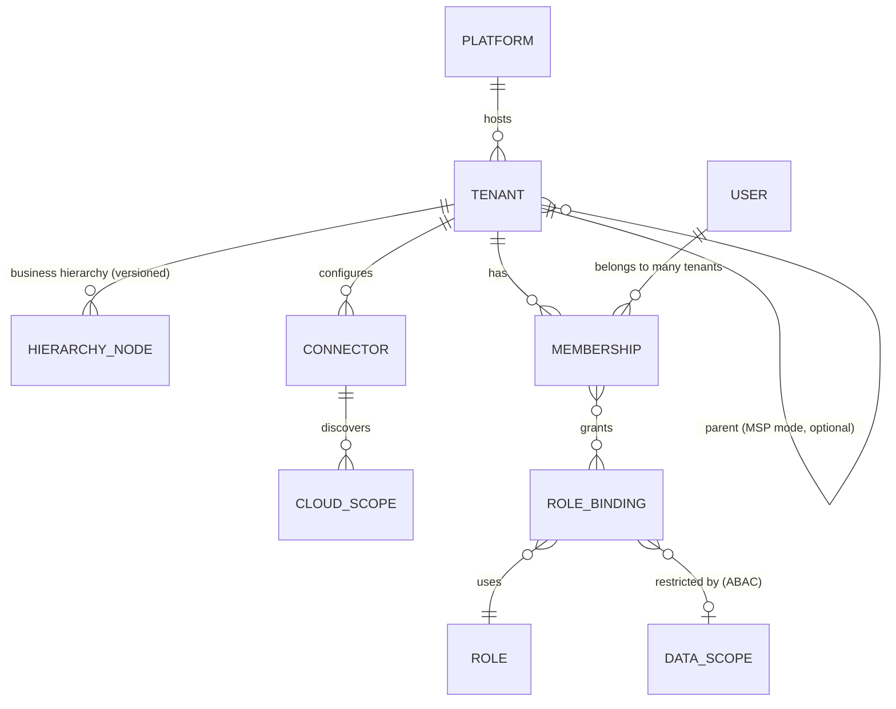
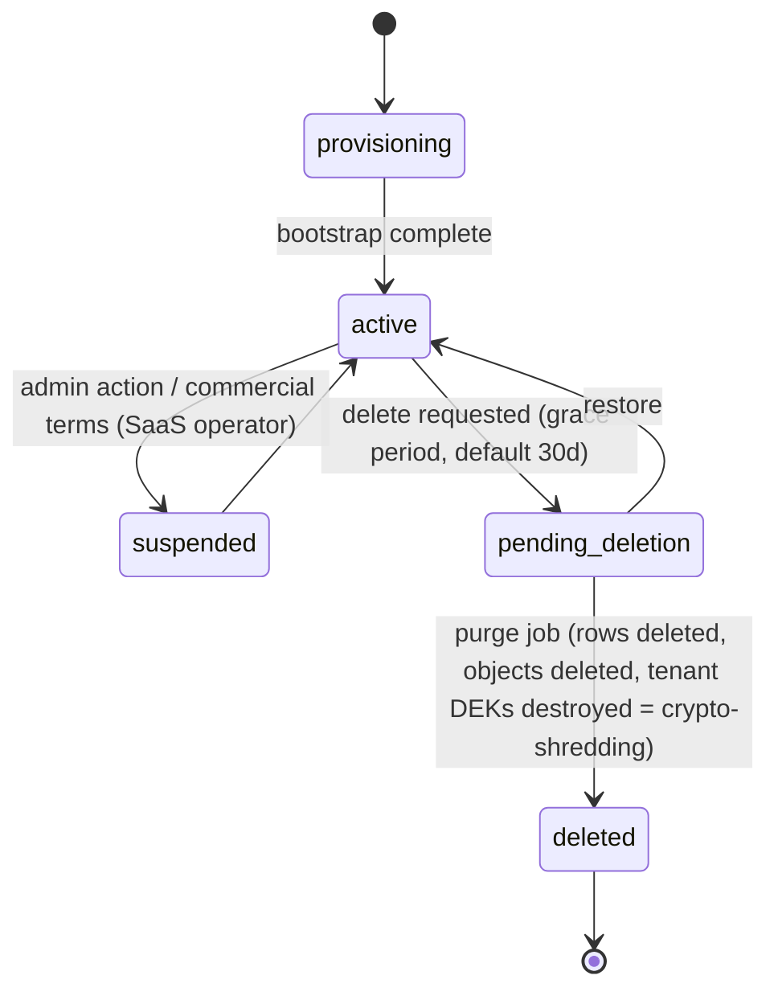

# Tenancy Model and Isolation

Decision: [ADR-0003](adr/0003-postgresql-control-plane-with-shared-schema.md). Licensing note: operating multiple tenants **for external customers** (SaaS/MSP) requires a commercial license. Internal multi-tenant use (e.g. per affiliate or business unit) is free. The technical model is the same in both cases.

## 1. Concepts

- **Platform**: one deployment. Platform admins manage tenants but have **no implicit data access**. Data access requires an explicit, time-boxed, audited break-glass grant.
- **Tenant**: the isolation boundary for all data, configuration, keys, object storage prefixes and caches.
  - `kind = individual | organization`.
  - Optional `parent_tenant_id` for MSP/holding structures. A parent can manage child configuration only through delegated role bindings. No data visibility is inherited.
- **User**: global identity (from IdP). It can be a member of multiple tenants. The active tenant is chosen per session and request (`X-CloudLedger-Tenant` header or a session claim) and verified against memberships.
- **Cloud scope**: provider hierarchy objects discovered by connectors (org/account, billing account/project, billing account/subscription/RG).
- **Hierarchy node**: tenant-defined business structure (versioned tree, effective-dated), independent of cloud hierarchy and used for allocation and ABAC.
- **Data scope**: an ABAC predicate set, e.g. `{provider in [aws], account_id in [...], hierarchy_node descendant-of X, tag.env = prod}`.

## 2. Isolation layers (defense in depth)

| Layer | Mechanism | Verified by |
|---|---|---|
| API | Tenant resolved from the authenticated principal. Every handler receives a `TenantContext`. Any tenant ID in a path must equal the context tenant or the request fails with 404 (not 403, to avoid existence oracles). | API isolation tests |
| Service | Repositories require `TenantContext`. No method signature allows omitting it (compile-time). | Static check + unit tests |
| PostgreSQL | RLS on every tenant table. App role has no `BYPASSRLS`. `SET LOCAL app.tenant_id` per transaction. Composite FKs `(tenant_id, id)`. | CI catalog test: every table with `tenant_id` has RLS enabled and forced. Cross-tenant SQL tests. |
| Analytics | Semantic compiler injects `tenant_id = $t` plus ABAC predicates. ClickHouse: tables `ORDER BY (tenant_id, …)`, row policies for the query user using a per-query custom setting. DuckDB: one database file per tenant (Lite) or mandatory predicate. PG: RLS on the analytics schema. | Engine contract isolation tests |
| Object storage | Prefix `…/{tenant_id}/…`. Per-tenant DEK for sensitive artifacts. Pre-signed URLs scoped to one object and short TTL. | Path traversal tests |
| Caches | Keys prefixed with tenant ID and principal scope hash. | Unit tests |
| Jobs | Job payload includes tenant ID. The worker sets tenant context before any DB access. | Job isolation tests |
| AI | Tools call internal APIs as the user. The conversation store is tenant-scoped. | Prompt-injection and cross-tenant tests |
| Logs/telemetry | Tenant ID in logs and spans. Billing values are not logged at INFO. | Log redaction tests |

## 3. Tenant lifecycle

Tenant export (`cloudledger admin tenant export`) produces a signed archive of configuration and normalized data for portability (GDPR Art. 20 support).

## 4. Tenant settings (FR-TEN-007)
`reporting_currency`, `fx_policy`, `accounting_calendar` (gregorian, 4-4-5, 4-5-4, 5-4-4, custom), `fiscal_year_start_month`, `timezone`, `retention` overrides, `ai_enabled`, `ai_provider_ref`, `data_egress_policy`, `default_cost_metric` (billed/effective).

## 5. Noisy-neighbor controls
Per-tenant quotas on concurrent jobs, query concurrency, query bytes scanned (ClickHouse `max_bytes_to_read`), export size and AI token budget. These are configurable by the platform admin and are operational protections, not license limits.
