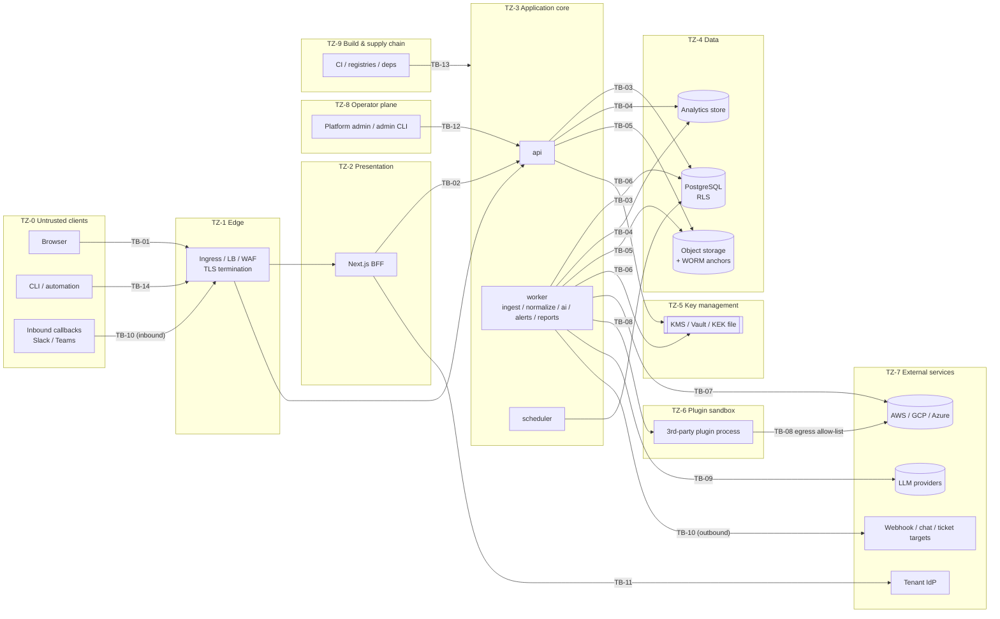

# Trust Boundaries and Data Classification

> **Status: DRAFT design.** Nothing here is implemented. To be ratified in Phase 02. Threats per boundary: [THREAT_MODEL.md](../security/THREAT_MODEL.md). Controls: [SECURITY_ARCHITECTURE.md](../security/SECURITY_ARCHITECTURE.md).

## 1. Trust zones

| Zone | Name | Members | Trust level |
|---|---|---|---|
| TZ-0 | Untrusted clients | Browsers, CLI/automation clients, inbound Slack/Teams callbacks, anonymous internet | Untrusted. Every input validated; identity proven per request. |
| TZ-1 | Edge | Ingress / load balancer / WAF, TLS termination | Trusted to terminate TLS and forward; not trusted for authn decisions. |
| TZ-2 | Presentation | `apps/web` Next.js BFF | Partially trusted: holds sessions and short-lived API JWTs; cannot mint sessions (the API re-validates ID tokens). |
| TZ-3 | Application core | `api`, `worker`, `scheduler`, LLM gateway (in `worker` `ai` queue) | Trusted code; enforces authn, authz, tenant context. |
| TZ-4 | Data | PostgreSQL control plane, analytics store (PG/DuckDB/ClickHouse), object storage, backups | Trusted storage; defense in depth via RLS, row policies, prefixes, encryption. |
| TZ-5 | Key management | KMS / Vault / KEK file, external secret stores | Most trusted; minimal callers. |
| TZ-6 | Plugin sandbox | Out-of-process third-party plugins | **Untrusted code**; no access to TZ-4/TZ-5; output validated. |
| TZ-7 | External services | AWS/GCP/Azure APIs and export locations, tenant IdPs, LLM providers, notification and ticketing targets, FX sources, SIEM | Semi-trusted: authenticated, but their returned content is untrusted data. |
| TZ-8 | Operator plane | Platform admins, `cloudledger admin` CLI, `/api/v1/admin/*`, Helm/Compose operators | Privileged for platform configuration; **no standing tenant-data access** (break-glass only). |
| TZ-9 | Build and supply chain | GitHub repository, Actions runners, registries, dependency ecosystems | Trusted only through verification (signatures, provenance, pinning). |

## 2. Diagram

## 3. Trust boundaries

| ID | Boundary | Crossing data (max class) | Authentication | Key controls | Threats |
|---|---|---|---|---|---|
| TB-01 | Browser ↔ BFF | DC-2 | Session cookie + CSRF token | SEC-SESS-*, SEC-WEB-* | T-01..T-08 |
| TB-02 | BFF ↔ API | DC-2 | mTLS workload identity + API JWT | SEC-S2S-01, SEC-AUTHN-03 | T-09..T-13 |
| TB-03 | App ↔ PostgreSQL | DC-3 (ciphertext) | DB role + TLS | SEC-ISO-03, DB roles, SEC-AUD-04 | T-14..T-19 |
| TB-04 | App ↔ analytics store | DC-2 | DB user + TLS | SEC-ISO-04, query limits | T-20..T-23 |
| TB-05 | App ↔ object storage | DC-2 / DC-3 ciphertext | Workload identity / access key ref | SEC-ISO-05, SEC-ENC-03 | T-24..T-27 |
| TB-06 | App ↔ KMS / Vault / secret stores | DC-3 | Workload identity | KEY-* | T-28..T-31 |
| TB-07 | Workers ↔ cloud provider APIs | DC-2 inbound, DC-3 creds | STS / WIF / federated tokens | SEC-FED-* | T-32..T-37 |
| TB-08 | Worker ↔ plugins | DC-2, scoped DC-3 | AutoMTLS + handshake | SEC-PLG-* | T-38..T-41 |
| TB-09 | AI gateway ↔ LLM providers | DC-2 (minimized) | Provider API key (secret ref) | LLM-* | T-42..T-45 |
| TB-10 | Webhooks / notifications (out) and callbacks (in) | DC-2 (summaries) | HMAC signatures | SEC-SSRF-*, signed callbacks | T-46..T-49 |
| TB-11 | BFF/API ↔ IdP, SCIM inbound | DC-1 identity | OIDC/SAML signatures, SCIM token | SEC-AUTHN-* | T-50..T-52 |
| TB-12 | Operator plane ↔ platform | DC-3 config | OIDC + platform role + step-up | Break-glass, `cl_platform` role | T-53..T-54 |
| TB-13 | Supply chain ↔ deployed artifacts | code | Cosign + provenance | SC-* | T-60..T-62 |
| TB-14 | Automation clients ↔ API | DC-2 | API tokens | SEC-TOK-* | T-10, T-13 |

## 4. Data classification

| Class | Name | Definition | Examples |
|---|---|---|---|
| DC-0 | Public | Intended for public release; disclosure has no impact. | Public price catalogs (`price_catalog`), FOCUS spec mappings, OpenAPI spec, docs, provider IaC templates without connector values |
| DC-1 | Internal | Operational data whose disclosure gives minor advantage to an attacker or embarrassment. | Tenant slug, connector status, ingestion health, job metadata, non-sensitive config, metrics without tenant IDs, user display names and emails within a tenant (also personal data; see overlay) |
| DC-2 | Confidential-Financial | Tenant business and billing data; disclosure is a material breach. Default class for any tenant data not listed elsewhere. | Normalized and raw billing data, invoices, allocation rules, hierarchy, tags and resource names, budgets, forecasts, anomalies, recommendations, exports, reports, period snapshots, AI conversations, audit events, cloud account IDs, AWS ExternalIds |
| DC-3 | Secret | Material that grants access or decrypts data. | KEKs, tenant keys, DEKs, static cloud credentials, API token secrets and pepper, session sealing keys, JWT and anchor signing keys, webhook signing secrets, IdP client secrets, SCIM tokens, LLM API keys, DB passwords |

**Personal-data overlay (PD):** orthogonal flag on DC-1/DC-2 fields that contain personal data (email, name, IP, user agent, IdP subject, free-text tags/resource names, AI content). PD fields additionally follow SEC-PRIV-* (export, erasure, subject-key encryption in audit).

## 5. Handling rules

| Rule | DC-0 | DC-1 | DC-2 | DC-3 |
|---|---|---|---|---|
| Storage at rest | Any | Storage-level encryption | Storage-level encryption; app-level envelope encryption for object-store artifacts (SEC-ENC-03) | App-level envelope encryption or external secret store **only**; never plaintext in DB, files, env dumps, Helm values |
| Transit | TLS externally | TLS externally; TLS internally in Std/HA | TLS everywhere in Std/HA; mTLS BFF↔API | TLS + memory-only after resolution; never sent to plugins except connector-scoped short-lived creds |
| Access | Anyone | Tenant members / operators | Authorized principals within data scope; platform admins only via break-glass | Code paths only (no human read API); operators via KMS/Vault policies |
| Logging | Allowed | Allowed (IDs) | IDs and counts only; no values at INFO+; DEBUG with expiring operator flag | Never (redacted by type and pattern) |
| Telemetry / metrics labels | Allowed | Bounded-cardinality only | Never as labels | Never |
| LLM egress | Allowed | Allowed if needed | Only per tenant egress policy (aggregates by default), minimized and delimited | **Never** |
| Export / download | Allowed | Permissioned | Permission + ABAC scope + export limits; audited | Never exportable (tenant export includes references only) |
| Caching | Any | Tenant-keyed | Tenant + scope-hash keyed, `no-store` to browsers | Never cached outside the resolving process (≤ credential lifetime) |
| Backups | Any | Encrypted | Encrypted; crypto-shreddable via tenant key | Wrapped forms only; KEK never in the same backup |
| Retention | n/a | Operational | Tenant policy (DATABASE_SCHEMA §4) | Until rotated/revoked; destroyed on tenant deletion |
| Deletion | n/a | Row delete | Purge + crypto-shredding | Key destruction (KMS scheduled deletion or Vault destroy) |

## 6. Rules for crossing a boundary

1. Data may cross into a lower-trust zone only at or below the class that boundary allows (table §3). Crossings of DC-2 into TZ-7 (LLM, webhooks) require an explicit tenant policy.
2. Data entering from TZ-0, TZ-6 or TZ-7 is untrusted regardless of class (SP-06) and is validated, size-capped and treated as data.
3. DC-3 never leaves TZ-3/TZ-5 except as a short-lived, scoped derivative (STS/WIF tokens to plugins, signed webhooks).
4. Every new boundary or class change requires an update to this document and THREAT_MODEL.md in the same PR.
