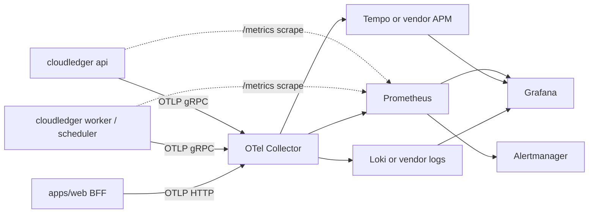

# Observability

Status: **DRAFT plan**. No instrumentation, dashboards or alert rules exist yet. Decision: [ADR-0017](../architecture/adr/0017-opentelemetry-native-observability.md) (OpenTelemetry-native). Requirements: FR-OPS-002, NFR-OBS-001. Baseline instrumentation lands in Phase 03, ingestion health in Phase 12, and full dashboards and alerting in Phase 33. Assets ship under `deploy/observability/` (planned) and are packaged into the Helm chart.

## 1. Pipeline

| Profile | Traces | Metrics | Logs |
|---|---|---|---|
| Lite | off by default (`observability.traces.enabled=false`) | `/metrics` endpoint on, optional Prometheus | JSON to stdout |
| Standard | OTel Collector, parent-based sampling 10%, tail sampling keeps all errors and slow spans | Prometheus + bundled Grafana dashboards | stdout → Collector → Loki (or operator choice) |
| HA Enterprise | as Standard, plus Tempo or vendor APM | Prometheus HA pair or remote-write | Loki or vendor; SIEM stream for audit (FR-AUD-003) |

Nothing is sent outside the deployment unless the operator configures an exporter endpoint. There is no default phone-home (OQ-17).

## 2. Tracing conventions

### 2.1 Span names

Span names have low cardinality: no IDs, no tenant names, no free text.

| Span kind | Name format | Example |
|---|---|---|
| HTTP server (api, web BFF) | `{METHOD} {route template}` (OTel semconv) | `GET /api/v1/connectors/{connector_id}` |
| HTTP client (BFF → API, provider APIs, webhooks) | `{METHOD}` plus `server.address` attribute | `POST` |
| Job consumer | `job {queue}.{kind}` | `job ingest.aws_cur_fetch` |
| Job producer (enqueue) | `enqueue {queue}.{kind}` | `enqueue normalize.focus_map` |
| Pipeline stage | `{module}.{stage}` | `billing.parse`, `billing.invariants`, `billing.swap` |
| Semantic query | `analytics.compile`, `analytics.execute` | `analytics.execute` |
| Domain operation | `{module}.{operation}` in snake_case | `finance.period_close`, `allocation.apply_rule_set` |
| DB (pgx, ClickHouse driver) | OTel DB semconv `{db.operation.name} {db.collection.name}` | `SELECT jobs` |
| Outbox relay | `outbox.relay {event type}` | `outbox.relay cost.period.normalized.v1` |
| Provider SDK call | `provider.{provider}.{api_family}.{operation}` | `provider.aws.s3.get_object` |
| Plugin gRPC | `plugin.{plugin_key}.{method}` | `plugin.example_provider.Discover` |
| LLM gateway | `ai.llm.request`, `ai.tool.{tool}` | `ai.tool.semantic_query` |

### 2.2 Attributes

Standard OTel semantic conventions apply first (`http.*`, `db.*`, `server.*`, `error.type`). CloudLedger-specific attributes use the `cloudledger.` namespace.

| Attribute | Type | Set on | Notes |
|---|---|---|---|
| `cloudledger.run_mode` | string | resource | `api`, `worker`, `scheduler`, `migrate`, `admin`, `web` |
| `service.name`, `service.version`, `deployment.environment.name` | string | resource | `service.name` = `cloudledger-<run_mode>` |
| `cloudledger.profile` | string | resource | `lite`, `standard`, `ha` |
| `cloudledger.tenant.id` | string (UUID) | root and job spans | see §2.3 |
| `cloudledger.principal.type` | string | API spans | `user`, `api_token`, `service`, `break_glass` |
| `cloudledger.principal.id` | string (UUID) | API spans | never email or name |
| `cloudledger.request.id` | string | API spans | same value as the `request_id` in problem+json errors |
| `cloudledger.job.id`, `.queue`, `.kind`, `.attempt` | string/int | job spans | |
| `cloudledger.connector.id`, `cloudledger.provider`, `cloudledger.capability` | string | ingestion spans | |
| `cloudledger.ingestion_run.id`, `cloudledger.billing_period` | string | ingestion spans | `billing_period` as `YYYY-MM` |
| `cloudledger.data_version` | int | query, swap spans | |
| `cloudledger.query.id`, `.engine`, `.source`, `.rows`, `.bytes_read` | mixed | query spans | `source`: `dashboard`, `api`, `ai`, `report`, `export` |
| `cloudledger.query.shape_hash` | string | query spans | hash of the semantic query structure without filter values |
| `cloudledger.error.class` | string | any failed span | `transient`, `auth`, `permission_partial`, `data`, `not_ready`, `bug` ([INGESTION_PIPELINE.md §3](../architecture/INGESTION_PIPELINE.md)) |
| `cloudledger.authz.decision` | string | authz spans | `allow`, `deny` |

**Never** recorded on spans: secret values, tokens, cookies, presigned URLs, SQL literal values (statements are recorded parameterized only), semantic-query filter values, cost amounts, tag values, resource names, LLM prompts and completions, uploaded file contents, email addresses.

### 2.3 Tenant handling

| Rule | Detail |
|---|---|
| Tenant on spans and logs | Recorded as `cloudledger.tenant.id` (ADR-0017). Used for per-tenant troubleshooting by platform operators. |
| Tenant never as an unbounded metric label | NFR-OBS-001. Per-tenant detail comes from the API, logs, traces and metric exemplars. |
| Optional bounded tenant label | HA operators may set `observability.metrics.tenant_label_allowlist` (max 50 tenant IDs) to add a `tenant` label to a small set of ingestion and query metrics. Off by default. |
| Pseudonymization | `observability.tenant_id_mode`: `raw` (default self-hosted) or `hmac` (HMAC-SHA256 with a deployment key, recommended when exporting telemetry to a third-party vendor or when operating for external customers). |
| Baggage | Tenant and principal IDs are **not** placed in W3C baggage. Inbound baggage from untrusted callers is dropped at the API edge. |
| Outbound propagation | `traceparent` is propagated BFF → API → worker (stored in job metadata) and to plugins. It is **not** sent to cloud provider APIs, webhooks, chat/ticketing integrations or LLM endpoints unless `observability.propagate_external=true`. |
| Cross-tenant jobs | Platform-level jobs (retention sweeps, aggregate maintenance) use the reserved platform tenant UUID and open a child span per tenant processed. |

### 2.4 Sampling

Head sampling is parent-based with a ratio (`observability.traces.sample_ratio`, default 0.1 in Standard/HA). The Collector tail-sampling policy keeps 100% of traces with errors, traces slower than the relevant SLO threshold, and traces for `admin` run mode and break-glass sessions. Job traces link to the enqueueing request through span links, not parent-child, so long-running jobs do not create giant traces.

## 3. Metric catalog

Conventions: Prometheus naming (`_total` counters, `_seconds` and `_bytes` base units), `snake_case`, prefix `cloudledger_`. Histograms include the SLO thresholds as bucket boundaries ([SLOS.md §6](SLOS.md#6-how-slis-are-measured)). Allowed labels are bounded enumerations. **Forbidden labels:** `tenant_id`, `user_id`, `principal_id`, `connector_id`, `resource_id`, `account_id`, `request_id`, `query_id`, raw URL paths, error messages. A CI test (planned, Phase 03) scrapes `/metrics` after the integration suite and fails if any series carries a forbidden label or a metric exceeds 1 000 series per process.

### 3.1 Process and build

| Metric | Type | Labels | Description |
|---|---|---|---|
| `cloudledger_build_info` | gauge (=1) | `version`, `commit`, `go_version`, `run_mode` | build metadata |
| `cloudledger_config_reload_total` | counter | `outcome` | config file reloads (where hot reload is supported) |
| `cloudledger_ready` | gauge | `component` | readiness of dependencies (`postgres`, `analytics`, `objectstore`, `kms`) |
| Go runtime and process | — | — | standard `go_*`, `process_*` collectors |

### 3.2 API and web BFF

| Metric | Type | Labels | Description |
|---|---|---|---|
| `cloudledger_http_requests_total` | counter | `method`, `route`, `route_class`, `status`, `status_class` | `route_class`: `metadata`, `query`, `export`, `ai`, `auth`, `admin`, `health` |
| `cloudledger_http_request_duration_seconds` | histogram | `method`, `route_class`, `status_class` | server-side latency |
| `cloudledger_http_inflight_requests` | gauge | `route_class` | |
| `cloudledger_rate_limited_total` | counter | `bucket` | 429s by bucket (`query`, `ai`, `export`, `default`) |
| `cloudledger_idempotency_replays_total` | counter | `route_class` | requests served from an idempotency record |
| `cloudledger_web_ssr_duration_seconds` | histogram | `route` | Next.js server render time |
| `cloudledger_web_bff_upstream_errors_total` | counter | `upstream`, `status_class` | BFF → API errors |
| `cloudledger_sessions_active` | gauge | — | active web sessions |

### 3.3 Authentication, authorization, tenancy, audit

| Metric | Type | Labels | Description |
|---|---|---|---|
| `cloudledger_authn_attempts_total` | counter | `method` (`oidc`, `saml`, `api_token`, `local`), `outcome` | |
| `cloudledger_authz_decisions_total` | counter | `decision`, `resource_type` | Cedar decisions |
| `cloudledger_authz_evaluation_seconds` | histogram | — | policy evaluation latency |
| `cloudledger_tenant_guard_violations_total` | counter | `layer` (`api`, `repository`, `analytics`, `objectstore`, `cache`, `job`) | defensive assertion fired: a row, object or cache entry with a tenant different from the request context. **Must stay 0.** |
| `cloudledger_break_glass_sessions_active` | gauge | — | |
| `cloudledger_tenants` | gauge | `status` | tenants by lifecycle status |
| `cloudledger_audit_events_total` | counter | `outcome` | |
| `cloudledger_audit_chain_verification_failures_total` | counter | — | hash-chain verification failures. **Must stay 0.** |
| `cloudledger_audit_siem_export_lag_seconds` | gauge | `sink` | |

### 3.4 Ingestion and connectors

| Metric | Type | Labels | Description |
|---|---|---|---|
| `cloudledger_ingestion_freshness_seconds` | gauge | `provider`, `capability` | maximum freshness lag across connectors (name fixed by [INGESTION_PIPELINE.md §5](../architecture/INGESTION_PIPELINE.md)) |
| `cloudledger_ingestion_artifact_delay_seconds` | histogram | `provider`, `capability` | `live_at − available_at` per artifact (freshness SLI) |
| `cloudledger_ingestion_runs_total` | counter | `provider`, `capability`, `status` | terminal run status (`succeeded`, `failed`, `failed_validation`, `quarantined`, `cancelled`) |
| `cloudledger_ingestion_stage_duration_seconds` | histogram | `provider`, `stage` | `discover`, `fetch`, `parse`, `validate`, `map`, `stage`, `invariants`, `swap` |
| `cloudledger_ingestion_rows_total` | counter | `provider`, `capability`, `result` | `accepted`, `rejected` |
| `cloudledger_ingestion_bytes_total` | counter | `provider`, `capability` | raw bytes fetched |
| `cloudledger_ingestion_invariant_failures_total` | counter | `provider`, `invariant` | `control_totals`, `row_count`, `duplicate_key`, `currency`, `period_bounds` |
| `cloudledger_ingestion_quarantined_runs` | gauge | `provider`, `reason` | currently quarantined runs (`unknown_schema`, `invariant`, `parse`) |
| `cloudledger_ingestion_restatements_total` | counter | `provider` | new `billing_period_versions` for an already-live period |
| `cloudledger_connectors` | gauge | `provider`, `status` | connectors by status (`active`, `degraded`, `error`, `disabled`) |
| `cloudledger_connector_auth_failures_total` | counter | `provider`, `auth_method` | AssumeRole/WIF/federated credential failures |
| `cloudledger_provider_api_requests_total` | counter | `provider`, `api_family`, `outcome` | `ok`, `throttled`, `client_error`, `server_error`, `network` |
| `cloudledger_provider_api_duration_seconds` | histogram | `provider`, `api_family` | |
| `cloudledger_provider_circuit_state` | gauge | `provider`, `api_family` | 0 closed, 1 half-open, 2 open |
| `cloudledger_file_parse_rejections_total` | counter | `format`, `reason` | size cap, decompression ratio, schema |

### 3.5 Jobs, scheduler, outbox

| Metric | Type | Labels | Description |
|---|---|---|---|
| `cloudledger_jobs_enqueued_total` | counter | `queue`, `kind` | |
| `cloudledger_jobs_finalized_total` | counter | `queue`, `kind`, `state` | `completed`, `discarded`, `cancelled` (job success SLI) |
| `cloudledger_job_attempts_total` | counter | `queue`, `kind`, `outcome` | `success`, `retryable`, `error` |
| `cloudledger_job_duration_seconds` | histogram | `queue`, `kind` | execution time per attempt |
| `cloudledger_job_wait_seconds` | histogram | `queue` | `leased_at − scheduled_at` (pickup latency SLI) |
| `cloudledger_jobs_queue_depth` | gauge | `queue`, `state` | sampled from `jobs` table every 30 s by the scheduler leader |
| `cloudledger_jobs_oldest_available_age_seconds` | gauge | `queue` | age of oldest runnable job |
| `cloudledger_jobs_lease_expired_total` | counter | `queue` | lease timeouts (worker crash or stall) |
| `cloudledger_jobs_dead_letter` | gauge | `queue` | jobs in `discarded` state not yet acknowledged |
| `cloudledger_worker_pool_utilization` | gauge | `queue` | busy slots ÷ pool size |
| `cloudledger_scheduler_is_leader` | gauge | — | 1 on the leader instance |
| `cloudledger_scheduler_missed_ticks_total` | counter | `schedule` | cron ticks not enqueued on time |
| `cloudledger_outbox_unpublished` | gauge | — | outbox rows with `published_at IS NULL` |
| `cloudledger_outbox_oldest_unpublished_age_seconds` | gauge | — | |
| `cloudledger_event_handler_failures_total` | counter | `event_type`, `consumer` | |

### 3.6 Analytics and storage

| Metric | Type | Labels | Description |
|---|---|---|---|
| `cloudledger_query_duration_seconds` | histogram | `engine`, `source`, `outcome` | semantic query execution (query latency SLI) |
| `cloudledger_query_compile_seconds` | histogram | `engine` | semantic compile time |
| `cloudledger_query_bytes_read_total` | counter | `engine`, `source` | |
| `cloudledger_query_rejected_total` | counter | `reason` | `validation`, `forbidden_dimension`, `timeout`, `row_limit`, `bytes_limit`, `quota` |
| `cloudledger_query_cache_requests_total` | counter | `result` | `hit`, `miss`, `stale` |
| `cloudledger_analytics_swap_duration_seconds` | histogram | `engine` | atomic partition swap |
| `cloudledger_analytics_aggregate_rebuild_seconds` | histogram | `engine` | rollup rebuild after data-version bump |
| `cloudledger_analytics_renormalization_backlog` | gauge | — | partitions awaiting re-normalization ([UPGRADES_AND_MIGRATIONS.md §5](UPGRADES_AND_MIGRATIONS.md)) |
| `cloudledger_db_pool_connections` | gauge | `db`, `state` | `db`: `control_plane`, `analytics` |
| `cloudledger_db_pool_wait_seconds` | histogram | `db` | |
| `cloudledger_schema_version` | gauge | `store` | applied migration version |
| `cloudledger_schema_migrations_pending` | gauge | `store` | |
| `cloudledger_objectstore_operations_total` | counter | `op`, `outcome` | `put`, `get`, `head`, `list`, `delete` |
| `cloudledger_objectstore_operation_seconds` | histogram | `op` | |

ClickHouse and PostgreSQL server metrics come from their native exporters (ClickHouse built-in Prometheus endpoint, `postgres_exporter` or the CloudNativePG metrics). CloudLedger does not re-export them.

### 3.7 Alerts, notifications, reports, recommendations

| Metric | Type | Labels | Description |
|---|---|---|---|
| `cloudledger_notifications_total` | counter | `channel_type`, `outcome` | `delivered`, `retrying`, `dead_lettered`, `deduplicated` |
| `cloudledger_notification_delivery_latency_seconds` | histogram | `channel_type` | event `created_at` → first 2xx (alert delivery SLI) |
| `cloudledger_notification_dead_letter` | gauge | `channel_type` | |
| `cloudledger_webhook_ssrf_blocks_total` | counter | `reason` | destination blocked by egress rules |
| `cloudledger_report_runs_total` | counter | `format`, `outcome` | |
| `cloudledger_export_bytes_total` | counter | `format` | |
| `cloudledger_recommendation_evaluations_total` | counter | `category`, `outcome` | |
| `cloudledger_anomaly_detections_total` | counter | `detector_version` | |

### 3.8 Security, secrets, AI, backup

| Metric | Type | Labels | Description |
|---|---|---|---|
| `cloudledger_secret_resolutions_total` | counter | `backend`, `outcome` | `vault`, `aws_sm`, `gcp_sm`, `azure_kv`, `k8s`, `file`, `db_envelope` |
| `cloudledger_kms_operations_total` | counter | `op`, `outcome` | `wrap`, `unwrap` |
| `cloudledger_kek_age_seconds` | gauge | `kek_id_slot` (`active`, `previous`) | time since KEK activation (rotation hygiene) |
| `cloudledger_ai_requests_total` | counter | `provider_kind`, `outcome` | `openai_compatible`, `anthropic`, `ollama_compatible` |
| `cloudledger_ai_tokens_total` | counter | `provider_kind`, `direction` | `in`, `out` |
| `cloudledger_ai_tool_calls_total` | counter | `tool`, `authz_decision` | |
| `cloudledger_ai_guardrail_blocks_total` | counter | `reason` | `prompt_injection`, `unauthorized_scope`, `output_validation`, `budget` |
| `cloudledger_backup_last_success_timestamp_seconds` | gauge | `store` | `control_plane`, `analytics`, `objectstore`, `config` |
| `cloudledger_backup_duration_seconds` | gauge | `store` | last run |
| `cloudledger_restore_verification_last_success_timestamp_seconds` | gauge | `store` | [BACKUP_DR.md §6](BACKUP_DR.md) |
| `cloudledger_restore_verification_checks` | gauge | `store`, `check`, `result` | per-check result of last verification |

## 4. Log schema and redaction

### 4.1 Format

Go services use `log/slog` with a JSON handler; the web BFF uses a JSON logger with the same field names. One event per line to stdout. Timestamps are UTC RFC 3339 with nanoseconds.

| Field | Required | Description |
|---|---|---|
| `ts` | yes | UTC timestamp |
| `level` | yes | `DEBUG`, `INFO`, `WARN`, `ERROR` |
| `msg` | yes | human-readable, constant string (no interpolated values) |
| `event` | yes for INFO+ | stable dotted event name, e.g. `ingestion.run.failed`, `job.discarded`, `authz.denied` |
| `module` | yes | `internal/<module>` name |
| `run_mode`, `version` | yes | |
| `trace_id`, `span_id` | when in a span | W3C IDs for log-trace correlation |
| `request_id` | API | |
| `tenant_id` | when tenant-scoped | subject to `observability.tenant_id_mode` |
| `principal_id`, `principal_type` | API | UUID only |
| `job_id`, `queue`, `kind`, `attempt` | jobs | |
| `connector_id`, `provider`, `capability`, `ingestion_run_id`, `billing_period` | ingestion | |
| `error.class`, `error.code`, `error.message` | on error | `error.message` passes through redaction |
| `duration_ms` | timed operations | |

Level guidance: `ERROR` means operator action may be required and links to a runbook ID (`runbook` field). `WARN` means degraded but self-healing (retries, partial permissions). `INFO` covers lifecycle events (startup, run state changes, swaps). `DEBUG` is off in production and still subject to redaction.

### 4.2 Redaction rules

| Data | Rule | Mechanism |
|---|---|---|
| Secrets, tokens, passwords, cookies, `Authorization` headers, client secrets, private keys, SAS tokens, STS session tokens | never logged at any level | `secret.Value` type implements `slog.LogValuer` returning `[REDACTED]`; `ReplaceAttr` deny-list on key names (`*secret*`, `*token*`, `*password*`, `authorization`, `cookie`, `*key*` except allow-listed IDs) |
| Presigned and signed URLs | query string stripped | URL attribute helper |
| Secret references (`vault://…`) | allowed (references are not secrets) | |
| Cost amounts and billing row contents | not logged at INFO or above (TENANCY.md) | finance packages log counts and control-total match booleans, not values |
| Tag values, resource names, descriptions | not logged at INFO (may contain PII or injection payloads) | logged at DEBUG only, truncated to 256 chars and escaped |
| Emails and names | never logged; use `principal_id` | |
| IP addresses | logged in audit events only, not application logs | |
| LLM prompts, completions, tool results | never logged; token counts only | `ai` module logger wrapper |
| Uploaded file contents | never logged; rejected-row samples go to object storage, not logs | |
| SQL | parameterized statement text only; no bound values | DB tracer config |
| Panics | stack traces logged, but the API response returns only `request_id` | recovery middleware |

Verification (planned, Phase 03 and 34): a redaction test suite runs integration flows with canary secrets, tokens, emails and amounts, captures all log output and spans, and fails if any canary appears. Gitleaks also runs over captured CI logs.

### 4.3 Audit log is separate

Security-relevant and financial actions are written to the hash-chained `audit_events` table (ADR-0014), not to application logs. Application logs are operational, have shorter retention (operator-defined, suggested 30 days) and are not tamper-evident. Optional SIEM streaming of audit events is described in FR-AUD-003.

## 5. Grafana dashboards (planned)

Shipped as JSON in `deploy/observability/grafana/dashboards/` and provisioned by the Helm chart. All dashboards have `profile`, `namespace` and `instance` variables and no tenant variable (except the opt-in allow-list).

| Dashboard | Key panels | Primary audience |
|---|---|---|
| **CloudLedger Overview / SLOs** | SLI vs. target and remaining error budget per SLO, active alerts, build info by run mode | on-call |
| **API and Web BFF** | request rate, error ratio, latency heatmaps per `route_class`, top slow routes, 429s by bucket, BFF upstream errors | on-call |
| **Analytics Queries** | query latency per engine and source, rejections by reason, bytes read, cache hit ratio, compile vs. execute time | on-call, perf |
| **Ingestion Pipeline** | freshness per provider and capability, artifact-delay histogram, run outcomes, stage durations, rows accepted/rejected, invariant failures, quarantines, restatements | on-call, FinOps admins (via operator) |
| **Connectors and Provider APIs** | connectors by status, auth failures, throttling, circuit-breaker state, provider API latency | on-call |
| **Jobs and Queues** | depth and oldest age per queue, wait time, duration, retry and dead-letter rates, lease expirations, pool utilization | on-call |
| **Scheduler and Outbox** | leader, missed ticks, outbox backlog and age, event-handler failures | on-call |
| **Notifications** | delivery latency, outcomes per channel type, dead-letter, SSRF blocks | on-call |
| **PostgreSQL** | connections, pool waits, replication lag, WAL archive status, bloat, long transactions, `jobs` table size | DBA |
| **ClickHouse** | disk usage per disk and table, parts count, merges, replication queue, query memory, rejected inserts | DBA |
| **Object Storage** | operation rates, errors, latency, bytes | on-call |
| **Security and Tenancy** | authz denials, tenant-guard violations, audit-chain failures, break-glass sessions, authn failures, AI guardrail blocks | security |
| **AI Gateway** | requests, tokens, tool calls by authz decision, guardrail blocks, provider latency | security, on-call |
| **Backup and DR** | last successful backup and restore verification per store, durations vs. RPO/RTO | on-call, DBA |
| **Go Runtime** | goroutines, GC, heap, CPU per run mode | developers |

## 6. Alert rules

Planned in `deploy/observability/prometheus/rules/`. SLO burn-rate alerts are defined in [SLOS.md §5](SLOS.md#5-alerting-on-slos). Thresholds below are defaults that operators can override. Lite downgrades `page` to `ticket`.

| Alert | Condition (summary) | For | Severity | Runbook |
|---|---|---|---|---|
| `CloudLedgerTenantGuardViolation` | `increase(cloudledger_tenant_guard_violations_total[5m]) > 0` | 0 m | page (security) | RB-09 |
| `CloudLedgerAuditChainBroken` | `increase(cloudledger_audit_chain_verification_failures_total[15m]) > 0` | 0 m | page (security) | RB-09 |
| `CloudLedgerAPIDown` | no successful probe for 3 consecutive checks or all `api` targets down | 2 m | page | RB-12 |
| `CloudLedgerIngestionStalled` | `cloudledger_ingestion_freshness_seconds > (expected cadence × 2 + 3600)` | 30 m | ticket (page if > 6 h) | RB-01 |
| `CloudLedgerIngestionFreshnessBurn` | freshness SLO burn rate (SLOS.md) | per SLOS.md | page / ticket | RB-01 |
| `CloudLedgerConnectorAuthFailures` | `increase(cloudledger_connector_auth_failures_total[30m]) > 0` and connectors with `status="error"` increased | 15 m | ticket | RB-02 |
| `CloudLedgerProviderCircuitOpen` | `cloudledger_provider_circuit_state == 2` | 15 m | ticket | RB-01 |
| `CloudLedgerInvariantFailure` | `increase(cloudledger_ingestion_invariant_failures_total[15m]) > 0` | 0 m | ticket (page if ≥ 3 providers or ≥ 10 runs in 1 h) | RB-03 |
| `CloudLedgerQuarantineGrowing` | `cloudledger_ingestion_quarantined_runs` increasing over 2 h | 2 h | ticket | RB-03 |
| `CloudLedgerQueueBacklog` | `cloudledger_jobs_oldest_available_age_seconds{queue!="backfill"} > 900` | 10 m | page (HA) / ticket | RB-04 |
| `CloudLedgerDeadLetterGrowing` | `increase(cloudledger_jobs_finalized_total{state="discarded"}[1h]) > 10` | 0 m | ticket | RB-04 |
| `CloudLedgerJobLeaseExpiries` | `rate(cloudledger_jobs_lease_expired_total[15m]) > 0.1` | 15 m | ticket | RB-04 |
| `CloudLedgerOutboxStalled` | `cloudledger_outbox_oldest_unpublished_age_seconds > 600` | 10 m | page | RB-04 |
| `CloudLedgerNoSchedulerLeader` | `sum(cloudledger_scheduler_is_leader) != 1` | 5 m | page | RB-04 |
| `CloudLedgerClickHouseDiskPressure` | ClickHouse free disk < 20% | 15 m | ticket; < 10% for 5 m → page | RB-05 |
| `CloudLedgerPostgresDiskPressure` | PG volume free < 20% | 15 m | ticket; < 10% → page | RB-05 (adapted) |
| `CloudLedgerPostgresReplicationLag` | replica lag > 60 s (HA) | 5 m | page | RB-06 |
| `CloudLedgerWALArchiveFailing` | archive failures or last archived WAL age > 15 min (HA) / 60 min (Standard) | 5 m | page | RB-06 |
| `CloudLedgerBackupMissing` | `time() - cloudledger_backup_last_success_timestamp_seconds > 1.5 × schedule` | 0 m | page (HA) / ticket | RB-06 |
| `CloudLedgerRestoreVerificationFailed` | latest verification has any failed check, or no success within 2 × verification interval | 0 m | ticket (page in HA) | RB-06 |
| `CloudLedgerKEKRotationOverdue` | `cloudledger_kek_age_seconds{kek_id_slot="active"} > 365 d` | 1 d | ticket | RB-07 |
| `CloudLedgerSecretResolutionFailures` | `rate(cloudledger_secret_resolutions_total{outcome="error"}[10m]) > 0` | 10 m | ticket | RB-07 |
| `CloudLedgerTenantPurgeStuck` | tenant in `pending_deletion` past grace + 24 h | 1 h | ticket | RB-08 |
| `CloudLedgerNotificationDeadLetter` | `cloudledger_notification_dead_letter > 0` increasing | 30 m | ticket | RB-04 |
| `CloudLedgerAIGuardrailSpike` | guardrail blocks > 5× 7-day baseline | 30 m | ticket (security) | RB-09 |
| `CloudLedgerMigrationPending` | `cloudledger_schema_migrations_pending > 0` for running pods after deploy | 30 m | ticket | RB-10 |

Every alert includes `summary`, `description`, `runbook_url`, `severity`, `profile` and a dashboard link annotation. Alert rules are unit-tested with `promtool test rules` in CI (planned, Phase 33).
