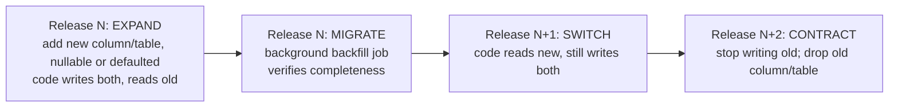

# Upgrades and Migrations

Status: **DRAFT plan**. No migration tooling exists yet. Requirements: FR-OPS-004 (zero-downtime upgrades for Standard and HA with expand/contract migrations), [COMPATIBILITY.md](../contracts/COMPATIBILITY.md) (forward-only schema, N-1 binary compatibility, downgrade = restore). Migration framework lands in Phase 04, analytics adapter migrations in Phase 13, zero-downtime upgrade verification in Phase 33, and upgrade-path certification in Phase 38.

## 1. Policy summary

| Rule | Detail |
|---|---|
| Forward-only | Migrations are never edited after merge and never have "down" scripts in production. Rollback is by binary rollback (when safe) or restore (§6). |
| Expand/contract | Every breaking schema change is split into expand → migrate data → contract across **at least two minor releases**. |
| N-1 compatibility | Binary version N-1 must run correctly against schema version N. This is what makes rolling upgrades safe. |
| Supported path | N-1 → N directly. Skipping minors requires sequential upgrades unless release notes say otherwise. |
| Pre-1.0 | Breaking changes are allowed in minor releases but must be listed under **Breaking** in CHANGELOG with an upgrade note. |
| One migrator | Only `cloudledger migrate` changes schemas. `api` and `worker` refuse to start if the schema is older than they require, and log a warning (not an error) if it is newer within the supported window. |
| Licensing | Upgrades never introduce license checks, keys or feature gating (NFR-LIC-004). |

## 2. Migration types

| Store | Location (planned) | Mechanism |
|---|---|---|
| Control plane (PostgreSQL) | `database/postgres/migrations/` | numbered SQL files (`NNNNNN_description.up.sql`) applied in a transaction where possible; non-transactional statements (for example `CREATE INDEX CONCURRENTLY`) isolated in their own file with a `-- cloudledger:no-transaction` directive |
| Analytics (PostgreSQL schema) | `database/postgres/analytics/` | as above, applied by the PG analytics adapter `Migrate()` |
| Analytics (ClickHouse) | `database/clickhouse/migrations/` | idempotent DDL (`IF NOT EXISTS`, `ON CLUSTER` when clustered); column additions use defaults; no `ALTER … UPDATE` mutations on large tables (re-normalization instead) |
| Analytics (DuckDB) | `database/duckdb/migrations/` | applied per tenant database file at open time |
| FOCUS mappings | versioned `mapping_versions` rows + Go mapping code | new mapping version, never edited in place (ADR-0006); see §5 |
| Data backfills | Go job kinds in `maintenance` queue | resumable, batched, idempotent, throttled |

Migration authoring conventions are in [CODING_STANDARDS.md §4](../contributors/CODING_STANDARDS.md#4-sql-and-migration-conventions).

## 3. Expand/contract pattern

| Change | Expand (N) | Contract (≥ N+2) |
|---|---|---|
| Rename column | add new column; dual-write; backfill | drop old column |
| Change column type | add new column with new type; dual-write; backfill with validation | drop old |
| Add NOT NULL | add nullable with default; backfill; add `CHECK … NOT VALID` then `VALIDATE CONSTRAINT` | set `NOT NULL` |
| Split table | create new table; dual-write; backfill | drop old table |
| Remove enum value | stop producing it; readers tolerate both | data migration to new value, then tighten `CHECK` |
| Add index | `CREATE INDEX CONCURRENTLY` in its own non-transactional migration | — |
| New RLS-protected table | create with `tenant_id`, RLS enabled and forced in the same migration | — |

Forbidden in a single release: dropping or renaming anything still read by N-1; adding a `NOT NULL` column without a default; long `ACCESS EXCLUSIVE` locks on hot tables (`jobs`, `outbox_events`, `audit_events`, `ingestion_runs`). A CI check (planned, Phase 04) runs every migration against a database with production-like row counts and fails if any statement holds a blocking lock longer than `lock_timeout` (default 5 s in migrations).

## 4. Rolling upgrade procedure (Standard / HA)

| Step | Action | Verification |
|---|---|---|
| 0 | Read release notes (Breaking, required intermediate versions, config renames). Confirm the current version is N-1. | `cloudledger version`, `cloudledger migrate status` |
| 1 | Confirm a recent successful backup **and** restore verification (BACKUP_DR.md §6). HA: take an on-demand base backup or snapshot. | Backup and DR dashboard |
| 2 | `cloudledger config validate` with the new binary against the current config. | no errors; deprecation warnings reviewed |
| 3 | Run migrations: Helm pre-upgrade hook Job `cloudledger migrate up` (owner role, `lock_timeout` 5 s, `statement_timeout` per migration). Only expand migrations run in this step. | `cloudledger_schema_migrations_pending == 0` |
| 4 | Roll `worker` pools (graceful drain: stop leasing, finish or release jobs within `server.shutdown_grace`). | no lease expiries spike |
| 5 | Roll `scheduler` (standby first, then leader; advisory lock hands over). | exactly one leader |
| 6 | Roll `api` with `maxUnavailable: 0`, `maxSurge: 25%`; readiness requires DB, analytics and KMS reachable. | API SLO burn alerts quiet |
| 7 | Roll `web`. | BFF upstream errors flat |
| 8 | Post-upgrade checks: smoke test, ingestion freshness, job success rate, analytics contract smoke query. | dashboards |
| 9 | Background data migrations and re-normalization (§5) proceed at low priority. | `cloudledger_analytics_renormalization_backlog` decreasing |

Lite (Docker Compose) accepts brief downtime: `docker compose pull` → `cloudledger admin backup` → `docker compose run --rm migrate` → `docker compose up -d`.

During steps 3–7, N-1 and N binaries run side by side against schema N. Job payloads and events carry versions so both binaries can process them; a binary that receives a job kind or payload version it does not understand returns the job to the queue (not discarded) with a delay.

## 5. Analytics re-normalization jobs

A FOCUS mapping change, a bug fix in a mapper, or a new analytics column with derived values requires recomputing analytics data. CloudLedger never mutates live analytics rows in place; it re-derives them from immutable raw objects.

| Aspect | Design |
|---|---|
| Trigger | a release ships a new `mapping_version`, or an operator runs `cloudledger admin analytics renormalize --provider aws --from 2025-11 [--tenant <id>]` |
| Unit of work | `(tenant, connector, billing_period)`, the same partition key as ingestion |
| Process | read raw objects for the live period version → map with the new `mapping_version` → stage → run the same invariants (control totals against the source) → atomic swap → `data_version++` → `cost.period.normalized.v1` → allocation and aggregates rebuild |
| Safety | old partition stays live until invariants pass; the previous version stays available for diff (`/api/v1/ingestion/periods/{period}/diff`) |
| Closed periods | never altered. Differences for closed periods are surfaced as `period_adjustments` booked in the next open period (UJ-09) |
| Ordering | newest periods first (most-viewed data improves first), low priority queue, per-tenant concurrency cap |
| Visibility | release notes state which periods and providers are affected; UI shows "recalculating" per affected period; `cloudledger_analytics_renormalization_backlog` metric |
| Restartability | idempotent by `(partition, mapping_version)`; safe to interrupt and resume |
| Engine schema changes | ClickHouse: new column added with a default, then repopulated by re-normalization, not by `ALTER UPDATE`. Rollups rebuilt via `RebuildAggregates`. |
| Verification | the analytics contract suite runs on the new mapping in CI before release; operators can run `cloudledger admin analytics reconcile` after the backlog drains |

## 6. Rollback

| Situation | Rollback method | Data impact |
|---|---|---|
| Problem detected during the rolling upgrade, only expand migrations applied | Roll binaries back to N-1 (supported by N-1 compatibility). Leave the schema at N. | none |
| Problem after upgrade, still only expand migrations | Same as above. The next attempt reuses the already-expanded schema. | none |
| Contract migration already applied, or a data migration corrupted data | **Restore** the control plane to a point before the migration (PITR, [BACKUP_DR.md §5.1](BACKUP_DR.md#51-control-plane-point-in-time-standardha)), deploy the matching older binary, run post-restore steps. | writes after the restore point are lost from the control plane; billing data is re-ingested from provider exports |
| Analytics re-normalization produced wrong results (and passed invariants) | Swap back to the previous partition version (kept until `DropPartitionVersions` retention) via `cloudledger admin analytics revert --mapping-version <old>`; fix the mapper; re-run | none for raw data |
| Lite | `cloudledger admin restore` of the pre-upgrade backup and the previous image tag | since backup |

Never run hand-written "down" SQL against production. Never downgrade the binary below the minimum version stated in `cloudledger migrate status` (the oldest binary compatible with the current schema).

## 7. Testing upgrades (planned)

| Test | Phase | Description |
|---|---|---|
| Migration lint | 04 | each migration file follows conventions; no forbidden operations; RLS catalog test after apply |
| Lock-duration test | 04 | apply all migrations on a seeded database; assert no blocking lock over threshold |
| N-1 compatibility test | 33 | run the N-1 integration suite against schema N |
| Upgrade path test | 33, 38 | install N-1 with golden datasets → upgrade to N under k6 load → assert zero 5xx beyond SLO, no lost jobs, identical golden totals |
| Re-normalization test | 11, 13 | old and new mapping versions on golden datasets; diffs match expected change list exactly |
| Restore-rollback test | 33 | apply a contract migration, then PITR and older binary; §6 procedure succeeds within RTO |

Results are recorded in phase `TEST_RESULTS.md` files and never fabricated.
