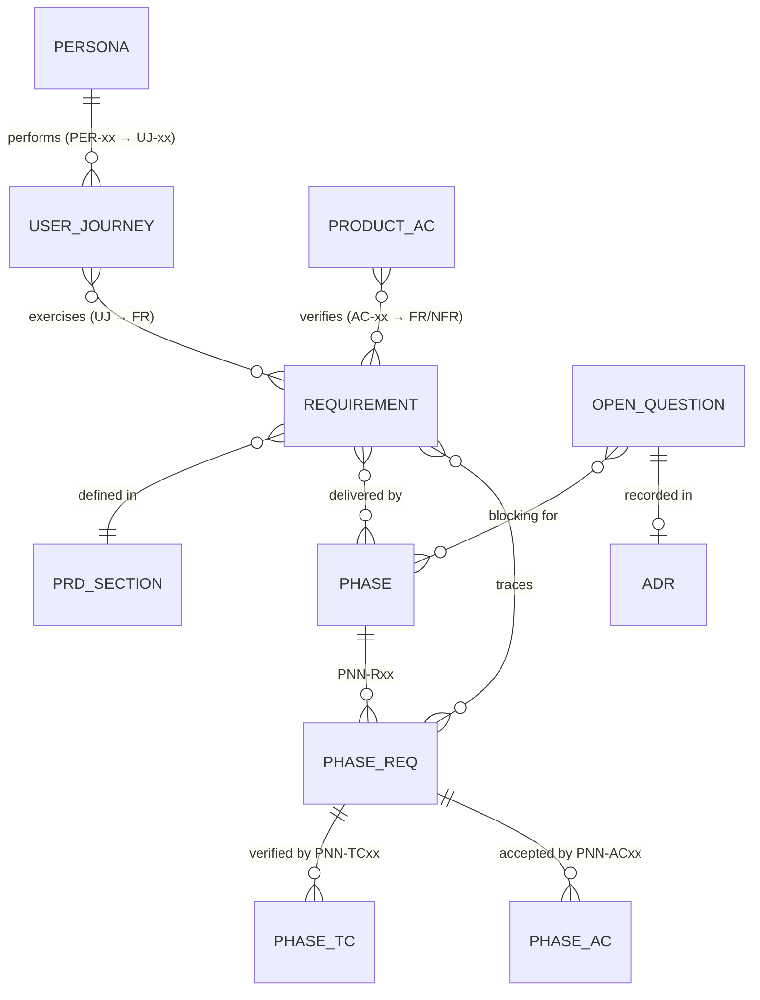

# Phase 01 — PRD, personas, acceptance criteria, licensing decision [LIC]: Design

Status: **NOT STARTED** · Release: v0.1 · Owner: TBD

Phase 01 produces no software. Its "design" is the **review process**, the **document information model** that later phases trace against, and the **decision workflow** for open questions and licensing.

## 1. Components and paths touched

| Area | Paths | Change |
|---|---|---|
| Product | `docs/product/PRD.md`, `OPEN_QUESTIONS.md`, `GLOSSARY.md` | ratify, decision log, glossary additions |
| Product (new) | `docs/product/PERSONA_VALIDATION.md`, `docs/product/DPIA.md` | create |
| Planning (new) | `docs/planning/{TRACEABILITY_MATRIX,ACCEPTANCE_MATRIX,RISK_REGISTER,RELEASE_PLAN,DEPENDENCY_GRAPH}.md` | create (directory currently empty) |
| Legal | `docs/legal/DECISIONS.md` (new), `LICENSE.md`, `CLA.md`, `COMMERCIAL_LICENSE.md`, `TRADEMARK_POLICY.md`, `LICENSE_FAQ.md` | decision memo summary; drafts annotated with counsel status. Texts stay drafts. |
| Tooling (new) | `scripts/docs/lint_ids.py` | doc lint (stdlib-only Python, alongside existing `scripts/docs/gen_adrs.py`) |
| Not touched | `internal/*`, `apps/*`, `providers/*`, `database/*` | do not exist yet; Phase 03+ |

No migrations. No data model in a database. The "data model" is the ID scheme below.

## 2. Requirement ID information model



ID grammar (enforced by `lint_ids.py`):

| Kind | Pattern | Example | Defined in |
|---|---|---|---|
| Persona | `PER-\d{2}` | PER-04 | PRD §3 |
| Journey | `UJ-\d{2}` | UJ-08 | PRD §4 |
| Functional | `FR-[A-Z]{2,3}-\d{3}` | FR-AWS-002 | PRD §5 |
| Non-functional | `NFR-[A-Z0-9]{2,5}-\d{3}` | NFR-PERF-001, NFR-A11Y-001 | PRD §6 |
| Product AC | `AC-\d{2}` | AC-11 | PRD §7 |
| Open question | `OQ-\d{2}` | OQ-21 | OPEN_QUESTIONS.md |
| Legal question | `LQ-\d{1,2}` | LQ-5 | LICENSING_EVALUATION §5 |
| Phase req/task/test/AC | `P\d{2}-(R|T|TC|AC)\d{2}` | P06-TC14 | phase docs |

Freeze rules: a defining occurrence appears exactly once (a table row whose first cell is the ID); every other occurrence is a reference and must resolve to a definition. Deprecated IDs keep their row with `Deprecated (date, reason, replacement)`.

## 3. Review workflow

```mermaid
sequenceDiagram
  autonumber
  participant PO as Product owner
  participant AR as Architecture lead
  participant SEC as Security / privacy
  participant FIN as Finance SME
  participant LC as Legal counsel
  participant LIC as Licensor rep
  PO->>PO: persona validation (interviews / proxies)
  PO->>AR: PRD walk-through (FR/NFR, phases)
  AR-->>PO: feasibility notes, phase mapping fixes
  PO->>FIN: FIN/NRM/ACC requirements, AC-01 thresholds
  PO->>SEC: NFR-SEC/PRIV, DPIA outline
  PO->>LIC: OQ decisions needing Licensor (OQ-01, 15, 20–24)
  LIC->>LC: engagement + LQ-1…LQ-12
  LC-->>LIC: recommendations (privileged; summary only to repo)
  LIC-->>PO: decisions OQ-21/23/24, recommendation OQ-22, OQ-01 search
  PO->>PO: freeze IDs, update decision log, run doc lint
  PO->>AR: hand-off to Phase 02 (ADR ratification)
```

## 4. Open-question disposition design
Each OQ row gets one of: **Decided** (new value), **Default accepted** (proposed default adopted as-is), **Deferred with trigger** (only for non-v0.1-blocking items; names the phase that must re-evaluate). The full disposition table is in [IMPLEMENTATION.md §OQ worklist](IMPLEMENTATION.md#oq-worklist).

## 5. Reference scale and SLO design
- Confirm the three profiles of PRD §8 and attach the **reference hardware** from OQ-13 (Standard: 3× 8 vCPU/32 GiB app nodes; ClickHouse 16 vCPU/64 GiB/NVMe; PostgreSQL 4 vCPU/16 GiB). Add a Lite reference (4 vCPU/8 GiB per DEPLOYMENT_PROFILES) and an HA reference sketch.
- Each SLO row records: metric, percentile, dataset (e.g. 13 months at Standard scale), engine, hardware, measurement tool (k6 / query benchmark), and status `provisional`.
- Fixing hardware here resolves the NFR-PERF-003 vs. OQ-13 phase mismatch; OQ-13's "blocking for" is updated to Phase 01 (decision) and Phase 34 (benchmark).

## 6. DPIA outline structure (`docs/product/DPIA.md`)
1. Processing description and roles (deployer = controller; CloudLedger maintainers are not a processor for self-hosted deployments). 2. Data inventory (identity, session, audit metadata, AI conversations, cloud resource tags that may contain personal data). 3. Necessity and proportionality (minimization; telemetry opt-in OQ-17). 4. Risks (cross-tenant leak, LLM egress, tag PII, audit retention vs. erasure). 5. Measures (RLS, AI disabled by default, redaction, crypto-shredding, retention defaults OQ-09). 6. Residual risk and review cadence. Final DPIA is the deployer's responsibility; the outline is a template plus product facts.

## 7. Licensing decision design [LIC]
- Options for OQ-21 evaluated against L-1…L-8 ([LICENSING_EVALUATION §2](../../legal/LICENSING_EVALUATION.md#2-options-compared)).
- Privileged counsel advice stays outside the repository; `docs/legal/DECISIONS.md` records only decision, date, approver and non-privileged rationale.
- Until the publication gate passes: repo private; LICENSE.md and siblings keep the "draft, pending legal review" banner; README states all rights reserved pending approval.
- Licensing does not change the architecture or scope (ADR-0015, PRD A6); NFR-LIC-004 forbids license keys and usage limits.

## 8. Security considerations
- Interview notes may contain personal data or customer cost figures: store outside the repo; commit only anonymized summaries.
- Counsel correspondence is privileged: never committed.
- Trademark search results stay private until a name is final.

## 9. Failure modes and handling
| Failure | Handling |
|---|---|
| Counsel response not received by phase end | OQ-21/23/24 recorded as "Decided (direction), counsel approval pending"; publication gate stays closed; Phase 02–05 continue privately; risk logged |
| Persona invalidated (e.g. PER-01 not a real target) | Amend PRD personas and journeys; affected FR priorities re-reviewed before freeze |
| Trademark conflict | Rename decision before Phase 03; global rename task recorded |
| SLO target disputed | Record range + owner; Phase 34 benchmark decides; target marked provisional |
| Lint finds duplicate or dangling IDs | Fix before freeze; freeze not declared until lint is clean |

## 10. Design decisions and ADR links
- No new ADR in Phase 01; decisions feed Phase 02 ratification of [ADR-0005](../../architecture/adr/0005-postgresql-backed-durable-job-queue-and.md) (OQ-05), [ADR-0006](../../architecture/adr/0006-focus-1-2-as-normalization-baseline.md) (OQ-02), [ADR-0008](../../architecture/adr/0008-authorization-rbac-abac-via-cedar-policies.md) (OQ-06), [ADR-0012](../../architecture/adr/0012-plugin-model-compile-time-first-party.md) (OQ-14), [ADR-0015](../../architecture/adr/0015-source-available-licensing.md) (OQ-21…24).
