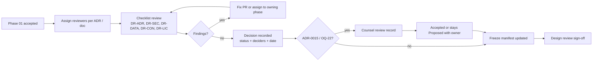

# Phase 02 — Architecture, ADRs, extension contracts [LIC: ADR-0015, license map]: Design

Status: **NOT STARTED** · Release: v0.1 · Owner: TBD

Phase 02 produces no code. Its "design" is the review process, the decisions it must take and the concrete findings already identified in the draft documents.

## 1. Artifacts touched

| Area | Documents | Change in this phase |
|---|---|---|
| ADRs | [adr/0001…0017](../../architecture/adr/README.md) | status, deciders, date, decision notes; stubs 0018/0019 |
| Architecture | [architecture/*](../../architecture/README.md) | status DRAFT → RATIFIED; corrections |
| Security | [THREAT_MODEL](../../security/THREAT_MODEL.md), [SECURITY_ARCHITECTURE](../../security/SECURITY_ARCHITECTURE.md), [AUTHORIZATION_MODEL](../../security/AUTHORIZATION_MODEL.md), [TRUST_BOUNDARIES](../../architecture/TRUST_BOUNDARIES.md) | review section, residual-risk acceptance |
| Contracts | [API_GUIDELINES](../../contracts/API_GUIDELINES.md), [EVENTS](../../contracts/EVENTS.md), [PROVIDER_SDK](../../contracts/PROVIDER_SDK.md), [CAPABILITY_MANIFEST](../../contracts/CAPABILITY_MANIFEST.md), [COMPATIBILITY](../../contracts/COMPATIBILITY.md), [`cloudledger.v1.yaml`](../../../api/openapi/cloudledger.v1.yaml) | freeze levels, `x-phase` corrections, new `FREEZE_v0.1.md` |
| Legal | [LICENSE_MAP](../../legal/LICENSE_MAP.md), [PLUGIN_LICENSING](../../legal/PLUGIN_LICENSING.md), [ADR-0015](../../architecture/adr/0015-source-available-licensing.md) | designation decision; counsel review record |
| Providers | [providers/](../../providers/README.md) (AWS, GCP, Azure) | read for consistency with SDK and manifest; no ratification of provider-specific limits (verified per phase) |

## 2. Review workflow

Decision rule: maintainer council lazy consensus (OQ-20 default) with a 5-business-day window per ADR; the Licensor retains final authority over licensing decisions.

## 3. Review checklists (used as test cases)

| Checklist | Items |
|---|---|
| **DR-ADR** | context states the forces; ≥ 2 alternatives with reasons; consequences include operational and testing impact; affected NFRs listed; reversible vs. one-way door noted; links to phases that implement it |
| **DR-SEC** | each trust boundary has STRIDE entries; each threat has mitigation + verifying phase + residual rating; tenant isolation has ≥ 2 independent layers on every path (SP-01); default deny (SP-02); keyless first (SP-05) |
| **DR-DATA** | composite keys `(tenant_id, …)` and forced RLS on every tenant table or documented exception; money `numeric(38,12)`; UTC timestamps; partition keys valid for PostgreSQL constraints; retention defaults per OQ-09 |
| **DR-CON** | conventions consistent across API_GUIDELINES, OpenAPI and EVENTS; every operation has `x-phase`, permission and error set; idempotency and LRO semantics specified; compatibility promise defined |
| **DR-LIC** | SPDX designation per path; import boundary rule; no license enforcement code paths; no OSI wording; plugin rules consistent with manifest `license` field |

## 4. Design-review findings to resolve before Phase 04

Found while preparing this phase. Each must be fixed in [DATABASE_SCHEMA.md](../../architecture/DATABASE_SCHEMA.md) (or the named doc) or assigned to a phase DESIGN.md with the stated resolution.

| ID | Finding | Proposed resolution | Owner phase |
|---|---|---|---|
| F-01 | `audit_events` declares `PRIMARY KEY (tenant_id, seq)` with `PARTITION BY RANGE (occurred_at)`. PostgreSQL requires unique constraints on a partitioned table to include all partition-key columns, so this DDL is invalid. | PK `(tenant_id, seq, occurred_at)` plus a per-tenant `seq` uniqueness guarantee from the serialized chain writer; or start unpartitioned and partition later via expand/contract. | 04 |
| F-02 | `roles` has `PRIMARY KEY (id)` with nullable `tenant_id` (NULL = built-in), and `role_bindings.role_id` references `roles(id)` without `tenant_id`. This breaks the composite-key convention and allows a binding to reference another tenant's custom role at FK level. | Split built-in roles into a global read-only catalog and tenant roles with PK `(tenant_id, id)`; bindings reference either via a discriminator with check constraints. | 05 |
| F-03 | `role_permissions`, `identities`, `sessions`, `outbox_events`, `jobs` lack a stated tenancy/RLS model (no `tenant_id` or nullable `tenant_id`, single-column PKs). | Document per table: global (users, identities) vs. tenant (role_permissions for custom roles) vs. mixed (jobs/outbox: tenant rows RLS-protected; platform worker role with audited cross-tenant read). | 04, 05 |
| F-04 | Abbreviated DDL omits composite FKs for children (e.g. `hierarchy_nodes.version_id`, connector child tables). | Full DDL in migrations uses composite FKs `(tenant_id, x_id)`; catalog test enforces it. | 04, 06 |
| F-05 | Raw object path differs: [DATA_FLOW.md](../../architecture/DATA_FLOW.md) uses `raw/{tenant}/{connector}/{period}/{sha256}`; [INGESTION_PIPELINE.md](../../architecture/INGESTION_PIPELINE.md) and ADR-0010 include `{capability}`. | Ratify `raw/{tenant}/{connector}/{capability}/{period}/{sha256}.{ext}`; fix DATA_FLOW. | 02 |
| F-06 | `tenant_settings` DDL lacks `default_cost_metric` and `data_egress_policy` listed in [TENANCY.md §4](../../architecture/TENANCY.md); `fiscal_year_start_month` lives inside `accounting_calendar` jsonb. | Add the two columns with check constraints; document the jsonb location for fiscal year start. | 04 |
| F-07 | Event and endpoint phase columns predate the early-pipeline decision ([phase index note](../README.md#note-on-early-phase-scope)): `cost.period.normalized.v1` (listed Phase 11), `ingestion.run.completed/failed.v1` (Phase 12) and the operations/ingestion-run endpoints are needed by Phase 06. | Correct catalogs to "first produced in Phase 06; hardened in 11/12". | 02 |
| F-08 | `source_objects` uniqueness is `(tenant_id, sha256)` while storage paths are per connector and capability; identical bytes delivered to two connectors would collide. | Keep content-address dedup per tenant and add a `source_object_refs` link (connector, capability, period) or widen the unique key; decide in Phase 06 DESIGN. | 06 |
| F-09 | `api_tokens` PK `(tenant_id, id)` but token lookup is by global `prefix` before tenant context exists, so RLS would hide the row. | Lookup through a narrowly-scoped `SECURITY DEFINER` function returning only `(tenant_id, id, secret_hash, expires_at, revoked_at)`; audited. | 05 |

## 5. Contract freeze decisions

| Item | Draft state | Decision to take |
|---|---|---|
| `POST /connectors/{id}:sync` has `x-phase: "12"` | Phase 06 UJ-01 needs a first sync | Keep manual `:sync` in Phase 12; Phase 06 triggers the first sync automatically after successful verification and on schedule. |
| `GET /operations/{id}` has `x-phase: "12"`; `:verify` (Phase 06) returns `202` Operation | inconsistent | Move `getOperation` to `x-phase: "06"`. |
| `GET /ingestion/runs`, `/runs/{id}` have `x-phase: "12"` | Phase 06 needs run visibility | Move read-only list/get to `"06"`; `:cancel` and period diff stay `"12"`. |
| `GET /connectors/{id}/scopes` has `x-phase: "07"` | AWS Organizations discovery is Phase 06 | Move to `"06"`. |
| `:verify` description points to `GET /connectors/{id}/health` (`"12"`) | inconsistent | Verification results are returned in `Connector.capabilities` (Phase 06); health endpoint stays Phase 12. |
| `POST /audit-events:verify` has `x-phase: "30"`; ADR-0014 requires a verifier command | Phase 04 delivers chain + CLI verifier | Keep HTTP verify in Phase 30; Phase 04 delivers `cloudledger admin audit verify`. |
| `OnboardingTemplate.external_id` described as tenant-specific | confused-deputy guidance in [AWS.md](../../providers/AWS.md) | Decide per-connector vs. per-tenant ExternalId in Phase 06 DESIGN; generated server-side only. |
| Contracts README lists `RECOMMENDATION_SDK.md` | file does not exist | Mark as Phase 21 deliverable in contracts README. |

Freeze levels recorded in `docs/contracts/FREEZE_v0.1.md`:

| Level | Meaning | Applies to |
|---|---|---|
| `frozen-v0.1` | Changes need contract-owner approval and a CHANGELOG **Breaking** or **Changed** entry | API conventions, Problem Details codes, pagination, idempotency, ETag, LRO, money format, CloudEvents envelope |
| `draft-v0` | Additive changes allowed by owning phases; breaking changes need design review | provider SDK, capability manifest, OpenAPI operation bodies for phases ≥ 04 |
| `informative` | Guidance, not a contract | provider docs' quota numbers and prices (re-verified at implementation) |

## 6. [LIC] Licensing design decisions
- **OQ-22**: Option A (Apache-2.0 for Plugin Interfaces) is the recommendation in LICENSE_MAP. Phase 02 records counsel's position and the decision. Either outcome is implementable in Phase 03 through `REUSE.toml` path annotations without moving code.
- **Boundary rule**: packages under permissive paths may not import core packages (Phase 03 rule B4). Provider SDK types must therefore not reference `internal/*` types; review of PROVIDER_SDK.md confirms this.
- **ADR-0015**: may only become *Accepted* after counsel review; otherwise stays *Proposed (requires legal review)* with owner and target date. The repository stays private and all rights reserved.
- **No enforcement code**: architecture review confirms quotas in TENANCY §5 and rate limits in API_GUIDELINES §8 are operational protections, not license limits (NFR-LIC-004).

## 7. Security considerations
- Review records must not contain secrets, customer data or privileged legal advice (non-privileged summaries only in `docs/legal/DECISIONS.md`).
- Threat model residual risks rated *high* block ratification of the affected ADR until mitigated or explicitly accepted by the security lead with an expiry.

## 8. Failure modes
| Failure | Handling |
|---|---|
| ADR rejected | Write a superseding ADR; update dependent docs and phase specs before Phase 03 |
| Counsel unavailable | ADR-0015 and OQ-22 recorded as pending with owner; defaults applied; not a blocker for private Phases 03–05 |
| Unresolvable schema finding | Assign to owning phase DESIGN with resolution; Phase 04 entry criteria re-check it |
| Contract churn after freeze | Change request with owner approval; CHANGELOG entry; affected phase specs updated |

## 9. Related ADRs
All of ADR-0001…ADR-0017; reserved ADR-0018 and ADR-0019.
