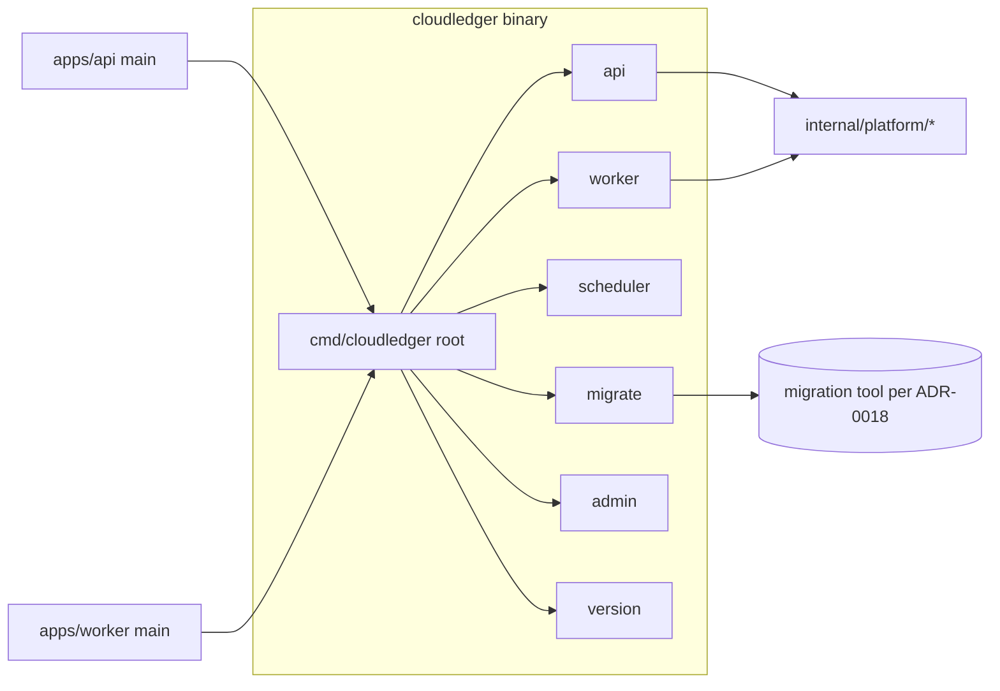
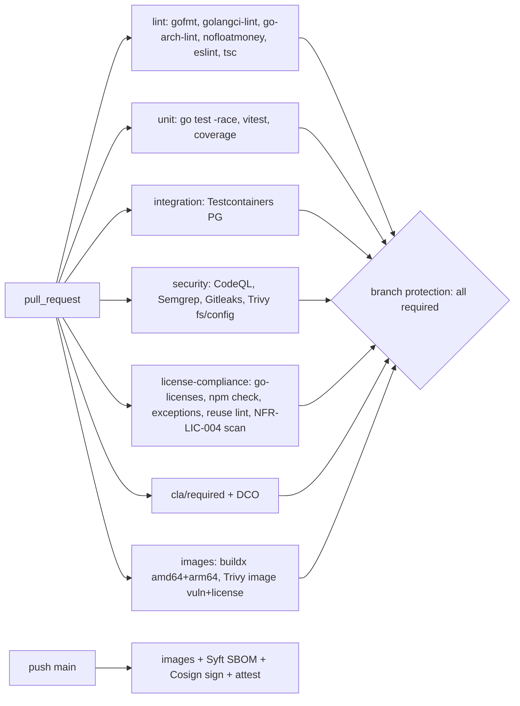

# Phase 03 — Monorepo, local dev, CI, standards: Design

Status: **NOT STARTED** · Release: v0.1 · Owner: TBD

## 1. Components and packages touched

| Path | Purpose in this phase |
|---|---|
| `go.mod` (module `github.com/<org>/cloudledger`, placeholder until OQ-01) | single Go module for `cmd`, `apps`, `internal`, `providers`, `sdk` (SDK becomes a separate module in Phase 35 if OQ-22 requires) |
| `cmd/cloudledger/` | the one binary; Cobra-style command tree: `api`, `worker`, `scheduler`, `migrate`, `admin`, `version` |
| `apps/api/main.go`, `apps/worker/main.go` | thin wrappers: `cloudledger.Run("api")`, `cloudledger.Run("worker")` (README layout kept; ADR-0001 single binary preserved) |
| `apps/web/` | Next.js App Router, TS strict, Tailwind, shadcn/ui, `app/api/health/route.ts`, i18n catalog `messages/en.json` |
| `internal/platform/config` | typed config struct, loader, validation, redaction, doc generator |
| `internal/platform/observability` | slog JSON handler, OTel tracer/meter providers, Prometheus exporter, label guard |
| `internal/platform/httpserver` | router, middleware (request ID, recovery, OTel, security headers, Problem Details), health handlers |
| `internal/platform/db` | pgx pool, migration-version probe; `WithTenantTx` signature stubbed (implemented Phase 04) |
| `internal/platform/jobs` | `Queue`, `Handler`, `Job` interfaces + in-memory fake (PG implementation Phase 04) |
| `internal/platform/timeutil`, `internal/platform/ids` | UTC clock abstraction, UUIDv7 generator |
| `internal/platform/money` | decimal wrapper per ADR-0019 |
| `internal/<module>/` (identity, authz, tenants, connectors, billing, analytics, …) | README placeholders only, owning phase stated |
| `database/postgres/migrations/` | `0001_bootstrap.sql` |
| `deploy/docker/` | `Dockerfile.go`, `Dockerfile.web`, `compose.lite.yaml`, `otel-collector.yaml` |
| `.github/` | workflows, CODEOWNERS, PR template, `dependabot.yml`/`renovate.json` |
| `compliance/`, `REUSE.toml`, `LICENSES/` | [LIC] policy files |
| `tools/lint/` | custom `go/analysis` analyzers (`nofloatmoney`), `.golangci.yml`, `.go-arch-lint.yml`, Semgrep rules |
| `scripts/compliance/`, `scripts/ci/` | npm license checker, exception validator, action-pin checker, NFR-LIC-004 scanner |

## 2. Layout decision
README lists `apps/api`, `apps/worker`; ADR-0001 mandates one binary with run modes. Decision: **`cmd/cloudledger` is the canonical binary and the only image entrypoint**; `apps/api` and `apps/worker` remain as thin `main` packages so `go run ./apps/api` works for developers and the README tree stays accurate. No logic lives in `apps/*` Go packages (enforced by an import-lint rule allowing only `cmd/cloudledger` imports). The scheduler runs inside `worker` in Lite (`--with-scheduler`).



## 3. Startup and readiness sequence

```mermaid
sequenceDiagram
  autonumber
  participant OS as Container runtime
  participant B as cloudledger api
  participant C as config
  participant O as observability
  participant PG as PostgreSQL
  OS->>B: start (env CLOUDLEDGER_*)
  B->>C: load defaults → YAML → env; validate (strict?)
  alt invalid / unknown key in strict mode
    C-->>B: error → exit 2 (no secrets in message)
  end
  B->>O: init slog JSON; OTLP only if endpoint set; Prometheus on admin port
  B->>B: listen :8080 (API) and :9090 (/metrics, admin)
  Note over B: /healthz = 200 immediately
  loop readiness probe (every 5 s, cached 2 s)
    B->>PG: SELECT 1; read schema version
    PG-->>B: version N
    B->>B: ready = (N == expected) && !draining
  end
  OS->>B: SIGTERM
  B->>B: draining=true → /readyz 503; stop accepting; wait in-flight ≤ drain timeout
  B-->>OS: exit 0
```

## 4. Data model and migrations
No tenant-owned tables in this phase (they start in Phase 04 at sequence 0010, per [DATABASE_SCHEMA.md](../../architecture/DATABASE_SCHEMA.md)).

| Migration | Content |
|---|---|
| `0001_bootstrap.sql` | `CREATE EXTENSION IF NOT EXISTS citext, ltree, pgcrypto`; roles: `cloudledger_owner` (NOLOGIN, owns schema objects), `cloudledger_migrator` (LOGIN, member of owner, used only by `cloudledger migrate`), `cloudledger_app` (LOGIN, `NOBYPASSRLS NOSUPERUSER NOCREATEROLE NOCREATEDB`, DML grants only via default privileges), `cloudledger_platform` (NOLOGIN, for audited platform-admin paths in Phase 04); `REVOKE CREATE ON SCHEMA public FROM PUBLIC`; schema `cl` (control plane) with default privileges |
| `0002`–`0009` | reserved for Phase 03 fixes |

Reserved ranges: P04 0010–0049 · P05 0050–0089 · P06 0090–0139 · P07 0140–0159 · P08 0160–0179. Analytics PG baseline migrations live in `database/postgres/analytics/migrations/` from Phase 06.

Role passwords are not in migrations: Compose generates them into a local `.env` (git-ignored) via `make bootstrap`; managed deployments supply them via secret references.

## 5. Decision: migration tool (ADR-0018, Proposed)
| Criterion | Atlas (versioned mode) | golang-migrate |
|---|---|---|
| Plain SQL, forward-only | yes | yes |
| Checksums of applied files (`atlas.sum`) | yes, built-in | no (needs custom) |
| Destructive-change and backward-compat lint | `atlas migrate lint` | no |
| Embeddable in Go binary | yes (SDK / exec) | yes (library) |
| License | Apache-2.0 for the open-core CLI; verify the exact components used against the allow-list | MIT |
| Ops simplicity | larger tool | minimal |

**Recommendation:** Atlas versioned migrations (plain SQL, `atlas.sum` integrity, lint for destructive changes supporting expand/contract), invoked by `cloudledger migrate`. Fallback: golang-migrate + a custom checksum and lint step. The license of the Atlas distribution actually used (some features/binaries carry different terms) must be confirmed by the license CI before acceptance; if it fails policy, the fallback applies.

## 6. Decision: decimal library (ADR-0019, Proposed)
| Criterion | `cockroachdb/apd/v3` | `shopspring/decimal` |
|---|---|---|
| Arbitrary precision with explicit context (precision, rounding) | yes (`apd.Context`) | implicit precision; division needs explicit precision |
| Half-even rounding | `apd.RoundHalfEven` | `RoundBank` |
| Allocation per op | low (value types, reusable) | higher (big.Int per op) |
| pgx integration | via `pgtype.Numeric` conversion helpers | community codec |
| API ergonomics | verbose | simple |
| License | Apache-2.0 | MIT |

**Recommendation:** `apd/v3` behind `internal/platform/money`, because explicit contexts make rounding auditable and allocation residual logic (Phase 15) deterministic. Ergonomics are addressed by the wrapper. JSON encodes money as `{"amount":"<string>","currency":"XXX"}` per [API_GUIDELINES §1](../../contracts/API_GUIDELINES.md#1-basics).

Lint rule `nofloatmoney` (custom `go/analysis` analyzer run through golangci-lint): reports any `float32`/`float64` type, conversion or literal-to-float in packages matching `internal/{billing,finance,allocation,analytics,recommendations,forecasting}/...` and `internal/platform/money`, except files annotated `//cl:allow-float <reason>` (used e.g. for statistical confidence in forecasting, reviewed by CODEOWNERS).

## 7. Module boundary rules (import-lint)
Implemented with `go-arch-lint` (component graph) plus `depguard` (deny lists); both run in `make lint`.

| Rule | From | May not import |
|---|---|---|
| B1 | `internal/platform/**` | any other `internal/*` |
| B2 | `internal/<a>/**` | `internal/<b>/**` except `internal/<b>/api` |
| B3 | `providers/**`, `sdk/**` | `internal/**`, `cmd/**`, `apps/**` |
| B4 | permissive paths per OQ-22 (`sdk/*` interfaces, `schemas`, generated `api/openapi` clients) | any core path |
| B5 | `apps/api`, `apps/worker` | anything except `cmd/cloudledger` |
| B6 | all | cycles |

## 8. CI architecture



Workflow hygiene: every `uses:` pinned to a 40-char SHA (checked by `scripts/ci/check-action-pins.sh`); top-level `permissions: contents: read`; `id-token: write` only in the signing job; no `pull_request_target` with checkout of untrusted code; caches keyed by lockfile hashes.

## 9. [LIC] License compliance design
- **Policy files:** `compliance/allowed-licenses.txt` and `denied-licenses.txt` mirror [LICENSE_COMPLIANCE.md §2](../../legal/LICENSE_COMPLIANCE.md); review-required licenses are absent from both, so they fail unless an exception exists.
- **Exceptions:** `license-exceptions.yaml` schema: `{package, ecosystem, version_range, license, reason, approved_by (maintainer), approved_by_licensor, expires (date ≤ 12 months)}`; validated by `scripts/compliance/validate-exceptions.mjs` (JSON Schema + date check against UTC today).
- **SPDX:** `REUSE.toml` annotations by path glob per [LICENSE_MAP.md](../../legal/LICENSE_MAP.md); `LICENSES/LicenseRef-CloudLedger-SAL-1.0.txt` (copy of draft LICENSE.md) and `LICENSES/Apache-2.0.txt` only if OQ-22 Option A is chosen. Headers on code files; `REUSE.toml` for generated, binary and fixture files.
- **NFR-LIC-004 scanner:** Semgrep rules `tools/lint/semgrep/no-license-enforcement.yml` (patterns: functions/identifiers like `licen[sc]e_?key`, `validateLicense`, `seat(s)?_?limit`, `max_?(users|accounts|tenants)` used in conditionals returning errors, HTTP calls to hosts containing `license`/`activation`) plus `tests/compliance/nolicense_test.go` that walks the tree and fails on matches outside an allow-list (`docs/`, `compliance/`, the rule files themselves, tenant **operational quotas** in `internal/platform/quota` which are documented as non-license protections per TENANCY §5). A seeded fixture under `tests/compliance/testdata/violation/` proves the rule fires.
- **CLA/DCO:** CLA Assistant configured with the draft CLA URL; signatures stored in a private repo/gist; DCO app. Until OQ-23 approval, the repo is private and branch protection restricts PR authors to org members.

## 10. Security considerations
- No secrets in the repo; `.env` generated locally and git-ignored; Gitleaks with custom rules for `clt_` token prefix (Phase 05 format) and cloud key patterns.
- Containers: distroless static (Go), `node:<lts>-slim`→ distroless node for web, UID 65532, read-only root, `cap_drop: [ALL]`, `no-new-privileges`.
- Security headers middleware: `X-Content-Type-Options: nosniff`, `Cache-Control: no-store` on API responses; no CORS by default.
- `/metrics` on a separate port, not exposed by Compose outside the host network by default.
- Errors use RFC 9457 Problem Details from day one; no stack traces in responses.
- OQ-17: OTLP and any telemetry disabled unless explicitly configured; startup makes no outbound calls (TC14).

## 11. Failure modes
| Failure | Handling |
|---|---|
| PostgreSQL unreachable at start | api starts, `/healthz` 200, `/readyz` 503 with reason `db_unreachable`; retry with backoff; log at WARN with no DSN password |
| Schema behind binary | `/readyz` 503 `schema_behind`; `cloudledger migrate up` required (Compose runs a one-shot `migrate` service first) |
| Schema ahead of binary (rollback of binary) | `/readyz` 200 if within N-1 compatibility window declared in binary; else 503 `schema_ahead` |
| OTLP collector down | exporter drops with bounded queue; app unaffected; metric `cloudledger_otel_export_failures_total` |
| Invalid config | exit 2 with key path; secrets redacted |
| CI third-party service outage (Sigstore, CLA app) | job fails closed for signing/CLA; documented manual re-run; no bypass label |
| New dependency with unknown license | CI fails; developer files exception PR (CODEOWNERS approval) or replaces dependency |

## 12. Related ADRs
[ADR-0001](../../architecture/adr/0001-go-modular-monolith-with-separately-scalable.md) · [ADR-0002](../../architecture/adr/0002-next-js-web-app-as-bff.md) · [ADR-0003](../../architecture/adr/0003-postgresql-control-plane-with-shared-schema.md) · [ADR-0005](../../architecture/adr/0005-postgresql-backed-durable-job-queue-and.md) · [ADR-0007](../../architecture/adr/0007-fixed-point-decimal-money-end-to.md) · [ADR-0011](../../architecture/adr/0011-api-first-rest-openapi-3-1.md) · [ADR-0015](../../architecture/adr/0015-source-available-licensing.md) · [ADR-0016](../../architecture/adr/0016-uuidv7-identifiers-and-utc-timestamps.md) · [ADR-0017](../../architecture/adr/0017-opentelemetry-native-observability.md) · ADR-0018 (new, migration tool) · ADR-0019 (new, decimal library)
