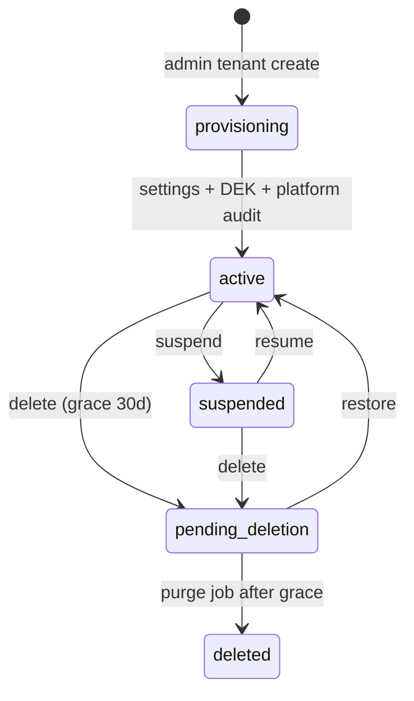

# Phase 04 — Tenancy schema, migrations, audit foundation: Design

Status: **NOT STARTED** · Release: v0.1 · Owner: TBD

## 1. Components and packages
| Path | Responsibility |
|---|---|
| `internal/platform/db` | pgx pool as `cloudledger_app`; `WithTenantTx`, `WithPlatformTx` (separate pool as `cloudledger_platform`, audited); `TenantContext` type required by all repositories |
| `internal/platform/jobs` | PG `Queue` implementation, worker loop, lease reaper |
| `internal/platform/outbox` | `Publish(tx, event)`, relay (poll + `LISTEN/NOTIFY` wake-up), subscriber registry |
| `internal/platform/idempotency` | HTTP middleware + store |
| `internal/platform/crypto` | envelope encryption; per-tenant DEK wrap/unwrap/destroy (KEK backend per [SECRETS_AND_KEYS.md](../../security/SECRETS_AND_KEYS.md)) |
| `internal/tenants` | lifecycle service, settings, hierarchy; `api.go` exported interface |
| `internal/audit` | chain writer, canonical JSON, verifier, anchor job |
| `cmd/cloudledger/admin` | tenant and audit CLI |
| `database/postgres/migrations/0010…0021` | schema below |

## 2. Data model and migrations
| Migration | Content |
|---|---|
| `0010_tenants.sql` | `tenants` (DATABASE_SCHEMA §2.1); not RLS'd by `tenant_id`; app role gets `SELECT` only via view `cl.current_tenant` filtered by `app.tenant_id`; platform role full access |
| `0011_tenant_settings.sql` | as DDL + `default_cost_metric text CHECK IN ('billed','effective')`, `data_egress_policy jsonb` (F-06); RLS forced |
| `0012_rls_helpers.sql` | `cl.enable_tenant_rls(regclass)` applying ENABLE/FORCE + `tenant_isolation` policy; used by all later migrations |
| `0013_hierarchy.sql` | `hierarchy_versions`, `hierarchy_nodes` with composite FKs `(tenant_id, version_id)`, `(tenant_id, parent_id)`; GiST index on `path` |
| `0014_audit_events.sql` | PK `(tenant_id, seq, occurred_at)` (F-01), `UNIQUE`-equivalent per-tenant `seq` guaranteed by serialized writer; monthly RANGE partitions created ahead by a maintenance job; trigger `audit_events_immutable` raises on UPDATE/DELETE unless `cl.purge_mode` set by the platform purge function; app role INSERT/SELECT only |
| `0015_audit_anchors.sql` | `audit_anchors (tenant_id, seq, head_hash, storage_uri, written_at)` |
| `0016_outbox_events.sql` | DDL §2.2 + RLS on tenant rows; relay runs under platform role with audited cross-tenant read (F-03) |
| `0017_jobs.sql` | DDL §2.2; `tenant_id` nullable only for platform jobs (`kind LIKE 'platform.%'` check) |
| `0018_idempotency_keys.sql` | `(tenant_id, principal_id, key)` PK, `request_hash`, `response jsonb`, `expires_at`; RLS forced |
| `0019_tenant_keys.sql` | `(tenant_id, key_id)` wrapped DEK, `kek_ref`, `status active/destroyed`; RLS forced |
| `0020_break_glass_grants.sql` | `(tenant_id, id, platform_user_ref, reason, starts_at, expires_at, revoked_at)`; enforcement Phase 05 |
| `0021_grants.sql` | privileges for `cloudledger_app` / `cloudledger_platform`; `REVOKE UPDATE, DELETE ON audit_events` |

Reserved platform tenant UUID `00000000-0000-7000-8000-000000000000` (row in `tenants`, status `active`, kind `organization`, never listed or deletable) owns platform audit events.

## 3. Tenant-scoped transaction

```mermaid
sequenceDiagram
  autonumber
  participant H as Handler / Job
  participant S as tenants service
  participant DB as internal/platform/db
  participant PG as PostgreSQL (RLS)
  participant A as audit writer
  participant O as outbox
  H->>S: UpdateSettings(TenantContext, patch, If-Match)
  S->>DB: WithTenantTx(tc)
  DB->>PG: BEGIN; SET LOCAL app.tenant_id = $tc
  S->>PG: UPDATE tenant_settings ... WHERE version = $v
  S->>A: Append(tx, settings.update)
  A->>PG: pg_advisory_xact_lock(hash(tenant)); read head; INSERT audit_events(seq+1, prev_hash, hash)
  S->>O: Publish(tx, event)  (if any)
  DB->>PG: COMMIT
```
If any step fails the transaction rolls back: no change without its audit record.

## 4. Tenant lifecycle and purge


Purge job (`platform.tenant.purge`, unique key = tenant id): (1) audit `tenant.purge.started` in platform chain; (2) delete tenant rows table by table in FK-safe order under `cl.purge_mode` (batched, resumable via checkpoint in job payload); (3) delete object prefixes `…/{tenant_id}/…`; (4) destroy DEKs (`tenant_keys.status=destroyed`, KEK backend delete); (5) final anchor of the tenant chain head into the platform chain; (6) `tenant.deleted.v1`. Dry-run lists counts only.

## 5. Audit chain
- Canonical JSON: RFC 8785 (JCS) over `{tenant_id, seq, id, occurred_at, actor_*, action, target_*, outcome, request_id, trace_id, details}`.
- Genesis `prev_hash` = 32 zero bytes. Verifier recomputes the chain per tenant and compares heads with anchors.
- Anchor job (`platform.audit.anchor`, hourly default): writes `anchors/{tenant}/{seq}.json` with object lock where supported (HA), MinIO/local FS in Lite (documented weaker guarantee).
- Actions in this phase: `tenant.create|suspend|resume|delete|restore|purge|export`, `settings.update`, `hierarchy.*`, `audit.verify`, `platform.role.use`.

## 6. Security considerations
- Defense in depth: application `TenantContext` + RLS (SP-01). Cross-tenant path IDs return 404.
- `tenants` table is not readable by the app role except the current tenant row via view.
- `SECURITY DEFINER` functions: only `cl.purge_tenant_batch` and `cl.current_tenant`; owned by `cloudledger_owner`, `search_path` pinned, reviewed (TC).
- Testauth injector compiled only with build tag `testauth`; a CI check asserts release binaries do not contain the symbol.
- Export archives are signed (Ed25519 key from KEK backend) and contain no secrets.

## 7. Failure modes
| Failure | Handling |
|---|---|
| Missing `app.tenant_id` | RLS returns no rows; inserts fail `WITH CHECK`; repository returns `ErrNoTenantContext` |
| Concurrent audit writes | advisory lock serializes per tenant; lock wait metric |
| Partition for month missing | maintenance job creates 3 months ahead; insert falls into default partition and raises alert |
| Purge interrupted | job retried from checkpoint; idempotent deletes |
| Relay crash | unpublished rows remain; consumers idempotent by event id |
| Job worker crash | lease expires, job re-delivered; `attempt` incremented |
| Anchor storage unavailable | anchor job retries; verifier reports `anchor_missing` (warning) |

## 8. Decisions and ADRs
[ADR-0003](../../architecture/adr/0003-postgresql-control-plane-with-shared-schema.md) (RLS), [ADR-0005](../../architecture/adr/0005-postgresql-backed-durable-job-queue-and.md) (queue/outbox), [ADR-0014](../../architecture/adr/0014-hash-chained-append-only-audit-log.md) (audit), [ADR-0016](../../architecture/adr/0016-uuidv7-identifiers-and-utc-timestamps.md). Decision: in-house queue over River unless River passes license CI and supports the `tenant_id` contract (record in ADR-0005 notes). Decision: HTTP routes 401 until Phase 05 rather than shipping a temporary auth scheme.
