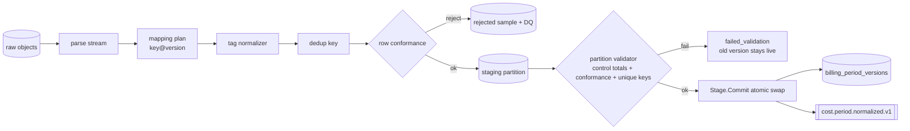
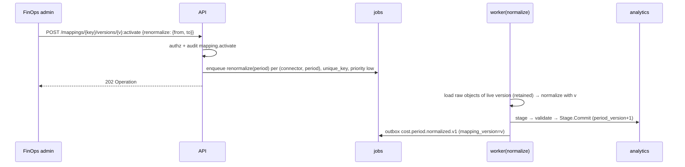

# Phase 11 — Design

Related: [FOCUS_NORMALIZATION.md](../../architecture/FOCUS_NORMALIZATION.md) · [INGESTION_PIPELINE.md](../../architecture/INGESTION_PIPELINE.md) · [DATABASE_SCHEMA.md](../../architecture/DATABASE_SCHEMA.md) · [ANALYTICS_ADAPTERS.md](../../architecture/ANALYTICS_ADAPTERS.md) · ADR-0006, ADR-0007, ADR-0010.

## 1. Components and packages

| Package | Responsibility |
|---|---|
| `internal/billing/focus/schema` | Column registry for the pinned FOCUS version generated from `schemas/focus/focus-1.2.columns.json` (name, type, required/conditional, allowed values, nullability). Single source for DDL generation, validator and API docs. |
| `internal/billing/focus/mapping` | Mapping definition model, loader (bundled provider mappings + tenant mappings), compiler to an executable plan, closed expression evaluator. |
| `internal/billing/focus/normalize` | Streaming normalizer: raw row → FOCUS row + `x_*` + `x_raw` + lineage. Pure function of (raw row, mapping version, tenant dimension snapshot). |
| `internal/billing/focus/conformance` | Validator (row-level and partition-level rules); also exported to `sdk/provider/testkit`. |
| `internal/billing/dedup` | Dedup key derivation and in-stage uniqueness check (spillable sorted set for large partitions). |
| `internal/billing/tags` | Tag key normalization algorithm and collision policy. |
| `internal/billing/renormalize` | Orchestrates re-normalization operations into per-period jobs (queue `normalize`, priority low). |
| `internal/tenants/dimensions` | Custom dimension definitions; scope → hierarchy-node assignments; publishes `dim_scope_hierarchy` to the analytics store. |
| `providers/{aws,gcp,azure}/mapping/` | Bundled mapping definitions (YAML) + fixtures; `generic` mappings come from Phase 09 templates. |



## 2. Mapping definitions

Stored in `mapping_definitions.definition` (JSONB) and as YAML in-repo for bundled mappings:

```yaml
key: aws-cur2-focus
version: 4
focus_version: "1.2"
source: { format: parquet, schema_fingerprints: ["sha256:…"] }   # accepted source schemas
columns:
  BilledCost:      { expr: "decimal(line_item_unblended_cost)" }
  EffectiveCost:   { expr: "coalesce(decimal(savings_plan_savings_plan_effective_cost), decimal(reservation_effective_cost), decimal(line_item_unblended_cost))", when: "..." }
  ChargeCategory:  { expr: "case(line_item_line_item_type, {Usage: Usage, Tax: Tax, Credit: Credit, Refund: Credit, SavingsPlanRecurringFee: Purchase, ...}, default: reject)" }
  InvoiceId:       { expr: "nullif(bill_invoice_id, '')" }
extensions:
  x_UsageType:     { expr: "line_item_usage_type" }
line_id: [identity_line_item_id, identity_time_interval]
rounding: { max_scale: 12, on_excess: reject }       # or half_even with DQ count
```

- **Expression language**: closed, typed, side-effect-free (field refs, literals, `case`, `coalesce`, `nullif`, `decimal()`, `date()`, string functions, arithmetic on decimals only). Compiled once per run; max AST depth 32, max evaluation steps per row 10 000. No reflection, no regex backtracking (RE2 only).
- **Lifecycle**: `draft` (editable, tenant-defined only) → `published` (immutable; checksum stored) → `retired` (not selectable for new runs, still referenced by history). Bundled provider mappings ship as `published` with `tenant_id = NULL`.
- **Selection**: a connector pins `config.mapping = {key, version}` or follows `latest_published` of its key. Selection is recorded on the run (`ingestion_runs.mapping_version`).

## 3. Tag normalization (P11-R07)
Algorithm `tagnorm/v1` (versioned; stored per row as `x_tagnorm_version`):
1. Unicode NFKC, trim whitespace.
2. Split camelCase/PascalCase boundaries (`CostCenter` → `Cost_Center`).
3. Replace runs of `[^A-Za-z0-9]` with `_`; strip leading/trailing `_`.
4. Lowercase. Truncate to 128 bytes on a rune boundary.
5. Provider prefixes are retained as namespaces: AWS `user:`/`aws:` → `user_`/`aws_` is **not** applied; instead the namespace is kept in a separate field (`aws:createdBy` → key `created_by`, namespace `aws`).
6. Collision: if two raw keys on the same row normalize to the same key, the value from the lexicographically smallest raw key wins; the row gets `x_tag_collisions` and the DQ report counts it.

Values are not normalized (Phase 15 value maps). Empty-string and NULL values normalize to absence; the semantic layer exposes absence as `(untagged)`.

## 4. Deduplication (P11-R09)
- With provider line IDs: `dedup_key = sha256(provider ‖ line_id ‖ billing_period ‖ charge_period_start ‖ charge_period_end ‖ content_hash)`.
- Without line IDs (generic imports, some Azure exports): natural key declared in the mapping (`line_id` list) plus `content_hash`; if two rows within one source object are byte-identical, the 0-based **occurrence ordinal** in file order is appended, so legitimate repeated lines are kept and replays still yield the same keys.
- Cross-object duplicates (the same file delivered twice) are removed earlier by `source_objects UNIQUE (tenant_id, sha256)`. Overlapping different files (e.g. Azure daily month-to-date exports) are resolved by the mapping's `supersedes` rule: the latest artifact for a period is the period's complete set.
- Partition validator asserts `count(*) = count(distinct dedup_key)`.

## 5. Data model and migrations

### 5.1 Control plane (PostgreSQL)
```sql
-- 0011_001: mapping lifecycle hardening
ALTER TABLE mapping_definitions
  ADD COLUMN checksum bytea, ADD COLUMN published_at timestamptz, ADD COLUMN published_by uuid,
  ADD CONSTRAINT ck_mapping_status CHECK (status IN ('draft','published','retired'));
-- trigger: reject UPDATE of definition/checksum when status <> 'draft'

-- 0011_002: custom dimensions (table listed in DATABASE_SCHEMA §2.4 under Phase 15; created here, rules populate in 15)
CREATE TABLE custom_dimensions (tenant_id uuid NOT NULL, id uuid NOT NULL, key text NOT NULL CHECK (key ~ '^[a-z][a-z0-9_]{0,62}$'),
  name text NOT NULL, allowed_values text[], created_at timestamptz NOT NULL DEFAULT now(), updated_at timestamptz NOT NULL DEFAULT now(),
  version bigint NOT NULL DEFAULT 1, PRIMARY KEY (tenant_id,id), UNIQUE (tenant_id,key));

-- 0011_003: cloud scope -> hierarchy node assignment (FR-TEN-003)
CREATE TABLE scope_hierarchy_assignments (
  tenant_id uuid NOT NULL, id uuid NOT NULL, hierarchy_version_id uuid NOT NULL, cloud_scope_id uuid NOT NULL,
  hierarchy_node_id uuid NOT NULL, effective_from date NOT NULL, effective_to date,
  created_at timestamptz NOT NULL DEFAULT now(), version bigint NOT NULL DEFAULT 1,
  PRIMARY KEY (tenant_id,id),
  FOREIGN KEY (tenant_id, cloud_scope_id) REFERENCES cloud_scopes(tenant_id,id),
  FOREIGN KEY (tenant_id, hierarchy_node_id) REFERENCES hierarchy_nodes(tenant_id,id),
  EXCLUDE USING gist (tenant_id WITH =, hierarchy_version_id WITH =, cloud_scope_id WITH =,
                      daterange(effective_from, effective_to) WITH &&));

-- 0011_004: allow re-normalization trigger
ALTER TABLE ingestion_runs DROP CONSTRAINT ingestion_runs_trigger_check,
  ADD CONSTRAINT ingestion_runs_trigger_check CHECK (trigger IN ('schedule','backfill','manual','restatement','replay','renormalize'));
```
All new tables get the RLS template (forced). Migrations are expand-only.

### 5.2 Analytics (engine-neutral; PG implemented here, DuckDB/ClickHouse in Phase 13)
- `cost_focus`: add the remaining pinned-version columns (generated from the registry), `x_tags_normalized` (map), `x_tagnorm_version`, `x_tag_collisions`, `x_cloud_scope_key` (`{provider}:{scope_type}:{native_id}` of the most specific scope), `period_version int`, `focus_version`.
- `dim_scope_hierarchy(tenant_id, hierarchy_version_id, scope_key, node_id, node_type, node_path, effective_from, effective_to)`: replicated from the control plane on change; joined at query time, so hierarchy edits do **not** require re-normalization. Publishing a change bumps tenant `data_version`.

## 6. Re-normalization sequence

If raw objects for a period have expired (retention, OQ-09), the job fails with `raw_unavailable` and the period stays on its previous mapping version; the operation reports it per period.

## 7. Conformance validator rules (excerpt)
Row: required non-null columns; enum domains; `BillingCurrency` ISO 4217; `ChargePeriodStart < ChargePeriodEnd`; charge period within billing period (± provider-documented exceptions); `ChargeClass='Correction'` ⇒ charge period may precede billing period; `ChargeCategory='Purchase'` with commitment ⇒ `CommitmentDiscountId` present; `x_*` naming. Partition: unique `dedup_key`; control totals; single `BillingCurrency` per billing account per period unless the provider declares multi-currency; row-count parity minus rejections.

## 8. Security
- Tags, names and `x_raw` are untrusted: never interpolated into SQL (parameterized writes), never logged at INFO, length-capped (`x_raw` ≤ 64 KiB per row; overflow truncated with a flag).
- Tenant-defined mappings can only reference the source row; the expression evaluator has no I/O.
- New endpoints require `mappings.manage`, `dimensions.manage`, `hierarchy.manage` permissions (final names per Phase 05 catalog). Cross-tenant IDs → 404.
- Audit actions: `mapping.publish`, `mapping.activate`, `normalization.renormalize`, `custom_dimension.*`, `scope_assignment.*`.

## 9. Failure modes
| Failure | Behavior |
|---|---|
| Unknown source schema fingerprint | Run `quarantined` (Phase 12 quarantine flow); no partial rows |
| Row fails conformance | Rejected with reason; if rejects > mapping `max_reject_ratio` (default 0) → `failed_validation` |
| Control totals mismatch | `failed_validation`; previous version stays live; health alert |
| Mapping expression runtime error | Row rejected with `mapping_error`; counted |
| Re-normalization interrupted | Staging discarded; job retried; live version unchanged |
| Hierarchy assignment overlap | Rejected by exclusion constraint → 409 |
