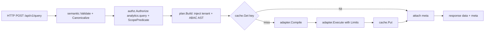
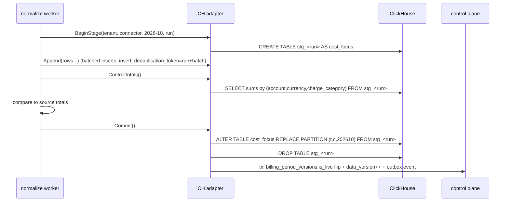

# Phase 13 Design: Analytics Adapters and Semantic Layer

Source of truth for the logical model: [ANALYTICS_ADAPTERS.md](../../architecture/ANALYTICS_ADAPTERS.md), [DATABASE_SCHEMA.md §3](../../architecture/DATABASE_SCHEMA.md), [TENANCY.md §2](../../architecture/TENANCY.md), [DATA_FLOW.md §2](../../architecture/DATA_FLOW.md). Security context: [TRUST_BOUNDARIES.md](../../architecture/TRUST_BOUNDARIES.md).

## 1. Components and packages

| Package | Responsibility |
|---|---|
| `internal/analytics/semantic` | `Query` type, JSON Schema validation, canonicalization (sorted keys, normalized filters) and `QueryHash` |
| `internal/analytics/semantic/registry` | metric and dimension definitions (Go code, versioned `registry_version`); visibility hooks |
| `internal/analytics/plan` | logical plan: projections, group-by, filter AST (with injected security predicate), time bucket, order, limit |
| `internal/analytics/adapter` | `Adapter`, `Stage`, `CompiledQuery`, `Limits`, `Capabilities`, typed errors |
| `internal/analytics/adapter/postgres` | SQL emitter (pgx), RLS session, partition attach/detach |
| `internal/analytics/adapter/duckdb` | SQL emitter, per-tenant file manager, view swap |
| `internal/analytics/adapter/clickhouse` | SQL emitter, row-policy setting, `REPLACE PARTITION` |
| `internal/analytics/cache` | `Cache` interface; in-process LRU (default) with byte budget; optional shared backend interface (no extra infrastructure required) |
| `internal/analytics/service` | `QueryService.Run(ctx, principal, query)` orchestrates authz → compile → cache → execute → meta |
| `internal/analytics/dataversion` | per-tenant monotonic counter in control-plane PG |
| `tests/contracts/analytics` | parity, isolation, limits, restatement, rounding, unicode suites |



## 2. Compiler design
1. **Front end (engine-neutral)**: validate, resolve registry entries, build logical plan, inject security predicate as the root `AND` (never as a user-modifiable node). Time bucketing is expressed logically (`bucket(month, charge_period_start)`).
2. **Emitter (per engine)**: maps logical nodes to SQL. Only identifiers from the registry are emitted unquoted; all values are bind parameters (PG `$n`, DuckDB `?`, ClickHouse `{p:Type}` server-side parameters).
3. **Determinism rules**: every ordered query gets a deterministic tiebreak on all group-by columns ascending; NULL ordering `NULLS LAST` explicit; tag absence coalesced to `'(untagged)'` at compile time; sums of zero rows return `0.000000000000` not NULL.
4. **Decimal rules**: sums cast to scale 12 (`numeric(38,12)`, `DECIMAL(38,12)`, `toDecimal128(x,12)`). Derived metrics (`savings_vs_list`) computed from aggregated decimals, not per-row floats. Results serialized as strings with exactly 12 fractional digits; presentation rounding is the client's job using the declared currency minor units.

PostgreSQL half-even function (installed by migration):
```sql
CREATE FUNCTION cl_round_half_even(v numeric, s int) RETURNS numeric
LANGUAGE sql IMMUTABLE STRICT PARALLEL SAFE AS $$
  SELECT CASE
    WHEN abs(v * 10^s - trunc(v * 10^s)) = 0.5
      THEN (trunc(v * 10^s) + CASE WHEN mod(trunc(v * 10^s), 2) = 0 THEN 0 ELSE sign(v) END) / 10^s
    ELSE round(v, s) END $$;
```
Needed because PG `round(numeric, s)` rounds half away from zero; tested at ±x.5 boundaries against DuckDB `round_even` and ClickHouse `roundBankers`.

## 3. Data model and migrations

### Control plane (PostgreSQL)
Proposed addition to DATABASE_SCHEMA.md (the doc references a per-tenant data version but defines no table):
```sql
CREATE TABLE tenant_data_versions (
  tenant_id uuid PRIMARY KEY REFERENCES tenants(id),
  data_version bigint NOT NULL DEFAULT 0,
  engine text NOT NULL CHECK (engine IN ('postgres','duckdb','clickhouse')),
  updated_at timestamptz NOT NULL DEFAULT now()
); -- RLS enabled + forced
```
`data_version` is incremented in the same control-plane transaction that flips `billing_period_versions.is_live` (Phase 12) after the engine commit succeeds; see failure modes.

### Analytics stores
| Table | PostgreSQL | DuckDB | ClickHouse |
|---|---|---|---|
| `cost_focus` | schema `analytics`; `PARTITION BY LIST (tenant_id)` → sub-partition `RANGE (billing_period)`; staging table + `ATTACH PARTITION` in one tx; RLS | file `{data_dir}/tenants/{tenant_id}.duckdb`; table per period `cost_focus_p{yyyymm}_v{n}` + `CREATE OR REPLACE VIEW cost_focus` | `MergeTree PARTITION BY (tenant_id, toYYYYMM(billing_period)) ORDER BY (tenant_id, billing_period, billing_account_id, service_name, charge_period_start)`; staging table + `REPLACE PARTITION` |
| `cost_allocated` | DDL only (Phase 15 fills) | same | same |
| `cost_daily_agg` | materialized table rebuilt per data version | not created (on-the-fly) | `AggregatingMergeTree` |
| `fx_applied` | DDL only (Phase 18) | same | same |

Note: ClickHouse `PARTITION BY (tenant_id, month)` partitions on the connector-less key, whereas the swap unit is `(tenant, connector, billing_period)`. Design choice: include `connector_id` in the ClickHouse partition key `(tenant_id, connector_id, toYYYYMM(billing_period))` so one `REPLACE PARTITION` equals one swap unit. This differs from ANALYTICS_ADAPTERS.md §3 and must be reconciled there.

Migrations: `database/postgres/analytics/0001_cost_focus.sql…`, `database/clickhouse/0001_…sql`, `database/duckdb/0001_…sql`, each tracked in a per-engine `schema_migrations` table.

## 4. Atomic swap sequence (ClickHouse example)

If the PG transaction fails after the engine swap, a reconciler job compares engine partition run IDs with `billing_period_versions` and re-applies the live version (engine partitions carry `ingestion_run_id`, so the check is exact).

## 5. Security
- Analytics DB credentials: separate read role (`cl_query`) and write role (`cl_ingest`). Query role has `SELECT` only; ClickHouse query user has row policy `tenant_id = toUUID(getSetting('SQL_cloudledger_tenant'))` on every table and `readonly=2` (can set only whitelisted settings).
- PG analytics schema RLS identical to control plane template; app role without `BYPASSRLS`.
- DuckDB: file path derived from `TenantContext` only, validated UUID; no user input reaches file paths; `enable_external_access=false`.
- Scope hash = SHA-256 of canonical ABAC predicate AST + role permission set version; included in cache key.
- Typed errors never echo SQL text to clients; compiled SQL is logged at DEBUG with parameters redacted.

## 6. Failure modes
| Failure | Behavior |
|---|---|
| Engine down / timeout | `503 analytics_unavailable` + `Retry-After`; circuit breaker per engine; no cross-engine fallback |
| Commit fails mid-swap | engine-native atomicity keeps old partition; stage dropped on retry; `failed` run |
| Engine swapped but PG tx failed | reconciler detects run-ID mismatch and repairs; data_version bumped only once repair completes |
| Decimal overflow | `422 unsupported_query` with code `decimal_overflow`; never truncated |
| Cache backend failure | bypass cache (fail open to the engine, never to another tenant's entry) |
| Registry/schema version skew in rolling upgrade | registry is versioned; unknown metric → `422`; N-1 binary compatible |

## 7. ADR links
ADR-0004 (engines), ADR-0007 (decimal), ADR-0008 (ABAC predicates), ADR-0010 (swap), ADR-0016 (UTC), ADR-0017 (OTel).
