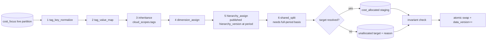

# Phase 15 Design: Allocation engine

Architecture reference: [ALLOCATION_ENGINE.md](../../architecture/ALLOCATION_ENGINE.md) (authoritative for algorithm details once written; this document is the phase-level design). ADRs: [ADR-0007](../../architecture/adr/0007-fixed-point-decimal-money-end-to.md) (decimals), [ADR-0008](../../architecture/adr/0008-authorization-rbac-abac-via-cedar-policies.md) (ABAC), [ADR-0010](../../architecture/adr/0010-immutable-content-addressed-raw-storage-and.md) (staged swap), [ADR-0004](../../architecture/adr/0004-pluggable-analytics-engines-behind-a-semantic.md) (semantic layer), [ADR-0005](../../architecture/adr/0005-postgresql-backed-durable-job-queue-and.md) (jobs/outbox), [ADR-0014](../../architecture/adr/0014-hash-chained-append-only-audit-log.md) (audit).

## 1. Components

| Package | Responsibility |
|---|---|
| `internal/allocation/rules` | Rule AST types, JSON Schema (`schemas/allocation/rule.v1.json`), validator, canonical JSON + checksum |
| `internal/allocation/eval` | Pure evaluator: pipeline stages over a stream of cost rows → allocation targets. No I/O. |
| `internal/allocation/split` | Shared-cost splitter with decimal largest-remainder residual handling |
| `internal/allocation/invariant` | Control totals and invariant checks |
| `internal/allocation/service` | Draft/publish/preview commands, ETag concurrency, audit, outbox |
| `internal/allocation/worker` | `allocate` queue job: load period, evaluate, stage, verify, swap, emit |
| `internal/allocation/api.go` | Exported interface for other modules (chargeback presets, Phase 17/29 consumers) |
| `internal/authz` (extension) | New ABAC attributes `hierarchy_node`, `dim`, `tag`; predicate compiler cases |
| `internal/analytics` (extension) | `cost_allocated` table in each adapter, dimensions `hierarchy:<node_type>`, `dim:<key>`, `allocation_target`, `allocation_status`, `allocation_rule`; metric `allocated_effective_cost` and siblings |
| `apps/web/app/(app)/allocation/*` | Rule editor, preview diff, publish, unallocated explorer, chargeback |

## 2. Evaluation pipeline

Stages run in fixed order per cost row. Within a stage, rules apply in `position` order.



- Stages 1–5 are row-local and streamable. Stage 6 needs a **basis** over the whole period (for example cost per receiving node), so the worker runs two passes: pass A assigns targets and accumulates basis totals; pass B splits shared pools.
- Shared pools are rows matched by a `shared_split` condition (for example `tag:cost_center = platform` or `service_category = Networking`). A pool row is never also directly allocated.
- Receivers of a split are hierarchy nodes or dimension values listed in the rule action, or "all nodes of type X that have basis > 0".
- Hierarchy resolution uses the `hierarchy_versions` row with `status = published` and the greatest `effective_from <= billing_period`.

## 3. Data model and migrations

Existing tables in [DATABASE_SCHEMA.md](../../architecture/DATABASE_SCHEMA.md) §2.4 are used as-is: `custom_dimensions`, `allocation_rule_sets`, `allocation_rules`. This phase **proposes** the following additive changes; DATABASE_SCHEMA.md must be updated in the same PR as the migration.

```sql
-- 0015_001: name and notes on rule sets (current table only has version/status)
ALTER TABLE allocation_rule_sets
  ADD COLUMN name text NOT NULL DEFAULT 'default',
  ADD COLUMN description text,
  ADD COLUMN based_on_version int,                    -- draft lineage
  ADD COLUMN created_by uuid NOT NULL,
  ADD COLUMN created_at timestamptz NOT NULL DEFAULT now(),
  ADD COLUMN updated_at timestamptz NOT NULL DEFAULT now(),
  ADD COLUMN row_version bigint NOT NULL DEFAULT 1;   -- ETag; `version` is the business version number
CREATE UNIQUE INDEX uq_alloc_one_draft ON allocation_rule_sets (tenant_id) WHERE status = 'draft';

-- 0015_002: rule metadata
ALTER TABLE allocation_rules
  ADD COLUMN name text NOT NULL,
  ADD COLUMN enabled boolean NOT NULL DEFAULT true,
  ADD CONSTRAINT ck_alloc_rule_position CHECK (position >= 0);

-- 0015_003: run history (FR-ALC-006 re-run history)
CREATE TABLE allocation_runs (
  tenant_id uuid NOT NULL, id uuid NOT NULL,
  rule_set_id uuid NOT NULL, rule_set_version int NOT NULL,
  billing_period date NOT NULL, input_data_version bigint NOT NULL, output_data_version bigint,
  trigger text NOT NULL CHECK (trigger IN ('publish','normalized','restated','manual','preview')),
  status text NOT NULL CHECK (status IN ('queued','running','validating','swapping','succeeded','failed','failed_invariant','skipped_closed')),
  totals jsonb NOT NULL DEFAULT '{}',   -- per (currency, metric): source, allocated, unallocated, residual_units
  error jsonb, started_at timestamptz, finished_at timestamptz,
  PRIMARY KEY (tenant_id, id),
  FOREIGN KEY (tenant_id, rule_set_id) REFERENCES allocation_rule_sets (tenant_id, id)
);
CREATE UNIQUE INDEX uq_alloc_run_live ON allocation_runs (tenant_id, billing_period, input_data_version, rule_set_version)
  WHERE status = 'succeeded' AND trigger <> 'preview';

-- 0015_004: preview results (ephemeral, TTL 24 h, purged by job)
CREATE TABLE allocation_previews (
  tenant_id uuid NOT NULL, id uuid NOT NULL, rule_set_id uuid NOT NULL, period_from date NOT NULL, period_to date NOT NULL,
  status text NOT NULL, diff jsonb, warnings jsonb NOT NULL DEFAULT '[]', expires_at timestamptz NOT NULL,
  PRIMARY KEY (tenant_id, id)
);
```
All new tables get the RLS template, composite FKs and `ix_` indexes on `(tenant_id, billing_period)`.

Analytics: `cost_allocated` per [DATABASE_SCHEMA.md](../../architecture/DATABASE_SCHEMA.md) §3, physical columns:
`tenant_id, billing_period, cost_row_ref (dedup_key), connector_id, target_kind ('node'|'dimension'|'unallocated'), hierarchy_node_id, hierarchy_path, dims Map, tags_normalized Map, allocation_share Decimal(38,12), billed_cost, effective_cost, list_cost, contracted_cost Decimal(38,12), billing_currency, allocation_method ('direct'|'shared'|'inherited'), unallocated_reason, rule_set_version, rule_ids Array, source_rule_id, run_id`. Partition `(tenant_id, billing_period)`; written through `Adapter.BeginStage(PartitionKey{Table: "cost_allocated"})`.

## 4. Decimal splitting and residuals

For a pool amount `A` (scale 12) and receivers with weights `w_i`:
1. Compute exact rational share `A · w_i / Σw` with `apd` at 34 significant digits.
2. Truncate each share toward zero to **scale 12** (storage scale). Residual `R = A − Σ truncated`; `R` is an integer number of `1e-12` units, `0 ≤ R < n` units.
3. Distribute residual units one each to receivers ordered by largest fractional remainder, tie-break by `(hierarchy_node_key, dimension value)` ascending, byte order. Deterministic across runs and engines because splitting happens in Go, not in SQL.
4. Presentation rounding to the currency minor unit (ISO 4217 exponent, e.g. JPY 0, USD 2, BHD 3) happens at query time with half-even, and chargeback reports apply the same largest-remainder rule at the minor unit so that report rows sum to the report total (documented "report residual" line is never needed).
5. Negative amounts (credits, refunds) split by the same weights; sign preserved; truncation toward zero.
6. `fixed_percentage` weights are decimals that must sum to exactly `100`; validation rejects 33.33 × 3.

Invariant (checked per run, per (currency, metric)): `Σ cost_allocated.amount (all targets, incl. unallocated) == Σ cost_focus.amount` exactly, and `Σ allocation_share` per `cost_row_ref == 1` exactly.

## 5. Sequences

```mermaid
sequenceDiagram
  autonumber
  participant U as FinOps admin
  participant API
  participant SVC as allocation.service
  participant Q as jobs
  participant W as allocation.worker
  participant A as analytics adapter
  participant OB as outbox
  U->>API: POST /allocation/rule-sets/{id}:preview {period_from, period_to}
  API->>Q: enqueue allocate.preview (op)
  W->>A: read live cost_focus (scope = tenant, no ABAC: system job)
  W->>W: evaluate draft and live versions in memory/temp tables
  W->>SVC: store allocation_previews.diff
  U->>API: POST /allocation/rule-sets/{id}:publish (If-Match, Idempotency-Key)
  API->>SVC: validate, checksum, status=published, previous → superseded (one tx) + audit + outbox allocation.published.v1
  OB-->>Q: allocate(period) for each open period >= effective_from
  W->>A: BeginStage(cost_allocated, period) → Append → ControlTotals
  W->>W: invariant check
  alt ok
    W->>A: Commit (swap), data_version++
    W->>OB: cost.period.allocated.v1
  else fail
    W->>A: Abort; run=failed_invariant; ingestion-health style alert
  end
```

## 6. Security
- Rule editing never accepts SQL. Conditions use the semantic filter AST (`dim`, `op`, `value(s)`), validated against the dimension registry. Regex is RE2 (`regexp` in Go), max 512 chars, compiled once per run.
- Allocation workers run as a system principal scoped to one tenant (`SET LOCAL app.tenant_id`) and read the full tenant data. Preview responses, however, are filtered by the caller's ABAC scope; a FinOps admin with a restricted scope sees diff rows only for nodes in scope and aggregate "out of scope" totals.
- ABAC extension (FR-IAM-006): data scope predicate AST gains `{"attr":"hierarchy_node","op":"descendant_of","value":"<node_key>"}`, `{"attr":"dim:<key>","op":"in",...}`, `{"attr":"tag:<key>",...}`. On `cost_allocated` the compiler matches `hierarchy_path <@ ltree` (PG), `startsWith(hierarchy_path, ...)` (ClickHouse/DuckDB), on node **keys** resolved against the hierarchy version for each period.
- Shared cost visibility: a viewer scoped to node X sees shared cost received by X, with the source pool shown as `rule name` and amount only. Source pool row details (account, resource IDs) are visible only if the pool rows are also in scope.
- Queries on `cost_focus` by a principal whose scope includes hierarchy or dimension predicates are rewritten to join `cost_allocated` (row-level membership), or rejected with `422 unsupported_query` for dimensions only available pre-allocation. Decision: such principals query allocated metrics only.
- Audit events: `allocation.rule_set.created`, `.updated`, `.published`, `.previewed`, `allocation.run.failed_invariant`, `data_scope.updated`.

## 7. Failure modes

| Failure | Behavior |
|---|---|
| Invariant mismatch | Abort stage, previous allocation stays live, run `failed_invariant`, alert, event not emitted |
| Worker crash mid-run | Job lease expires, retry drops staging partition and restarts (idempotent) |
| Publish while a run is in progress for an older version | Older run completes but is superseded; the newer job's unique key `(tenant, period, rule_set_version)` re-runs |
| Restatement arrives during allocation | New `data_version` triggers a new job; the in-flight run's swap is rejected if `input_data_version` is no longer live (compare-and-swap on the live pointer) |
| Zero basis for a proportional split | Use declared fallback (`even` or `unallocated`), warning in run totals |
| Hierarchy node deleted in a new hierarchy version | Rules referencing a missing node fail validation at publish; existing published rules targeting it route to unallocated `missing_node` with warning |
| Period closed (Phase 30) | Run `skipped_closed`; changes surface as post-close adjustments later |
| Pathological regex or 10 000 rules | Validation caps (rules ≤ 2 000 per set, conditions depth ≤ 8), per-run time budget |
