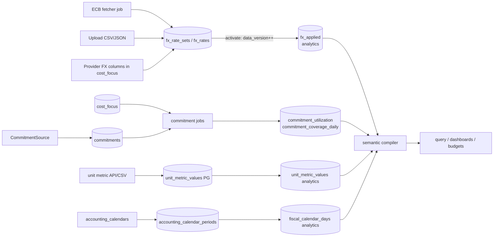

# Phase 18: FX, commitments, unit economics, accounting calendars: Design

Status: **NOT STARTED** · Release checkpoint: v0.3 · Spec status: DRAFT (no code exists)

Related: [FINANCE_RECONCILIATION.md](../../architecture/FINANCE_RECONCILIATION.md) · [DATABASE_SCHEMA.md](../../architecture/DATABASE_SCHEMA.md) §2.6, §3 · [ANALYTICS_ADAPTERS.md](../../architecture/ANALYTICS_ADAPTERS.md) · [ADR-0004](../../architecture/adr/0004-pluggable-analytics-engines-behind-a-semantic.md) · [ADR-0007](../../architecture/adr/0007-fixed-point-decimal-money-end-to.md) · [ADR-0008](../../architecture/adr/0008-authorization-rbac-abac-via-cedar-policies.md) · [ADR-0014](../../architecture/adr/0014-hash-chained-append-only-audit-log.md)

## 1. Components and packages
| Package | Responsibility |
|---|---|
| `internal/finance/fx` | Rate-set repository, canonicalization + checksum, `Converter` (pure), policy resolution, ECB fetcher job, upload parser |
| `internal/finance/commitments` | Inventory sync (`CommitmentSource` + billing-row discovery), utilization/coverage/amortization jobs, provider mappers `mapper_aws.go`, `mapper_gcp.go`, `mapper_azure.go` |
| `internal/finance/unitmetrics` | Definitions, batch/CSV ingestion, validation, replication to analytics |
| `internal/finance/calendar` | Calendar definitions, `Generate(def, fy) []Period` (pure), activation, `accounting_periods` generation |
| `internal/analytics/semantic` | Registry additions: metrics `commitment_utilization`, `commitment_unused_cost`, `commitment_coverage`, `unit_metric:<key>`, `unit_cost:<key>`; dimensions `commitment_type`, `fiscal_year`, `fiscal_quarter`, `fiscal_period`; grains `fiscal_*`; currency conversion stage |
| `providers/{aws,gcp,azure}` | `CommitmentSource.ListCommitments` implementations (read-only APIs: EC2 `DescribeReservedInstances`, `savingsplans:DescribeSavingsPlans`; GCP `compute.regionCommitments.list` + billing-account CUDs; Azure `Microsoft.Capacity/reservationOrders`, `Microsoft.BillingBenefits/savingsPlanOrders`) |
| `apps/web` | Rate sets, commitments (coverage/utilization charts), unit metrics, calendar settings pages |



## 2. Data model and migrations
### Schema delta vs DATABASE_SCHEMA.md (additive; DATABASE_SCHEMA.md updated in the same PR)
```sql
-- fx_rate_sets: add columns (existing: tenant_id NULL=shared, id, source, version, retrieved_at, checksum)
ALTER TABLE fx_rate_sets ADD COLUMN name text NOT NULL, ADD COLUMN base_currency char(3) NOT NULL,
  ADD COLUMN status text NOT NULL CHECK (status IN ('draft','active','superseded','rejected')),
  ADD COLUMN provenance jsonb NOT NULL,      -- {uri, http_etag, publisher, upload_object_id, connector_id}
  ADD COLUMN coverage daterange NOT NULL, ADD COLUMN created_by uuid,
  ADD CONSTRAINT ck_fx_source CHECK (source IN ('ecb','provider','upload','manual'));
CREATE UNIQUE INDEX uq_fx_rate_sets_version ON fx_rate_sets (coalesce(tenant_id,'00000000-0000-0000-0000-000000000000'), name, version);
-- RLS: USING (tenant_id IS NULL OR tenant_id = current_setting('app.tenant_id')::uuid); WITH CHECK (tenant_id = current tenant). Shared sets written only by platform role.
-- fx_rates has no tenant_id: RLS policy via EXISTS on parent rate set.
CREATE TABLE tenant_fx_bindings (tenant_id uuid NOT NULL, id uuid NOT NULL, rate_set_id uuid NOT NULL, priority smallint NOT NULL,
  effective_from date NOT NULL, activated_by uuid NOT NULL, activated_at timestamptz NOT NULL, PRIMARY KEY (tenant_id,id),
  UNIQUE (tenant_id, priority, effective_from));
ALTER TABLE tenant_settings ADD COLUMN fx_carry_forward_days smallint NOT NULL DEFAULT 5 CHECK (fx_carry_forward_days BETWEEN 0 AND 10);

ALTER TABLE commitments ADD COLUMN connector_id uuid NOT NULL, ADD COLUMN status text NOT NULL CHECK (status IN ('active','expired','retired','queued','unknown')),
  ADD COLUMN upfront_fee numeric(38,12), ADD COLUMN recurring_hourly_fee numeric(38,12),
  ADD COLUMN commitment_unit text NOT NULL CHECK (commitment_unit IN ('hours','normalized_units','currency_per_hour','vcpu','memory_gib')),
  ADD COLUMN committed_quantity numeric(38,12), ADD COLUMN source text NOT NULL CHECK (source IN ('api','billing')),
  ADD COLUMN first_seen_at timestamptz NOT NULL, ADD COLUMN last_seen_at timestamptz NOT NULL, ADD COLUMN version bigint NOT NULL DEFAULT 1;
ALTER TABLE commitments ADD CONSTRAINT ck_commitment_type CHECK (type IN ('aws_ri','aws_sp_compute','aws_sp_ec2','aws_sp_sagemaker',
  'gcp_cud_resource','gcp_cud_spend','azure_reservation','azure_savings_plan'));

ALTER TABLE unit_metrics ADD COLUMN aggregation text NOT NULL DEFAULT 'sum' CHECK (aggregation IN ('sum','avg','last')),
  ADD COLUMN dimension text,   -- optional semantic dimension the values are keyed by, e.g. 'hierarchy:product'
  ADD COLUMN description text, ADD COLUMN created_at timestamptz NOT NULL DEFAULT now(), ADD COLUMN updated_at timestamptz NOT NULL DEFAULT now(),
  ADD COLUMN version bigint NOT NULL DEFAULT 1, ADD CONSTRAINT uq_unit_metrics_key UNIQUE (tenant_id, key);
ALTER TABLE unit_metric_values ADD COLUMN batch_id uuid NOT NULL, ADD COLUMN ingested_at timestamptz NOT NULL;
CREATE TABLE unit_metric_batches (tenant_id uuid NOT NULL, id uuid NOT NULL, metric_id uuid NOT NULL, source text NOT NULL CHECK (source IN ('api','upload')),
  source_object_id uuid, accepted bigint NOT NULL, rejected bigint NOT NULL, rejected_sample_uri text, created_by uuid, created_at timestamptz NOT NULL, PRIMARY KEY (tenant_id,id));

CREATE TABLE accounting_calendars (tenant_id uuid NOT NULL, id uuid NOT NULL, version int NOT NULL,
  kind text NOT NULL CHECK (kind IN ('gregorian','4-4-5','4-5-4','5-4-4','custom_weeks')),
  fiscal_year_start_month smallint NOT NULL CHECK (fiscal_year_start_month BETWEEN 1 AND 12),
  week_start_dow smallint CHECK (week_start_dow BETWEEN 0 AND 6),            -- 0=Sunday; NULL for gregorian
  year_end_rule text CHECK (year_end_rule IN ('last_weekday','nearest_weekday')), year_end_dow smallint,
  extra_week_period smallint DEFAULT 12,  -- period receiving week 53
  custom_pattern smallint[],              -- weeks per period for custom_weeks, sums to 52
  fiscal_year_label text NOT NULL DEFAULT 'end' CHECK (fiscal_year_label IN ('start','end')),
  status text NOT NULL CHECK (status IN ('draft','active','superseded')), effective_from_fy int NOT NULL,
  created_at timestamptz NOT NULL DEFAULT now(), updated_at timestamptz NOT NULL DEFAULT now(), PRIMARY KEY (tenant_id,id), UNIQUE (tenant_id, version));
CREATE TABLE accounting_calendar_periods (tenant_id uuid NOT NULL, calendar_id uuid NOT NULL, fiscal_year int NOT NULL, quarter smallint NOT NULL,
  period_no smallint NOT NULL, weeks smallint, start_date date NOT NULL, end_date date NOT NULL,
  PRIMARY KEY (tenant_id, calendar_id, fiscal_year, period_no), CHECK (end_date >= start_date));
```
`tenant_settings.accounting_calendar` (jsonb, Phase 04) becomes a pointer `{"calendar_id": "…"}`; the table is authoritative. Activation also upserts `accounting_periods` rows (status `open`) for generated periods not yet present.

### Analytics store (all three engines)
| Table | Grain | Notes |
|---|---|---|
| `fx_applied` (exists) | rate_set_id × date × base × quote | Densified daily: carry-forward rows flagged `carried_from date` so the join is a simple equality |
| `commitment_utilization` (exists, columns extended) | commitment × usage_date | `committed_amount`, `used_amount`, `unused_amount`, `amortized_fee`, `provider_amortized_fee`, `currency`, `source_rows`, `data_version` |
| `commitment_coverage_daily` (new) | date × provider × service_category × region × sub_account | `eligible_od_equivalent`, `covered_od_equivalent`, `covered_effective_cost`, `currency` |
| `unit_metric_values` (exists) | metric × date × dimension_key | replicated on write |
| `fiscal_calendar_days` (new) | tenant × calendar version × date | `fiscal_year`, `fiscal_quarter`, `fiscal_period`, `fiscal_week` |

## 3. FX algorithm
1. **Rate selection** for (date d, from F, to T, policy P) over bound rate sets in priority order: the first set containing the needed pair wins; a set that lacks the pair is skipped (documented, logged in `meta.fx_sources`). Skipping because a *date* is missing is **not** allowed: if the highest-priority set covering the pair lacks d after carry-forward, fail closed.
2. **Policies**: `charge_date` = rate on `ChargePeriodStart` date (UTC); `month_end` = last published rate on or before the last day of the charge month; `month_average` = arithmetic mean of published rates in the charge month, computed at scale 18 half-even; `provider` = rate the provider supplied for the row (CUR `pricing/currency` conversion, GCP `currency_conversion_rate`, Azure `exchangeRatePricingToBilling`) only when it targets the reporting currency, else `fx_rate_missing`.
3. **Pair resolution**: direct `F→T` → `amount × r`; inverse (`T→F` stored) → `amount ÷ r`; triangulated via base B → `amount × r(B→T) ÷ r(B→F)`. Intermediate arithmetic uses apd context of 34 significant digits; **one** rounding to scale 12 half-even at the end.
4. **Carry-forward**: a missing date may use the latest prior published date within `fx_carry_forward_days`; the result carries `carried_from`.

Worked examples (golden set `fx_conversion`):
| # | Input | Rates | Policy | Result (reporting EUR or GBP) |
|---|---|---|---|---|
| FX-1 | `1234.56` USD on 2026-10-15 | EUR→USD `1.08` | charge_date, inverse | `1143.111111111111` EUR |
| FX-2 | `1000.00` USD | EUR→USD `1.08`, EUR→GBP `0.8424` | triangulated | `780.000000000000` GBP |
| FX-3 | `217.00` USD, October | EUR→USD daily `1.08, 1.10, 1.09, 1.07` | month_average → `1.085000000000000000` | `200.000000000000` EUR |
| FX-4 | charge on Saturday 2026-10-17 | last published Fri 2026-10-16 | charge_date, carry 1 day | uses 10-16 rate, `carried_from=2026-10-16` |
| FX-5 | charge on 2026-10-17, carry_forward_days=0 | none for 10-17 | charge_date | `422 fx_rate_missing` `[{"date":"2026-10-17","pair":"USD/EUR"}]` |
| FX-6 | `100.00` EUR, reporting EUR | — | any | `100.000000000000` (identity, no rate needed) |

## 4. Commitment definitions (canonical)
All amounts in the commitment's currency; hourly granularity aggregated to days.
- **Committed amount (hour h)**: AWS RI = normalized units purchased × on-demand-equivalent hourly rate (amortized fee basis); AWS SP / Azure savings plan / GCP spend CUD = committed $/hour; GCP resource CUD and Azure reservation = committed quantity × commitment unit rate.
- **Used amount**: portion of the commitment consumed by eligible usage in h (from FOCUS rows with `CommitmentDiscountId` = commitment and `CommitmentDiscountStatus = Used`). **Unused** = committed − used (`CommitmentDiscountStatus = Unused` rows when provided; cross-checked).
- **Utilization** = Σ used ÷ Σ committed over the window (scale 12). Undefined (null) when committed = 0.
- **Coverage** = covered on-demand-equivalent ÷ eligible on-demand-equivalent, where eligibility is per provider mapping (e.g. EC2/Fargate/Lambda for Compute SP; vCPU/memory families for GCP resource CUDs).
- **Amortization**: hourly fee = `upfront_fee ÷ term_hours + recurring_hourly_fee`, `term_hours` = actual hours between `start_at` and `end_at` (leap years included). Provider `EffectiveCost` remains authoritative; derived vs. provider fee per commitment-month must match within 0.01, else a `commitment_amortization_divergence` finding.

| # | Case | Inputs | Expected |
|---|---|---|---|
| CM-1 | AWS RI 1y all upfront | upfront `876.00`, 8760 h | hourly `0.100000000000` |
| CM-2 | AWS RI 1y partial upfront | upfront `438.00`, recurring `0.05`/h, 8760 h | hourly `0.100000000000` |
| CM-3 | Term including 2028-02-29 | upfront `878.40`, 8784 h | hourly `0.100000000000` |
| CM-4 | 3y all upfront, October (744 h) | upfront `26280.00`, 26280 h | October amortized `744.000000000000` |
| CM-5 | RI day, used 18 of 24 h | hourly `0.10` | utilization `0.750000000000`, unused `0.600000000000` |
| CM-6 | Savings plan hour | committed `10.00`, used `7.50` | utilization `0.750000000000`, unused `2.500000000000` |
| CM-7 | Coverage day | eligible OD-eq `300.00`, covered `240.00` | coverage `0.800000000000` |
| CM-8 | GCP spend CUD hour, usage below commitment | committed `5.00`/h, eligible `3.20` | used `3.20`, unused `1.800000000000` |

## 5. Unit cost
`unit_cost:<key>` = Σ(selected cost metric, after allocation/FX) ÷ Σ unit values at the same grain and, if the metric has a `dimension`, joined on that dimension. Aggregation `avg`/`last` applies across time within the grain. Denominator 0 → `null`, reason `zero_denominator`; absent values → `null`, reason `missing_denominator`. One rounding, scale 12 half-even.
Examples: UC-1 `12500.00` EUR ÷ `50000` orders = `0.250000000000`; UC-2 `100.00` ÷ `3` = `33.333333333333`; UC-3 cost `40.00`, units `0` → `null (zero_denominator)`.

## 6. Accounting calendars
- `gregorian`: fiscal year starts on day 1 of `fiscal_year_start_month`; periods = calendar months. FY label default = year in which it ends (start month 4 → FY2027 = 2026-04-01..2027-03-31).
- Week-based (`4-4-5`, `4-5-4`, `5-4-4`, `custom_weeks`): year ends on the `year_end_dow` that is the last in (`last_weekday`) or nearest to (`nearest_weekday`) the end of the month preceding `fiscal_year_start_month`. Years are 52 or 53 weeks; week 53 is appended to `extra_week_period` (default period 12).
- Golden CAL-1 (NRF-style: Saturday nearest 31 Jan, 4-4-5): FY2023 = 2023-01-29..2024-02-03 (**53 weeks**, 371 days); FY2024 = 2024-02-04..2025-02-01 (52 weeks); FY2024 P1 = 2024-02-04..2024-03-02, P2 = 2024-03-03..2024-03-30, P3 = 2024-03-31..2024-05-04.
- Period boundaries are UTC dates (storage is UTC-only); `tenant_settings.timezone` affects display only (documented limitation).

## 7. Security
- RLS forced on all new tables; shared ECB sets use the `tenant_id IS NULL` read policy and are only writable by the platform migration/job role. `fx_rates` protected via parent policy; catalog test asserts it.
- Permissions: `fx:read`, `fx:manage`, `commitments:read`, `unit_metrics:read`, `unit_metrics:write`, `calendars:manage` (see API_CONTRACTS). Commitments and unit values pass through ABAC predicates (provider, account, hierarchy node).
- Uploads: 50 MiB cap, streaming parser, decompression ratio cap, values stored as data; CSV formula prefixes escaped on export (FR-IMP-004 rules reused).
- ECB fetcher egress is operator-enabled (`cl.finance.fx_ecb_fetch`), fixed URL allow-list, TLS verification, response checksummed and stored raw in object storage.
- Audit events: `fx.rate_set.uploaded`, `fx.rate_set.activated`, `calendar.activated`, `unit_metric.batch_ingested`, `commitments.sync`.

## 8. Failure modes
| Failure | Behavior |
|---|---|
| ECB unreachable / malformed XML | job retries (transient policy); no new version; existing active set unchanged; health alert after 3 days stale |
| Rate missing for a needed date | `422 fx_rate_missing` with list; dashboards show explicit error tile, never partial converted totals |
| Upload with duplicate (date, pair) or non-positive rate | whole upload rejected (`validation_failed`), no partial rate set |
| Commitment API permission denied | capability `commitments` → `fail`; inventory derived from billing rows only (`source=billing`), UI badge |
| Billing rows reference unknown commitment ID | placeholder commitment `status=unknown` created; finding raised |
| Amortization divergence | finding; provider value used for cost; derived value shown in commitment detail |
| Calendar activation overlapping closed period | `409 period_closed`; no change |
| Unit CSV partially invalid | valid rows accepted, rejected rows sampled with reasons (per FR-IMP-003 pattern); batch status `partial` |
