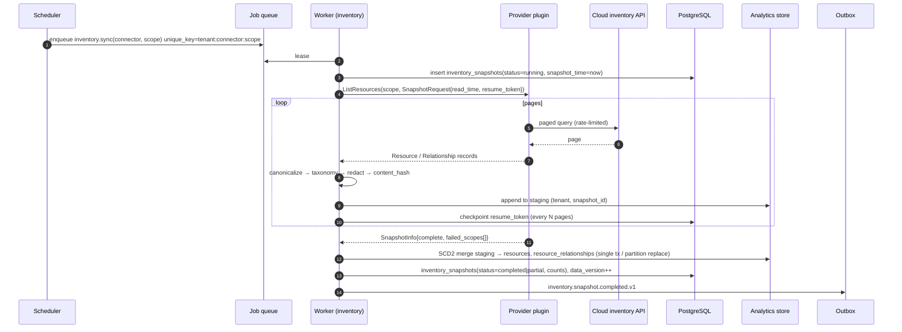

# Phase 19: Resource inventory for AWS, GCP and Azure: Design

Status: **NOT STARTED** · Release checkpoint: v0.5 · Spec status: DRAFT (no code exists)

Architecture references: [RESOURCE_INVENTORY.md](../../architecture/RESOURCE_INVENTORY.md), [DATA_FLOW.md §3](../../architecture/DATA_FLOW.md), [DATABASE_SCHEMA.md](../../architecture/DATABASE_SCHEMA.md), [ANALYTICS_ADAPTERS.md](../../architecture/ANALYTICS_ADAPTERS.md), [PROVIDER_SDK.md](../../contracts/PROVIDER_SDK.md), [TENANCY.md](../../architecture/TENANCY.md).

## 1. Components and packages

| Package | Responsibility |
|---|---|
| `sdk/provider` | `InventorySource` interface (amended, see §7), `Resource`, `Relationship`, `SnapshotInfo` types, `testkit` `Inventory` group |
| `providers/aws/inventory` | Config aggregator client (`SelectAggregateResourceConfig`, paged by `NextToken`), Resource Explorer client (`ListResources` with view ARN), native → taxonomy map, relationship extraction from Config `relationships` |
| `providers/gcp/inventory` | CAI `searchAllResources` (discovery, paged) + `listAssets` (`RESOURCE`, `RELATIONSHIP` content types where available), `readTime` pinned per snapshot |
| `providers/azure/inventory` | Resource Graph KQL queries over `resources` and `resourcecontainers`, `$skipToken` paging, batched by subscription (≤ 1 000 subscriptions per request) |
| `internal/inventory/sync` | Job handler `inventory.sync(connector, scope)`; drives the provider iterator, stages rows, finalizes snapshot |
| `internal/inventory/canon` | Canonical ID rules and `resource_key` (versioned rule set `canon_version`) |
| `internal/inventory/taxonomy` | Native type → normalized type tables (YAML embedded, versioned) |
| `internal/inventory/scd2` | Merge staged snapshot into `resources` / `resource_relationships` |
| `internal/inventory/redact` | Per-type attribute allow-list and secret-field denylist |
| `internal/inventory/match` | Inventory-to-cost match-rate job, triggered by `cost.period.allocated.v1` and `inventory.snapshot.completed.v1` |
| `internal/inventory/api` | HTTP handlers, authz checks, cursor pagination |
| `internal/analytics/semantic` | New dimensions and metric registrations |

## 2. Sync flow



## 3. Data model

### 3.1 Control plane (PostgreSQL). Schema delta vs DATABASE_SCHEMA.md: **new table**
```sql
CREATE TABLE inventory_snapshots (
  tenant_id uuid NOT NULL, id uuid NOT NULL, connector_id uuid NOT NULL,
  scope_key text NOT NULL,                       -- e.g. aws_organization:o-abc, gcp_folder:123, azure_mg:root
  source text NOT NULL,                          -- aws_config_aggregator | aws_resource_explorer | gcp_cai | azure_resource_graph
  ingestion_run_id uuid NOT NULL,                -- ingestion_runs.capability = 'inventory'
  snapshot_time timestamptz NOT NULL,            -- provider read time (CAI readTime) or start of enumeration
  status text NOT NULL CHECK (status IN ('running','completed','partial','failed','cancelled')),
  completeness numeric(5,4),                     -- complete child scopes / expected child scopes
  failed_scopes jsonb NOT NULL DEFAULT '[]',     -- [{scope_key, error_class, missing_permissions[]}]
  counts jsonb NOT NULL DEFAULT '{}',            -- seen, created, updated, unchanged, tombstoned, redacted_fields, unmapped_types
  canon_version int NOT NULL, taxonomy_version int NOT NULL,
  started_at timestamptz NOT NULL, finished_at timestamptz,
  created_at timestamptz NOT NULL DEFAULT now(), updated_at timestamptz NOT NULL DEFAULT now(), version bigint NOT NULL DEFAULT 1,
  PRIMARY KEY (tenant_id, id),
  FOREIGN KEY (tenant_id, connector_id) REFERENCES connectors(tenant_id, id)
);
CREATE INDEX ix_inventory_snapshots_scope ON inventory_snapshots (tenant_id, connector_id, scope_key, snapshot_time DESC);
-- RLS template applied (ENABLE + FORCE + tenant_isolation policy).
```
`sync_checkpoints` (capability `inventory`) stores `{snapshot_id, resume_token, child_scope_cursor}` for page-level resumption.

### 3.2 Analytics store. Schema delta vs DATABASE_SCHEMA.md §3
DATABASE_SCHEMA.md lists `resources` with an inline `relationships` column. This phase moves relationships to their own SCD2 table (edges change independently of nodes) and adds `inventory_match_stats`.

| Table | Grain | Key columns |
|---|---|---|
| `resources` | resource version (SCD2) | `tenant_id`, `resource_key` (text `provider:canonical_native_id`), `resource_key_hash` (32-byte SHA-256 of `resource_key`, used for ordering/joins in ClickHouse), `version_no`, `provider`, `connector_id`, `native_id` (canonical), `native_id_raw`, `resource_type`, `native_type`, `region`, `zone`, `sub_account_id`, `name`, `tags` (map raw), `tags_normalized` (map), `attributes` (JSON, allow-listed, ≤ 64 KiB), `lifecycle_state` (`active`, `stopped`, `missing`, `deleted`, `unknown`), `miss_count`, `content_hash`, `first_seen_at`, `last_seen_at`, `valid_from`, `valid_to` (NULL = current), `is_current`, `snapshot_id`, `canon_version`, `taxonomy_version` |
| `resource_relationships` | edge version (SCD2) | `tenant_id`, `source_key`, `rel_type`, `target_key`, `target_native_id`, `target_resolved`, `valid_from`, `valid_to`, `snapshot_id` |
| `inventory_match_stats` | tenant × provider × service × billing_period × data_version | `cost_ids_total`, `cost_ids_matched`, `usage_effective_cost_with_id`, `usage_effective_cost_matched`, `rows_without_resource_id`, `count_match_rate`, `cost_match_rate`, `canon_version`, `computed_at` |

Engine notes: ClickHouse `resources` uses `ReplacingMergeTree(version_no)` ordered by `(tenant_id, resource_key, valid_from)`; current-state reads use `is_current = 1` with `FINAL` avoided via a materialized `resources_current` table rebuilt per snapshot. PostgreSQL analytics schema: partial index on `(tenant_id, resource_key) WHERE valid_to IS NULL`. DuckDB: per-tenant file, same columns. Telemetry-style numerics follow DECIMAL(20,6); match rates are `Decimal(9,6)` (not money).

## 4. Algorithms

### 4.1 Canonical IDs and `resource_key` (canon_version = 1)
`resource_key = provider || ':' || canonical_native_id` (text, as in RESOURCE_INVENTORY.md §5.1); `resource_key_hash = sha256(resource_key)` is a physical join/sort key only.

| Provider | Inventory ID | Cost `ResourceId` transform |
|---|---|---|
| AWS | ARN as returned (case preserved) | If value starts with `arn:` use as-is. Else map by `x_ServiceCode` + prefix: `i-` → `arn:aws:ec2:{region}:{account}:instance/{id}`; `vol-` → `…:volume/{id}`; `snap-` → `arn:aws:ec2:{region}::snapshot/{id}` (Config form) ; `nat-` → `…:natgateway/{id}`; `eipalloc-` → `…:elastic-ip/{id}`; S3 bucket name → `arn:aws:s3:::{name}`; Lambda name → `arn:aws:lambda:{region}:{account}:function:{name}`. Partition (`aws`, `aws-cn`, `aws-us-gov`) taken from the connector. Unmapped prefixes stay raw and are counted as `unmatched_unmappable`. |
| GCP | CAI `name` (`//compute.googleapis.com/projects/p/zones/z/instances/i`) | Prefer billing `resource.global_name` (already full form). Else build from `resource.name` + service host table. Project number vs ID normalized to **project ID** via `cloud_scopes`. |
| Azure | Resource Graph `id` lowercased, trailing `/` trimmed | `ResourceId` lowercased, trimmed; `/providers/microsoft.compute/virtualmachines/x` style kept. Reservation and marketplace IDs excluded. |

Rules are data (YAML) under `internal/inventory/canon/rules/v1.yaml`, unit-tested with a fixture table, and shared with the cost join so both sides use the same function.

### 4.2 Content hash
`content_hash = sha256(canonical_json({resource_type, native_type, region, zone, sub_account_id, name, tags, attributes_allowlisted, lifecycle_state, parent}))` with sorted keys, NFC-normalized strings and volatile fields removed (per-type `volatile` list, e.g. `configurationItemCaptureTime`, `etag`, `updateTime`, `properties.provisioningState` transitions while `Updating`).

### 4.3 SCD2 merge (per scope, deterministic)
For each staged resource S with key k and current version C:
1. No C → insert version 1 (`valid_from = snapshot_time`, `first_seen_at = snapshot_time`).
2. C exists and `C.content_hash = S.content_hash` → update `last_seen_at` only (current-state table; history untouched).
3. Hash differs → close C (`valid_to = snapshot_time`), insert version `C.version_no + 1`.
4. C exists in scope but not staged: only if the snapshot is `completed` **and** the scope is not in `failed_scopes`, increment `miss_count`. First miss → new version with `lifecycle_state = missing`. When `miss_count ≥ delete_after_snapshots` (default 3, RESOURCE_INVENTORY.md §2.2) or the provider reports deletion (Config `ResourceDeleted` item, CAI deleted asset, ARG `resourcechanges` delete), close the current version and insert a `deleted` version (`valid_from = snapshot_time`, `valid_to = NULL`, `is_current = true`). If the scope is in `failed_scopes`, resources in it get a `lifecycle_state = unknown` version instead (permission loss is never deletion).
5. A `missing` or `deleted` key that reappears gets a new version with `lifecycle_state` from the provider (resurrection is logged, `first_seen_at` unchanged).
Relationships use the same algorithm keyed by `(source_key, rel_type, target_key)`; `rel_type` ∈ {`attached_to`, `snapshot_of`, `member_of`, `contained_in`, `routes_to`, `uses_ip`, `runs_on`, `backs_up`}. Ordering: staged rows are sorted by `resource_key` before merge so that results are independent of page order.

### 4.5 Canonical type taxonomy v1 (`taxonomy_version = 1`)
Types extend the examples in RESOURCE_INVENTORY.md §2 and are the vocabulary used by Phases 20–25.

| Type | AWS (examples) | GCP | Azure |
|---|---|---|---|
| `compute.vm` | `AWS::EC2::Instance` | `compute.googleapis.com/Instance` | `microsoft.compute/virtualmachines` |
| `compute.vm_group` | `AWS::AutoScaling::AutoScalingGroup` | `compute.googleapis.com/InstanceGroupManager` | `microsoft.compute/virtualmachinescalesets` |
| `compute.function` | `AWS::Lambda::Function` | `cloudfunctions.googleapis.com/Function`, `run.googleapis.com/Service` | `microsoft.web/sites` (kind `functionapp`) |
| `compute.machine_image` | `AWS::EC2::Image` (AMI) | `compute.googleapis.com/Image` | `microsoft.compute/images`, gallery image versions |
| `k8s.cluster` / `k8s.node_pool` | `AWS::EKS::Cluster` / `AWS::EKS::Nodegroup` | `container.googleapis.com/Cluster` / `NodePool` | `microsoft.containerservice/managedclusters` / agent pools |
| `storage.block_volume` | `AWS::EC2::Volume` | `compute.googleapis.com/Disk` | `microsoft.compute/disks` |
| `storage.snapshot` | `AWS::EC2::Snapshot`, RDS snapshots | `compute.googleapis.com/Snapshot` | `microsoft.compute/snapshots` |
| `storage.object_bucket` | `AWS::S3::Bucket` | `storage.googleapis.com/Bucket` | `microsoft.storage/storageaccounts` (blob service) |
| `storage.file_share` | `AWS::EFS::FileSystem` | `file.googleapis.com/Instance` | `microsoft.storage/storageaccounts/fileservices` |
| `db.managed_instance` | `AWS::RDS::DBInstance` | `sqladmin.googleapis.com/Instance` | `microsoft.sql/servers/databases`, `microsoft.dbforpostgresql/flexibleservers` |
| `db.cluster` | `AWS::RDS::DBCluster` | `alloydb.googleapis.com/Cluster` | `microsoft.documentdb/databaseaccounts` |
| `db.nosql_table` | `AWS::DynamoDB::Table` | `bigtableadmin.googleapis.com/Instance` | Cosmos DB containers |
| `network.load_balancer` | `AWS::ElasticLoadBalancingV2::LoadBalancer`, classic ELB | `compute.googleapis.com/ForwardingRule` (+ backend service) | `microsoft.network/loadbalancers`, `microsoft.network/applicationgateways` |
| `network.nat_gateway` | `AWS::EC2::NatGateway` | `compute.googleapis.com/Router` (Cloud NAT config) | `microsoft.network/natgateways` |
| `network.public_ip` | `AWS::EC2::EIP` | `compute.googleapis.com/Address` (EXTERNAL) | `microsoft.network/publicipaddresses` |
| `network.vpc_endpoint` | `AWS::EC2::VPCEndpoint` | Private Service Connect endpoint | `microsoft.network/privateendpoints` |
| `network.cdn_distribution` | `AWS::CloudFront::Distribution` | Cloud CDN-enabled backend | `microsoft.cdn/profiles` |
| `logging.log_group` | `AWS::Logs::LogGroup` | `logging.googleapis.com/LogBucket` | `microsoft.operationalinsights/workspaces` |
| `backup.vault` / `backup.recovery_point` | `AWS::Backup::BackupVault` / recovery points | Backup and DR vault / backups | `microsoft.recoveryservices/vaults` / recovery points |

`k8s.workload` and `k8s.node` are added by Phase 20 from OpenCost/Prometheus input. Exact native type strings are **verify (Phase 19)** items against the provider docs ([AWS.md §8](../../providers/AWS.md), [GCP.md §5](../../providers/GCP.md), [AZURE.md §7](../../providers/AZURE.md)).

### 4.4 Inventory-to-cost join and match rate
Time-aware join: cost row r matches resource version v when `canon(r.ResourceId) = v.native_id AND v.valid_from < r.ChargePeriodEnd AND (v.valid_to IS NULL OR v.valid_to > r.ChargePeriodStart)`. Deleted resources therefore still match their historical cost.

Population per (provider, ServiceName, billing_period): rows with `ChargeCategory = 'Usage'` from the live `billing_period_versions`. Tax, Credit, Purchase and Adjustment rows are excluded (they rarely carry a resource ID and would distort the ratio).
- `count_match_rate = |distinct canon IDs matched| / |distinct canon IDs with non-null ResourceId|`
- `cost_match_rate = Σ |EffectiveCost| of matched rows / Σ |EffectiveCost| of rows with non-null ResourceId` (absolute values so that negative usage corrections do not inflate the rate)
- `rows_without_resource_id` reported separately (coverage of the bill, not a match failure).
Division by zero → `null` with reason `no_resource_ids`. Rates are computed in decimal and rounded half-even to 6 dp. Recomputed when either side's data version changes.

## 5. Security
- Read-only templates: AWS `config:SelectAggregateResourceConfig`, `config:DescribeConfigurationAggregators`, `resource-explorer-2:ListResources`, `resource-explorer-2:Search`, `resource-explorer-2:GetView`; GCP `roles/cloudasset.viewer` (+ `serviceusage.services.use` on the quota project); Azure `Reader`. The verification probe asserts no write action is present in the template (static check in CI).
- Attribute allow-list per normalized type; denylist (always dropped, even if allow-listed by mistake): `Environment.Variables`, `UserData`, `metadata.items[*]` on GCE, `properties.siteConfig.appSettings`, `connectionStrings`, any key matching `(?i)(password|secret|token|connection_?string|private_?key)`. Count of redacted fields is recorded, values never logged.
- Untrusted strings (names, tags) are stored as data only and delimited if later passed to the AI ([LLM_SECURITY.md](../../architecture/LLM_SECURITY.md)).
- Tenancy: RLS on `inventory_snapshots`; analytics reads only via the semantic compiler or inventory repository that requires `TenantContext`; ABAC predicates on `provider`, `sub_account_id`, `region`, `tag:*`, `hierarchy:*` apply to `resources` exactly as to cost ([ADR-0008](../../architecture/adr/0008-authorization-rbac-abac-via-cedar-policies.md)).
- Credentials: just-in-time via federation ([ADR-0009](../../architecture/adr/0009-keyless-cloud-federation-and-secret-references.md)).

## 6. Failure modes
| Failure | Detection | Behavior |
|---|---|---|
| Throttling (`ThrottlingException`, CAI `RESOURCE_EXHAUSTED`, ARG 429 / `x-ms-user-quota-remaining=0`) | SDK `ErrThrottled{RetryAfter}` | Back off, resume from the page checkpoint; snapshot stays `running` |
| Child scope denied | `ErrPermission` | Scope listed in `failed_scopes`; snapshot `partial`; resources in that scope become `unknown` (never `missing`); health `degraded` |
| Config aggregator missing or not authorized for all regions | Verify probe | Source falls back to Resource Explorer; capability `pass` with warning `reduced_fidelity` |
| Resource Explorer view missing | Verify | capability `fail`, remediation text |
| Unknown native type | taxonomy miss | Stored as `other.<provider>`; counted in `unmapped_types` |
| Attribute > 64 KiB | size check | Truncated by dropping non-allow-listed keys first; flag `attributes_truncated` |
| Worker crash mid-snapshot | lease expiry | Retry resumes from checkpoint; staging keyed by `snapshot_id` is idempotent |
| Merge failure | tx error | Staging retained; snapshot `failed`; previous inventory stays current |
| Clock skew between provider `readTime` and worker | — | `snapshot_time` uses provider read time when available; never later than worker `now()` |

## 7. SDK interface amendment
The draft `ListResources(ctx, scope, since) (iter.Seq2[Resource, error], Checkpoint, error)` cannot return a checkpoint before iteration finishes, and has no completeness signal. Proposed:
```go
type InventorySource interface { // capability: inventory
    InventorySources() []string                                   // e.g. ["aws_config_aggregator","aws_resource_explorer"]
    ListResources(ctx context.Context, req SnapshotRequest) (InventoryStream, error)
}
type InventoryStream interface {
    Resources() iter.Seq2[Resource, error]
    Relationships() iter.Seq2[Relationship, error] // may be empty
    ResumeToken() string                           // valid after each yielded page
    Info() SnapshotInfo                            // valid after both iterators are drained
}
type SnapshotInfo struct { Complete bool; ReadTime time.Time; FailedScopes []ScopeFailure; Source string }
```
This is additive to the draft SDK (pre-v1, frozen in Phase 35).

## 8. ADR links
[ADR-0004](../../architecture/adr/0004-pluggable-analytics-engines-behind-a-semantic.md) · [ADR-0005](../../architecture/adr/0005-postgresql-backed-durable-job-queue-and.md) · [ADR-0008](../../architecture/adr/0008-authorization-rbac-abac-via-cedar-policies.md) · [ADR-0009](../../architecture/adr/0009-keyless-cloud-federation-and-secret-references.md) · [ADR-0012](../../architecture/adr/0012-plugin-model-compile-time-first-party.md) · [ADR-0016](../../architecture/adr/0016-uuidv7-identifiers-and-utc-timestamps.md) · [ADR-0017](../../architecture/adr/0017-opentelemetry-native-observability.md)
