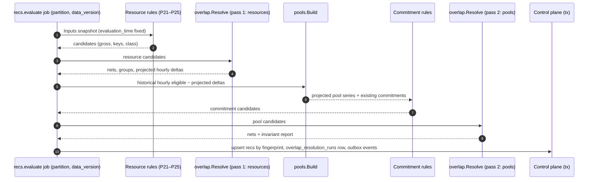

# Phase 25 — Design

Authoritative algorithm text: [RECOMMENDATION_ENGINE.md §5](../../architecture/RECOMMENDATION_ENGINE.md). This document gives the implementation design. Rule catalog rows REC-COM-*, REC-REG-*, REC-LIC-*, REC-GOV-* are defined in §2 of that document.

## 1. Components

| Package | Responsibility |
|---|---|
| `internal/recommendations/overlap` | Pure function `Resolve(ctx, Partition, []Candidate, PoolState) (Result, error)`. It has no I/O, uses decimals only, sorts its input first, and asserts invariants. |
| `internal/recommendations/pools` | Builds `CommitmentPool`s per provider type from `commitments`, `commitment_utilization` and hourly eligible spend (semantic query). Provides the eligibility predicate and coverage order. |
| `internal/recommendations/rules/commitments` | REC-COM-001…004 (they run after the resource resolution pass) |
| `internal/recommendations/rules/regions` | REC-REG-001/002 |
| `internal/recommendations/rules/licensing` | REC-LIC-001/002 (reads `license_declarations`) |
| `internal/recommendations/rules/governance` | REC-GOV-001/002/003 |
| `internal/recommendations/simulate` | Read-only commitment what-if (P25-R15) |



If an invariant fails, the job ends `failed_validation`. No recommendation rows change, an ingestion-health-style alert is raised, and the run is recorded with the failing invariant.

## 2. Resolver algorithm (deterministic)

```
sort candidates by (partition, fingerprint)
components = union-find over overlap_keys (pool:* keys excluded in pass 1)
for each component G (sorted by min fingerprint):
  r = target resource; cost0 = C_m(r) ; S* = C_m(r)
  if any eliminate in G: winner = argmax score; net(winner)=cost0; others alternative/0
  else:
    for each exclusive key k (resource_shape, resource_schedule, purchase_option): keep argmax score
    survivors sorted by (class precedence, score desc, rule_id, fingerprint)
    cost = cost0
    for s in survivors: proj = s.projected_cost(cost); net=min(cost-proj, s.gross); cost=proj
                        if covered_by_inflexible_commitment(r) and no_other_eligible_usage:
                            net = net × on_demand_share(r)   # freed commitment still billed
  assert Σnet ≤ S*, 0 ≤ net ≤ gross
emit hourly projected deltas per pool membership (net/730 spread over the resource's active hours)
```

`projected_cost(cost)` is declared by each rule as a ratio or delta function so it can be applied to an already-reduced base. Examples: reshape = `cost × price(target)/price(current)`; schedule = `cost × scheduled_hours/730`; spot = `cost × (1 − spot_discount)`.

### 2.1 Commitment sizing (REC-COM-001/002)
- `E_h` = projected eligible on-demand-equivalent spend for hour h over the lookback (30 days min, 60 days preferred), after subtracting the deltas from pass 1 and the coverage of existing commitments, applied in provider coverage order (RIs before SPs on AWS; resource CUDs before spend CUDs on GCP; reservations before savings plans on Azure).
- Discount `d` comes from the price catalog for (term, payment option) and is adjusted by the observed discount ratio (`f_price`).
- Hourly commitment `c = (1 − d) × p10(E_h)`. Savings = `Σ_h (min(E_h, c/(1−d)) − c)`, normalized to 730 h. Hours where E_h falls below the commitment level reduce savings automatically.
- S\*(pool) = `Σ_h E_h × d_max`, where `d_max` is the best available discount. INV-2 checks Σ net(pool recs) ≤ S\*(pool).
- Evidence includes the hourly percentile table, the existing coverage, the projected-vs-historical delta, breakeven months = upfront ÷ monthly savings, and alternatives by term and payment option (stored as alternatives with net 0).

### 2.2 Pool keys
| Provider | Pool type | Pool key | Flexibility |
|---|---|---|---|
| AWS | Compute SP | `pool:aws:csp:<payer>` | any region/family/OS, EC2+Fargate+Lambda |
| AWS | EC2 Instance SP | `pool:aws:isp:<payer>:<region>:<family>` | size/OS within family+region |
| AWS | RI (regional, Linux) | `pool:aws:ri:<payer>:<region>:<family>` | size flexibility via normalization factors |
| GCP | Resource CUD | `pool:gcp:rcud:<billing_account>:<region>:<series>` | vCPU/memory within series+region |
| GCP | Spend CUD | `pool:gcp:scud:<billing_account>:<service>` | per-service spend |
| Azure | Reservation | `pool:azure:res:<scope>:<isf_group>:<region>` | instance-size-flexibility group |
| Azure | Savings plan | `pool:azure:sp:<scope>` | compute across regions |

## 3. Licensing and governance
- REC-LIC-001: license-meter cost (Windows/SQL "license included" meters, from FOCUS `x_` columns or SKU mapping) on resources where the tenant has declared eligible licenses with unused capacity (`declared_cores − cores already applied`). Net is capped by the declared capacity, assigned in descending order of meter cost, with deterministic tie-breaks.
- REC-LIC-002: SQL Enterprise with ≤ 16 cores and no Enterprise-only features observed. If feature usage is not observable, confidence is capped at 0.5 and risk is high.
- Governance: REC-GOV-001 uses the required-tag policy (`tag_policies` or Phase 15's equivalent). REC-GOV-002 uses Phase 15 unallocated totals. REC-GOV-003 uses Phase 17 budgets.

## 4. Data model (migrations `p25_*`)

```sql
-- p25_001_recommendation_overlap (expand)
ALTER TABLE recommendations
  ADD COLUMN action_class text CHECK (action_class IN ('eliminate','reshape','schedule','purchase_option','pricing','informational')),
  ADD COLUMN overlap_keys text[] NOT NULL DEFAULT '{}',
  ADD COLUMN overlap_role text CHECK (overlap_role IN ('primary','sequential','alternative')),
  ADD COLUMN overlap_sequence int,
  ADD COLUMN achievable_monthly_savings numeric(38,12),
  ADD COLUMN savings_kind text NOT NULL DEFAULT 'saving' CHECK (savings_kind IN ('saving','avoidance','informational','governance')),
  ADD COLUMN resolution_run_id uuid;
CREATE INDEX ix_recs_overlap_group ON recommendations (tenant_id, overlap_group);

-- p25_002_commitment_pools
CREATE TABLE commitment_pools (
  tenant_id uuid NOT NULL, id uuid NOT NULL, provider text NOT NULL, pool_type text NOT NULL,
  pool_key text NOT NULL, scope jsonb NOT NULL, currency char(3) NOT NULL,
  eligible_monthly_od numeric(38,12) NOT NULL, covered_monthly_od numeric(38,12) NOT NULL,
  utilization numeric(7,6), data_version bigint NOT NULL, computed_at timestamptz NOT NULL,
  PRIMARY KEY (tenant_id, id), UNIQUE (tenant_id, pool_key));

-- p25_003_overlap_resolution_runs
CREATE TABLE overlap_resolution_runs (
  tenant_id uuid NOT NULL, id uuid NOT NULL, partition_key text NOT NULL, data_version bigint NOT NULL,
  input_sha256 bytea NOT NULL, candidates int NOT NULL, groups int NOT NULL,
  invariants jsonb NOT NULL, status text NOT NULL CHECK (status IN ('succeeded','failed_validation')),
  started_at timestamptz NOT NULL, finished_at timestamptz NOT NULL, PRIMARY KEY (tenant_id, id));

-- p25_004_license_declarations
CREATE TABLE license_declarations (
  tenant_id uuid NOT NULL, id uuid NOT NULL, product text NOT NULL CHECK (product IN ('windows_server','sql_server_standard','sql_server_enterprise','rhel','sles','other')),
  program text NOT NULL CHECK (program IN ('byol','azure_hybrid_benefit','license_mobility','other')),
  cores int NOT NULL CHECK (cores > 0), scope jsonb NOT NULL, valid_from date NOT NULL, valid_to date,
  attested_by uuid NOT NULL, note text, version bigint NOT NULL DEFAULT 1,
  created_at timestamptz NOT NULL DEFAULT now(), updated_at timestamptz NOT NULL DEFAULT now(), PRIMARY KEY (tenant_id, id));

-- p25_005_tag_policies (only if Phase 15 did not deliver an equivalent)
CREATE TABLE tag_policies (tenant_id uuid NOT NULL, id uuid NOT NULL, scope jsonb NOT NULL, required_keys text[] NOT NULL,
  threshold_pct numeric(7,3) NOT NULL DEFAULT 5, PRIMARY KEY (tenant_id, id));
```
All new tables: RLS enabled and forced with the standard `tenant_isolation` policy. `commitment_pools` is a derived cache that is rebuilt per `data_version`.

## 5. Security
- Permissions (from [AUTHORIZATION_MODEL.md](../../security/AUTHORIZATION_MODEL.md)): `recommendations:read` (scoped), `commitments:read` (scoped), `recommendation_rules:configure`. New: `license_declarations:read` / `license_declarations:manage` (tenant-wide, to be added to the catalog).
- Pool aggregates can include usage from scopes the caller cannot see. The API returns pool numbers only when the caller's `commitments:read` scope contains the pool scope (AZ-10). Otherwise it returns 404, which avoids partial-sum leakage.
- License declarations are attestations: `attested_by` is recorded, every change is audited (`license_declaration.update`), and evidence cites the declaration ID.

## 6. Failure modes
| Failure | Behavior |
|---|---|
| Invariant violated | run `failed_validation`, previous nets stay live, alert, run row kept for diagnosis |
| Missing hourly series (pool) | no commitment candidate; `data_gap` note |
| Price catalog lacks a term/payment option | that alternative is omitted; `f_price` lowered |
| Commitment data stale (> 7 days) | commitment rules skip (freshness rule) |
| Partial-inputs evaluation | candidates are not expired (§7 of the engine doc) |

ADRs: [ADR-0007](../../architecture/adr/0007-fixed-point-decimal-money-end-to.md), [ADR-0012](../../architecture/adr/0012-plugin-model-compile-time-first-party.md), [ADR-0004](../../architecture/adr/0004-pluggable-analytics-engines-behind-a-semantic.md).
