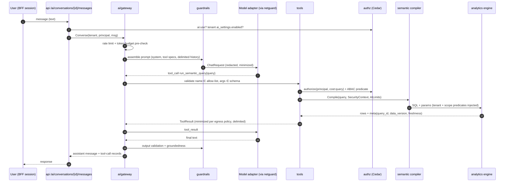
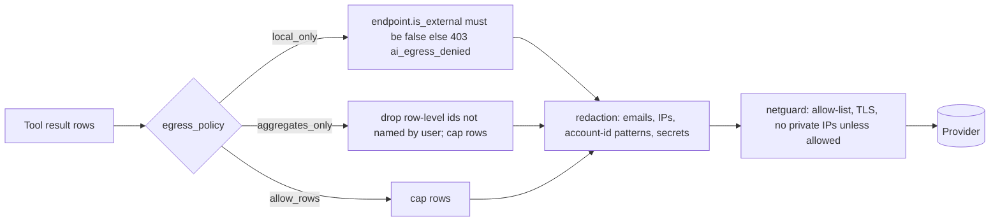

# Phase 27 — Design: LLM gateway and governed NL-to-query

Related decisions: [ADR-0013](../../architecture/adr/0013-llm-gateway-with-tool-only-data.md) (tool-only data access, no model SQL), [ADR-0008](../../architecture/adr/0008-authorization-rbac-abac-via-cedar-policies.md) (Cedar + predicate compilation), [ADR-0009](../../architecture/adr/0009-keyless-cloud-federation-and-secret-references.md) (secret references), [ADR-0004](../../architecture/adr/0004-pluggable-analytics-engines-behind-a-semantic.md) (semantic layer), [ADR-0014](../../architecture/adr/0014-hash-chained-append-only-audit-log.md) (audit). Threat model: [LLM_SECURITY.md](../../architecture/LLM_SECURITY.md), [TRUST_BOUNDARIES.md](../../architecture/TRUST_BOUNDARIES.md).

## 1. Components

| Package | Responsibility |
|---|---|
| `internal/ai/gateway` | `Gateway` interface. Selects the adapter from tenant config, enforces budgets and timeouts, and normalizes tool-call formats and usage accounting. |
| `internal/ai/adapters/openai` | OpenAI-compatible Chat Completions (`tools`, `tool_choice`, `stream`). Covers vLLM, LiteLLM, Azure OpenAI via base URL. |
| `internal/ai/adapters/anthropic` | Anthropic Messages API (`tools`, `tool_use`/`tool_result` blocks, SSE). |
| `internal/ai/adapters/ollama` | Ollama-compatible `/api/chat` with `tools`. Typically local. |
| `internal/ai/adapters/mock` | Deterministic scripted adapter. Scripts are YAML: a match on the user message, then a sequence of tool calls and a final text. Used by all CI tests. |
| `internal/ai/tools` | Tool registry, JSON Schemas for arguments, execution through domain `api.go` interfaces with the user principal. |
| `internal/ai/guardrails` | Prompt assembly (instruction hierarchy, data delimiting), input and output validation, redaction, groundedness check. |
| `internal/ai/policy` | Egress policy, minimization (aggregate-only shaping), budgets and rate limits. |
| `internal/ai/conversations` | Conversation and message persistence, retention, purge job. |
| `internal/platform/netguard` | Outbound HTTP client with an allow-list, private-IP blocking and DNS-rebinding defense. |

```go
// internal/ai/gateway/gateway.go
type Gateway interface {
    Converse(ctx context.Context, tc tenancy.Context, p authz.Principal, req TurnRequest, sink EventSink) (TurnResult, error)
}
type ModelAdapter interface {
    Name() string                                          // "openai" | "anthropic" | "ollama" | "mock"
    Chat(ctx context.Context, req ChatRequest) (ChatStream, error) // ChatStream yields TextDelta | ToolCall | Usage | Done
}
type Tool interface {
    Name() string
    ArgsSchema() json.RawMessage                            // JSON Schema 2020-12
    RequiredPermission() authz.Action                       // e.g. "cost:query"
    Execute(ctx context.Context, p authz.Principal, args json.RawMessage) (ToolResult, error) // read-only
}
```

## 2. Turn sequence



The loop is bounded: at most 8 tool calls per turn, a 60 s wall-clock turn budget and a 15 s query timeout.

## 3. Data model and migrations

The tables from [DATABASE_SCHEMA.md §2.8](../../architecture/DATABASE_SCHEMA.md) (`ai_conversations`, `ai_messages`, `ai_tool_calls`) are extended. No duplicates are created.

```sql
-- p27_001_ai_provider_configs.sql
CREATE TABLE ai_provider_configs (
  tenant_id uuid NOT NULL REFERENCES tenants(id), id uuid NOT NULL,
  adapter text NOT NULL CHECK (adapter IN ('openai','anthropic','ollama')),
  base_url text NOT NULL, model text NOT NULL,
  credential_ref text,                       -- secret reference; NULL allowed for local Ollama
  is_external boolean NOT NULL,              -- false only if endpoint resolves to an operator-allowed private range
  params jsonb NOT NULL DEFAULT '{}',        -- temperature (default 0), max_output_tokens
  created_at timestamptz NOT NULL DEFAULT now(), updated_at timestamptz NOT NULL DEFAULT now(), version bigint NOT NULL DEFAULT 1,
  PRIMARY KEY (tenant_id, id)
);
-- tenant_settings.ai_settings (existing jsonb, default {"enabled":false}) gains validated keys:
-- {"enabled":false,"provider_config_id":null,"egress_policy":"aggregates_only","allow_external":false,
--  "retention_days":30,"budgets":{"user_daily_tokens":200000,"tenant_monthly_tokens":20000000,"user_rpm":10},
--  "tools":["semantic_catalog","run_semantic_query","get_freshness","list_recommendations","get_recommendation","list_anomalies","list_budgets"],
--  "redaction_patterns":[], "link_allow_list":[]}

-- p27_002_ai_usage_ledger.sql
CREATE TABLE ai_usage (
  tenant_id uuid NOT NULL, id uuid NOT NULL, user_id uuid NOT NULL, conversation_id uuid,
  provider_config_id uuid NOT NULL, tokens_in int NOT NULL, tokens_out int NOT NULL,
  occurred_at timestamptz NOT NULL, PRIMARY KEY (tenant_id, id)
);
CREATE INDEX ix_ai_usage_user_day ON ai_usage (tenant_id, user_id, occurred_at);

-- p27_003_ai_conversation_ext.sql (expand only)
ALTER TABLE ai_conversations ADD COLUMN deleted_at timestamptz, ADD COLUMN egress_policy text NOT NULL DEFAULT 'aggregates_only';
ALTER TABLE ai_messages ADD COLUMN redacted boolean NOT NULL DEFAULT false, ADD COLUMN guardrail_flags jsonb NOT NULL DEFAULT '[]';
ALTER TABLE ai_tool_calls ADD COLUMN error_code text, ADD COLUMN query_id text, ADD COLUMN rows_returned int;
```
All new tables: RLS enabled and forced through the Phase 04 migration helper, composite FKs on `(tenant_id, …)`. `ai_tool_calls.arguments` stores the validated semantic query, never SQL.

## 4. Tool allow-list

| Tool | Underlying permission | Result shaping |
|---|---|---|
| `semantic_catalog` | `cost:query` | metrics and dimensions visible to the principal only |
| `run_semantic_query` | `cost:query` | ≤ 1 000 rows. Under `aggregates_only`, the dimension `resource_id` is allowed only if the user message contains that ID. |
| `get_freshness` | `cost:query` | per-connector lag, completeness |
| `list_recommendations` / `get_recommendation` | `recommendations:read` | ≤ 50 items; evidence summarized |
| `list_anomalies` | `anomalies:read` | ≤ 50 items |
| `list_budgets` | `budgets:read` | ≤ 50 items |

The registry is compiled into the binary. Tenants can disable tools but cannot add them. No tool has a write path: a static test asserts that every tool's domain dependency is a `Reader` interface.

## 5. Prompt assembly and injection defenses
1. **Instruction hierarchy**: system policy, then tool specs, then conversation, then data. The system prompt is versioned (`prompt_version`) and stored with each message.
2. **Delimiting**: every untrusted value is serialized inside `<untrusted_data id="…">` JSON blocks. Delimiter collisions in data are escaped (`<` → `<`). Tool results are always JSON, never free text.
3. **Argument validation**: JSON Schema with `additionalProperties:false`. Any string matching `(?i)\b(select|insert|update|delete|drop|union)\b.*\b(from|into|table)\b` in a free-text field is rejected as `sql_not_allowed`.
4. **Output validation**: strip HTML and markdown images. Links are kept only if they match the tenant `link_allow_list` or the CloudLedger origin. Secret-pattern scan (gitleaks rules subset). Block outputs that claim actions were performed ("I have deleted…").
5. **Refusals**: unauthorized scope, unsupported question, budget exceeded. All use templated text that does not reveal whether out-of-scope data exists.

## 6. Egress and minimization



## 7. Security
- Conversations: RLS by tenant, with an owner check at the service layer (`user_id = principal`). Admins cannot read other users' conversations. They can delete them for compliance (`ai.conversation.admin_delete`, audited).
- Caches: semantic results keyed by tenant and principal scope hash (Phase 13 behavior is reused unchanged).
- Audit actions: `ai.config.update`, `ai.enabled`, `ai.disabled`, `ai.tool.denied`, `ai.query.rejected`, `ai.egress.denied`, `ai.budget.exceeded`, `ai.conversation.delete`. Details never include prompt text.
- Logs: prompts and completions are never logged at INFO. A DEBUG content log is off by default, and when it is enabled it carries redacted content only.

## 8. Failure modes

| Failure | Behavior |
|---|---|
| Provider timeout or 5xx | Retry once with jitter (non-streaming phase only), then `503 ai_provider_unavailable`. No partial answer is persisted as final. |
| Provider 429 | Propagate `Retry-After`; count no tokens. |
| Malformed tool call (bad JSON) | Return a tool error to the model (max 2 repairs), then refuse. |
| Query exceeds limits | Typed tool error (`ai_limit_exceeded`) so the model can narrow the query. |
| Analytics unavailable | Tool error `analytics_unavailable`; the answer states that data could not be retrieved. |
| Secret ref unresolvable | AI marked `degraded` in settings; `503 ai_misconfigured`; admin notified. |
| Budget ledger write fails | Fail closed: the turn is rejected. |
