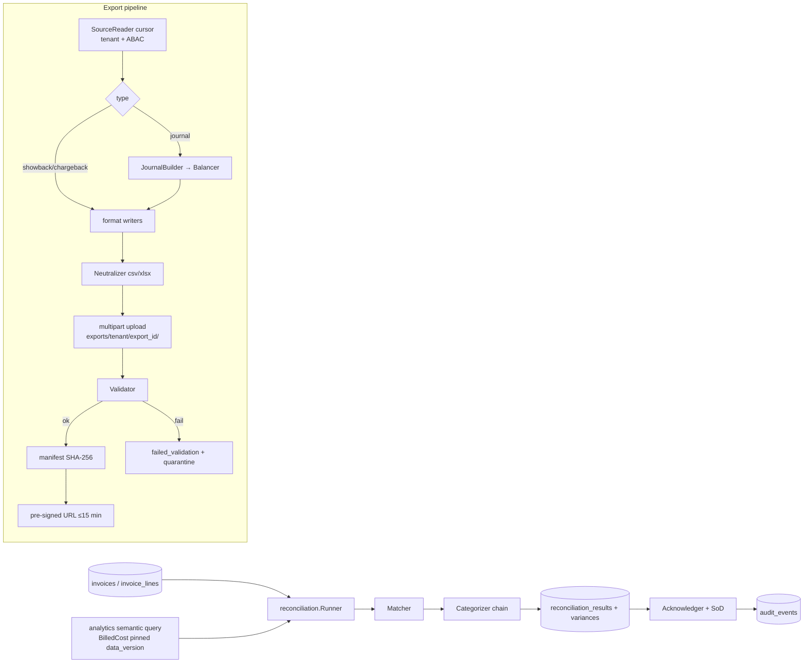
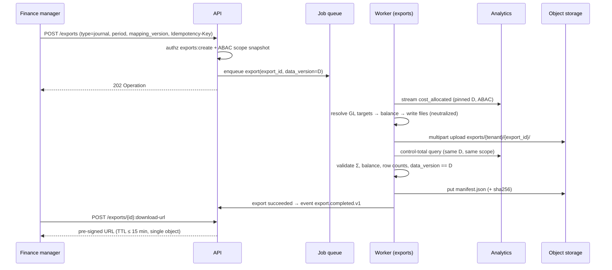

# Phase 29 — Design

Builds on Phase 10 (reconciliation foundation), Phase 15 (allocation) and Phase 18 (FX, calendars). Reference: [FINANCE_RECONCILIATION.md](../../architecture/FINANCE_RECONCILIATION.md), [DATABASE_SCHEMA.md §2.6](../../architecture/DATABASE_SCHEMA.md).

## 1. Components

| Package | Responsibility |
|---|---|
| `internal/finance/reconciliation` | `Runner` (pins `data_version`, builds line groups), `Matcher` (v2: invoice_id first, then period/account/currency/category keys), `Categorizer` chain, `Acknowledger` (SoD checks), restatement subscriber |
| `internal/finance/journal` | `GLMappingSet` (versioned), `Resolver` (precedence), `JournalBuilder`, `Balancer` (half-even rounding + residual line) |
| `internal/finance/exports` | `ExportEngine` (job orchestration), `SourceReader` (semantic query cursor), writers (`csv`, `xlsx`, `ndjson`, `parquet`, `pdf`), `Neutralizer`, `ManifestBuilder`, `Validator`, `Uploader` (multipart, tenant prefix) |
| `internal/analytics` (existing) | semantic queries over `cost_focus` / `cost_allocated` with tenant + ABAC injection |
| `internal/audit` (existing) | `variance.acknowledge`, `gl_mapping.publish`, `export.create`, `export.download_url.issue` |
| `apps/web` | reconciliation workbench, GL mapping editor, export wizard |

## 2. Reconciliation algorithm

1. Resolve invoice → period window, billing account(s), currency. Read `data_version` D for the tenant; all queries pin D.
2. Build **line groups**: invoice lines grouped by (account_ref, category normalized to FOCUS ChargeCategory, service when present). Computed side: semantic query `billed_cost` by the same keys with `include.tax=true, credits=true`, filtered to `InvoiceId` when the provider populates it (FOCUS 1.2), else by billing period + account.
3. `diff = invoice_amount − computed_amount` per group (exact decimal).
4. Categorizer chain (ordered, each consumes part of the remaining diff and emits a variance with evidence):
   `tax` (invoice tax vs Tax charge category) → `credit` → `marketplace` → `support` → `fx` (billing vs invoice currency rate source differences) → `late_correction` (rows with ChargeClass=Correction after `provider_final`) → `timing` (charges dated outside the invoice window) → `missing_data` (expected scope/period absent per ingestion health) → `rounding` (|remaining| ≤ number of lines × half minor unit) → `unexplained` (the rest).
5. Invariant: Σ variances = Σ diff. Asserted before commit; failure aborts the run (bug class).
6. Status: `matched` if diff = 0; `within_tolerance` if |diff| ≤ tolerance and no `unexplained`; else `variance`. Result is `acknowledged` when every non-rounding variance has a current acknowledgment.

Restatement: subscriber on `cost.period.restated.v1` enqueues `reconcile(invoice_id)` with unique key `(tenant, invoice_id, data_version)`. Variances are matched to the previous run by (category, group key); if the amount changed, the old acknowledgment is marked stale.

## 3. GL mapping and journal

GL mapping rule: `{match: {hierarchy_node?: path-prefix, dimension?: {key, value}, charge_category?: [...], provider?: [...]}, target: {gl_account, cost_center, entity, tax_code?}, position}`. First match by `position` wins; the mapping set must define `default_account` (suspense) and `offset_account` (credit side, e.g. accrued cloud payable) and `rounding_account`.

Journal builder (per entity, currency, accounting period from Phase 18 calendar):
1. Aggregate `cost_allocated` by mapping target at full precision (scale 12).
2. For each target emit a debit line `round_half_even(amount, minor_unit)`; negative amounts (credits) become credits to the expense account.
3. Offset: one credit line per (entity, currency) equal to Σ unrounded amounts rounded half-even.
4. Residual = offset − Σ rounded debit lines; if ≠ 0, post to `rounding_account` (bounded by n × half minor unit, else fail). Lines are ordered deterministically (gl_account, cost_center, hierarchy path).

## 4. Formula-injection neutralization
Applied to every string cell in CSV and XLSX: if first rune ∈ {`=`,`+`,`-`,`@`,`\t`,`\r`} prefix `'`. Additionally CSV fields are RFC 4180 quoted; embedded NUL stripped. Money columns are typed: CSV writes canonical decimal strings generated by the writer (not user data, so not neutralized); XLSX writes numeric cells from decimal with format `#,##0.00` plus a text column `amount_exact` preserving 12 dp. JSON and Parquet are not neutralized (no formula semantics) but are schema-typed.

## 5. Data model and migrations

| Migration | Change |
|---|---|
| `p29_001_reconciliation_ext.sql` | `reconciliation_results` + `initiated_by uuid`, `superseded_by uuid`, `line_group_count int`; `reconciliation_variances` + `group_key text`, `ack_status text CHECK (ack_status IN ('none','current','stale'))`, `ack_reason_category text` (expand only) |
| `p29_002_variance_acks.sql` | `reconciliation_acknowledgments (tenant_id, id, variance_id, actor_id, reason text NOT NULL, category_confirmed text NOT NULL, supersedes_id uuid, created_at)` insert-only (trigger rejects UPDATE/DELETE) — acknowledgments are history, the variance columns are a projection |
| `p29_003_gl_mappings.sql` | `gl_mapping_sets (tenant_id, id, key, version int, status draft/published/superseded, effective_from date, default_account, offset_account, rounding_account, entity_default, checksum bytea, published_by, published_at)`, `gl_mapping_rules (tenant_id, id, set_id, position, match jsonb, target jsonb)`; UNIQUE `(tenant_id, key, version)` |
| `p29_004_exports.sql` | `exports (tenant_id, id, type CHECK IN ('showback','chargeback','journal','cost_detail','reconciliation'), formats text[], params jsonb, data_version bigint, scope_hash bytea, gl_mapping_set_id uuid, status CHECK IN ('queued','running','validating','succeeded','failed','failed_validation','expired'), row_count bigint, manifest_sha256 bytea, storage_prefix text, requested_by uuid, created_at, finished_at, expires_at)`, `export_files (tenant_id, export_id, name, format, sha256, size_bytes, row_count)` |

All tables: `tenant_id` first, PK `(tenant_id, id)`, composite FKs, RLS enabled and forced, `numeric(38,12)` for money. Exports are retained per tenant setting (default 30 days); manifests are retained with the audit log. Phase 30 reuses `exports` for report artifacts via `report_runs`.

## 6. Security
- Authorization: `reconciliations:read|run|acknowledge`, `gl_mappings:read|write|publish`, `exports:create|read|download`. Built-in: finance manager (all), FinOps admin (exports, read reconciliations), auditor (read + download, no acknowledge), engineering manager (showback within scope only).
- ABAC: the export captures the principal's scope hash at request time; worker re-evaluates the scope (membership revoked mid-run → fail). Journal export requires full-tenant scope (partial-scope journals would be misleading) unless `allow_partial=true` is explicitly set and labeled.
- Pre-signed URLs: single object, `GET` only, TTL ≤ 15 min, `Content-Disposition: attachment`, issuance audited.
- No billing values logged at INFO; manifest contains totals and is tenant-scoped.

## 7. Failure modes
| Failure | Behavior |
|---|---|
| Restatement mid-export (`data_version` changes) | validator fails → `failed_validation`, user retries; never mixed versions |
| Unbalanced journal / residual too large | export fails closed with `journal_unbalanced` detail |
| Unmapped rows | posted to default (suspense) account and counted in manifest `unmapped_amount`; warning, not failure |
| Object storage outage | job retries (transient policy); partial multipart uploads aborted |
| Worker crash | job lease expires; restart from scratch (staging prefix deleted) |
| Analytics timeout | export bucket timeout higher than interactive (default 30 min); typed error |
| Invoice in currency with no FX rate | `fx` variance cannot be computed → `missing_data` variance with reason |

## 8. ADRs
[ADR-0004](../../architecture/adr/0004-pluggable-analytics-engines-behind-a-semantic.md) (exports read only through the semantic layer), [ADR-0005](../../architecture/adr/0005-postgresql-backed-durable-job-queue-and.md), [ADR-0007](../../architecture/adr/0007-fixed-point-decimal-money-end-to.md), [ADR-0008](../../architecture/adr/0008-authorization-rbac-abac-via-cedar-policies.md), [ADR-0010](../../architecture/adr/0010-immutable-content-addressed-raw-storage-and.md), [ADR-0014](../../architecture/adr/0014-hash-chained-append-only-audit-log.md).
