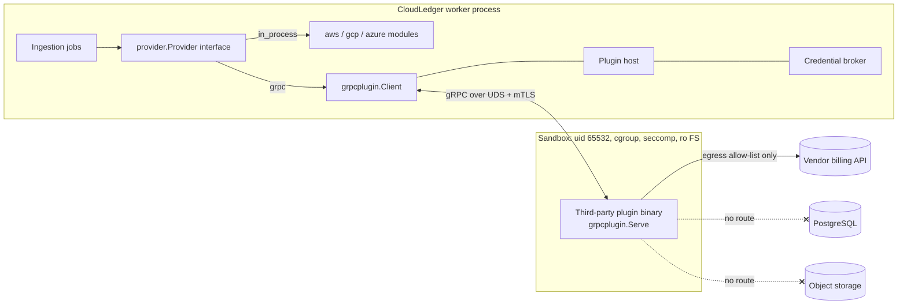

# Phase 35 Design: External Provider Connector SDK

Decisions: [ADR-0012](../../architecture/adr/0012-plugin-model-compile-time-first-party.md) (plugin model), [ADR-0009](../../architecture/adr/0009-keyless-cloud-federation-and-secret-references.md) (credentials), [ADR-0017](../../architecture/adr/0017-opentelemetry-native-observability.md) (telemetry), [ADR-0015](../../architecture/adr/0015-source-available-licensing.md) (licensing; documentation and CI only).

## 1. Components

| Component | Package | Responsibility |
|---|---|---|
| SDK v1 | `sdk/provider` | Interfaces, types, error classes, `Manifest` type, helpers. No dependency on core. |
| Proto + adapters | `sdk/provider/proto/provider/v1`, `sdk/provider/grpcplugin` | IDL, `Serve(Provider)` for plugin authors, `Client` that implements `provider.Provider` on the host side. |
| Manifest validator | `sdk/provider/manifest` | JSON Schema validation (embedded schema), SPDX expression parser, capability cross-check helper. |
| Testkit | `sdk/provider/testkit` | Compatibility suite, fixture recorder/replayer, read-only HTTP allow-list checker, goroutine-leak detector. |
| Plugin registry | `internal/plugins/registry` | `plugins_installed` persistence, checksum verification, enable/disable, audit. |
| Plugin host | `internal/plugins/host` | Process launch, handshake, health, restart policy, deadlines, log capture, OTel propagation. |
| Sandbox driver | `internal/plugins/sandbox` | `exec` driver (Compose/Lite: setuid user + cgroup v2 + seccomp + nftables egress) and `pod` driver (Kubernetes: sidecar-less plugin pods with NetworkPolicy). |
| Credential broker | `internal/plugins/credbroker` | Serves `CredentialProvider` over gRPC; mints short-lived scoped credentials from the connector's federation config. |
| Admin API/UI | `internal/plugins/api`, `apps/web/app/admin/plugins` | Platform-admin plugin management and Plugins page (license column). |
| CLI | `cmd/cloudledger-sdk` | `init`, `validate`, `test`, `package`, `run --dev`. |
| Example provider | `providers/examples/examplecloud` | Reference implementation; billing (CSV), inventory (JSON API), verification. |

## 2. Execution model



The core persists everything; plugins only return typed records and streams (PROVIDER_SDK.md design rule 2).

## 3. Handshake and lifecycle

```mermaid
sequenceDiagram
  participant H as Host
  participant P as Plugin process
  H->>H: verify package checksum == plugins_installed.checksum
  H->>H: check compatibility.sdk / .cloudledger ranges
  H->>P: exec in sandbox, env CLOUDLEDGER_PLUGIN_COOKIE, PROTO_MIN=1, PROTO_MAX=1, ephemeral client cert
  P-->>H: stdout line "1|1|unix|/run/cl-plugins/<id>.sock|grpc|<server-cert-b64>"
  H->>P: TLS dial (pinned server cert), Handshake{cookie, proto=1}
  P-->>H: HandshakeResponse{proto=1, manifest_digest}
  H->>H: manifest_digest must equal installed manifest checksum
  H->>P: Health.Check every 15 s
  Note over H,P: per-call deadline; crash → restart w/ backoff (1s..60s, 5/10min) → degraded
  H->>P: Shutdown (grace 10 s) then SIGKILL
```

Protocol versioning: integer major (`1`). Additive fields are allowed within v1 (proto3 unknown-field tolerance). A v2 requires a new package `cloudledger.provider.v2` and a host that serves both for one minor release ([COMPATIBILITY.md](../../contracts/COMPATIBILITY.md)).

## 4. Manifest schema

`schemas/manifest/plugin-manifest.v1.json` formalizes [CAPABILITY_MANIFEST.md](../../contracts/CAPABILITY_MANIFEST.md). Key constraints:

| Field | Constraint |
|---|---|
| `apiVersion` | const `cloudledger.dev/plugin/v1` (prefix placeholder pending OQ-01) |
| `kind` | enum `Provider`, `RecommendationRule`, `PricingSource`, `DashboardWidget` (latter three detailed in Phase 36) |
| `metadata.id` | first-party: `^[a-z][a-z0-9-]{1,31}$`; third-party: reverse-DNS `^[a-z0-9]+(\.[a-z0-9-]+){2,}$` |
| `metadata.version` | SemVer 2.0 |
| `metadata.license` | **required**, string, validated by SPDX expression parser (custom keyword `x-spdx-expression`) |
| `metadata.source`, `security_contact` | required for `execution.mode = grpc` |
| `execution.egress` | required and non-empty for `grpc`; host:port patterns, no IP literals in private ranges unless operator override |
| `capabilities.*` | each must map to an implemented SDK interface (testkit cross-check) |

## 5. Data changes

Migration `0350_plugins_installed_v2` (expand-only; existing table in [DATABASE_SCHEMA.md §2.8](../../architecture/DATABASE_SCHEMA.md)):

```sql
ALTER TABLE plugins_installed
  ADD COLUMN execution_mode text NOT NULL DEFAULT 'in_process' CHECK (execution_mode IN ('in_process','grpc')),
  ADD COLUMN sdk_version text,
  ADD COLUMN protocol_version int,
  ADD COLUMN status text NOT NULL DEFAULT 'installed' CHECK (status IN ('installed','running','degraded','disabled','incompatible')),
  ADD COLUMN status_reason text,
  ADD COLUMN sbom_ref text,
  ADD CONSTRAINT uq_plugins_key_version UNIQUE (plugin_key, version);
CREATE TABLE plugin_validation_log (
  id uuid PRIMARY KEY, plugin_id uuid NOT NULL REFERENCES plugins_installed(id),
  at timestamptz NOT NULL, outcome text NOT NULL, license_spdx text, messages jsonb NOT NULL
);
```

`plugins_installed` is platform-scoped (no `tenant_id`); per-tenant use is via `connectors.provider = <plugin id>`. `license_spdx` is denormalized from the manifest for display only. No column, index or code path uses it for authorization or gating (NFR-LIC-004).

## 6. Infrastructure changes

- Helm: `plugins.enabled`, `plugins.driver: pod|exec`, `plugins.defaultLimits {cpu: 500m, memory: 512Mi, pids: 256}`, a `cloudledger-plugins` namespace-scoped ServiceAccount with no RBAC, a default-deny NetworkPolicy plus generated per-plugin egress policies.
- Compose (Lite): `exec` driver; requires cgroup v2. If unavailable, the host refuses `grpc` plugins unless `plugins.allowUnsandboxed=true` (logged as a warning, documented as unsafe).
- Images: plugins mounted read-only from `/var/lib/cloudledger/plugins/<id>/<version>/`.

## 7. Security

| Threat | Control |
|---|---|
| Malicious plugin reads other tenants' data | Plugin never connects to stores; the host passes only the connector's scope and credentials; every call is bound to one `(tenant, connector)` and the host discards records with mismatched scope refs. |
| Credential exfiltration | Broker issues credentials with ≤ 15 min TTL scoped to the connector role; egress allow-list; static keys never leave the host where federation exists. |
| Spoofed plugin process / socket hijack | Per-launch keypair, pinned cert, socket dir `0700` owned by host user, magic cookie. |
| Resource exhaustion | cgroup limits, gRPC max message size (16 MiB), stream back-pressure, per-call deadlines. |
| Supply chain | Package checksum pinned at install; optional Cosign signature verification (`plugins.requireSignature`); SBOM recorded. |
| Log injection / secret leakage | Plugin stderr is captured line-by-line, truncated at 8 KiB, passed through the redaction filter. |

The pen-test scope in Phase 34 includes the plugin sandbox; findings from that phase must be closed or accepted before this phase's exit.

## 8. Failure modes

| Failure | Behavior |
|---|---|
| Handshake mismatch | Plugin `incompatible`, connector verification returns `fail` with remediation text; audit event `plugin.launch_failed`. |
| Plugin crash mid-stream | Ingestion run fails with `ErrTransient`; stage aborted (no partial commit, ADR-0010); retried per FR-ING-004. |
| Plugin hang | Deadline exceeded → kill → restart; after 5 restarts in 10 min → `degraded`, jobs back off. |
| Manifest drift (binary manifest ≠ installed manifest) | Launch refused. |
| Sandbox driver unavailable | `grpc` plugins disabled, admin banner; in-process providers unaffected. |

## 9. Licensing design [LIC]

Documentation and CI only; no runtime behavior depends on license values.

| Path | Header (Option A / Option B per OQ-22) | Import-lint rule |
|---|---|---|
| `sdk/provider/**` (incl. `proto`, `manifest`, `grpcplugin`, `testkit`) | `Apache-2.0` / `LicenseRef-CloudLedger-SAL-1.0 WITH LicenseRef-CloudLedger-Plugin-Exception` | may import only stdlib, allow-listed third party and other permissive `sdk/**` paths |
| `schemas/manifest/**` | same as SDK | n/a (JSON) |
| `providers/examples/**` | same as SDK (LICENSE_MAP) | same as SDK |
| `cmd/cloudledger-sdk`, `internal/plugins/**`, `providers/{aws,gcp,azure}` | `LicenseRef-CloudLedger-SAL-1.0` | core |

Enforcement: `reuse lint` with `REUSE.toml` path annotations; `golangci-lint` `depguard` rule `plugin-interfaces-no-core` denying `github.com/<org>/cloudledger/internal/...`, `/apps/...`, `/providers/aws|gcp|azure/...` for files in permissive paths; a `license-boundary` PR label required by CODEOWNERS when files move between path classes (LICENSE_MAP rule 2).

**Inconsistency to resolve (P35-T13):** LICENSE_MAP designates `providers/examples/` "same as SDK" (potentially Apache-2.0), while PLUGIN_LICENSING §1/§2 says every in-tree plugin under `providers/<name>` is CL-SAL-1.0. Proposed resolution: `providers/examples/**` is the only in-tree plugin path licensed as Plugin Interfaces (it is a template meant to be copied); all other `providers/**` remain CL-SAL. Requires Licensor sign-off and an edit to PLUGIN_LICENSING.md by the Licensor designee (outside this phase's docs).

**Dependency licensing:** `github.com/hashicorp/go-plugin` and `hashicorp/yamux` are MPL-2.0 (review-required). Preferred design: a native handshake on `google.golang.org/grpc` (Apache-2.0), avoiding the dependency; fallback is a recorded exception. Final choice in P35-T02.
