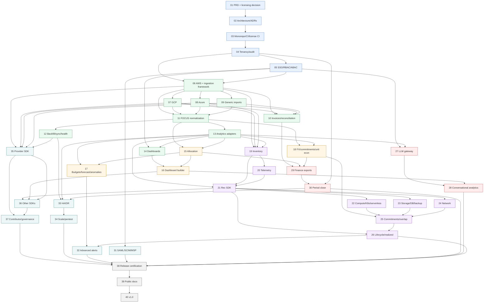

# Phase Dependency Graph

Source of truth for dependencies: [docs/phases/README.md](../phases/README.md). An edge `A --> B` means B cannot start its implementation until A is **ACCEPTED** (design work may overlap).

Colors: v0.1 blue · v0.2 green · v0.3 amber · v0.5 purple · v0.7 red · v0.9 teal · v1.0 grey.

## Critical path
`01 → 02 → 03 → 04 → 05 → 06 → 11 → 13 → 15 → 18 → 25 → 26 → 32 → 38 → 39 → 40` (plus `19 → 20 → 21 → 22/23/24 → 25`).

Phases 06–09, 19–24 and 31/35 contain parallelizable work streams once their prerequisites are accepted.

## Parallelization opportunities (with multiple contributors)
| After accepting | Can run in parallel |
|---|---|
| 06 | 07, 08, 09 |
| 11 | 12, 13 |
| 13 | 14, 15, 18, 19, 27 |
| 21 | 22, 23, 24 |
| 05 | 31 (design early; implementation planned for v0.9) |

## Licensing dependencies (documentation/compliance only)
`01 (decision + counsel) → 02 (ADR-0015, license map) → 03 (license CI) → 35/36 (plugin licensing) → 37 (CLA/trademark/governance) → 38 (license release gate) → 39 (publish approved texts) → 40 (final license in effect)`. Public repository publication is gated by [LICENSING_EVALUATION.md §6](../legal/LICENSING_EVALUATION.md#6-publication-gate).
