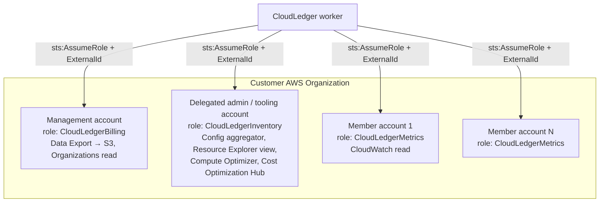

# AWS Provider

Status: **DRAFT**. No code exists. Primary phase: **06** (scopes, auth, CUR 2.0, Athena, Cost Explorer). Later: 10 (invoices), 18 and 25 (commitments), 19 (inventory), 20 (metrics), 21 (provider recommendations, pricing).
Requirements: FR-CON-001…006, FR-AWS-001…006, FR-NRM-002, FR-RES-001…003, FR-TEL-001…002, FR-REC-005.

> **Verification rule.** Statements marked **verify (Phase NN)** describe behaviour, limits or permission names that must be confirmed against current AWS documentation, and a recorded fixture, before implementation in that phase. IAM action names below come from the AWS Service Authorization Reference as understood at the time of writing. Phase 06 must re-validate every action with IAM Access Analyzer policy validation.

## 1. Scopes (FR-AWS-001)

| Scope type (`cloud_scopes.scope_type`) | What it is | Billing data visible | Discovery |
|---|---|---|---|
| `aws_account` (standalone) | An account that is not in an organization | Own account | `sts:GetCallerIdentity` |
| `aws_organization` (management / payer) | The management account of AWS Organizations | All member accounts. Data Exports created in the management account include every member account. | `organizations:ListAccounts`, OUs and tags |
| `aws_account` (linked / member) | A member account in an organization | Only its own usage, and only for the period it was a member, when the Data Export is created in that member account. Member-account access to billing data can be restricted by the management account. **verify (Phase 06)** | Parent from organization discovery |
| `aws_ou` | An organizational unit (for hierarchy and ABAC only, not a billing scope) | — | `organizations:ListOrganizationalUnitsForParent` |
| Delegated administrator | A member account registered as delegated admin for a specific service | Applies **per service**: AWS Config aggregators, Resource Explorer multi-account views, Compute Optimizer, Trusted Advisor organizational view and Cost Optimization Hub can be delegated. Billing data (Data Exports) is generally **not** delegable in the same way. Organizations read APIs can be delegated through an Organizations resource-based delegation policy. **verify (Phase 06, 19, 21)** | `organizations:ListDelegatedAdministrators` |

Recommended topology for organizations:



Keeping the management-account role limited to billing and Organizations reads follows AWS guidance to minimise workloads and access in the management account. Member-account roles are deployed with a CloudFormation **StackSet** (service-managed, auto-deploy to new accounts).

## 2. Authentication (FR-CON-003, ADR-0009)

| Method | When | Mechanics | Status |
|---|---|---|---|
| `assume_role` + ExternalId | Default | CloudLedger obtains its own AWS identity (see below) and calls `sts:AssumeRole` on the customer role with `ExternalId` set to a per-connector random value (≥ 32 chars). The trust policy pins CloudLedger's principal and requires `sts:ExternalId`. Session duration ≤ 1 h. Session name `cloudledger-{tenant_short}-{connector_short}` for CloudTrail attribution. | Recommended |
| Web identity (CloudLedger runs on AWS, for example EKS) | CloudLedger's own source identity | The pod receives credentials via IRSA (`sts:AssumeRoleWithWebIdentity`) or EKS Pod Identity, then chains into the customer role with `sts:AssumeRole` + ExternalId. Role chaining limits sessions to 1 h. | Recommended when hosted on AWS |
| Web identity, CloudLedger outside AWS | Self-hosted on GCP, Azure, on-prem or Kubernetes | The customer creates an IAM OIDC identity provider that trusts CloudLedger's workload OIDC issuer (for example the Kubernetes service-account issuer) and a role trusting it with `aud` and `sub` conditions. CloudLedger calls `sts:AssumeRoleWithWebIdentity` directly. IAM Roles Anywhere (X.509) is an alternative. **verify (Phase 06)**: exact condition keys for third-party issuers. | Supported |
| Access keys (`access_key`) | Only if federation is impossible | IAM user keys stored as a secret reference. Keys are used only to call `sts:AssumeRole` into the read-only role, so the user has no data permissions itself. Rotation reminders at 90 days. Verification warns `static_credentials_in_use`. | **Discouraged** |

Trust policy (sketch):

```json
{
  "Version": "2012-10-17",
  "Statement": [{
    "Effect": "Allow",
    "Principal": { "AWS": "arn:aws:iam::<CLOUDLEDGER_ACCOUNT_ID>:role/<cloudledger-worker-role>" },
    "Action": "sts:AssumeRole",
    "Condition": { "StringEquals": { "sts:ExternalId": "<per-connector-external-id>" } }
  }]
}
```

The ExternalId prevents the confused-deputy problem when one CloudLedger deployment (for example a SaaS operator, which requires a commercial license) serves several customers. ExternalIds are generated by CloudLedger, never chosen by users, and are shown once and stored as non-secret connector parameters.

## 3. Billing: CUR 2.0 via AWS Data Exports (FR-AWS-002)

### 3.1 Source
- **Customer setup** (template or console): create a Data Exports export of type **"Standard data export" (CUR 2.0)** with Parquet format, daily or hourly granularity, resource IDs **included**, and split cost allocation data included if the customer uses ECS/EKS split allocation. The export is created in `us-east-1` (Data Exports is a global service endpoint there) and delivers to an S3 bucket the customer owns (PRD A3).
- The S3 bucket policy must allow the service principal `bcm-data-exports.amazonaws.com` (and `billingreports.amazonaws.com`) to `s3:PutObject` and `s3:GetBucketPolicy`, conditioned on `aws:SourceAccount` and `aws:SourceArn`. **verify (Phase 06)**: current required principals and conditions.
- Exports can use SQL column selection. CloudLedger's template uses a **full column set** so that the mapping is independent of customer column choices. If a customer-created export omits required columns, schema detection quarantines it (FR-ING-006).
- Optional additional exports: **FOCUS 1.2 with AWS columns** (GA November 2025; adds `InvoiceId` and other 1.2 columns, plus `x_Discounts`, `x_Operation`, `x_ServiceCode`), used as a cross-check (§13). Cost optimization recommendations and Carbon exports are out of scope for v1.0.

### 3.2 Delivery layout and manifests
Typical layout (**verify (Phase 06)** exact paths and file naming):

```
s3://<bucket>/<prefix>/<export-name>/data/BILLING_PERIOD=YYYY-MM/<...>.snappy.parquet
s3://<bucket>/<prefix>/<export-name>/metadata/BILLING_PERIOD=YYYY-MM/<export-name>-Manifest.json
```

- The **manifest** lists the data files of a delivery, the column schema and a delivery or assembly identifier. CloudLedger treats the manifest as the unit of consistency: it never reads data files that are not listed in a complete manifest.
- **Overwrite vs. create new.** With "overwrite existing export file", each refresh replaces the files for the billing period in place. With "create new export file", each delivery is written under a new execution folder. CloudLedger supports both. Because raw objects are content-addressed (ADR-0010), overwrites never lose history in CloudLedger even when they do in S3.
- Checkpoint cursor (from [INGESTION_PIPELINE.md §4](../architecture/INGESTION_PIPELINE.md)): `{billing_period → last_manifest_id, manifest_etag, data_file_etags}`.

### 3.3 Refresh, restatement and finality
- AWS refreshes the current month's data **up to several times a day**. The first data for a new export typically arrives **within 24 h**, and backfill of earlier months may be requested through AWS Support or the console's backfill option. **verify (Phase 06)**: current backfill options and limits.
- The **previous month** continues to be refreshed after month end until the invoice is finalised. Credits, refunds and corrections can also cause a closed month to be **restated** later. Each restatement delivers a complete new version of the billing period. CloudLedger:
  1. detects a new manifest (or changed etags) for period P,
  2. ingests the full period as a new `billing_period_versions` row,
  3. swaps atomically after invariants pass (FR-ING-005), and keeps the old version for diffing.
- **Finality signal.** CUR includes `bill_bill_type` and invoice IDs (`bill_invoice_id`) populated once the invoice is issued. CloudLedger sets `provider_final = true` when all rows for the period carry an invoice ID, **verify (Phase 06)** that this is a reliable signal. Later deliveries are flagged `late_correction`.
- **Latency.** Expected data latency is 8–24 h for usage (PRD NG7). The `not_ready` error class applies until the first manifest of a new period appears.

### 3.4 Parsing
Parquet is read in row groups with bounded memory. CUR 2.0 has a **fixed schema with nested map columns** (`resource_tags`, `cost_category`, `discount`, `product`). Schema fingerprints are computed from the manifest schema plus the Parquet schema. A new column causes a schema-version bump. A missing required column quarantines the delivery.

## 4. Optional Athena path (FR-AWS-003)

For very large organizations, a customer may already query CUR through Athena (CUR 2.0 data can be catalogued with a Glue crawler or table). CloudLedger can use Athena to **pre-aggregate** or **filter** before download:

- Used only when the customer opts in and the dataset exceeds a configured size, or when CloudLedger cannot read S3 directly.
- Queries use `UNLOAD ... TO 's3://<results-bucket>/cloudledger/...' WITH (format = 'PARQUET')` to produce Parquet that then flows through the normal fetch path.
- **Side effect:** Athena writes query results and `UNLOAD` output to S3, and Athena charges per TB scanned. The role therefore needs `s3:PutObject` on a dedicated **results prefix** that the template creates. This is not a mutation of customer workloads, but it is a write. See [README §6](README.md#6-open-points-raised-by-these-documents).
- Lineage records the query text, execution ID and output objects, so idempotency still holds (same data + same query → same output hash).
- Queries always filter on the billing period partition and use a dedicated Athena workgroup with a per-query bytes-scanned cutoff.

## 5. Cost Explorer API (FR-AWS-004)

- **Purpose:** quick-start preview (month-to-date by service before the first CUR delivery arrives) and **validation** (cross-check CUR-derived totals per month and account).
- **Cost:** Cost Explorer API requests are **charged per paginated request** (USD 0.01 per request at the time of writing; **verify (Phase 06)**). CloudLedger therefore:
  - uses a per-connector **request budget** (default: 200 requests per month, configurable, shown in the UI with the estimated cost),
  - prefers `GetCostAndUsage` with `MONTHLY` granularity and at most two `GroupBy` keys,
  - caches responses for 6 h,
  - never uses Cost Explorer as a primary ingestion source.
- **Endpoint:** `ce.us-east-1.amazonaws.com`. Throttling returns `LimitExceededException`, which maps to `ErrThrottled`. A low default rate (1 request/s per credential) applies. **verify (Phase 06)** the published quota.
- Cost Explorer must be **enabled** in the account. If it is not, the API returns an error that maps to `unknown` with remediation.
- Cost Explorer numbers differ from CUR by design (rounding, amortization views, refresh timing). Validation tolerances are documented in Phase 06 and Phase 10.

## 6. Invoices (FR-AWS-005, Phase 10)

Availability is **entitlement- and API-dependent**:
- The **AWS Invoicing API** (`invoicing`, API version 2024-12-01) provides `ListInvoiceSummaries`, which returns invoice summaries (no line items) for the account or a linked account. **verify (Phase 10)**: behaviour for member accounts, invoice entities (for example AISPL, AWS EMEA), tax fields and PDF retrieval.
- **Line-level** reconciliation uses CUR (`bill_invoice_id`, `bill_invoicing_entity`) rather than invoice line items.
- Invoice **PDFs** are not assumed to be available through any API. The fallback is user upload (PDF metadata plus a structured CSV), handled in Phase 10.
- Accounts on invoice-based billing through resellers or AWS Marketplace private offers may see different invoice structures. **verify (Phase 10)**.

## 7. Organizations APIs (FR-AWS-001)

Used for scope discovery, OU hierarchy and account tags (which can feed allocation in Phase 15). Calls go to the Organizations endpoint in `us-east-1`. Organizations APIs are throttled at low rates, so discovery is daily with full pagination and backoff. **verify (Phase 06)** current limits.

## 8. Inventory (FR-AWS-006, Phase 19)

| Source | Strengths | Limits |
|---|---|---|
| **AWS Resource Explorer** (`resource-explorer-2`) | Cheap, broad resource list with ARN, type, region, tags and last-reported time. Multi-account through an organization-wide view in the delegated admin account. | Limited properties (no size or state for most types). `Search` returns at most 1 000 results per query, so full listing uses `ListResources` or partitioned searches. Requires the customer to turn on indexes, including an aggregator index. **verify (Phase 19)** |
| **AWS Config** aggregator | Rich configuration items (instance type, volume size, state, relationships), configuration history (SCD2 source) | Customer must record the resource types (Config charges per configuration item recorded). Aggregator in the management or delegated admin account. Query language subset only (`SelectAggregateResourceConfig`). |
| Service `Describe*` APIs (fallback) | Exact attributes for key types (EC2, EBS, RDS, ELB, S3, Lambda) | Per region × per account calls. Heavier throttling. Used only for types that recommendation rules need when Config is not recording them. |

Strategy: Resource Explorer for breadth, Config for depth and history where available, targeted `Describe*` for gaps. The source of each attribute is recorded in the resource record (`attr_source`). See [RESOURCE_INVENTORY.md](../architecture/RESOURCE_INVENTORY.md).

## 9. Metrics: CloudWatch (FR-TEL-001, Phase 20)

- `GetMetricData` with batched queries (up to 500 metric queries per request). It is **charged per metric requested**. CloudLedger budgets requests per connector and prefers 1 h period statistics.
- Retention: 1-minute data for 15 days, 5-minute data for 63 days and 1-hour data for 455 days (**verify (Phase 20)**). Backfill of utilization beyond these windows is impossible, and rules must account for this.
- **Memory and disk-space** metrics for EC2 require the CloudWatch agent. Their absence is a coverage gap (FR-TEL-002), not zero usage.
- Per-region and per-account calls; regional rate limits apply.

## 10. Provider recommendations (FR-AWS-006, FR-REC-005, Phase 21)

| Source | Entitlement | Notes |
|---|---|---|
| **AWS Compute Optimizer** | Free, but requires **opt-in** (per account or for the organization). Enhanced infrastructure metrics are a paid option. | EC2, Auto Scaling groups, EBS, Lambda, ECS on Fargate, RDS, idle resources. **verify (Phase 21)** current resource types. `GetEnrollmentStatus` detects opt-in. |
| **AWS Trusted Advisor** | Full cost-optimization checks require **Business, Enterprise On-Ramp or Enterprise Support**. With Basic or Developer Support, the Support API returns `SubscriptionRequiredException`. | Two API families: AWS Support API (`support:DescribeTrustedAdvisor*`, `us-east-1`) and the newer Trusted Advisor API (`trustedadvisor:List*Recommendations`). **verify (Phase 21)** which to use. |
| **AWS Cost Optimization Hub** (candidate) | Free, requires opt-in. Consolidates Compute Optimizer, RI/SP and idle recommendations with deduplicated savings estimates. | Not in the PRD source list. Proposed as an additional source in Phase 21. |

Native recommendations are stored with provenance in `provider_recommendations` and deduplicated against CloudLedger rules (FR-REC-005).

## 11. Pricing: Price List API (Phase 21–25)

- **Price List Query API** (`pricing:GetProducts`, `DescribeServices`, `GetAttributeValues`) at `pricing.us-east-1.amazonaws.com` (also `ap-south-1` and `eu-central-1` endpoints). Signed requests are required, but data is public list price.
- **Price List Bulk API** (`pricing:ListPriceLists`, `pricing:GetPriceListFileUrl`) for full offer files. The bulk files are very large (EC2 offer files are multiple GB). CloudLedger streams them and stores a versioned catalog in `price_catalog`, which is not tenant-scoped.
- Negotiated prices (private pricing, EDP discounts) are **not** in the Price List API. They are derived from CUR (`pricing_public_on_demand_cost` vs. `line_item_unblended_cost`, `line_item_net_unblended_cost`, discount columns).
- Savings Plans rates: `savingsplans:DescribeSavingsPlansOfferingRates`.

## 12. Commitments: RIs and Savings Plans (Phase 18, 25)

| Data | Source |
|---|---|
| Inventory of RIs | `ec2:DescribeReservedInstances` (per region), `rds:DescribeReservedDBInstances`, `elasticache:DescribeReservedCacheNodes`, `redshift:DescribeReservedNodes`, `es:DescribeReservedInstances` (OpenSearch), `memorydb:DescribeReservedNodes` |
| Inventory of Savings Plans | `savingsplans:DescribeSavingsPlans`, `savingsplans:DescribeSavingsPlanRates` |
| Utilization and coverage | **Derived from CUR** (`reservation_*` and `savings_plan_*` columns, line item types `DiscountedUsage`, `RIFee`, `SavingsPlanCoveredUsage`, `SavingsPlanNegation`, `SavingsPlanRecurringFee`, `SavingsPlanUpfrontFee`) into `commitment_utilization`. Cost Explorer `GetReservationUtilization` and `GetSavingsPlansUtilization` are validation only, because they are charged. |
| Purchases | Never. NG2: CloudLedger does not purchase commitments. |

RI and SP inventory APIs are called from the management account (for organization-wide Savings Plans) and per account and region (for RIs owned by member accounts). **verify (Phase 18)**: whether management-account calls return member-owned RIs.

## 13. Least-privilege permissions per capability (FR-CON-004, FR-CON-006)

Each capability is a separate managed policy so customers can grant only what they want. Resource ARNs are restricted wherever the action supports resource-level permissions. All actions are **read-only**, except the Athena results prefix (§4), which is a write side effect isolated in its own policy.

| Capability | Role / account | IAM actions | Resource scoping |
|---|---|---|---|
| `connect` (always) | every role | `sts:GetCallerIdentity` | `*` (no permission needed in practice) |
| `billing` (CUR 2.0 from S3) | management or standalone | `s3:ListBucket`, `s3:GetBucketLocation`, `s3:GetObject`, `bcm-data-exports:ListExports`, `bcm-data-exports:GetExport`, `bcm-data-exports:ListExecutions`, `bcm-data-exports:GetExecution`, `kms:Decrypt` (only if the bucket uses SSE-KMS) | bucket ARN and `<bucket>/<prefix>/*`; KMS key ARN with `kms:ViaService = s3.<region>.amazonaws.com` |
| `billing_athena` (optional) | management or tooling | `athena:StartQueryExecution`, `athena:GetQueryExecution`, `athena:GetQueryResults`, `athena:StopQueryExecution`, `athena:GetWorkGroup`, `glue:GetDatabase`, `glue:GetTable`, `glue:GetPartitions`, `s3:GetObject`/`s3:ListBucket` on CUR data, **`s3:PutObject`, `s3:AbortMultipartUpload`** on the results prefix only | workgroup ARN, Glue catalog/database/table ARNs, results prefix ARN |
| `cost_preview` (Cost Explorer) | management or standalone | `ce:GetCostAndUsage`, `ce:GetDimensionValues`, `ce:GetCostForecast` (optional) | `*` (no resource-level support) |
| `discovery` (Organizations) | management (or delegated) | `organizations:DescribeOrganization`, `organizations:ListRoots`, `organizations:ListAccounts`, `organizations:ListOrganizationalUnitsForParent`, `organizations:ListAccountsForParent`, `organizations:ListParents`, `organizations:DescribeAccount`, `organizations:DescribeOrganizationalUnit`, `organizations:ListTagsForResource`, `organizations:ListDelegatedAdministrators` | `*` |
| `invoices` | management or standalone | `invoicing:ListInvoiceSummaries` (**verify (Phase 10)**: any additional `invoicing:*` actions for PDFs) | `*` or invoice unit ARNs |
| `inventory` (Resource Explorer) | delegated admin or each account | `resource-explorer-2:Search`, `resource-explorer-2:ListResources`, `resource-explorer-2:ListViews`, `resource-explorer-2:GetView`, `resource-explorer-2:GetDefaultView`, `resource-explorer-2:ListIndexes`, `resource-explorer-2:GetIndex` | view ARNs where supported |
| `inventory` (Config) | aggregator account | `config:DescribeConfigurationAggregators`, `config:SelectAggregateResourceConfig`, `config:ListAggregateDiscoveredResources`, `config:BatchGetAggregateResourceConfig`, `config:GetAggregateResourceConfig`, `config:GetResourceConfigHistory` (single-account history) | aggregator ARN |
| `inventory` (Describe fallback) | each account | `ec2:DescribeInstances`, `ec2:DescribeVolumes`, `ec2:DescribeSnapshots` (with `OwnerIds=self`), `ec2:DescribeAddresses`, `ec2:DescribeNatGateways`, `ec2:DescribeRegions`, `elasticloadbalancing:DescribeLoadBalancers`, `rds:DescribeDBInstances`, `rds:DescribeDBClusters`, `lambda:ListFunctions`, `s3:ListAllMyBuckets`, `s3:GetBucketLocation`, `s3:GetBucketTagging`, `tag:GetResources` | `*` |
| `metrics` | each account | `cloudwatch:GetMetricData`, `cloudwatch:ListMetrics`, `cloudwatch:GetMetricStatistics` | `*` |
| `provider_recommendations` (Compute Optimizer) | management or delegated admin | `compute-optimizer:GetEnrollmentStatus`, `compute-optimizer:GetRecommendationSummaries`, `compute-optimizer:GetEC2InstanceRecommendations`, `compute-optimizer:GetAutoScalingGroupRecommendations`, `compute-optimizer:GetEBSVolumeRecommendations`, `compute-optimizer:GetLambdaFunctionRecommendations`, `compute-optimizer:GetECSServiceRecommendations`, `compute-optimizer:GetRDSDatabaseRecommendations`, `compute-optimizer:GetIdleRecommendations`, plus `ec2:DescribeInstances`, `autoscaling:DescribeAutoScalingGroups` (required by some Get* calls; **verify (Phase 21)**) | `*` |
| `provider_recommendations` (Trusted Advisor) | management or each account | `support:DescribeTrustedAdvisorChecks`, `support:DescribeTrustedAdvisorCheckResult`, `support:DescribeTrustedAdvisorCheckSummaries`, and/or `trustedadvisor:ListChecks`, `trustedadvisor:ListRecommendations`, `trustedadvisor:ListOrganizationRecommendations`, `trustedadvisor:GetRecommendation` | `*` |
| `provider_recommendations` (Cost Optimization Hub, candidate) | management or delegated admin | `cost-optimization-hub:ListEnrollmentStatuses`, `cost-optimization-hub:ListRecommendations`, `cost-optimization-hub:GetRecommendation`, `cost-optimization-hub:ListRecommendationSummaries` | `*` |
| `pricing` | any one role (or CloudLedger's own AWS identity) | `pricing:GetProducts`, `pricing:DescribeServices`, `pricing:GetAttributeValues`, `pricing:ListPriceLists`, `pricing:GetPriceListFileUrl`, `savingsplans:DescribeSavingsPlansOfferingRates` | `*` |
| `commitments` | management and each RI-owning account | `ec2:DescribeReservedInstances`, `rds:DescribeReservedDBInstances`, `elasticache:DescribeReservedCacheNodes`, `redshift:DescribeReservedNodes`, `es:DescribeReservedInstances`, `memorydb:DescribeReservedNodes`, `savingsplans:DescribeSavingsPlans`, `savingsplans:DescribeSavingsPlanRates`, optional `ce:GetReservationUtilization`, `ce:GetSavingsPlansUtilization` (charged) | `*` |

Explicitly **not** granted: AWS managed policies `ReadOnlyAccess` or `ViewOnlyAccess` (too broad: `ReadOnlyAccess` can read S3 objects, secrets metadata and more), any `*:Put*`, `*:Create*`, `*:Delete*`, `*:Update*`, `iam:PassRole`, and `s3:GetObject` on any bucket other than the export bucket (and the Athena results bucket).

## 14. Onboarding template outline (FR-CON-006)

Delivered in Phase 06 as `templates/aws/cloudledger-readonly.yaml` (CloudFormation) and `templates/aws/terraform/` (module), as referenced in the [capability manifest](../contracts/CAPABILITY_MANIFEST.md).

```
Parameters:
  CloudLedgerPrincipalArn   # CloudLedger worker role, or OIDC provider details
  ExternalId                # generated per connector, NoEcho
  Capabilities              # CommaDelimitedList: billing, billing_athena, cost_preview, discovery, invoices, inventory, metrics, recommendations, pricing, commitments
  CreateDataExport          # true|false; if true, create the CUR 2.0 export + bucket (requires us-east-1 for the export)
  ExportBucketName / ExportPrefix / ExportKmsKeyArn
  AthenaResultsBucket / AthenaWorkgroup (optional)
  DeployMemberRoles         # true → StackSet (service-managed) for member accounts
Conditions: one per capability
Resources:
  CloudLedgerBillingRole           (management account; trust = principal + ExternalId; MaxSessionDuration 3600)
  Policy per capability            (AWS::IAM::ManagedPolicy, attached only if the capability is selected)
  ExportBucket + BucketPolicy      (optional; allows bcm-data-exports/billingreports principals with SourceArn/SourceAccount conditions; TLS-only; Block Public Access)
  DataExport                       (optional; AWS::BCMDataExports::Export, CUR 2.0, Parquet, resource IDs on, overwrite mode)
  MemberRoleStackSet               (optional; CloudLedgerMetrics/Inventory roles in every member account; auto-deployment on)
Outputs:
  RoleArn, MemberRoleName, ExportS3Uri, ExternalIdEcho (hash only), TemplateVersion
```

Terraform mirrors the same inputs and uses `aws_iam_role`, `aws_iam_policy`, `aws_bcmdataexports_export` and `aws_cloudformation_stack_set` (or per-account providers). **verify (Phase 06)** resource type names against the current AWS provider. Templates are versioned, and the version is stored on the connector so CloudLedger can detect outdated templates.

## 15. Verification checks per capability (FR-CON-002)

| Capability | Probe | Pass | Fail / unknown |
|---|---|---|---|
| connect | `sts:AssumeRole` then `sts:GetCallerIdentity` | Assumed role ARN matches the configured role | `AccessDenied` → `error` (auth): wrong ExternalId, trust policy or principal |
| billing | `bcm-data-exports:GetExport` on the configured export; `s3:ListBucket` on `<prefix>/<export>/metadata/`; `s3:GetObject` (range request of 1 KiB) on the newest manifest | Export exists, is CUR 2.0 and Parquet, has resource IDs, a manifest is readable | No manifest yet → `not_ready` (expected for up to 24 h after creation). `AccessDenied` on KMS → `fail` with `kms:Decrypt` missing. Wrong format (CSV or legacy CUR) → `fail` with remediation |
| billing_athena | `athena:GetWorkGroup`; `glue:GetTable`; no test query (cost) unless the user requests it | Workgroup and table exist | `fail` with missing actions |
| cost_preview | One `GetCostAndUsage` call: yesterday, `DAILY`, no group-by (cost about USD 0.01, disclosed in the UI) | 200 response | Cost Explorer not enabled → `unknown`; `AccessDenied` → `fail` |
| discovery | `organizations:DescribeOrganization`, `ListAccounts` (first page) | Caller is management account or delegated | `AWSOrganizationsNotInUseException` → standalone, `not_applicable`; `AccessDenied` from a member account → `fail` |
| invoices | `invoicing:ListInvoiceSummaries` for the last closed month | 200 response | `AccessDenied` → `fail`; unsupported account type → `unknown` |
| inventory | `resource-explorer-2:GetDefaultView` / `ListIndexes`; `config:DescribeConfigurationAggregators` | A view with an aggregator index exists, or an aggregator exists | No index → `fail` with "turn on Resource Explorer" remediation; neither source → `fail` |
| metrics | `cloudwatch:ListMetrics` (namespace `AWS/EC2`, 1 page) per sampled member account | 200 response | Per-account `fail` with the account list |
| provider_recommendations | `compute-optimizer:GetEnrollmentStatus`; `support:DescribeTrustedAdvisorChecks` | Enrolled; checks listed | Not enrolled → `unknown` with opt-in instructions; `SubscriptionRequiredException` → `unknown` ("requires Business, Enterprise On-Ramp or Enterprise Support") |
| pricing | `pricing:DescribeServices` (1 page) | 200 response | `fail` |
| commitments | `savingsplans:DescribeSavingsPlans` (1 page); `ec2:DescribeReservedInstances` in one region | 200 responses (empty is fine) | `fail` per action |

Verification probes are recorded as HTTP fixtures in the compatibility suite and checked against a read-only allow-list ([PROVIDER_SDK.md §4](../contracts/PROVIDER_SDK.md)).

## 16. Quotas and throttling

| API family | Behaviour | CloudLedger policy |
|---|---|---|
| STS | High limits. Regional endpoints preferred. | Cache sessions until 5 min before expiry. Use regional STS. |
| S3 (export bucket) | Per-prefix request rates are high. `SlowDown` (503) possible. | Parallel range GETs bounded per job. Retry on 503. |
| Cost Explorer | Low TPS. **Charged per request.** | Per-connector monthly request budget, 1 rps token bucket, 6 h cache. |
| Organizations | Low TPS (account-wide). `TooManyRequestsException`. | Daily discovery, backoff, single worker per organization. |
| Resource Explorer | Per-account TPS limits. Result cap per `Search`. | Partition queries by region and type. **verify (Phase 19)** |
| Config | `SelectAggregateResourceConfig` result and TPS limits | Paginate with `NextToken`. One query per resource type. |
| CloudWatch `GetMetricData` | Per-region TPS. Charged per metric. | Batch 500 queries. Hourly period. Per-connector metric budget. |
| Compute Optimizer / Trusted Advisor | Low TPS | Daily refresh |
| Price List | Low TPS. Bulk files are very large. | Weekly refresh. Bulk files streamed. Shared across tenants (public data). |

All throttling exceptions (`Throttling`, `ThrottlingException`, `TooManyRequestsException`, `LimitExceededException`, `RequestLimitExceeded`, `SlowDown`) map to `ErrThrottled`. AWS does not consistently return `Retry-After`, so backoff uses the pipeline defaults ([INGESTION_PIPELINE.md §3](../architecture/INGESTION_PIPELINE.md)). Exact quota values are **verify (Phase 06, 19, 20)** items and are recorded in the Phase 06 design.

## 17. FOCUS 1.2 mapping highlights (Phase 06 minimal core, Phase 11 full)

Mapping key `aws-cur2-focus` (versioned). The table lists the intended direction. Phase 11 owns exact formulas and conformance tests.

| FOCUS column | CUR 2.0 source | Notes |
|---|---|---|
| `BilledCost` | `line_item_unblended_cost` | What is invoiced for the line. Discounts that appear as separate lines (for example `EdpDiscount`, `PrivateRateDiscount`, `BundledDiscount`) are their own rows. **verify (Phase 11)** treatment of `line_item_net_unblended_cost` when net columns are present. |
| `EffectiveCost` | Usage: `line_item_unblended_cost`, or `reservation_effective_cost` for `DiscountedUsage`, or `savings_plan_savings_plan_effective_cost` for `SavingsPlanCoveredUsage`. Net variants (`reservation_net_effective_cost`, `savings_plan_net_savings_plan_effective_cost`, `line_item_net_unblended_cost`) when the account has discounts. Purchases (`RIFee`, `SavingsPlanRecurringFee`, upfront fees) and `SavingsPlanNegation` handled so that EffectiveCost is not double counted. | Core amortization logic. Golden fixtures cover RI all/partial/no upfront and Compute/EC2 Savings Plans. |
| `ListCost` | `pricing_public_on_demand_cost` | Zero or null for some line types (tax, credits, marketplace). |
| `ContractedCost` | `line_item_unblended_cost` adjusted for negotiated discounts, or net columns where present | **verify (Phase 11)** exact definition against FOCUS 1.2 and AWS's FOCUS export. |
| `ChargeCategory` | from `line_item_line_item_type`: `Usage`/`DiscountedUsage`/`SavingsPlanCoveredUsage` → Usage; `RIFee`/`SavingsPlanUpfrontFee`/`SavingsPlanRecurringFee`/`Fee` → Purchase; `Tax` → Tax; `Credit`/`Refund` → Credit; discounts → Adjustment or Credit per FOCUS rules | Unknown line item types → quarantine with alert (not defaulted). |
| `ChargeClass` | `Correction` when the row restates a prior period (for example refunds referencing an earlier usage period) | Detection rule defined in Phase 11. |
| `ChargePeriodStart/End` | `line_item_usage_start_date` / `line_item_usage_end_date` | UTC |
| `BillingPeriodStart/End` | `bill_billing_period_start_date` / `bill_billing_period_end_date` | |
| `BillingAccountId` | `bill_payer_account_id` | |
| `SubAccountId` / `SubAccountName` | `line_item_usage_account_id` / `line_item_usage_account_name` | Name column availability **verify (Phase 06)** |
| `InvoiceId` | `bill_invoice_id` | Empty until the invoice is issued |
| `InvoiceIssuerName` / `PublisherName` | `bill_invoicing_entity`, `product_publisher` / `line_item_legal_entity` | Marketplace rows have third-party publishers |
| `ServiceName` / `ServiceCategory` | `product_servicecode` / `line_item_product_code` → CloudLedger service catalog | Category via a versioned lookup table |
| `RegionId` | `product_region_code` | |
| `ResourceId` | `line_item_resource_id` | Only when the export includes resource IDs. ID forms vary (ARN, instance ID, bucket name). Normalized for the inventory join ([RESOURCE_INVENTORY.md §5](../architecture/RESOURCE_INVENTORY.md)). |
| `SkuId` / `SkuPriceId` | `product_sku` / `pricing_rate_code` or `pricing_rate_id` | |
| `CommitmentDiscountId` | `reservation_reservation_a_r_n` / `savings_plan_savings_plan_a_r_n` | |
| `ConsumedQuantity` / `ConsumedUnit` | `line_item_usage_amount` / `pricing_unit` | |
| `PricingQuantity` / `PricingUnit` | `line_item_usage_amount` / `pricing_unit` (normalized unit table) | |
| `BillingCurrency` | `line_item_currency_code` | Pricing currency columns may differ for non-USD billing |
| `Tags` | `resource_tags` (map; keys prefixed `user_` / `aws_`) + `cost_category` (map) | Raw keys preserved. Normalized keys in Phase 11/15. |
| `x_` extensions | `x_line_item_type`, `x_operation`, `x_usage_type`, `x_split_cost_*` | Plus `x_raw` |

**AWS's own FOCUS export.** AWS Data Exports offers **FOCUS 1.2 with AWS columns** (GA November 2025, created in `us-east-1`, no GovCloud or China regions) and publishes a list of conformance gaps. CloudLedger may ingest it as an optional cross-check: per billing period, Σ`BilledCost` and Σ`EffectiveCost` from CloudLedger's CUR mapping are compared with AWS's FOCUS export and differences are reported in the data-quality report. Choosing it as the primary source is an open point ([README §6](README.md#6-open-points-raised-by-these-documents)).

## 18. Known limitations

- Data Exports must be created by the customer (or by the template) before any history exists. Historical backfill depends on AWS backfill options, not on CloudLedger.
- Member-account connectors see only their own data and cannot reconstruct organization-level discounts or shared charges. CloudLedger labels such connectors `partial_view`.
- Legacy CUR (CUR 1.0, CSV) is **not** a supported primary source in v1.0. Customers on legacy CUR are guided to create a CUR 2.0 export. **verify (Phase 06)** whether a legacy CSV mapping is needed for backfill of older periods.
- Cost Explorer data does not match CUR exactly and is never used for finance-grade numbers.
- Trusted Advisor cost checks require paid support plans. Compute Optimizer requires opt-in and a metrics history (typically 14+ days) before recommendations appear.
- CloudWatch history cannot be backfilled beyond provider retention.
- AWS Marketplace, AISPL (India), AWS GovCloud (US) and China regions (separate partitions `aws-us-gov`, `aws-cn`) have different invoicing and endpoints. GovCloud and China are **not supported** in v1.0. **verify (Phase 06)** whether partition support should be scoped for later.
- Split cost allocation data (ECS/EKS) is only present if the customer enables it.

## 19. Fixture plan (Phase 06 tests)

All fixtures are synthetic or scrubbed. No real customer data is committed. Fixtures live under `testdata/providers/aws/` (path finalized in Phase 03).

| Fixture ID | Content | Used by |
|---|---|---|
| AWS-FX-01 | Minimal CUR 2.0 Parquet + manifest, one standalone account, one month, Usage + Tax + Credit lines | parse, map, control totals |
| AWS-FX-02 | Organization: payer + 3 member accounts; RI (all/partial/no upfront), Compute SP and EC2 Instance SP; amortization edge cases | EffectiveCost golden totals |
| AWS-FX-03 | Same billing period delivered twice (overwrite) with a restated credit | restatement, atomic swap, diff API |
| AWS-FX-04 | Same period in "create new" mode (two execution folders) | artifact versioning |
| AWS-FX-05 | Manifest present, one data file missing | `not_ready` / partial delivery handling |
| AWS-FX-06 | Schema with an added unknown column; schema with a required column removed | schema-version bump vs. quarantine |
| AWS-FX-07 | Non-USD billing currency; marketplace line; EDP discount lines with net columns | currency and discount mapping |
| AWS-FX-08 | Resource ID variants (ARN, instance ID, bucket name, empty) | ResourceId normalization (Phase 19 reuse) |
| AWS-FX-09 | Recorded STS, Organizations, Data Exports, Cost Explorer HTTP interactions: success, `AccessDenied`, `ThrottlingException`, `AWSOrganizationsNotInUseException`, Cost Explorer not enabled | verify, errors, discovery |
| AWS-FX-10 | Large synthetic CUR (≥ 10 M rows, generated, not committed) | memory bound and throughput tests |
| AWS-FX-11 | Matching FOCUS 1.2 with AWS columns export for AWS-FX-02 | cross-check comparison (Phase 11) |

Tests: unit (mapping per line item type), contract (Provider SDK compatibility suite), integration (MinIO standing in for S3, LocalStack where it supports the API; **verify (Phase 06)** LocalStack coverage of Data Exports), failure injection (throttling, mid-stream connection reset, KMS denial), property tests (Σ BilledCost invariant across random row orders and duplicates). A manual **live-account checklist** (opt-in, using a maintainer sandbox account) runs before each release. Its results are recorded in `TEST_RESULTS.md` only when actually executed.
