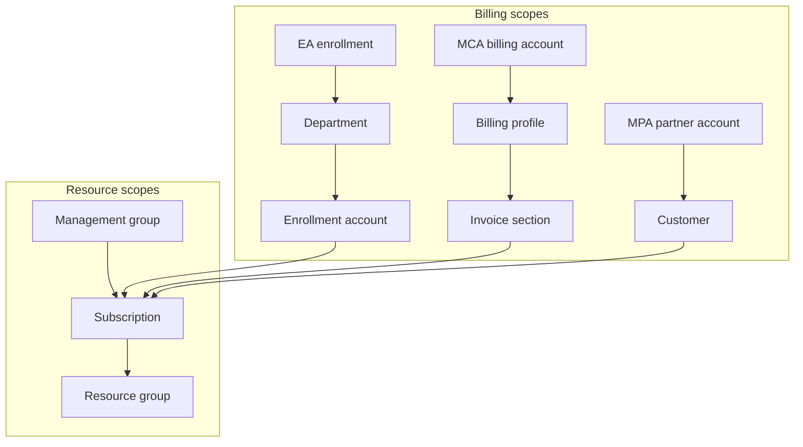

# Azure Provider

Status: **DRAFT**. No code exists. Primary phase: **08** (agreement types, scopes, auth, Cost Management exports, Cost Details and Query APIs). Later: 10 (invoices), 18 and 25 (reservations and savings plans), 19 (Resource Graph), 20 (Azure Monitor), 21 (Advisor, Retail Prices).
Requirements: FR-CON-001…006, FR-AZR-001…005, FR-NRM-002, FR-RES-001…003, FR-TEL-001…002, FR-REC-005. Open question: OQ-19 (supported agreement types).

> **Verification rule.** Azure Cost Management behaviour differs by **agreement type** and changes frequently (API versions, export features, FOCUS dataset versions). Items marked **verify (Phase NN)** must be confirmed against current Microsoft Learn documentation and a recorded fixture during that phase. Role names below are built-in role names as understood at the time of writing.

## 1. Agreement types and scopes (FR-AZR-001)

The billing account's `agreementType` (read from `Microsoft.Billing/billingAccounts`) decides which scopes exist, which roles grant access and which datasets are available. CloudLedger reads it at verification and **never assumes** it.

| Agreement | `agreementType` | Billing scopes | Billing role model | Notes |
|---|---|---|---|---|
| **Enterprise Agreement (EA)** | `EnterpriseAgreement` | Billing account (enrollment) → department → enrollment account → subscription | EA roles (Enterprise administrator, Enterprise administrator (read only), Department reader, Account owner). EA read roles can be assigned to a **service principal** through the billing role assignments API (for example the `EnrollmentReader` role). **verify (Phase 08)** | Microsoft is transitioning EA customers to MCA. Department/account scope semantics differ from MCA. |
| **Microsoft Customer Agreement (MCA)** | `MicrosoftCustomerAgreement` | Billing account → billing profile (invoice) → invoice section → subscription | MCA billing roles (Billing account reader, Billing profile reader, Invoice section reader). Assignable to service principals. **verify (Phase 08)** | Billing profile = one invoice. Both enterprise (field-led) and individual (web-direct) MCA exist. |
| **Microsoft Partner Agreement (MPA / CSP)** | `MicrosoftPartnerAgreement` | Partner billing account → billing profile → **customer** → subscription | Partner billing roles; customers' own users see only subscription scope | For CSP **customers**, cost is visible at subscription scope only after the partner enables cost visibility, and shows **pay-as-you-go (retail) rates**, not partner prices. Partner-scope ingestion is partner-only and may imply MSP use (commercial license required to serve third parties). |
| **Pay-as-you-go (MOSP / legacy)** | `MicrosoftOnlineServicesProgram` | Subscription (and resource group) | Azure RBAC only | No billing-account-level exports. Invoices per subscription. |

Resource scopes (all agreement types): **management group → subscription → resource group**. Cost Management supports these as cost scopes with Azure RBAC, with limits:
- Management group scope cost data is supported for EA, MCA and MOSP subscriptions under the group, but **purchases (reservations, savings plans, Marketplace)** and some charge types may not be included at management group scope. **verify (Phase 08)**
- Subscription and resource group scopes include usage charges. Amortized views exist, but purchase rows belong to the billing scope.



CloudLedger scope types: `azure_billing_account`, `azure_billing_profile`, `azure_invoice_section`, `azure_ea_department`, `azure_ea_enrollment_account`, `azure_customer` (MPA), `azure_management_group`, `azure_subscription`, `azure_resource_group`.

**Recommended root scope:** the highest **billing** scope the customer can grant (EA enrollment, MCA billing account or billing profile), because only billing scopes include purchases, refunds and invoice-aligned charges. Subscription-only connectors are labelled `partial_view`.

## 2. Authentication (FR-CON-003, ADR-0009)

| Method | When | Mechanics |
|---|---|---|
| **Workload identity federation on an app registration** | Default (CloudLedger outside Azure, or SaaS) | The customer creates (or consents to) an Entra ID app registration with a **federated identity credential**: `issuer` = CloudLedger's workload OIDC issuer (for example its Kubernetes service-account issuer or AWS/GCP-issued tokens via a broker), `subject` = the specific CloudLedger workload, `audiences` = `api://AzureADTokenExchange`. CloudLedger presents its OIDC token as a client assertion to the Entra token endpoint and receives an ARM / Storage token. No secret exists. |
| **Federated credential on a user-assigned managed identity** | Alternative to an app registration | Same flow; the managed identity lives in the customer's subscription. Managed identities with federated credentials have documented restrictions (for example region and issuer limits). **verify (Phase 08)** |
| **Managed identity** | CloudLedger itself runs in Azure, in the customer's tenant | System- or user-assigned identity; no federation needed. Cross-tenant use of a managed identity is not supported, so this applies only to same-tenant self-hosting. |
| Client secret / certificate | Only when federation is impossible | Stored as a secret reference. **Discouraged.** Verification warns `static_credentials_in_use`, with expiry reminders. |

Multi-tenant SaaS note: a CloudLedger operator may use a **multi-tenant app registration** that customers consent to, creating a service principal in their tenant. The federated credential is then configured on the operator's app. Operating CloudLedger for third parties requires a commercial license.

Tokens are requested per resource (`https://management.azure.com/.default`, `https://storage.azure.com/.default`) with ≤ 1 h lifetime.

## 3. Billing: Cost Management exports (FR-AZR-002)

### 3.1 Datasets
Exports are configured by the customer (or the template) at a billing or resource scope and write to a **customer-owned storage account** (PRD A3).

| Dataset (export `type` / dataset) | Content | CloudLedger use |
|---|---|---|
| **Actual cost** (`ActualCost`) | Charges as billed; purchases appear when bought | BilledCost basis |
| **Amortized cost** (`AmortizedCost`) | Reservation and savings plan purchases spread over the term, with unused commitment rows | EffectiveCost basis |
| **FOCUS cost** (`FocusCost`) | Combined actual and amortized in FOCUS format. Dataset versions: `1.0`, and `1.2-preview` (preview announced June 2025). **verify (Phase 08)** current GA status and supported agreement types. | Optional primary or cross-check (open point, [README §6](README.md#6-open-points-raised-by-these-documents)) |
| Price sheet | Negotiated prices (EA/MCA billing scopes) | Pricing (Phase 21) |
| Reservation details / transactions / recommendations | Reservation utilization and purchases | Commitments (Phase 18/25) |

Proposed default: **ingest both ActualCost and AmortizedCost** (two artifacts per period) and join them into one FOCUS row set, or ingest **FocusCost** where available and verified. The choice per connector is recorded in its config and mapping version. **verify (Phase 08/11)** which approach gives better conformance at each agreement type.

### 3.2 Delivery
- Formats: CSV (gzip) and **Parquet** (snappy) in the newer exports experience. Large exports are **partitioned** into multiple files with a **`manifest.json`** listing blobs, row counts and the run ID. **verify (Phase 08)** manifest schema per API version.
- Schedule: daily month-to-date (current month), plus one-off or monthly exports for closed months. "**File overwrite**" replaces the previous files for the same period; otherwise each run writes a new folder (`<root>/<export-name>/<YYYYMMDD-YYYYMMDD>/<run-id>/…`). **verify (Phase 08)** exact path layout.
- Historical data: exports can be run for past months (one month per run) within the provider retention window. Backfill (FR-ING-002) enqueues one export run per month **if** the template granted permission to trigger runs. Otherwise the customer triggers them. **verify (Phase 08)** retention limits per agreement type.
- Latency: cost data is typically available 8–24 h after usage. The previous month is updated until the invoice closes (MCA: around the 5th of the month; EA: varies). **verify (Phase 08)**
- Checkpoint (from [INGESTION_PIPELINE.md §4](../architecture/INGESTION_PIPELINE.md)): `{period → last_run_id, manifest blob etag, data blob etags}`. A new run for a period = new `billing_period_versions` row and atomic swap.
- Storage access: the storage account can be firewalled. Exports write via a trusted-service exception or the export's managed identity. CloudLedger reads via the data plane and needs network access (public endpoint with an IP allow-list, or a private endpoint in self-hosted Azure deployments).

## 4. Cost Details API (FR-AZR-003)

- Asynchronous: `POST {scope}/providers/Microsoft.CostManagement/generateCostDetailsReport` → `202` with a `Location` header → poll → result contains **SAS links to CSV blobs** and a manifest.
- Used when exports are unavailable (for example the customer cannot create a storage account) or for one-off backfill. The output enters the same raw-object path, with the report request recorded as lineage.
- Each request covers **at most one month**, and there are limits on how far back data can be requested and on request rate. **verify (Phase 08)**
- Supported scopes and agreement types: EA and MCA billing scopes and subscription/resource group scopes. Support for MOSP and MPA customer scopes **verify (Phase 08)**.
- It replaces the older Consumption Usage Details API, which CloudLedger does not use.

## 5. Query API (FR-AZR-003)

- `POST {scope}/providers/Microsoft.CostManagement/query` for **previews** (month-to-date by service before the first export lands) and **validation** (monthly totals per subscription).
- Aggregated results only, row limits per page, and strict **QPU-based throttling** (§13). Never a primary ingestion source.

## 6. Invoices (FR-AZR-004, Phase 10)

- MCA and MPA: `Microsoft.Billing/billingAccounts/{id}/invoices` (list, get, `download` for PDF via a short-lived URL). Requires a billing reader role at the billing account or profile.
- MOSP: invoices per subscription through the billing APIs (`Billing Reader` on the subscription). **verify (Phase 10)**
- EA: invoice data model differs (billing periods, credit/Azure Prepayment balance). **verify (Phase 10)** which API returns EA invoice documents.
- `InvoiceId` (FOCUS 1.2) is present in the FocusCost 1.2 dataset and as `InvoiceId`/`invoiceId` in MCA actual-cost exports. **verify (Phase 08)** per agreement type.
- Availability is `entitlement_dependent`; fallback is upload.

## 7. Inventory: Azure Resource Graph (FR-AZR-005, Phase 19)

- `POST /providers/Microsoft.ResourceGraph/resources` with KQL over `resources`, `resourcecontainers` (subscriptions, resource groups, management groups) and other tables. Results are limited to what the caller can read (`Reader`).
- Paged with `$skipToken`, max 1 000 rows per page. Queries are scoped to management groups or subscription lists.
- Change history: `resourcechanges` table (limited retention, about 14 days, **verify (Phase 19)**). CloudLedger's own SCD2 history starts at first sync.
- Some properties (for example VM power state) are in `properties.extended`. Missing fields are coverage gaps.

## 8. Metrics: Azure Monitor (FR-TEL-001, Phase 20)

- Metrics REST API per resource (`Microsoft.Insights/metrics`) or the **batch metrics API** (`metrics:getBatch` on regional `*.metrics.monitor.azure.com` endpoints) for many resources of one type and region. **verify (Phase 20)** batch API limits and required role.
- Platform metrics are retained for 93 days. Guest OS memory requires the Azure Monitor Agent (coverage gap otherwise).
- Reads are subject to ARM throttling (§13).

## 9. Advisor (FR-REC-005, Phase 21)

- `Microsoft.Advisor/recommendations` per subscription, filtered on `Category eq 'Cost'`. Available to any subscription without extra entitlement. Rightsizing thresholds are configurable by the customer (Advisor configurations), so CloudLedger records the configuration with each recommendation.
- Reservation and savings plan purchase recommendations: the Reservation recommendations API / export. **verify (Phase 21)**

## 10. Pricing: Retail Prices API (FR-AZR-005)

- `GET https://prices.azure.com/api/retail/prices` with OData `$filter`, unauthenticated, paged via `NextPageLink`. Returns **retail (pay-as-you-go) prices**, including reservation and savings plan prices, per currency.
- Negotiated EA/MCA prices are **not** in the Retail Prices API. They come from the price sheet export or API (billing scope, billing reader role).
- The retail catalog is public data shared across tenants in `price_catalog`. Weekly refresh.

## 11. Reservations and savings plans (Phase 18, 25)

| Data | Source |
|---|---|
| Reservation inventory | `Microsoft.Capacity/reservationOrders` and `reservations` (tenant-level resource provider). Read requires the **Reservations Reader** role (tenant scope) or ownership/reader on the reservation order. **verify (Phase 18)** |
| Savings plan inventory | `Microsoft.BillingBenefits/savingsPlanOrders` and `savingsPlans`. Read role: **Savings plan Reader** (or billing roles). **verify (Phase 18)** role name and scope |
| Utilization / coverage | **Derived from amortized exports** (`PricingModel` = `Reservation` / `SavingsPlan`, `ChargeType` = `UnusedReservation` / `UnusedSavingsPlan`, `BenefitId`), and optionally the reservation details export. |
| Purchases | Never (NG2). |

## 12. Least-privilege roles per capability (FR-CON-004, FR-CON-006)

Azure RBAC roles apply to management groups, subscriptions and resource groups. **Billing roles** (EA/MCA/MPA) are a separate system assigned on billing scopes.

| Capability | Scope | Role(s) | Notes |
|---|---|---|---|
| `connect` | Entra tenant | none beyond the service principal itself | Token acquisition only |
| `billing` (read exports) | storage **container** | **Storage Blob Data Reader** | Data-plane read and list. No account keys or SAS. |
| `billing` (export definitions, run history) | billing or resource scope | **Cost Management Reader** (RBAC scopes) or billing reader roles (billing scopes) | Reads `Microsoft.CostManagement/exports` and run history |
| `billing_export_manage` (optional, for automated backfill) | same scope | **Cost Management Contributor** (RBAC) or a billing contributor role | **Write** permission; off by default. Only needed if CloudLedger triggers export runs. |
| `billing` (EA billing scope) | enrollment / department / account | EA **Enterprise administrator (read only)** or `EnrollmentReader` (SPN), **Department reader** | **verify (Phase 08)** SPN role names |
| `billing` (MCA / MPA billing scope) | billing account / profile / invoice section | **Billing account reader**, **Billing profile reader**, **Invoice section reader** | |
| `cost_preview` (Query API), Cost Details | resource or billing scope | **Cost Management Reader** / billing reader roles | |
| `discovery` | root management group (or subscriptions) and billing account | **Reader** (for `resourcecontainers`, subscriptions, management groups); billing reader role for billing hierarchy | `Microsoft.Management/managementGroups/read` |
| `invoices` | billing account / profile, or subscription (MOSP) | **Billing account reader** / **Billing profile reader** (MCA), **Billing Reader** RBAC role on the subscription (MOSP) | |
| `inventory` | management group or subscriptions | **Reader** | Resource Graph only returns readable resources |
| `metrics` | management group or subscriptions | **Monitoring Reader** | `Microsoft.Insights/metrics/read` |
| `provider_recommendations` | subscriptions | **Reader** (Advisor read) | `Microsoft.Advisor/recommendations/read` |
| `pricing` (negotiated) | billing scope | billing reader roles (price sheet) | Retail prices need no role |
| `commitments` | tenant / reservation orders / savings plan orders | **Reservations Reader**, **Savings plan Reader** (**verify (Phase 18)**) | |

Explicitly **not** granted: `Contributor`, `Owner`, `Storage Blob Data Contributor`, `Storage Account Key Operator`, `Microsoft.Storage/storageAccounts/listKeys/action`, `User Access Administrator`.

Note: `Reader` includes reading most resource configuration. A **custom role** limited to `*/read` on selected resource providers is offered as the strict option in Phase 19. **verify (Phase 19)** whether Resource Graph honours custom read-only roles for all types.

## 13. Throttling (429 with retry headers)

| API | Behaviour | Policy |
|---|---|---|
| ARM (all control-plane reads) | Token-bucket limits per principal, per subscription and per region. `429` with `Retry-After`. Headers such as `x-ms-ratelimit-remaining-subscription-reads`. **verify (Phase 08)** current limits | Honour `Retry-After`; track remaining-quota headers and slow down proactively |
| Cost Management Query / Forecast | **QPU-based** throttling. `429` with headers including `x-ms-ratelimit-microsoft.costmanagement-qpu-retry-after`, `-entity-retry-after`, `-tenant-retry-after`, `-client-retry-after`, and `x-ms-ratelimit-microsoft.costmanagement-qpu-remaining`. **verify (Phase 08)** | Use the **largest** retry-after value. Per-scope budget. Previews only. |
| Cost Details | Request-rate limits per scope; async polling | Respect `Retry-After` on the polling `Location` |
| Resource Graph | Per-user quota (for example 15 queries per 5 s window), headers `x-ms-user-quota-remaining` and `x-ms-user-quota-resets-after` | Token bucket from headers; batch subscriptions per query |
| Azure Monitor metrics | Per-subscription limits; batch API with its own limits | Batch by region and type |
| Retail Prices | Undocumented / public limits | Low concurrency; weekly |
| Blob Storage | `503 ServerBusy` | Retry with backoff |

All `429` and `503` map to `ErrThrottled{RetryAfter}`.

## 14. Onboarding template outline (FR-CON-006)

Delivered in Phase 08 as `templates/azure/main.bicep` (with ARM JSON compiled from it) and `templates/azure/terraform/`. Billing-role assignments cannot be expressed as normal Azure RBAC in Bicep, so they are a scripted step (`az rest` / Terraform `azurerm_billing_*` or `azapi` resources). **verify (Phase 08)**.

```
Parameters:
  identityMode: 'appRegistrationFederated' | 'userAssignedIdentityFederated' | 'managedIdentity'
  cloudLedgerIssuer, cloudLedgerSubject, audience = 'api://AzureADTokenExchange'
  rootManagementGroupId, subscriptionIds[]
  billingScope: { type: ea|mca|mpa|mosp, id }
  exports: { create: bool, storageAccountId, container, datasets: [ActualCost, AmortizedCost, FocusCost], format: parquet, overwrite: true }
  capabilities: [billing, cost_preview, discovery, invoices, inventory, metrics, recommendations, pricing, commitments]
Resources (tenant / MG / subscription deployments):
  Entra app + service principal + federatedIdentityCredential   (Microsoft Graph Bicep extension or Terraform azuread)
    or Microsoft.ManagedIdentity/userAssignedIdentities + federatedIdentityCredentials
  Role assignments (RBAC): Reader, Monitoring Reader, Cost Management Reader at the MG; Storage Blob Data Reader on the container
  Microsoft.CostManagement/exports (optional; created with the deploying admin's rights, not CloudLedger's)
Scripted step:
  billing role assignment for the SPN (EA EnrollmentReader / MCA billing profile reader) via billing role assignment API
Outputs:
  tenantId, clientId, exportContainerUrl, scopes, templateVersion
```

## 15. Verification checks per capability (FR-CON-002)

| Capability | Probe | Pass | Fail / unknown |
|---|---|---|---|
| connect | Token exchange with the federated assertion | Token for ARM | `AADSTS70021` (no matching federated credential) or `AADSTS700016` (app not found) → `error` (auth) with remediation |
| agreement detection | `GET Microsoft.Billing/billingAccounts` | `agreementType` recorded | Empty list → subscription-only (`partial_view`), not an error |
| billing | `GET …/exports` at the configured scope; list blobs under the export root (1 page); read the newest `manifest.json` | Export exists, dataset and format supported, manifest readable | No run yet → `not_ready`; blob `AuthorizationPermissionMismatch` → `fail` (Storage Blob Data Reader missing); network denied → `fail` with firewall remediation |
| cost_preview | One Query API call: month-to-date total, no grouping | 200 | `401/403` → `fail`; agreement unsupported at scope → `unknown` |
| discovery | Resource Graph query on `resourcecontainers` (top 1); billing profiles / invoice sections list | 200 | `fail` |
| invoices | `GET …/invoices` for the last closed period | 200 | `403` → `fail`; agreement without invoice API → `unknown` |
| inventory | Resource Graph `resources | take 1` | 200 | `fail` |
| metrics | `metricDefinitions` for one sampled VM | 200 | `fail` |
| provider_recommendations | `GET …/providers/Microsoft.Advisor/recommendations?$top=1` on one subscription | 200 | `fail` |
| pricing | Retail Prices single page; price sheet read for negotiated prices | 200 | Price sheet `403` → `unknown` (retail only) |
| commitments | `GET Microsoft.Capacity/reservationOrders`; `Microsoft.BillingBenefits/savingsPlanOrders` | 200 (empty allowed) | `fail` |

## 16. FOCUS 1.2 mapping highlights (Phase 08 minimal core, Phase 11 full)

Mapping keys `azure-cm-actual-amortized-focus` and `azure-focuscost-focus` (versioned). Column names differ between EA and MCA exports and between API versions. Phase 08 records a schema fingerprint per variant.

| FOCUS column | Actual / amortized export source (MCA naming; EA differences noted) | Notes |
|---|---|---|
| `BilledCost` | `costInBillingCurrency` from the **actual** dataset (EA: `CostInBillingCurrency` / legacy `Cost`) | |
| `EffectiveCost` | `costInBillingCurrency` from the **amortized** dataset | Amortized dataset excludes purchase rows for amortized commitments and adds unused rows. Join actual and amortized by row identity (**verify (Phase 08)** availability of a stable row key) or ingest FocusCost. |
| `ListCost` | `paygCostInBillingCurrency` / `PayGPrice × quantity` | Availability per agreement type **verify (Phase 08)** |
| `ContractedCost` | `effectivePrice` × `quantity` or `unitPrice`-based (pre-commitment) | **verify (Phase 11)** |
| `ChargeCategory` | `chargeType`: `Usage` → Usage; `Purchase` → Purchase; `Refund` → Credit; `RoundingAdjustment` → Adjustment; `UnusedReservation` / `UnusedSavingsPlan` → Usage (unused commitment) | Tax: MCA invoices carry tax outside the cost rows. **verify (Phase 10)** |
| `ChargePeriodStart/End` | `date` (daily) | UTC daily grain |
| `BillingPeriodStart/End` | `billingPeriodStartDate` / `billingPeriodEndDate` | |
| `BillingAccountId` | `billingAccountId` | |
| `SubAccountId` / `SubAccountName` | `SubscriptionId` / `subscriptionName` | |
| `InvoiceId` | `invoiceId` (MCA) | EA: **verify (Phase 08)** |
| `ResourceId` | `ResourceId` (ARM ID) | Case-insensitive; normalized to lower case for joins |
| `RegionId` | `resourceLocation` normalized to ARM region names | Display names vs. names vary across exports |
| `ServiceName` / `ServiceCategory` | `serviceFamily`, `meterCategory`, `consumedService` → service catalog | |
| `SkuId` / `SkuPriceId` | `productId` / `meterId` | |
| `CommitmentDiscountId` | `benefitId` / `reservationId` | |
| `PricingQuantity` / `PricingUnit` | `quantity` / `unitOfMeasure` (normalized; for example "10 Hours") | Unit strings must be parsed into a multiplier |
| `BillingCurrency` | `billingCurrency` | `exchangeRatePricingToBilling` kept as provider FX provenance (OQ-11) |
| `Tags` | `tags` (JSON string, sometimes without enclosing braces in older CSV exports) | Defensive parser; keys case-insensitive in Azure |
| `PublisherName` | `publisherName`, `publisherType` (Azure / Marketplace) | |

**Azure's FOCUS export (`FocusCost`).** Microsoft publishes a conformance summary for its FOCUS datasets (the 1.2-preview dataset reported about 94% conformance, with documented gaps such as capacity reservation columns). CloudLedger may use it as the primary billing source where it is GA for the customer's agreement type, or as a cross-check. Decision in Phase 11.

## 17. Known limitations

- Data availability and column names vary by agreement type and API version; schema fingerprints and per-variant mappings are mandatory.
- CSP customers see retail-rate costs, not partner prices; partner-scope ingestion is out of scope for v1.0 unless a commercial MSP licensee requests it.
- Subscription- and management-group-scope connectors miss purchases and some charges (`partial_view`).
- Exports must exist before data flows; historical runs may be limited by retention and must be triggered (Cost Management Contributor, off by default).
- Azure Government, Azure China (21Vianet) and other sovereign clouds use different endpoints and are **not supported** in v1.0. **verify (Phase 08)** demand.
- Guest memory metrics need the Azure Monitor Agent.

## 18. Fixture plan (Phase 08 tests)

| Fixture ID | Content | Used by |
|---|---|---|
| AZ-FX-01 | MCA ActualCost + AmortizedCost Parquet (partitioned, with `manifest.json`) for one billing profile, one month | parse, map, totals |
| AZ-FX-02 | EA ActualCost + AmortizedCost CSV.gz with EA column names | EA variant mapping |
| AZ-FX-03 | Reservation and savings plan purchase, usage, unused rows, refund | EffectiveCost and commitments |
| AZ-FX-04 | FocusCost 1.0 and 1.2-preview samples for AZ-FX-01 | FocusCost mapping and cross-check |
| AZ-FX-05 | Same period re-run with overwrite; a new run folder without overwrite | restatement, versioning |
| AZ-FX-06 | Malformed tags strings, mixed-case resource IDs, unit-of-measure variants | defensive parsing, ID normalization |
| AZ-FX-07 | Non-USD billing currency with `exchangeRatePricingToBilling` | currency provenance |
| AZ-FX-08 | Cost Details API async flow (202, polling, SAS links) | fallback path |
| AZ-FX-09 | Recorded HTTP: token exchange errors (`AADSTS70021`), `403` per capability, Cost Management `429` with QPU headers, Resource Graph quota headers, ARM `Retry-After` | verify, throttling |
| AZ-FX-10 | MOSP subscription-only and MPA customer-scope samples | agreement detection, `partial_view` |

Integration tests use Azurite for Blob storage and recorded ARM responses (no Azure Cost Management emulator exists). Contract tests run through the Provider SDK compatibility suite.
