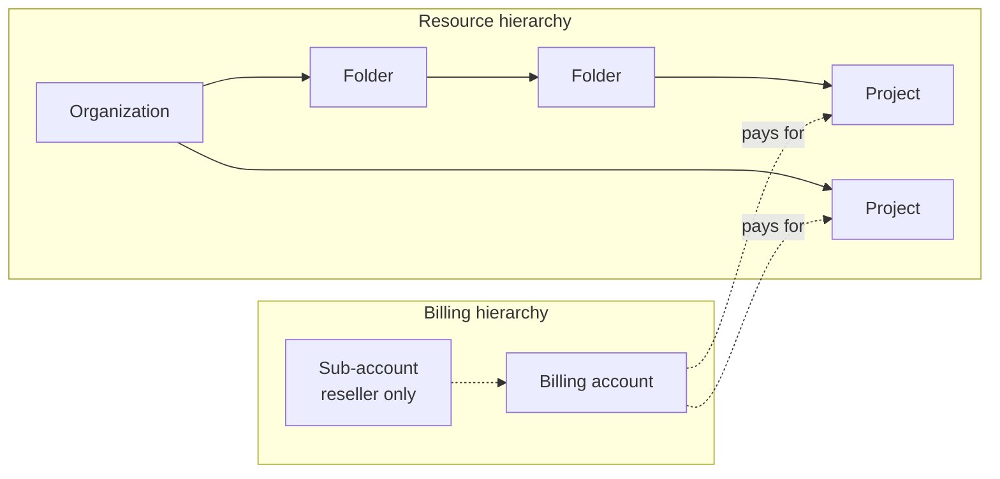

# Google Cloud Provider

Status: **DRAFT**. No code exists. Primary phase: **07** (scopes, auth, BigQuery billing exports, GCS path). Later: 10 (invoices), 18 and 25 (CUDs), 19 (inventory), 20 (metrics), 21 (Recommender, pricing).
Requirements: FR-CON-001…006, FR-GCP-001…005, FR-NRM-002, FR-RES-001…003, FR-TEL-001…002, FR-REC-005.

> **Verification rule.** Items marked **verify (Phase NN)** must be confirmed against current Google Cloud documentation and a recorded fixture during that phase. IAM role and permission names below reflect the authors' understanding at the time of writing. Phase 07 re-validates them with the IAM `queryTestablePermissions` and `troubleshoot` tooling.

## 1. Scopes (FR-GCP-001)

Google Cloud has **two separate hierarchies**, and CloudLedger tracks both:



| Scope type | Role in CloudLedger | Billing data | Discovery |
|---|---|---|---|
| `gcp_billing_account` | **Primary billing scope.** Billing exports are configured per billing account. | All projects linked to the account, including projects in other organizations or without an organization | `cloudbilling.billingAccounts.get`, `billingAccounts.projects.list` |
| `gcp_organization` | Inventory, metrics, recommendations and hierarchy (folders) | Via the billing account only | `cloudresourcemanager` v3 `organizations.get`, `folders.list`, `projects.search` |
| `gcp_folder` | Hierarchy node and inventory scope | — | as above |
| `gcp_project` | Smallest scope. Inventory, metrics and recommendations are project-scoped for many APIs. | Rows in the export carry `project.id`, `project.ancestors` | as above |
| `gcp_billing_subaccount` | Reseller (partner) sub-accounts | Partner-specific. **verify (Phase 07)** | — |

A project can move between billing accounts and between folders over time. The billing export records `project.ancestry_numbers` / `project.ancestors` at usage time, so CloudLedger uses row-level ancestry for historical allocation and the current hierarchy for inventory.

## 2. Authentication (FR-CON-003, ADR-0009)

| Method | When | Mechanics |
|---|---|---|
| **Service account impersonation** | CloudLedger runs on Google Cloud (GKE, Cloud Run, GCE) | CloudLedger's own SA (attached or GKE Workload Identity) calls `iamcredentials.generateAccessToken` on the customer's `cloudledger-reader@<customer-project>.iam.gserviceaccount.com`. The customer grants `roles/iam.serviceAccountTokenCreator` on that SA to CloudLedger's SA. |
| **Workload Identity Federation** (WIF) | CloudLedger runs outside Google Cloud (AWS, Azure, on-prem Kubernetes) | The customer creates a workload identity pool and provider (OIDC issuer = CloudLedger's workload issuer, for example its Kubernetes service-account issuer; or the AWS provider type when CloudLedger runs on AWS). CloudLedger exchanges its token at `sts.googleapis.com`, then impersonates the reader SA (`roles/iam.workloadIdentityUser` on the SA, bound to `principal://…` or `principalSet://…`). Attribute conditions restrict the subject and audience. |
| WIF direct resource access | Optional | Grant roles directly to the federated principal without an SA. Not all Google APIs accept federated principals directly, so **SA impersonation is the default**. **verify (Phase 07)** |
| SA key (JSON) | Only if neither is possible | Stored as a secret reference. **Discouraged.** Many organizations enforce `iam.disableServiceAccountKeyCreation`. Verification warns `static_credentials_in_use`. |

Organization policy note: `iam.allowedPolicyMemberDomains` (domain-restricted sharing) can block granting roles to a CloudLedger SA in another organization. Impersonating an SA that lives **inside the customer's organization** avoids this, which is why the template creates the reader SA in a customer project.

Access tokens are requested with the scope `https://www.googleapis.com/auth/cloud-platform` (permissions are enforced by IAM, not scopes) and a lifetime of ≤ 1 h.

## 3. Billing: Cloud Billing export to BigQuery (FR-GCP-002)

### 3.1 Export types

| Export | Table (in the customer's dataset) | Content | Backfill on enablement |
|---|---|---|---|
| **Standard usage cost** | `gcp_billing_export_v1_<BILLING_ACCOUNT_ID>` | Daily-ish cost per project, service, SKU, location, labels; credits array; invoice month; cost type | Google documents a limited backfill (around the start of the previous month). **verify (Phase 07)** |
| **Detailed usage cost** (resource-level) | `gcp_billing_export_resource_v1_<BILLING_ACCOUNT_ID>` | Standard columns plus `resource.name`, `resource.global_name` and `price.*` | Generally **no** historical backfill beyond enablement. **verify (Phase 07)** |
| **Pricing** | `cloud_pricing_export` | List and **contract (account-specific)** prices per SKU, tiers | Snapshot data from enablement |

- **Customer setup:** the billing account administrator enables the exports in the console (export enablement is console-driven; there is no general public API for configuring it. **verify (Phase 07)**). The dataset lives in a project the customer chooses, in a specific location (US/EU multi-region or a region). Google recommends enabling exports early because history is limited.
- CloudLedger prefers the **detailed** export (needed for resource-level cost and the inventory join) and falls back to standard. If both exist, detailed is used for cost and standard is ignored, to avoid double counting.
- **Other billing-export features**: newer columns such as `cost_at_list`, `transaction_type`, `seller_name`, `subscription`, `tags` (Resource Manager tags), `consumption_model` and `price.list_price` have been added over time. The mapping must tolerate their absence in older periods. **verify (Phase 07)** the current column list.

### 3.2 Watermark and late-arriving rows
- Rows are **appended** as Google processes usage. A given `usage_start_time` can receive rows hours or days later, and adjustments for earlier months can appear after the month has ended.
- Each row has `export_time`. CloudLedger's checkpoint is `max(export_time)` per billing account (see [INGESTION_PIPELINE.md §4](../architecture/INGESTION_PIPELINE.md)).
- **Re-read with lookback:** each sync re-reads `export_time > checkpoint − 72 h` (configurable) to tolerate rows with `export_time` values written slightly out of order.
- **Unit of replacement:** although discovery is incremental by `export_time`, normalization replaces the **full invoice month** (`invoice.month`) partition atomically. A sync identifies which `invoice.month` values gained rows, re-extracts those months in full (bounded by partition filters), and swaps them. This keeps rows unique without relying on a row ID, which the export does not provide.
- **Finality:** an invoice month is treated as `provider_final` after a configurable settling period after month end (default: until the 6th day of the following month with no new rows for 48 h). Google does not publish an explicit finality flag in the export. **verify (Phase 07)** and Phase 10 (invoice cross-check). Later rows are `late_correction`.
- **Dedup key:** the export has no line item identifier. The dedup key uses a composite natural key (billing account, project, service, SKU, usage start/end, location, resource name, labels hash, cost type, credits hash, `export_time`) plus the content hash (FR-NRM-006). Identical duplicates within one extract are counted and reported, not silently merged. **verify (Phase 11)** that legitimate identical rows do not occur. If they do, aggregation by natural key is used instead.

### 3.3 Partitioning and query cost control
BigQuery charges the **querying project** (on-demand bytes scanned or reserved slots). CloudLedger must not create surprise costs:

| Control | Rule |
|---|---|
| Partition filter | The billing export tables are **partitioned** (ingestion-time `_PARTITIONTIME` / `_PARTITIONDATE` for the standard and detailed tables). **verify (Phase 07)**: current partitioning column. Every query filters on the partition column, with a window that covers the `export_time` range. |
| Column projection | Select only the mapped columns. Never `SELECT *`. |
| `maximum_bytes_billed` | Set on every query job. Default per connector: 50 GiB per query (configurable). The job fails rather than over-spend. |
| Dry run | Before each extraction, a `dryRun` estimates bytes. If it exceeds the budget, the job splits by day partition. |
| Query project | The customer chooses which project runs (and pays for) jobs; the template grants `roles/bigquery.jobUser` there. |
| Monthly budget | Per-connector scanned-bytes budget with a UI estimate. Exceeding it pauses billing sync with `error_class = budget`. |
| Read path | Query results are written to an anonymous temporary table, then read with the **BigQuery Storage Read API** (Arrow), streamed to Parquet, and stored as raw objects. Storage Read API usage is billed separately. **verify (Phase 07)** current pricing. |
| Location | Jobs run in the dataset's location. |

Raw lineage for BigQuery: the "raw object" is the Parquet extract, plus a sidecar JSON with the query text, job ID, bytes processed, partition window and `max(export_time)`. Idempotency: the same table snapshot and query produce the same row set. To pin a snapshot, extracts use `FOR SYSTEM_TIME AS OF <job start>` where supported.

## 4. GCS path (FR-GCP-003)

Google **retired the native billing "file export" to Cloud Storage** (CSV/JSON) several years ago. BigQuery is the only native billing export. **verify (Phase 07)** that no native GCS billing export has been reintroduced.

The GCS path therefore ingests files **the customer produces**, for example a scheduled query using `EXPORT DATA OPTIONS(uri='gs://…/*.parquet', format='PARQUET')` from the billing export tables. This is useful when:
- the customer does not want CloudLedger to run BigQuery jobs (cost or governance),
- the data must cross an organization boundary via a bucket rather than IAM on a dataset.

Behaviour: object-store polling as in [GENERIC_IMPORTS.md §7](GENERIC_IMPORTS.md#7-object-store-polling), but with the **GCP billing mapping** (same columns as the BigQuery tables). The customer must export complete invoice months, or `export_time` windows declared in a manifest. CloudLedger provides a reference scheduled-query SQL in Phase 07.

## 5. Inventory: Cloud Asset Inventory (FR-GCP-005, Phase 19)

- `assets.searchAllResources` (organization, folder or project scope) for breadth: name, asset type, project, location, labels, state, create time, parent and additional attributes.
- `assets.list` / `ListAssets` with `content_type=RESOURCE` for full resource data on the types recommendation rules need (Compute instances, disks, snapshots, addresses, Cloud SQL, GKE, buckets).
- `assets.exportAssets` to BigQuery or GCS is **not** used by default, because it writes to a customer destination. It may be offered as an opt-in for very large organizations.
- History: `batchGetAssetsHistory` covers a limited window (35 days). SCD2 history in CloudLedger starts at first sync. **verify (Phase 19)** the window.
- Requires `cloudasset.googleapis.com` enabled in the **quota project**.

## 6. Metrics: Cloud Monitoring (FR-TEL-001, Phase 20)

- `projects.timeSeries.list` with aligners (`ALIGN_MEAN`, `ALIGN_PERCENTILE_95`, `ALIGN_MAX`) and alignment period 1 h. A **metrics scope** project can read many monitored projects in one call.
- CPU utilization for GCE is built in. **Memory** requires the Ops Agent (coverage gap if missing, FR-TEL-002).
- Retention for most GCP system metrics is 6 weeks. **verify (Phase 20)**. Backfill beyond that is impossible.
- Reading via the API is not charged, but the API has per-project quotas. Large time-series reads are paged.

## 7. Recommendations: Recommender API (FR-REC-005, Phase 21)

- `recommendations.list` per **recommender ID** and location, for example `google.compute.instance.MachineTypeRecommender`, `google.compute.instance.IdleResourceRecommender`, `google.compute.disk.IdleResourceRecommender`, `google.compute.address.IdleResourceRecommender`, `google.compute.commitment.UsageCommitmentRecommender`, `google.cloudsql.instance.IdleRecommender`, `google.cloudsql.instance.OverprovisionedRecommender`. **verify (Phase 21)** the current list.
- Recommenders are scoped to project, billing account (CUD recommenders), folder or organization, depending on type, and are listed per location, so a full sweep is (scope × location × recommender). CloudLedger restricts the sweep to locations seen in billing data.
- Optional: the **Recommender BigQuery export** (via BigQuery Data Transfer Service) can replace API sweeps for large organizations.
- Recommendations require usage history (typically 8+ days) before they appear.

## 8. Pricing (Phase 21–25)

- **Cloud Billing Catalog API** (`services.list`, `services.skus.list`): public list prices. Any authenticated caller can use it.
- **Pricing export** (BigQuery `cloud_pricing_export`): includes **account-specific contract prices**. Preferred when enabled.
- **Cloud Billing Pricing API** (account-specific prices, newer API version) as an alternative. **verify (Phase 21)** availability and status.
- The public catalog is shared across tenants in `price_catalog`. Account-specific prices are tenant-scoped.

## 9. Committed use discounts (Phase 18, 25)

| CUD type | Source | Notes |
|---|---|---|
| Resource-based CUDs (vCPU, memory, GPU, local SSD) | Compute Engine `regionCommitments.aggregatedList` / `regionCommitments.list` per project | Can be shared across projects in a billing account (CUD sharing). |
| Spend-based CUDs (Cloud SQL, GKE, Cloud Run, Compute flexible CUDs, etc.) | Purchased on the billing account. Utilization and fees appear in the billing export (credits of CUD types, commitment fee SKUs, `subscription` fields). | Google has changed the spend-based CUD billing model (moving from credits to discounted consumption pricing with `consumption_model` columns). **verify (Phase 18)**: current model, the API for listing spend-based commitments, and how utilization is represented. |
| Utilization and coverage | **Derived from billing export rows** into `commitment_utilization` | No paid API is needed. |

CloudLedger never purchases commitments (NG2).

## 10. Invoices (FR-GCP-004, Phase 10)

- Google Cloud does **not** offer a general public API that lists invoices and invoice PDFs for direct customers. **verify (Phase 10)**. Invoice-level totals are reconciled using billing export rows grouped by `invoice.month` and `cost_type` (`regular`, `tax`, `adjustment`, `rounding_error`).
- Invoice documents are imported by **upload** (PDF metadata plus structured CSV). The capability is `entitlement_dependent` and defaults to `upload_only`.
- Reseller and partner billing (Channel Services) have their own billing data paths, out of scope for v1.0.

## 11. Least-privilege IAM per capability (FR-CON-004, FR-CON-006)

The template creates **one reader service account** in a customer-chosen project and binds roles at the narrowest level. Predefined roles are listed first, then the key permissions they carry. Where a predefined role is broader than needed, a **custom role** with the listed permissions is offered as the strict option.

| Capability | Bind at | Predefined role(s) | Key permissions (custom-role option) |
|---|---|---|---|
| `connect` | reader SA | `roles/iam.serviceAccountTokenCreator` (granted **to CloudLedger's SA** on the reader SA) or `roles/iam.workloadIdentityUser` (to the federated principal) | `iam.serviceAccounts.getAccessToken` |
| `billing` (BigQuery) | billing export **dataset** | `roles/bigquery.dataViewer` | `bigquery.datasets.get`, `bigquery.tables.get`, `bigquery.tables.list`, `bigquery.tables.getData` |
| `billing` (BigQuery jobs) | **query project** | `roles/bigquery.jobUser`, `roles/bigquery.readSessionUser` | `bigquery.jobs.create`, `bigquery.readsessions.create`, `bigquery.readsessions.getData` |
| `billing` (discovery) | billing account | `roles/billing.viewer` | `billing.accounts.get`, `billing.resourceAssociations.list` (projects linked to the account) |
| `billing_gcs` (GCS path) | **bucket** | `roles/storage.objectViewer` | `storage.objects.get`, `storage.objects.list` (+ `storage.buckets.get` for verification, via a custom role or `roles/storage.legacyBucketReader`) |
| `discovery` (hierarchy) | organization | `roles/browser` | `resourcemanager.organizations.get`, `resourcemanager.folders.get`, `resourcemanager.folders.list`, `resourcemanager.projects.get`, `resourcemanager.projects.list` |
| `inventory` | organization / folder / project | `roles/cloudasset.viewer` | `cloudasset.assets.searchAllResources`, `cloudasset.assets.listResource` (and per-asset-type list permissions, **verify (Phase 19)**) |
| `inventory` (API quota) | quota project | `roles/serviceusage.serviceUsageConsumer` | `serviceusage.services.use` |
| `metrics` | metrics-scope project or each project | `roles/monitoring.viewer` | `monitoring.timeSeries.list`, `monitoring.metricDescriptors.list`, `monitoring.monitoredResourceDescriptors.list` |
| `provider_recommendations` | org / folder / project / billing account | Per-recommender viewer roles, for example `roles/recommender.computeViewer`, `roles/recommender.cloudsqlViewer`, `roles/recommender.projectCudViewer`, `roles/recommender.billingAccountCudViewer`. **verify (Phase 21)** exact role IDs. | `recommender.<type>Recommendations.list` / `.get` (one pair per recommender) |
| `pricing` | dataset (pricing export) | `roles/bigquery.dataViewer` on the pricing dataset | as billing |
| `commitments` | each project with CUDs | `roles/compute.viewer` (broad) or custom role | `compute.commitments.list`, `compute.commitments.get`, `compute.regions.list` |

Explicitly **not** granted: `roles/viewer` (basic role; too broad), `roles/billing.admin`, `roles/bigquery.user` (can create datasets), any `*.create`/`*.update`/`*.delete` except `bigquery.jobs.create` and the read-session permissions (non-workload side effects; see [README §6](README.md#6-open-points-raised-by-these-documents)).

## 12. Onboarding template outline (FR-CON-006)

Delivered in Phase 07 as `templates/gcp/setup.sh` (`gcloud`) and `templates/gcp/terraform/`.

```
Inputs:
  billing_account_id, organization_id (optional), host_project_id (for SA + WIF pool),
  query_project_id, billing_dataset (project.dataset), pricing_dataset (optional), gcs_bucket (optional),
  cloudledger_identity: { type: "gcp_sa", email } | { type: "oidc", issuer_uri, allowed_subject, audience } | { type: "aws", account_id, role_arn },
  capabilities: [billing, billing_gcs, discovery, inventory, metrics, recommendations, pricing, commitments]
Resources:
  google_service_account.cloudledger_reader                    (host project)
  google_iam_workload_identity_pool + _provider                (only for oidc/aws; attribute_condition pins subject)
  google_service_account_iam_member (tokenCreator | workloadIdentityUser)
  google_bigquery_dataset_iam_member (dataViewer on billing and pricing datasets)
  google_project_iam_member (bigquery.jobUser, bigquery.readSessionUser, serviceusage.serviceUsageConsumer on query project)
  google_billing_account_iam_member (billing.viewer)
  google_organization_iam_member (browser, cloudasset.viewer, recommender viewers)   [conditional]
  google_project_iam_member (monitoring.viewer on the metrics-scope project)          [conditional]
  google_storage_bucket_iam_member (objectViewer)                                    [conditional]
  google_project_service (bigquery, bigquerystorage, cloudasset, monitoring, recommender, cloudbilling, iamcredentials, sts) on host/query project
Outputs:
  reader_sa_email, wif_provider_resource_name, query_project_id, dataset ids, template_version
Manual step (documented, not automated):
  enable standard / detailed / pricing export to the dataset (billing account admin, console)
```

## 13. Verification checks per capability (FR-CON-002)

| Capability | Probe | Pass | Fail / unknown |
|---|---|---|---|
| connect | WIF token exchange → `generateAccessToken` for reader SA | Token issued | `PERMISSION_DENIED` on `getAccessToken` → `error` (auth) with the binding to add; invalid pool/provider/subject → `error` |
| billing | `bigquery.tables.get` on detailed and standard tables; `dryRun` query on yesterday's partition with `maximum_bytes_billed` = 1 GiB | Table exists, required columns present, dry run succeeds (0 bytes billed) | Table missing → `not_ready` ("enable detailed export" remediation). `bigquery.jobs.create` denied → `fail`. Dataset in an unexpected location → `fail` |
| billing (discovery) | `billingAccounts.get`, `billingAccounts.projects.list` (1 page) | 200 | `fail` |
| billing_gcs | `storage.objects.list` (1 page) | 200 | `fail` |
| discovery | `organizations.get`; `projects.search` (1 page) | 200 | `fail`; no organization (projects without org) → `not_applicable` |
| inventory | `searchAllResources` (page size 1) at the configured scope | 200 | API disabled → `fail` with "enable cloudasset.googleapis.com" |
| metrics | `timeSeries.list` for `compute.googleapis.com/instance/cpu/utilization`, 1 h window, page size 1 | 200 (empty allowed) | `fail` per project |
| provider_recommendations | `recommendations.list` for one recommender in one location | 200 | Per-recommender `fail`; API disabled → `fail` |
| pricing | `tables.get` on `cloud_pricing_export`; Catalog `services.list` | 200 | Export missing → `unknown` (list prices only) |
| commitments | `regionCommitments.aggregatedList` (1 page) | 200 | `fail` |
| invoices | none (no API) | — | `not_applicable` → upload path |

## 14. Quotas and throttling

| API | Behaviour | Policy |
|---|---|---|
| BigQuery jobs | Concurrent query and API-request quotas per project; cost by bytes scanned | Max 2 concurrent extraction jobs per connector; `maximum_bytes_billed`; dry run |
| BigQuery Storage Read API | Stream and throughput quotas | Bounded number of streams per job |
| Cloud Asset Inventory | Per-project and per-org quotas on search/list (relatively low) | Paginate; per-org token bucket; daily full sync plus asset feeds not used (they require a Pub/Sub topic write) |
| Cloud Monitoring | Time-series read quota per project | Batch by metrics scope; hourly alignment |
| Recommender | Per-project read quotas | Daily sweep restricted to active locations |
| Resource Manager | Read quotas | Daily discovery |

Google APIs return `429 RESOURCE_EXHAUSTED` (sometimes with `RetryInfo` in error details) or `403 rateLimitExceeded` (BigQuery). Both map to `ErrThrottled`, honoring `RetryInfo.retry_delay` when present. **verify (Phase 07, 19–21)** exact quota values; they are recorded in the phase designs, not here.

## 15. FOCUS 1.2 mapping highlights (Phase 07 minimal core, Phase 11 full)

Mapping key `gcp-billing-focus` (versioned).

| FOCUS column | Billing export source | Notes |
|---|---|---|
| `BilledCost` | `cost` + Σ `credits.amount` | The export reports `cost` before credits, and credits (negative) in an array. FOCUS BilledCost must include credits that reduce the invoice. Phase 11 decides whether credits become separate FOCUS rows (ChargeCategory Credit) or are netted; the proposed approach is **netted on usage rows for EffectiveCost and kept as `x_credits` detail**, with promotional and free-tier credits handled per FOCUS guidance. **verify (Phase 11)** against Google's FOCUS view. |
| `EffectiveCost` | `cost` + Σ credits (including CUD and sustained-use discounts) + amortized commitment fees | Spend-based CUD fee rows and their consumption model need a dedicated rule. **verify (Phase 18)** |
| `ListCost` | `cost_at_list` (where present) | Null in older periods |
| `ContractedCost` | `cost` (negotiated price before credits) | **verify (Phase 11)** |
| `ChargeCategory` | `cost_type`: `regular` → Usage (or Purchase for commitment fee SKUs); `tax` → Tax; `adjustment` → Adjustment/Credit; `rounding_error` → Adjustment | |
| `ChargeClass` | `Correction` when `adjustment_info` is present for an earlier period | |
| `ChargePeriodStart/End` | `usage_start_time` / `usage_end_time` | UTC |
| `BillingPeriodStart/End` | derived from `invoice.month` (YYYYMM) | Billing period follows the **Pacific Time** invoice month. **verify (Phase 07)** the time-zone convention and how CloudLedger stores a UTC-normalized period. |
| `BillingAccountId` | `billing_account_id` | |
| `SubAccountId` / `SubAccountName` | `project.id` / `project.name` | |
| `InvoiceId` | not present in the export (only `invoice.month`) | FOCUS 1.2 InvoiceId is null unless enriched from uploaded invoices (Phase 10). |
| `ServiceName` / `ServiceCategory` | `service.description` / service catalog lookup | `service.id` kept as `x_service_id` |
| `SkuId` | `sku.id` | |
| `RegionId` / `AvailabilityZone` | `location.region` / `location.zone` | `location.location` may be multi-region (`us`, `eu`) |
| `ResourceId` / `ResourceName` | `resource.global_name` / `resource.name` (detailed export only) | Global name is the stable join key for inventory |
| `ConsumedQuantity` / `ConsumedUnit` | `usage.amount` / `usage.unit` | |
| `PricingQuantity` / `PricingUnit` | `usage.amount_in_pricing_units` / `usage.pricing_unit` | |
| `BillingCurrency` | `currency` | `currency_conversion_rate` kept as `x_currency_conversion_rate` (provider FX provenance, OQ-11) |
| `CommitmentDiscountId` | from CUD credit IDs (`credits.id`) or subscription fields | **verify (Phase 18)** |
| `Tags` | `labels`, `project.labels`, `system_labels`, `tags` | Each source kept distinguishable (`x_label_source`). Project labels support inheritance rules (Phase 15). |

**Google's FOCUS view.** Google publishes a FOCUS-format BigQuery view/SQL template over the billing export. **verify (Phase 11)** its current FOCUS version. CloudLedger can run it as a cross-check, but it is a query (scan cost), so it is opt-in.

## 16. Known limitations

- History before export enablement is not available (or limited for the standard export). Customers should enable the detailed export as early as possible.
- No native line-item ID; dedup depends on composite keys (§3.2).
- No invoice API for direct customers. Invoices are uploaded.
- Querying the export costs money in the customer's query project; bounded by §3.3 controls.
- Resource-level cost is only available with the detailed export, and only for services that report resource names.
- Monitoring and asset history windows are short; recommendations from CloudLedger rules need weeks of collected metrics.
- Sub-accounts and reseller billing are out of scope for v1.0.
- BigQuery dataset location and VPC Service Controls perimeters can block access from outside the perimeter. A perimeter ingress rule is needed. **verify (Phase 07)**

## 17. Fixture plan (Phase 07 tests)

| Fixture ID | Content | Used by |
|---|---|---|
| GCP-FX-01 | Synthetic detailed-export rows (Parquet/Arrow with BigQuery nested types: `credits` array, `labels` repeated record, `project.ancestors`) for one billing account, two projects | parse, map, totals |
| GCP-FX-02 | Same, with late rows (new `export_time` for an earlier `usage_start_time`) and an adjustment for the prior invoice month | watermark, month re-extract, swap |
| GCP-FX-03 | CUD (resource-based) and spend-based CUD credits/fees; sustained-use discounts; promotional credits | EffectiveCost and credits mapping |
| GCP-FX-04 | Standard-only export (no resource columns) | fallback mapping |
| GCP-FX-05 | Older schema (no `cost_at_list`, no `tags`) and a newer schema with an unknown column | schema detection |
| GCP-FX-06 | Non-USD currency with `currency_conversion_rate` | currency provenance |
| GCP-FX-07 | Recorded HTTP/gRPC interactions: STS token exchange, `generateAccessToken` denied, BigQuery dry run, `maximum_bytes_billed` exceeded, `RESOURCE_EXHAUSTED` with `RetryInfo`, Asset API disabled | verify, errors |
| GCP-FX-08 | Customer-exported Parquet files in a GCS-like bucket (fake GCS server) | GCS path |
| GCP-FX-09 | Pricing export sample with tiered contract prices | pricing (Phase 21) |

Integration tests use the BigQuery emulator where its SQL and Storage Read API coverage suffices (**verify (Phase 07)**: emulator fidelity for partition pseudo-columns and Storage Read API), and a fake GCS server. The BigQuery client is behind an interface so that extraction logic is unit-tested with recorded result sets.
