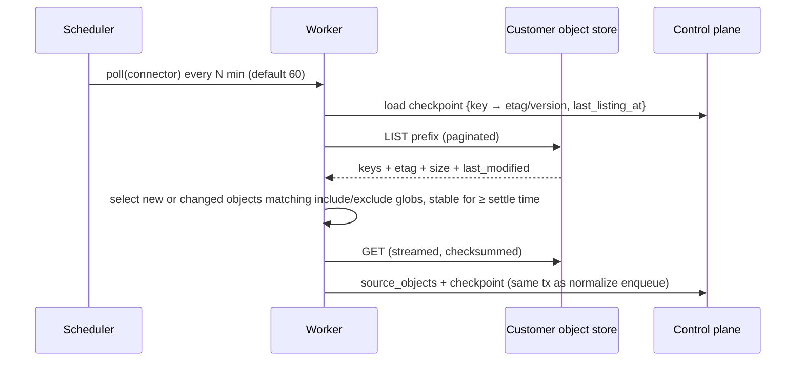

# Generic Imports

Status: **DRAFT**. No code exists. Phase: **09**. Requirements: FR-IMP-001…004, FR-NRM-002, FR-NRM-004, FR-ING-003, FR-ING-006. Invoice uploads reuse this pipeline in Phase 10 (FR-FIN-004).

Generic imports let tenants load cost data from sources without a first-party connector: other clouds or SaaS vendors (NG6), on-prem chargeback, internal platform costs, or provider data delivered as files. The importer is a **provider** (`provider = generic`) that implements `BillingSource` and goes through the same pipeline as cloud connectors ([INGESTION_PIPELINE.md](../architecture/INGESTION_PIPELINE.md)): raw storage, parse, validate, map, dedup, stage, invariants, atomic swap.

## 1. Entry points (FR-IMP-001)

| Entry | Mechanics | Limits (defaults, configurable by platform admin) |
|---|---|---|
| UI upload | Browser → API with resumable chunked upload (`POST /api/v1/imports`, then `PUT` parts, then `POST …/complete`). **Shape decided in Phase 09 per API guidelines.** | 2 GiB per file (Standard profile), 200 MiB (Lite) |
| API upload | Same endpoints with an API token (`imports:write` scope), `Idempotency-Key` header | same |
| Object-store polling | Connector with `root_scope = {"type":"object_store","uri":"s3://…|gs://…|azblob://…|minio://…"}`, polled on a schedule (§7) | same per object |

Every import is bound to an **import connector** (one per logical source, for example "Datacenter chargeback" or "Snowflake invoices"), so that restatement, health and lineage work as for cloud connectors.

## 2. Supported formats

| Format | Reader | Notes |
|---|---|---|
| CSV / TSV | streaming RFC 4180 reader | Delimiter, quote, encoding (UTF-8, UTF-16 with BOM, Windows-1252 opt-in), header row index, decimal separator (`.` or `,`) and thousands separator declared in the template. gzip and zip accepted. |
| JSON | streaming decoder over an array at a configured JSON pointer (for example `/data/items`) | No full-document load |
| NDJSON | line-by-line | Max line length 1 MiB |
| XLSX | **streaming** SAX-style reader on the sheet XML; one configured sheet; first N header rows skipped | XLS (binary), XLSM macros and external links are **rejected** |
| Parquet | row-group streaming | Decimal, int, string, timestamp logical types; nested types only via explicit paths |

Money columns must be parsed as decimal strings into `NUMERIC(38,12)` (ADR-0007). Spreadsheets often store floats. For XLSX numeric cells, the importer uses the cell's stored text representation where present and records `x_precision_warning` when a value was derived from a binary float.

## 3. Mapping templates (FR-IMP-002)

A mapping template is a versioned `mapping_definitions` row (`key`, `version`, `focus_version`, `definition`). Templates are tenant-owned. CloudLedger ships built-in templates (for example "FOCUS 1.2 CSV passthrough", "Simple cost CSV") with `tenant_id = NULL`.

```yaml
key: dc-chargeback
version: 3
focus_version: "1.2"
source:
  format: csv
  csv: { delimiter: ",", header_row: 1, encoding: utf-8, decimal_separator: "." }
  timezone: Europe/Berlin            # used for date-only and naive timestamps; stored as UTC
columns:                             # FOCUS column ← expression over source columns
  BilledCost:        { from: "Amount", type: decimal }
  EffectiveCost:     { from: "Amount", type: decimal }        # defaults to BilledCost if omitted
  BillingCurrency:   { const: "EUR" }
  ChargePeriodStart: { from: "Date", type: date, format: "dd.MM.yyyy" }
  ChargePeriodEnd:   { expr: "ChargePeriodStart + 1d" }
  BillingPeriodStart:{ expr: "month_start(ChargePeriodStart)" }
  BillingPeriodEnd:  { expr: "month_end_exclusive(ChargePeriodStart)" }
  ChargeCategory:    { from: "Type", map: { Usage: Usage, Fee: Purchase, Tax: Tax, Credit: Credit }, default: reject }
  ServiceName:       { from: "Service" }
  SubAccountId:      { from: "CostCenter" }
  ResourceId:        { from: "AssetId", optional: true }
  BillingAccountId:  { const: "dc-frankfurt" }
  ProviderName:      { const: "Datacenter Frankfurt" }
tags:
  from_columns: { "owner": "Owner", "env": "Environment" }   # tag key ← column
  from_json_column: "Labels"                                 # optional
extensions:
  x_rack: { from: "Rack" }
dedup:
  natural_key: [Date, AssetId, Service, Type]                 # plus content hash (FR-NRM-006)
period_replace: billing_period                                # unit of atomic replacement
```

Rules:
- Expressions use a small, **side-effect-free** expression language (arithmetic, date functions, string functions, lookups). No code execution. Grammar defined in Phase 09.
- Mapping templates are validated against the FOCUS 1.2 required-column list at save time. Missing mandatory columns are allowed only with explicit `const` or `derive` rules.
- Preview: `POST /api/v1/imports/{id}/preview` applies the template to the first 1 000 rows and returns mapped rows plus validation results without writing anything.
- Publishing a new template version triggers optional re-normalization of earlier imports (FR-NRM-004). Old versions stay readable.

## 4. Validation rules

| Rule | Level | Behaviour |
|---|---|---|
| File-level: format detection matches declared format | file | reject file |
| Required columns present (after mapping) | file | reject file (schema error → quarantine) |
| Header/schema fingerprint changed vs. the template's last import | file | quarantine + alert (FR-ING-006), unless the template allows `schema_drift: additive` |
| Decimal parse for money columns; scale ≤ 12; magnitude within `NUMERIC(38,12)` | row | reject row |
| Currency is ISO 4217 | row | reject row |
| Dates parse; `ChargePeriodStart < ChargePeriodEnd`; within `[BillingPeriodStart, BillingPeriodEnd)` | row | reject row |
| Dates within an allowed window (default: not more than 1 day in the future, not older than the tenant's retention horizon) | row | reject row |
| `ChargeCategory` in the FOCUS domain | row | reject row |
| Enum mappings without default | row | reject row with "unmapped value" |
| Duplicate natural key within the file | row | keep first, report duplicates (count + sample) |
| Duplicate against an earlier live import of the same period | file | expected for restatements: the whole period is replaced atomically |
| Tag keys and values: length limits (key 256, value 1 024 chars), valid UTF-8, control characters stripped | row | truncate with warning, never reject |
| Rejected-row ratio > threshold (default 1%) | file | run status `failed_validation`, previous version stays live |

Rows are never "fixed" silently. Each rejection carries a reason code.

## 5. Data-quality report (FR-IMP-003)

Stored in `data_quality_reports` (`checks` JSON, `rejected_rows`, `rejected_sample_uri`) and returned by `GET /api/v1/ingestion/runs/{id}/quality`.

```json
{
  "ingestion_run_id": "0193…",
  "connector_id": "0192…",
  "mapping": { "key": "dc-chargeback", "version": 3, "focus_version": "1.2" },
  "source": { "file_name": "chargeback-2026-10.csv", "sha256": "9f2c…", "size_bytes": 18234011, "format": "csv", "schema_fingerprint": "sf_51a0…" },
  "rows": { "read": 120431, "accepted": 120402, "rejected": 23, "duplicates": 6, "empty_skipped": 0 },
  "totals": [
    { "currency": "EUR", "charge_category": "Usage", "source_sum": "84211.120000000000", "accepted_sum": "84190.450000000000", "rejected_sum": "20.670000000000" }
  ],
  "periods": [ { "billing_period": "2026-10-01", "rows": 120402, "replaces_version": 2 } ],
  "rejections_by_reason": [
    { "code": "DECIMAL_PARSE", "count": 14, "sample_rows": [ 1043, 2210 ] },
    { "code": "UNMAPPED_ENUM", "column": "Type", "value": "Discount", "count": 9 }
  ],
  "warnings": [ { "code": "XLSX_FLOAT_PRECISION", "count": 0 }, { "code": "TAG_TRUNCATED", "count": 2 } ],
  "rejected_sample_uri": "s3://…/{tenant}/{connector}/quality/{run}/rejected-sample.csv",
  "status": "succeeded"
}
```

The control-total invariant for imports is: `source_sum = accepted_sum + rejected_sum` per currency and charge category (decimal-exact). The rejected-row sample (up to 1 000 rows) is stored with formula-neutralized cells (§6) and the same tenant encryption as raw objects.

## 6. Safety limits (FR-IMP-004)

| Threat | Control |
|---|---|
| Oversized input | Per-file size cap (§1). Per-tenant daily import volume quota (operational, not a license limit). Streaming only, bounded memory per job. |
| Decompression bombs | gzip/zip: max decompressed size (default 20× compressed, hard cap 20 GiB), max entries (zip: 1 entry for data; XLSX: entry count cap), nested archives rejected. Ratio checked while streaming, so the job aborts early. |
| XLSX / XML attacks (XXE, billion laughs) | XML parser with DTD processing and external entity resolution **disabled**; entity expansion off; max element depth and attribute count; shared-strings table size cap. External links, macros (VBA), embedded OLE objects ignored or rejected. |
| Formula / CSV injection | Values are stored verbatim as data. On **export** (CSV/XLSX reports, rejected samples), cells beginning with `=`, `+`, `-`, `@`, tab or carriage return are prefixed with `'` (or written as typed text in XLSX), per OWASP guidance. |
| Path traversal / zip slip | Archive entry names never used as file paths. Raw storage path is derived from the content hash. |
| Malicious Parquet | Max row-group size, max column count (default 1 000), max string length, schema depth limit. |
| Untrusted strings | Tags, service names and descriptions are untrusted (prompt injection relevance: [LLM_SECURITY.md](../architecture/LLM_SECURITY.md), planned). Never interpreted as code, templates or HTML. |
| Content type spoofing | Format sniffed from magic bytes and must match the declared format. |
| Malware | Optional ClamAV hook (HA profile), off by default. |
| Unauthorized upload | `imports:write` permission and ABAC scope; uploads are audited (`import.uploaded`, `import.completed`). |

Parser fuzzing (Go native fuzzing) for each format is part of the Phase 09 test plan.

## 7. Object-store polling



- Supported stores: S3 and S3-compatible (MinIO), GCS, Azure Blob. Credentials use the same federation methods as the cloud connectors (role assumption, WIF, federated credentials); static keys only as secret references.
- Object **settle time** (default 5 min unchanged) avoids reading partially written objects. If the producer writes a `_SUCCESS` marker or a manifest file, the template can require it.
- Period inference: from a path pattern (`…/period=YYYY-MM/…`) or from row data (`BillingPeriodStart`). An object that spans several periods is split into per-period work units.
- Restatement: a changed object (new etag) for a period re-imports **all** current objects for that period and swaps atomically. A deleted object does not delete data automatically; it raises a warning and requires an explicit "re-import period" action.
- Read-only: the poller never deletes or moves source objects.

## 8. Examples

**Minimal cost CSV (built-in "Simple cost CSV" template):**

```csv
date,account,service,cost,currency,tag_team
2026-10-01,shared-dc,Compute,1520.40,EUR,platform
2026-10-01,shared-dc,Storage,310.00,EUR,data
2026-10-01,shared-dc,Support,-50.00,EUR,
```

Result: three FOCUS rows with `ChargeCategory = Usage` for the first two and `Credit` for the third (negative amount with category rule `amount < 0 → Credit` in the template), `Tags = {team: …}`, untagged third row grouped under `(untagged)`.

**NDJSON from a SaaS vendor:**

```json
{"invoice":"INV-1001","period":"2026-10","item":"Seats","qty":40,"unit_price":"12.50","total":"500.00","currency":"USD"}
{"invoice":"INV-1001","period":"2026-10","item":"Overage","qty":3,"unit_price":"20.00","total":"60.00","currency":"USD"}
```

Template maps `InvoiceId ← invoice`, `PricingQuantity ← qty`, `ListUnitPrice ← unit_price`, `BilledCost ← total`, `ChargePeriodStart ← month_start(period)`.

**Rejected rows example:** `cost = "1.520,40"` with a template declaring `.` decimals → `DECIMAL_PARSE`; `currency = "EURO"` → `INVALID_CURRENCY`.

## 9. Fixture plan (Phase 09)

Valid files per format (small, wide, unicode, BOM), malformed files (truncated gzip, bad quoting, mixed encodings, Excel date serials, float-only XLSX), attack files (zip bomb at several ratios, XXE and billion-laughs XLSX, formula-injection cells, oversized line, deeply nested JSON, Parquet with huge strings), restatement scenarios (same period re-uploaded with changed rows), and polling scenarios (partial object, settle time, deleted object). Expected data-quality reports are stored as golden JSON.
