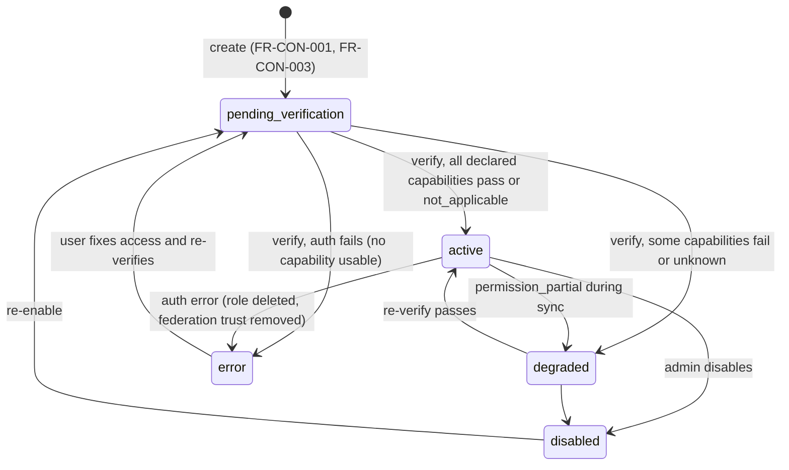
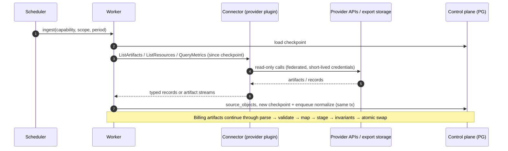

# Provider Integrations

Status: **DRAFT**. No connector code exists yet. These documents describe the **target** behaviour of the first-party connectors (AWS, GCP, Azure) and the generic file importer. Phase plans (`docs/phases/phase-XX/`) will refine them, and any item marked **verify** must be checked against current provider documentation during the named phase before implementation.

## 1. Document index

| Document | Scope | Delivered in |
|---|---|---|
| [AWS.md](AWS.md) | AWS standalone and Organizations scopes, CUR 2.0 / Data Exports, Athena, Cost Explorer, invoices, inventory, CloudWatch, Compute Optimizer, Trusted Advisor, Price List, RIs and Savings Plans | 06, 10, 18, 19–21, 25 |
| [GCP.md](GCP.md) | Billing account / organization / folder / project scopes, BigQuery billing exports, GCS path, Cloud Asset Inventory, Cloud Monitoring, Recommender, CUDs | 07, 10, 18, 19–21, 25 |
| [AZURE.md](AZURE.md) | EA / MCA / MPA / PAYG agreement types, Cost Management exports, Cost Details and Query APIs, Resource Graph, Azure Monitor, Advisor, Retail Prices, reservations and savings plans | 08, 10, 18, 19–21, 25 |
| [GENERIC_IMPORTS.md](GENERIC_IMPORTS.md) | CSV / JSON / NDJSON / XLSX / Parquet imports, mapping templates, validation, data-quality reports, safety limits, object-store polling | 09 |
| [COMPATIBILITY_MATRIX.md](COMPATIBILITY_MATRIX.md) | Provider × capability × scope availability and delivering phase | — |
| [../architecture/RESOURCE_INVENTORY.md](../architecture/RESOURCE_INVENTORY.md) | Unified resource model, inventory-to-cost join, telemetry model | 19–20 |

Related contracts and decisions:
- [Provider SDK](../contracts/PROVIDER_SDK.md) (Go interfaces, error classes, compatibility suite)
- [Capability manifest](../contracts/CAPABILITY_MANIFEST.md)
- [Ingestion pipeline](../architecture/INGESTION_PIPELINE.md) (stages, checkpoints, restatements, health)
- [ADR-0006](../architecture/adr/0006-focus-1-2-as-normalization-baseline.md) FOCUS 1.2 baseline · [ADR-0009](../architecture/adr/0009-keyless-cloud-federation-and-secret-references.md) keyless federation · [ADR-0010](../architecture/adr/0010-immutable-content-addressed-raw-storage-and.md) raw storage and atomic swap · [ADR-0012](../architecture/adr/0012-plugin-model-compile-time-first-party.md) plugin model

## 2. Common connector lifecycle

Every connector, whether first-party (compiled in, ADR-0012) or a third-party gRPC plugin, follows the same lifecycle. It is implemented against the `sdk/provider` interfaces (`Provider.Configure`, `Connector.Verify`, `Connector.DiscoverScopes`, capability interfaces such as `BillingSource`).

States map to `connectors.status` in [DATABASE_SCHEMA.md §2.3](../architecture/DATABASE_SCHEMA.md).

### 2.1 Create
1. The user selects a provider and a **root scope** (for example an AWS management account, a GCP billing account, or an Azure billing account or subscription).
2. CloudLedger generates the onboarding material for that provider (FR-CON-006): a CloudFormation/Terraform template (AWS), a `gcloud` script or Terraform module (GCP), or a Bicep/ARM/Terraform template (Azure). For AWS it also generates a **per-connector ExternalId**.
3. The user applies the template in their own cloud and pastes back the non-secret outputs (role ARN, service account email, workload identity pool provider, app registration client ID and tenant ID, export locations).
4. CloudLedger stores the auth method and non-secret parameters in `connectors.auth`. If a static secret is unavoidable, it stores only a secret reference in `credentials_refs` (ADR-0009, FR-CON-003).

### 2.2 Verify (FR-CON-002)
`Connector.Verify` runs **read-only probes per capability** and returns a `VerificationReport` whose capability results are `pass | fail | unknown | not_applicable`. Each check records the API called, the permission it exercises, the outcome and remediation text. Rules:

- Probes must be non-mutating and cheap. Where an API charges per request (AWS Cost Explorer) or per byte scanned (BigQuery), the probe uses the cheapest form (a single-day query, `dryRun`, `maximum_bytes_billed`) and the cost is documented in the provider doc.
- A denied probe produces `fail` with the missing permission(s) (`ErrPermission{Capability, Missing}`).
- A probe that cannot distinguish "not entitled" from "not permitted" (for example AWS Trusted Advisor on a Basic support plan) produces `unknown` with an explanation, never `pass`.
- Results are written to `connector_capabilities.verified_status` and `permission_report`, and are audited.
- Verification reruns automatically before each scheduled sync if the last result is older than 24 h (proposed default, decided in Phase 12), and on demand.

### 2.3 Discover
`Connector.DiscoverScopes` enumerates the provider hierarchy below the root scope (organization → accounts; billing account → projects; billing account → billing profiles → invoice sections → subscriptions …) into `cloud_scopes`, with stable native IDs and parent links. Discovery:
- runs on connector creation and then daily (proposed default),
- marks scopes not seen in the latest run as `status = missing` (never deleted, because cost history still refers to them),
- does **not** imply that every discovered scope is readable. Per-scope capability results are recorded separately (for example, an AWS member account where the inventory role was not deployed).

### 2.4 Sync
Each capability syncs independently as work units `(tenant, connector, capability, scope, billing_period | window)` per [INGESTION_PIPELINE.md §2](../architecture/INGESTION_PIPELINE.md):

Health per connector × capability × scope (FR-CON-005) is defined in [INGESTION_PIPELINE.md §5](../architecture/INGESTION_PIPELINE.md).

## 3. Capability model

Capabilities are declared in the provider's [capability manifest](../contracts/CAPABILITY_MANIFEST.md) and implemented as optional SDK interfaces.

| Capability | SDK interface | Typical sources | Phase(s) |
|---|---|---|---|
| `billing` | `BillingSource` | AWS CUR 2.0 / Data Exports, GCP BigQuery billing export, Azure Cost Management exports, generic files | 06–09, 11, 12 |
| `invoices` | `InvoiceSource` | AWS Invoicing API, Azure Billing invoices API, uploads | 10 |
| `inventory` | `InventorySource` | AWS Resource Explorer / Config, GCP Cloud Asset Inventory, Azure Resource Graph | 19 |
| `metrics` | `MetricsSource` | CloudWatch, Cloud Monitoring, Azure Monitor, OpenCost/Prometheus | 20 |
| `provider_recommendations` | `RecommendationSource` | Compute Optimizer, Trusted Advisor, Recommender, Advisor | 21 |
| `pricing` | `PricingSource` | AWS Price List API, GCP Cloud Billing Catalog / pricing export, Azure Retail Prices | 21–25 |
| `commitments` | `CommitmentSource` | RIs and Savings Plans, CUDs, Azure reservations and savings plans | 18, 25 |
| `cost_preview` (provider extension, proposed) | provider-specific | AWS Cost Explorer, Azure Query API | 06, 08 |

`cost_preview` is not yet in the SDK capability list in [PROVIDER_SDK.md](../contracts/PROVIDER_SDK.md). It is proposed here for the AWS Cost Explorer and Azure Query API quick-start and validation paths (FR-AWS-004, FR-AZR-003) and must be confirmed in Phase 02 or 06.

### 3.1 Availability levels
Each capability, per provider and scope type, has one of these availability levels in the manifest and the [compatibility matrix](COMPATIBILITY_MATRIX.md):

| Level | Meaning | Verification outcome allowed |
|---|---|---|
| `available` | Works for any customer who grants the documented permissions | `pass` / `fail` |
| `entitlement_dependent` | Depends on support plan, agreement type, opt-in, billing role or a feature the customer must enable | `pass` / `fail` / `unknown` |
| `customer_setup_required` | Requires the customer to create something first (an export, a dataset, an aggregator) | `pass` / `fail` / `not_ready` |
| `not_supported` | No provider mechanism exists for this scope type, or CloudLedger does not support it | `not_applicable` |

## 4. Principle: detect, don't assume

Provider data availability depends on agreement type, support plan, scope, opt-ins and roles (PRD assumption A1, risk R-06). CloudLedger therefore **detects** capabilities and never infers them:

1. **No silent defaults.** If a capability is unavailable, the UI and API show an explicit state (`unknown`, `fail`, `not_applicable`, `not_ready`) with the reason. They never show an empty chart that looks like "zero cost" or "no recommendations".
2. **Probe the actual entitlement.** For example: call the Trusted Advisor API and interpret `SubscriptionRequiredException` as "support plan does not include this", call the Compute Optimizer enrollment status, check that the GCP detailed export table exists, read the Azure billing account `agreementType`.
3. **Per-scope, not per-connector.** A capability can pass at the organization scope and fail for one member account. Health and coverage are tracked per scope.
4. **Absence of evidence lowers confidence.** Missing telemetry or missing provider recommendations reduce recommendation confidence (FR-TEL-002) and never produce fabricated values.
5. **Re-detect regularly.** Entitlements change (support plan upgrades, new exports, role changes). Verification is repeated, and changes are audited and surfaced as connector events.
6. **Document uncertainty.** Each provider document marks behaviour that varies, or that the authors could not confirm, as **verify in Phase NN**. The marker is removed only after the phase confirms the behaviour against current provider documentation and a recorded fixture.

## 5. Shared conventions for provider documents

Each provider document follows the same structure: scopes, authentication, per-capability sources, least-privilege permissions per capability, onboarding template outline, verification checks, quotas and throttling, FOCUS mapping highlights, known limitations, and the fixture plan for its connector phase.

- **Read-only.** Templates grant no permission that mutates customer workloads (FR-CON-004). Some data paths have **non-workload side effects** that are unavoidable and are called out explicitly where they occur: Athena writes query results to S3, BigQuery query jobs are created and billed in a project, and Cost Details API reports are generated by the provider. See the inconsistency note in §6.
- **Money.** All amounts are parsed into fixed-point decimals (ADR-0007). Provider floats (for example JSON numbers in API responses) are parsed from their string form and are never routed through `float64`.
- **Time.** All timestamps are stored in UTC (ADR-0016). Provider-local dates are converted with the documented provider time zone.
- **FOCUS.** Mapping to FOCUS 1.2 is versioned (ADR-0006). Where a provider offers a native FOCUS export, CloudLedger may ingest it, but it still applies its own versioned mapping and conformance validator (Phase 11). Provider FOCUS exports have documented conformance gaps.

## 6. Open points raised by these documents

| Point | Detail | Decide in |
|---|---|---|
| Scope of "read-only" (FR-CON-004) | Athena (S3 result writes), BigQuery (query jobs), and optional template-created exports have side effects that are not mutations of customer workloads. The requirement text should say "no mutation of customer workloads or configuration; documented, narrowly scoped data-plane side effects are permitted". | Phase 02 |
| `cost_preview` capability | Not in the SDK capability list. | Phase 02 / 06 |
| GCS path (FR-GCP-003) | Google no longer offers a native billing file export to Cloud Storage. The GCS path ingests files the customer exports from BigQuery. See [GCP.md](GCP.md). | Phase 07 |
| Native FOCUS exports as primary source | AWS (FOCUS 1.2 with AWS columns) and Azure (FocusCost export) now offer FOCUS-format exports. Whether these become primary sources or only cross-checks needs a decision. Proposed: provider-native schemas (CUR 2.0, Azure actual/amortized) stay primary, and FOCUS exports are optional sources and reconciliation cross-checks. | Phase 11 (OQ-02) |
