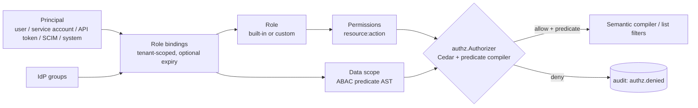
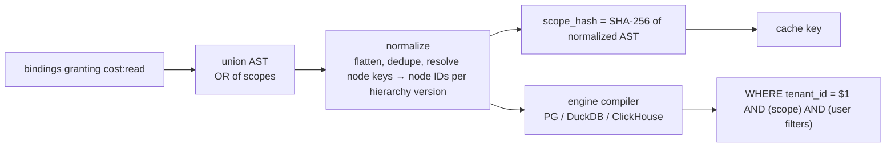

# Authorization Model (RBAC + ABAC)

> **Status: DRAFT design.** Nothing here is implemented. Decision: [ADR-0008](../architecture/adr/0008-authorization-rbac-abac-via-cedar-policies.md). Delivered in Phase 05 (foundations, built-in roles, matrix), Phase 15 (tag/hierarchy/dimension scopes on allocated cost), Phase 31 (custom policies, MSP delegation). Requirements: FR-IAM-004..008, FR-ANL-004, FR-DSH-005, FR-AI-002, AC-03.

## 1. Concepts



- **Permission:** `resource:action` string. Platform-plane permissions are prefixed `platform.` and can never appear in tenant roles.
- **Role:** named set of permissions. Built-in roles are global, immutable and versioned with the catalog; custom roles are tenant-owned.
- **Role binding:** `(subject, role, data_scope?, expires_at?)` within one tenant (`role_bindings`).
- **Data scope:** a validated ABAC predicate (`data_scopes.predicate`) restricting which cost rows and scoped objects the binding covers. No scope = all tenant data.

## 2. Core rules

| ID | Rule |
|---|---|
| AZ-01 | Every OpenAPI operation declares `x-cloudledger-permission` (one permission, or `public` for health/login). CI fails on missing or unknown values. The same annotation drives the generated test matrix (§10). |
| AZ-02 | Default deny. Unknown permission, empty role, invalid or empty-set data scope, unresolvable tenant → deny. |
| AZ-03 | Tenant boundary precedes everything: a principal acts in exactly one tenant per request; foreign objects return 404 (SEC-ISO-01). |
| AZ-04 | Multiple bindings combine by **union per permission**: permission *p* is allowed on row/object *r* iff some binding grants *p* and its scope matches *r*. Effective predicate for *p* = `OR(scope(b) for b granting p)`; any unscoped binding granting *p* → `TRUE`. |
| AZ-05 | **No escalation through delegation:** a principal can create/modify roles, bindings, scopes or tokens only with permissions it holds, and only with data scopes that are subsets of its own effective scope for each delegated permission (subset check via predicate normalization; undecidable cases → deny). |
| AZ-06 | API tokens: effective rights = token scopes ∩ owner's current rights (SEC-TOK-03). |
| AZ-07 | Bindings may expire (`expires_at`); expired bindings are ignored immediately and removed by a sweeper. |
| AZ-08 | Object-level rules (ownership, sharing, lifecycle state) are evaluated by Cedar; data-level rules by the compiled predicate. Both must pass. |
| AZ-09 | Decisions carry `policy_ids` and `scope_hash`; denials are audited (SEC-AUD-07). |
| AZ-10 | Scoped objects (budgets, anomalies, recommendations, resources, reports, saved views, widgets) carry a scope descriptor; a principal sees the object only if the object's scope intersects (list) or is contained in (mutate) its effective scope. |

## 3. Permission catalog

`S` in the *Scoped* column = the permission is filtered by data scope (ABAC). Others are tenant-wide. The machine-readable source of truth will be `internal/authz/catalog.yaml` (Phase 05), from which docs, Cedar schema and tests are generated.

| Permission | Scoped | Description | PRD |
|---|---|---|---|
| **Tenant and settings** | | | |
| `tenant:read` | | Read tenant profile | FR-TEN-001 |
| `settings:read` | | Read tenant settings | FR-TEN-007 |
| `settings:update` | | Update settings (currency, calendar, retention, egress policy) | FR-TEN-007 |
| `tenant:delete_request` | | Request tenant deletion (step-up) | FR-TEN-004 |
| **Identity and access** | | | |
| `members:read` | | List members | FR-IAM |
| `members:invite` | | Invite members | FR-IAM |
| `members:manage` | | Suspend/remove members, revoke their sessions | FR-IAM-010 |
| `roles:read` / `roles:manage` | | Read / create-edit-delete custom roles | FR-IAM-005 |
| `role_bindings:read` / `role_bindings:manage` | | Read / manage bindings (subject to AZ-05) | FR-IAM-004 |
| `data_scopes:read` / `data_scopes:manage` | | Read / manage ABAC scopes | FR-IAM-006 |
| `idp:read` / `idp:manage` | | IdP config, group mappings (step-up) | FR-IAM-001/002/008 |
| `scim:provision` | | SCIM endpoint (SCIM principal only) | FR-IAM-003 |
| `api_tokens:create_personal` | | Create own personal tokens (≤ own rights) | FR-IAM-007 |
| `api_tokens:manage` | | List/revoke all tokens; service-account tokens | FR-IAM-007 |
| `service_accounts:manage` | | Create service accounts and bind roles | FR-IAM-007 |
| **Hierarchy** | | | |
| `hierarchy:read` | | Read hierarchy versions/nodes | FR-TEN-003 |
| `hierarchy:manage` | | Draft/publish hierarchy versions | FR-TEN-003 |
| **Connectors and ingestion** | | | |
| `connectors:read` | | Connector config (non-secret), health, scopes | FR-CON-005 |
| `connectors:manage` | | Create/update/disable connectors | FR-CON-001 |
| `connectors:credentials_manage` | | Set/rotate credential references, regenerate ExternalId | FR-CON-003 |
| `connectors:verify` | | Run permission verification | FR-CON-002 |
| `connectors:sync` | | Trigger sync/backfill | FR-ING-001/002 |
| `imports:create` / `imports:read` | | Upload files / read import reports | FR-IMP-001/003 |
| `mappings:manage` | | Column mapping templates, FOCUS mapping overrides | FR-IMP-002, FR-NRM-004 |
| `ingestion:read` | | Runs, DQ reports, period diffs | FR-ING |
| **Cost analytics** | | | |
| `catalog:read` | | Semantic catalog (metrics, dimensions visible to the principal) | FR-ANL-002 |
| `cost:read` | S | Semantic queries over normalized/allocated cost | FR-ANL-004 |
| `cost:read_lineage` | S | Lineage refs, source rows, `x_raw` | FR-NRM-002 |
| **Dashboards** | | | |
| `dashboards:read` | | Read dashboards owned by or shared with the principal (data still scoped by `cost:read`) | FR-DSH-005 |
| `dashboards:create` | | Create own dashboards and saved views | FR-DSH-004 |
| `dashboards:share` | | Share own dashboards with members/groups | FR-DSH-005 |
| `dashboards:manage_all` | | Edit/delete any dashboard; tenant-visible and per-role default dashboards | FR-DSH-004 |
| `dashboard_templates:manage` | | Manage templates | FR-DSH-004 |
| `widgets:export` | S | Export widget data CSV/XLSX | FR-DSH-006 |
| **Allocation** | | | |
| `allocation:read` | | Read rule sets and custom dimensions | FR-ALC |
| `allocation:manage` | | Draft rules, preview | FR-ALC-006 |
| `allocation:publish` | | Publish rule-set versions | FR-ALC-006 |
| `custom_dimensions:manage` | | Define custom dimensions | FR-NRM-005 |
| **Budgets, forecasts, anomalies, alerts** | | | |
| `budgets:read` / `budgets:manage` | S | Read / manage budgets within scope | FR-BUD-001/002 |
| `forecasts:read` | S | Read forecasts | FR-BUD-003 |
| `anomalies:read` / `anomalies:triage` | S | Read / acknowledge, mark false-positive, suppress | FR-BUD-004 |
| `alert_channels:read` / `alert_channels:manage` | | Channels (secrets write-only) | FR-BUD-005 |
| `notifications:read` | | Delivery log | FR-BUD-006 |
| **Finance** | | | |
| `fx:read` / `fx:manage` | | FX rate sets and policy | FR-FIN-001 |
| `commitments:read` | S | Commitment inventory, utilization, coverage | FR-FIN-002 |
| `unit_metrics:read` / `unit_metrics:manage` | | Business metrics | FR-FIN-003 |
| `invoices:read` / `invoices:import` | | Invoices and lines | FR-FIN-004 |
| `reconciliation:read` / `reconciliation:run` | | Reconciliation results | FR-FIN-004 |
| `reconciliation:acknowledge_variance` | | Acknowledge variances | UJ-08 |
| `periods:read` / `periods:close` / `periods:reopen` | | Period lifecycle (close/reopen: step-up, four-eyes option) | FR-FIN-005 |
| `reports:read` | S | Read report definitions/runs/artifacts | FR-FIN-007 |
| `reports:manage` | S | Create/edit report definitions (incl. AI drafts) | FR-FIN-007, FR-AI-007 |
| `reports:run` | S | Run reports | FR-FIN-007 |
| `reports:deliver_external` | | Schedule delivery to non-member recipients (domain allow-list) | FR-FIN-007 |
| `exports:create` | S | Finance exports (CSV/XLSX/JSON/Parquet/PDF/journal) | FR-FIN-006 |
| **Inventory and telemetry** | | | |
| `resources:read` | S | Resource inventory and history | FR-RES-001 |
| `metrics:read` | S | Utilization metrics | FR-TEL-001 |
| **Recommendations** | | | |
| `recommendations:read` | S | Recommendations and evidence | FR-REC-002 |
| `recommendations:transition` | S | Acknowledge, request review, snooze, mark implemented | FR-REC-006 |
| `recommendations:approve` | S | Approve/reject (cannot approve own request) | FR-REC-006 |
| `recommendations:dismiss` | S | Dismiss | FR-REC-006 |
| `recommendations:ticket` | S | Create external ticket | FR-REC-008 |
| `recommendation_rules:configure` | | Enable/disable rules, thresholds | FR-REC-001 |
| **AI** | | | |
| `ai:use` | | Use the assistant (tools still require their own permissions) | FR-AI-002 |
| `ai:configure` | | Enable AI, provider, egress policy, retention (step-up) | FR-AI-001/008 |
| `ai:audit_read` | | Tool-call metadata for all users (not message content) | FR-AI-008 |
| **Audit** | | | |
| `audit:read` / `audit:export` / `audit:verify` | | Audit search, export, chain verification | FR-AUD-002 |
| **Misc** | | | |
| `operations:read` | | Own long-running operations | API §9 |
| `plugins:read` | | Installed plugins and manifests | FR-SDK-003 |

Platform-plane permissions (platform admin only; never in tenant roles):
`platform.tenants:read`, `platform.tenants:create`, `platform.tenants:suspend`, `platform.tenants:delete`, `platform.tenants:export`, `platform.users:read` (global directory: ID, email, status, memberships), `platform.settings:manage` (limits, SSRF allow-lists, egress), `platform.plugins:manage`, `platform.keys:rotate`, `platform.audit:read` (platform chain), `platform.break_glass:request`, `platform.break_glass:approve`, `platform.health:read`.

## 4. Built-in roles and permission matrix

Roles: **TO** tenant owner, **FA** FinOps admin, **FM** finance manager, **EM** engineering manager, **DEV** developer, **AUD** auditor, **VW** viewer. **PA** platform admin holds only `platform.*` permissions and **no tenant-plane permission** (data access only via break-glass, §9). Built-in tenant roles are typically bound with a data scope for EM, DEV and VW; ✓ means granted (subject to the binding's scope for `S` permissions).

| Permission | TO | FA | FM | EM | DEV | AUD | VW |
|---|---|---|---|---|---|---|---|
| `tenant:read`, `catalog:read`, `hierarchy:read`, `operations:read`, `fx:read` | ✓ | ✓ | ✓ | ✓ | ✓ | ✓ | ✓ |
| `settings:read` | ✓ | ✓ | ✓ | | | ✓ | |
| `settings:update`, `tenant:delete_request` | ✓ | | | | | | |
| `members:read` | ✓ | ✓ | | ✓ | | ✓ | |
| `members:invite`, `members:manage` | ✓ | | | | | | |
| `roles:read`, `role_bindings:read`, `data_scopes:read` | ✓ | ✓ | | | | ✓ | |
| `roles:manage`, `role_bindings:manage`, `data_scopes:manage` | ✓ | | | | | | |
| `idp:read` | ✓ | | | | | ✓ | |
| `idp:manage`, `api_tokens:manage`, `service_accounts:manage` | ✓ | | | | | | |
| `api_tokens:create_personal` | ✓ | ✓ | ✓ | ✓ | ✓ | | |
| `hierarchy:manage` | ✓ | ✓ | | | | | |
| `connectors:read` | ✓ | ✓ | ✓ | ✓ | | ✓ | |
| `connectors:manage`, `connectors:credentials_manage`, `connectors:verify`, `connectors:sync` | ✓ | ✓ | | | | | |
| `imports:create` | ✓ | ✓ | ✓ | | | | |
| `imports:read`, `ingestion:read` | ✓ | ✓ | ✓ | | | ✓ | |
| `mappings:manage` | ✓ | ✓ | | | | | |
| `cost:read` (S) | ✓ | ✓ | ✓ | ✓ | ✓ | ✓ | ✓ |
| `cost:read_lineage` (S) | ✓ | ✓ | ✓ | | | ✓ | |
| `dashboards:read` | ✓ | ✓ | ✓ | ✓ | ✓ | ✓ | ✓ |
| `dashboards:create` | ✓ | ✓ | ✓ | ✓ | ✓ | | ✓ |
| `dashboards:share` | ✓ | ✓ | ✓ | ✓ | | | |
| `dashboards:manage_all`, `dashboard_templates:manage` | ✓ | ✓ | | | | | |
| `widgets:export` (S) | ✓ | ✓ | ✓ | ✓ | ✓ | ✓ | |
| `allocation:read` | ✓ | ✓ | ✓ | ✓ | | ✓ | |
| `allocation:manage`, `allocation:publish`, `custom_dimensions:manage` | ✓ | ✓ | | | | | |
| `budgets:read`, `forecasts:read`, `anomalies:read` (S) | ✓ | ✓ | ✓ | ✓ | ✓ | ✓ | ✓ |
| `budgets:manage` (S) | ✓ | ✓ | ✓ | ✓ | | | |
| `anomalies:triage` (S) | ✓ | ✓ | | ✓ | | | |
| `alert_channels:read`, `notifications:read` | ✓ | ✓ | ✓ | ✓ | | ✓ | |
| `alert_channels:manage` | ✓ | ✓ | | | | | |
| `fx:manage` | ✓ | | ✓ | | | | |
| `commitments:read` (S) | ✓ | ✓ | ✓ | ✓ | | ✓ | |
| `unit_metrics:read` | ✓ | ✓ | ✓ | ✓ | ✓ | ✓ | ✓ |
| `unit_metrics:manage` | ✓ | ✓ | ✓ | | | | |
| `invoices:read`, `reconciliation:read`, `periods:read` | ✓ | ✓ | ✓ | | | ✓ | |
| `invoices:import`, `reconciliation:run`, `reconciliation:acknowledge_variance`, `periods:close` | ✓ | | ✓ | | | | |
| `periods:reopen` | ✓ | | | | | | |
| `reports:read` (S) | ✓ | ✓ | ✓ | ✓ | ✓ | ✓ | ✓ |
| `reports:manage` (S) | ✓ | ✓ | ✓ | ✓ | | | |
| `reports:run` (S) | ✓ | ✓ | ✓ | ✓ | | ✓ | |
| `reports:deliver_external` | ✓ | | ✓ | | | | |
| `exports:create` (S) | ✓ | ✓ | ✓ | ✓ | | ✓ | |
| `resources:read`, `recommendations:read` (S) | ✓ | ✓ | ✓ | ✓ | ✓ | ✓ | ✓ |
| `metrics:read` (S) | ✓ | ✓ | | ✓ | ✓ | ✓ | |
| `recommendations:transition`, `recommendations:ticket` (S) | ✓ | ✓ | | ✓ | ✓ | | |
| `recommendations:approve`, `recommendations:dismiss` (S) | ✓ | ✓ | | ✓ | | | |
| `recommendation_rules:configure` | ✓ | ✓ | | | | | |
| `ai:use` | ✓ | ✓ | ✓ | ✓ | ✓ | | |
| `ai:configure` | ✓ | | | | | | |
| `ai:audit_read` | ✓ | | | | | ✓ | |
| `audit:read`, `audit:export`, `audit:verify` | ✓ | | | | | ✓ | |
| `plugins:read` | ✓ | ✓ | | | | ✓ | |

Notes:
- **Separation of duties** (T-66): tenant setting `finance.four_eyes` (default on for `organization` tenants) requires a second, different principal with `periods:close` to approve a close or reopen, and forbids approving one's own recommendation review request (enforced in Cedar, §8).
- **Auditor** is strictly read-only; the only non-read actions are `reports:run` and `exports:create` (needed to produce evidence) and `audit:verify`.
- **Viewer** has no export, no AI by default; tenants can add `ai:use` with a custom role.
- **MSP delegation (Phase 31):** a parent tenant's principals act in a child tenant only through explicit role bindings created in the child tenant; no data visibility is inherited (TENANCY §1).

## 5. Custom roles (FR-IAM-005)

| ID | Rule |
|---|---|
| AZ-11 | Custom roles contain only tenant-plane permissions from the current catalog; `platform.*` rejected. |
| AZ-12 | Creator must hold every permission in the role (AZ-05). |
| AZ-13 | Built-in roles are immutable but can be cloned into custom roles. |
| AZ-14 | Catalog evolution: new permissions are added to built-in roles per release notes; never auto-added to custom roles. Removed permissions are deprecated for 2 minor releases (NFR-CMP-001) and then dropped from custom roles with an audit entry. |
| AZ-15 | Role changes take effect on the next request (permission cache TTL ≤ 30 s, invalidated on change events). |
| AZ-16 | Custom Cedar policies (Phase 31): tenant-authored `forbid` policies only (they can restrict, never broaden); validated against the schema and analyzed for conflicts before activation. |

## 6. ABAC data-scope predicate language

### 6.1 Grammar (JSON AST)

```text
Predicate   := All | Any | Not | Cmp | AllData
All         := {"all": [Predicate, ...]}            ; 1..32 children
Any         := {"any": [Predicate, ...]}            ; 1..32 children
Not         := {"not": Predicate}
AllData     := {"all_data": true}                   ; explicit unrestricted scope
Cmp         := {"attr": Attr, "op": Op, "value": Scalar}
             | {"attr": Attr, "op": SetOp, "values": [Scalar, ...]}   ; 1..1000 values
             | {"attr": Attr, "op": "exists" | "not_exists"}
Attr        := "provider" | "billing_account_id" | "sub_account_id"
             | "region_id" | "service_name" | "service_category"
             | "hierarchy_node" | "tag:" TagKey | "dim:" DimKey
Op          := "eq" | "neq" | "prefix" | "in_subtree"
SetOp       := "in" | "not_in"
Scalar      := string (≤ 256 chars, NFC-normalized)
```

Limits: depth ≤ 8, nodes ≤ 256, total values ≤ 5 000. Stored in `data_scopes.predicate`, validated by JSON Schema plus semantic checks on save.

### 6.2 Attributes

| Attribute | Meaning | Source column (analytics) | Allowed ops |
|---|---|---|---|
| `provider` | `aws`, `gcp`, `azure`, `generic`, plugin id | `provider` | eq, neq, in, not_in |
| `billing_account_id` | AWS payer, GCP billing account, Azure billing account/profile | FOCUS `BillingAccountId` | eq, in, not_in |
| `sub_account_id` | AWS account, GCP project, Azure subscription | FOCUS `SubAccountId` | eq, in, not_in, prefix |
| `region_id` | Provider region | FOCUS `RegionId` | eq, in, not_in, prefix |
| `service_name` / `service_category` | FOCUS service | `ServiceName` / `ServiceCategory` | eq, in, not_in |
| `hierarchy_node` | Tenant hierarchy node by **node key**; `in_subtree` includes descendants | `cost_allocated.hierarchy_node_id` | eq, in, in_subtree |
| `tag:<key>` | Normalized tag key (after FR-ALC-001 normalization) | tags map | eq, neq, in, not_in, prefix, exists, not_exists |
| `dim:<key>` | Custom dimension | `cost_allocated` dimension column/map | eq, in, not_in, exists |

### 6.3 Semantics

| ID | Rule |
|---|---|
| AZ-20 | Evaluation is two-valued with **missing = no match**: a comparison on a missing tag/dimension/attribute is `false` (for `neq` and `not_in` as well). `not_exists` is the only way to match missing values. Therefore `{"attr":"tag:env","op":"neq","value":"prod"}` does **not** match untagged rows. |
| AZ-21 | `not` is allowed but the save-time linter warns when a scope's match set is not bounded by at least one positive comparison (e.g., a lone `not`), because it grants access to future data (new accounts, new tags). |
| AZ-22 | `hierarchy_node` references node **keys** resolved against the hierarchy version effective for each row's charge period; `in_subtree` resolves to the set of node IDs whose `path <@ node.path` (ltree) in that version. |
| AZ-23 | A scope that references a tag key, dimension or node that does not exist is valid (it matches nothing) but flagged in the UI. |
| AZ-24 | `hierarchy_node` and `dim:` predicates are only evaluable on allocated cost. Queries by principals with such scopes are routed to `cost_allocated`; metrics only available on `cost_focus` (e.g. some lineage) are rejected with `unsupported_query` rather than evaluated unscoped. |
| AZ-25 | Dimension visibility: a principal may group/filter only by dimensions in the catalog and, for `tag:`/`dim:` dimensions, only keys not marked `restricted` by the tenant. The catalog endpoint returns only visible dimensions. |
| AZ-26 | Scoped objects (budgets, reports, saved views, widgets, recommendations, resources) are matched by evaluating the predicate against the object's scope attributes; recommendations and resources use their provider/account/region/tags. |

### 6.4 Examples

```json
{"all": [
  {"attr": "provider", "op": "in", "values": ["aws", "gcp"]},
  {"any": [
    {"attr": "hierarchy_node", "op": "in_subtree", "value": "bu-payments"},
    {"attr": "tag:team", "op": "eq", "value": "payments"}
  ]},
  {"attr": "tag:env", "op": "in", "values": ["prod", "staging"]}
]}
```

```json
{"all": [{"attr": "sub_account_id", "op": "in", "values": ["123456789012", "my-gcp-project"]}]}
```

## 7. Compilation into semantic-layer SQL



| ID | Rule |
|---|---|
| AZ-27 | The security predicate is compiled by `internal/authz` into a `semantic.SecurityContext{TenantID, RowPredicate, VisibleDimensions, ScopeHash}`; the semantic compiler places it **as a separate conjunct** around user filters: `tenant_id = $1 AND (<security>) AND (<user filters>)`. User filters cannot reference or negate it. |
| AZ-28 | All values become bound parameters; attribute names map to a fixed column whitelist; tag/dimension keys are passed as parameters to map-access functions, never interpolated. |
| AZ-29 | `in_subtree` compiles to `hierarchy_node_id = ANY($n)` (PG) / `has($n, hierarchy_node_id)` (ClickHouse) / `list_contains($n, hierarchy_node_id)` (DuckDB) with the pre-resolved node-ID set per hierarchy version, guarded by `hierarchy_version_id`. |

Example for the first scope in §6.4 on ClickHouse (illustrative):

```sql
SELECT service_name, sum(effective_cost) AS effective_cost
FROM cost_allocated
WHERE tenant_id = {t:UUID}
  AND ( provider IN {p1:Array(String)}
        AND ( has({nodes:Array(UUID)}, hierarchy_node_id)
              OR tags[{k1:String}] = {v1:String} )
        AND mapContains(tags, {k2:String}) AND tags[{k2:String}] IN {v2:Array(String)} )
  AND ( /* user filters */ )
  AND charge_period_start >= {from:DateTime64(3,'UTC')} AND charge_period_start < {to:DateTime64(3,'UTC')}
GROUP BY service_name
```

PostgreSQL equivalent uses `tags ->> $k = $v` and `(tags ? $k)` for `exists`; `mapContains` is required in ClickHouse because a missing key returns `''` (AZ-20 missing = no match).

## 8. Cedar policies

Cedar evaluates object-level decisions. Entity types (schema generated from the catalog in Phase 05):

```cedarschema
namespace CloudLedger {
  entity Tenant;
  entity User in [Group] { tenant: Tenant, roles: Set<String> };
  entity Group { tenant: Tenant };
  entity Dashboard { tenant: Tenant, owner: User, visibility: String, shared_with: Set<User> };
  entity Recommendation { tenant: Tenant, state: String, requested_by?: User, scope: ScopeAttrs };
  entity Period { tenant: Tenant, status: String, close_requested_by?: User };
  entity CostRow { tenant: Tenant, provider: String, sub_account_id: String, region_id: String,
                   hierarchy_path: Set<String>, tags: Map<String, String> };  // test-only (differential testing)
  action "dashboards:read", "dashboards:share", "recommendations:approve", "periods:close" appliesTo { ... };
}
```

Sample policies (illustrative):

```cedar
// Role grant (generated from the role catalog): permission check within the principal's tenant.
@id("role.finance_manager.periods_close")
permit (principal, action == CloudLedger::Action::"periods:close", resource is CloudLedger::Period)
when { principal.tenant == resource.tenant && principal.roles.contains("finance_manager") };

// Dashboard visibility: owner, explicit share, or tenant-visible.
@id("dashboards.read")
permit (principal, action == CloudLedger::Action::"dashboards:read", resource is CloudLedger::Dashboard)
when { principal.tenant == resource.tenant &&
       (resource.owner == principal || resource.visibility == "tenant" || resource.shared_with.contains(principal)) };

// Separation of duties: cannot approve your own review request.
@id("sod.recommendation.self_approval")
forbid (principal, action == CloudLedger::Action::"recommendations:approve", resource is CloudLedger::Recommendation)
when { resource has requested_by && resource.requested_by == principal };

// Four-eyes period close (when tenant setting finance.four_eyes = true; context supplied by the app).
@id("sod.period.four_eyes")
forbid (principal, action == CloudLedger::Action::"periods:close", resource is CloudLedger::Period)
when { context.four_eyes && resource has close_requested_by && resource.close_requested_by == principal };

// Global guard: no cross-tenant decisions ever.
@id("guard.tenant")
forbid (principal, action, resource) when { resource has tenant && principal has tenant && principal.tenant != resource.tenant };
```

| ID | Rule |
|---|---|
| AZ-30 | Policies are generated from the catalog plus a small hand-written set (guards, SoD). Hand-written policies require CODEOWNERS review by security maintainers. |
| AZ-31 | The policy set is validated against the schema in CI; `cedar` analysis checks that no `permit` can match across tenants. |
| AZ-32 | Equivalence: for test fixtures, each ABAC AST is also translated into a Cedar `when` condition over `CostRow`, and the SQL predicate result set must equal the Cedar-permitted row set (ADR-0008 consequence). |

## 9. Break-glass for platform admins

| ID | Rule |
|---|---|
| AZ-40 | Platform admins hold no tenant-plane permissions (SP-04). Tenant data access requires a **break-glass grant**: `{tenant, requester, reason, ticket_ref, permissions (default: read-only set), duration ≤ 4 h, approver}`. |
| AZ-41 | Request requires step-up auth; approval by a second platform admin (`platform.break_glass:approve`, cannot self-approve). Multi-tenant deployments: mandatory; single-tenant: configurable, default on (SQ-02). Tenants may additionally require tenant-owner approval (`settings.break_glass_requires_owner`). |
| AZ-42 | A grant materializes as an expiring role binding in the target tenant bound to the admin's identity with role `break_glass_readonly` (all read `S` permissions unscoped, `audit:read`; no exports, no AI, no mutations). Write access requires a separate grant listing explicit permissions and is always tenant-owner approved. |
| AZ-43 | All break-glass sessions run in read-only DB transactions where the permissions allow (`SET TRANSACTION READ ONLY`), carry a visible UI banner, and tag every audit event with `break_glass_id`. |
| AZ-44 | Lifecycle events (requested, approved, activated, every access, expired, revoked) are written to **both** the platform chain and the tenant chain; tenant owners are notified at activation (email + in-app). |
| AZ-45 | Grants auto-expire; `cloudledger admin break-glass revoke` ends them immediately; sessions are revoked on expiry. |
| AZ-46 | CLI path (`cloudledger admin`) for disaster scenarios (IdP outage) uses an operator credential from the KEK backend plus a recorded reason, and is audited identically. |

## 10. Testing approach (Phase 05; extended in 13, 15, 16, 27, 31)

| ID | Test | Description |
|---|---|---|
| AZ-50 | **Generated role × permission × scope matrix** | Generated from `catalog.yaml` and OpenAPI `x-cloudledger-permission`: for every operation, every built-in role, and scope fixtures {unscoped, in-scope, out-of-scope, partially-overlapping, foreign-tenant}, assert expected status (2xx / 403 / 404) and, for list/query endpoints, the exact visible fixture IDs. Positive and negative cases for every cell (AC-03). |
| AZ-51 | Principal variants | Same matrix for API tokens with reduced scopes, demoted owners (AZ-06), expired bindings, IdP-group-derived bindings, service accounts. |
| AZ-52 | Predicate differential testing | Property-based generation of random ASTs and random cost rows (tags missing/empty/unicode), comparing: Go reference evaluator, Cedar `CostRow` evaluation, PG SQL, DuckDB SQL, ClickHouse SQL. All five must agree (AZ-32). |
| AZ-53 | Escalation tests | Attempts to create roles/bindings/scopes/tokens beyond own rights (AZ-05), self-approval, four-eyes bypass, custom `forbid` policies cannot be used to broaden. |
| AZ-54 | Coverage gate | CI fails if any operation lacks a matrix entry or any permission has zero positive or zero negative tests. |
| AZ-55 | Mutation testing | Mutating the predicate compiler (e.g., dropping a conjunct) must fail the suite (Go mutation tool, run nightly). |
| AZ-56 | Break-glass tests | Approval rules, expiry, read-only enforcement, dual-chain audit, tenant notification. |
| AZ-57 | Cross-surface | The same scope fixtures are reused by dashboards (Phase 16), exports (Phase 29) and AI tools (Phase 27) so all surfaces return identical visible sets. |
