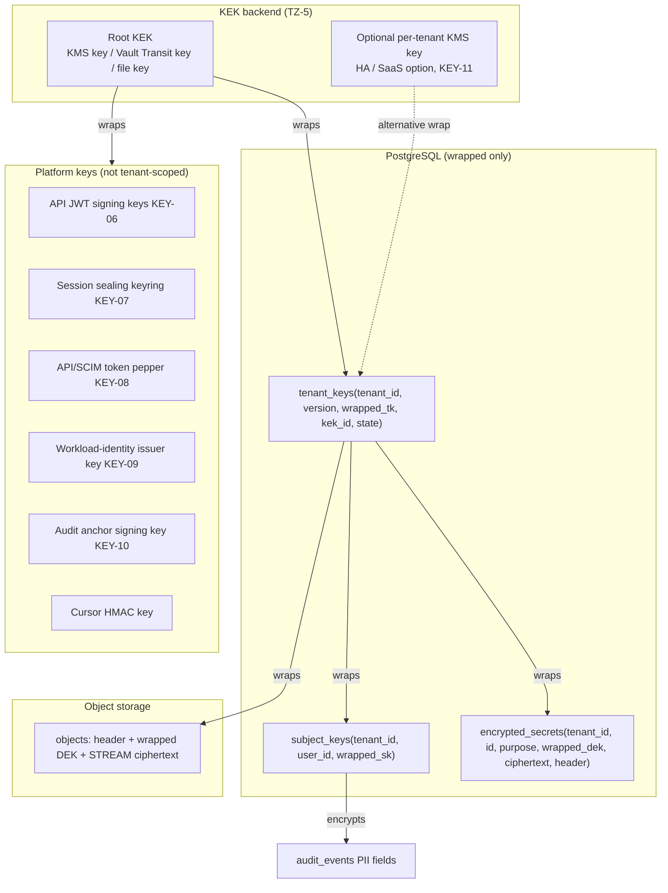

# Secrets and Key Management

> **Status: DRAFT design.** Nothing here is implemented. Decision: [ADR-0009](../architecture/adr/0009-keyless-cloud-federation-and-secret-references.md). Requirements: NFR-SEC-003, NFR-SEC-004, FR-TEN-004, FR-CON-003. Delivered in Phase 04 (envelope crypto primitives, tenant keys), Phase 05 (token pepper, session and JWT keys), Phase 06–08 (secret references for connectors), Phase 33 (rotation runbooks, crypto-shredding verification).

## 1. Principles

| ID | Rule |
|---|---|
| KEY-01 | Three-level hierarchy: **Root KEK** (in KMS/Vault/file) → **Tenant key (TK)** per tenant, versioned, stored only wrapped → **DEK** per secret or object. Plaintext keys exist only in process memory. |
| KEY-02 | Root KEK never leaves the backend when it is KMS or Vault Transit (wrap/unwrap are remote calls). A file KEK is allowed only in Lite and dev. |
| KEY-03 | AEAD only: AES-256-GCM (96-bit random nonces; DEKs are single-use for secrets, so nonce limits are not approached) and segment-based streaming AEAD for objects. AAD always binds `(tenant_id, object_or_secret_id, purpose, key_version)`. |
| KEY-04 | Crypto library: Go standard library primitives wrapped by `internal/platform/crypto` (or Google Tink-Go after Phase 03 evaluation). No custom cryptographic constructions beyond composition. |
| KEY-05 | Every ciphertext carries a header `{format_version, kek_id, tk_version, alg}` so rotation and re-wrapping are possible without guessing. |

## 2. Key hierarchy

| Key | Scope | Algorithm | Storage | Rotation |
|---|---|---|---|---|
| Root KEK | Deployment | KMS symmetric (AES-256-GCM in HSM) / Vault Transit `aes256-gcm96` / 32-byte file | Backend | Yearly (KMS automatic) or on compromise |
| Tenant key (TK) | Tenant | AES-256 | `tenant_keys` wrapped by Root KEK (or per-tenant KMS key) | Yearly, on demand, on admin compromise |
| Subject key (SK) | User within tenant | AES-256 | `subject_keys` wrapped by TK | Not rotated; destroyed on erasure |
| DEK | One secret / one object | AES-256 | Wrapped by TK next to ciphertext | New DEK on every write |
| API JWT signing (KEY-06) | Deployment | Ed25519 or ECDSA P-256 | Wrapped by Root KEK or KMS asymmetric key | 90 days, 2 active keys in JWKS |
| Session sealing (KEY-07) | Deployment | AES-256-GCM keyring | Wrapped by Root KEK | 30 days; previous key decrypt-only until absolute session timeout passes |
| Token pepper (KEY-08) | Deployment | HMAC-SHA256 key | Wrapped by Root KEK | Versioned; new tokens use the latest; old versions kept until all tokens using them expire (≤ 365 days) |
| Workload-identity issuer (KEY-09) | Deployment | ES256 (KMS asymmetric preferred) | KMS / wrapped | 90 days, JWKS overlap ≥ 24 h |
| Audit anchor (KEY-10) | Deployment | Ed25519 | KMS asymmetric or wrapped | Yearly; public keys published in each anchor and in docs; old keys retained for verification |
| Cursor HMAC | Deployment | HMAC-SHA256 | Wrapped | 30 days, overlap 24 h |
| Webhook signing secret | Alert channel | 32 random bytes | `encrypted_secrets` | On demand; dual-signing window 24 h |

## 3. Backends per deployment profile

| Profile | Root KEK backend | Static secrets (when federation unavailable) | Notes |
|---|---|---|---|
| **Lite** | File KEK (`/run/secrets/cloudledger_kek`, 32 random bytes, `0400`, owned by app UID) generated by `cloudledger admin init`; or env-injected from Docker secrets | `encrypted_secrets` in PG (`db://` refs) | Operator must back up the KEK **separately** from DB backups; losing it loses all secrets. Startup refuses a KEK file that is group/world-readable. |
| **Standard** | Cloud KMS (AWS KMS, GCP Cloud KMS, Azure Key Vault keys) via workload identity, or Vault Transit; file KEK via Kubernetes Secret only as a documented fallback | External secret stores (`vault://`, `aws-sm://`, `gcp-sm://`, `azure-kv://`, `k8s://`) or `db://` | ESO/CSI for operator-level secrets (DB passwords, OIDC client secrets). |
| **HA Enterprise** | KMS or Vault Transit (HSM-backed) only; file KEK not permitted | External references only (`db://` allowed only for tenant-created webhook/channel secrets) | Optional per-tenant KMS keys (KEY-11). KMS audit logs forwarded to SIEM. |

| ID | Rule |
|---|---|
| KEY-11 | **Per-tenant KMS key option** (HA/SaaS): TK is wrapped by a tenant-dedicated KMS key (optionally customer-managed, "BYOK/HYOK" style via cross-account KMS grant). Destroying or revoking it makes all tenant ciphertext unrecoverable, including backups. |
| KEY-12 | **Subject keys:** one random AES-256 key per (tenant, user), wrapped by the TK, used only to encrypt that user's PII fields in `audit_events` (`actor_ip`, `user_agent`, `details.pii`). Destroying it erases the PII without touching the hash chain (KEY-23, SEC-ENC-04). |
| KEY-13 | Unwrapped TKs are cached in memory per process for ≤ 15 min, max N entries (LRU), zeroed on eviction where the runtime allows; never written to disk, swap is expected to be disabled or encrypted on nodes (operator guide). |
| KEY-14 | KMS/Vault calls use workload identity (IRSA/WIF/managed identity/Vault Kubernetes auth); no static KMS credentials in Standard/HA. |

## 4. Envelope encryption flows

**Write secret:** generate DEK → AES-256-GCM encrypt with AAD → wrap DEK with current TK version → store `{header, wrapped_dek, nonce, ciphertext}` → zero DEK.
**Read secret:** load row → unwrap TK (cache) → unwrap DEK → decrypt with AAD recomputed from the row's own `tenant_id`/`id`/`purpose` (a row copied to another tenant fails authentication).
**Objects:** per-object DEK, STREAM segments of 64 KiB, header + wrapped DEK prefixed to the object; integrity of each segment verified on read; `sha256` content address is computed on plaintext and stored in `source_objects` (equality visible only within the tenant prefix).

## 5. Secret references

Tables store references in `*_ref` columns (`connectors.credential_ref`, `idp_configs.client_secret_ref`, `alert_channels.secret_ref`, AI `provider_ref`). The resolver interface: `secrets.Resolve(ctx, tenantCtx, ref, purpose) (secret.Value, error)`.

| Scheme | Format | Example | Allowed for |
|---|---|---|---|
| `db` | `db://secrets/<secret_uuid>` | `db://secrets/0193a1c4-…` | Tenant secrets envelope-encrypted in `encrypted_secrets` |
| `vault` | `vault://<mount>/<path>#<field>[?version=<n>]` (KV v2) | `vault://kv/cloudledger/tenants/0193…/aws-key#secret_access_key` | Tenant (namespaced) and operator |
| `aws-sm` | `aws-sm://<region>/<secret-name-or-arn>[#<json-key>][?stage=AWSCURRENT\|version=<id>]` | `aws-sm://eu-west-1/cloudledger/tenants/0193…/gcp-sa#private_key` | Tenant (namespaced) and operator |
| `gcp-sm` | `gcp-sm://projects/<project>/secrets/<name>/versions/<version\|latest>[#<json-key>]` | `gcp-sm://projects/ops-prj/secrets/cl-t-0193-azure/versions/latest` | Tenant (namespaced) and operator |
| `azure-kv` | `azure-kv://<vault-name>/secrets/<name>[/<version>]` | `azure-kv://cl-prod-kv/secrets/t-0193-slack-token` | Tenant (namespaced) and operator |
| `k8s` | `k8s://<namespace>/<secret-name>#<key>` | `k8s://cloudledger/oidc-client#client_secret` | **Operator only** |
| `file` | `file:///run/secrets/<name>` | `file:///run/secrets/pg_password` | **Operator only** (Lite/dev) |
| `env` | `env://<VAR_NAME>` | `env://CLOUDLEDGER_SMTP_PASSWORD` | **Operator only** (Lite/dev) |

| ID | Rule |
|---|---|
| KEY-15 | **Namespace binding:** a tenant-supplied reference must resolve within that tenant's namespace, configured by the operator per backend: Vault path prefix `…/tenants/{tenant_id}/`, AWS/GCP/Azure secret names prefixed `cl-t-{tenant_id_short}-` or tagged `cloudledger-tenant={tenant_id}` (tag verified on read). `k8s`, `file`, `env` are rejected for tenant input. Prevents cross-tenant and operator-secret reads (T-31). |
| KEY-16 | Resolution is just-in-time in the process that needs it; values are held as `secret.Value` (redacting type, SEC-LOG-02) for the shortest time; no caching beyond the life of a job (or ≤ 5 min for API-side use such as webhook signing). |
| KEY-17 | Reference changes are audited (old and new **references**, never values). APIs return references and metadata (`last_rotated_at`, `kind`), never values; secret fields are write-only. |
| KEY-18 | Tenant export includes references and `db://` secret **metadata** only; secrets are never exported. |
| KEY-19 | Resolver errors are classified (`not_found`, `permission_denied`, `namespace_violation`) without echoing backend responses. |

## 6. Rotation

| Item | Procedure | Downtime | Phase |
|---|---|---|---|
| Root KEK (KMS) | Enable KMS automatic rotation (key versions transparent). For backend migration (e.g. file → KMS): `cloudledger admin keys rewrap --to <kek_id>` re-wraps all TKs and platform keys; DEKs untouched. | None | 33 |
| Root KEK (file, Lite) | `cloudledger admin keys rotate-kek --new-file …` re-wraps TKs; old file removed after verification. | None | 05, 33 |
| Tenant key | `cloudledger admin keys rotate-tenant --tenant <id>`: new TK version active for new DEKs; background job re-wraps existing DEKs (no data re-encryption); old TK version destroyed after re-wrap completes and verification passes. | None | 33 |
| Static cloud credentials | Customer rotates at source; connector re-verify; UI warns at 90 days age. Prefer migrating to federation. | None | 06–08 |
| JWT / session / cursor / issuer keys | Keyring with overlap windows (table §2); rotation scheduled by the scheduler and auditable. | None | 05 |
| Token pepper | New version; old retained until dependent tokens expire. | None | 05 |
| Webhook secrets | New secret, dual-sign 24 h, retire old. | None | 17, 32 |
| On compromise | Revoke/rotate affected level; for TK compromise rotate TK **and** re-encrypt affected DEKs/objects (`--reencrypt`); incident runbook in `docs/operations` (Phase 33). | Possible degraded throughput | 33 |

All rotations write audit events (`key.rotated`, `key.destroyed`) to the platform chain and, for tenant keys, to the tenant chain.

## 7. Tenant crypto-shredding

```mermaid
stateDiagram-v2
  [*] --> pending_deletion: delete requested (grace 30 d)
  pending_deletion --> purging: grace elapsed + platform approval
  purging --> shredded: rows deleted, objects deleted, analytics partitions dropped, TK versions destroyed
  shredded --> verified: verification job (decrypt attempts fail; prefixes empty)
  verified --> [*]
```

| ID | Rule |
|---|---|
| KEY-20 | Purge order: (1) disable tenant and revoke sessions/tokens; (2) delete control-plane rows (`cl_purge`), except audit rows (KEY-23); (3) drop analytics partitions / per-tenant DuckDB file; (4) delete object prefix; (5) destroy all TK versions (and schedule deletion of the per-tenant KMS key if KEY-11); (6) write a `tenant.deleted` event to the platform chain with a deletion certificate (hashes of counts per store). |
| KEY-21 | **Backups:** object-store artifacts and field-encrypted data in backups become unreadable once the TK is destroyed **if** the TK is not itself recoverable from a backup. Therefore wrapped TKs are stored in `tenant_keys` *and* a deletion tombstone list is kept; any restore re-applies tombstones before the app starts (restore runbook step). With KEY-11 the guarantee is cryptographic. Without it, the guarantee holds after the PG backup retention window expires; this window is documented to tenants. |
| KEY-22 | **Analytics engines:** ClickHouse/PG analytics rows are not app-level encrypted (performance); deletion is by partition drop, and backups age out by retention. Documented residual: analytics backups retain tenant rows until backup expiry. |
| KEY-23 | **Audit retention vs. erasure:** audit rows remain (legal retention, SQ-03) but their PII fields are encrypted with subject keys or the TK; destroying keys renders PII unreadable while hash-chain verification still succeeds because hashes cover ciphertext (SEC-AUD-03). |
| KEY-24 | **User erasure** (GDPR Art. 17): destroy the user's subject key in each tenant; pseudonymize `users`/`identities`; delete AI conversations. |
| KEY-25 | Verification: Phase 33 test restores a backup taken before deletion and proves tenant objects and secrets cannot be decrypted after tombstone application. |
