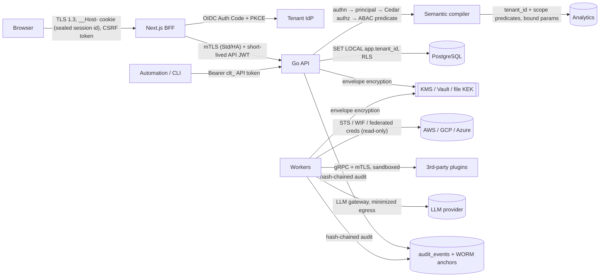

# Security Architecture

> **Status: DRAFT design.** Nothing here is implemented. Controls are targets for the phases listed. Related: [THREAT_MODEL.md](THREAT_MODEL.md), [AUTHORIZATION_MODEL.md](AUTHORIZATION_MODEL.md), [SECRETS_AND_KEYS.md](SECRETS_AND_KEYS.md), [SUPPLY_CHAIN.md](SUPPLY_CHAIN.md), [TRUST_BOUNDARIES.md](../architecture/TRUST_BOUNDARIES.md), [LLM_SECURITY.md](../architecture/LLM_SECURITY.md).

Controls are numbered `SEC-<AREA>-NN`. Each control lists the delivering phase and how it is verified. Threat IDs (`T-NN`) refer to [THREAT_MODEL.md](THREAT_MODEL.md).

## 1. Overview



Principal types: `user` (via BFF session), `api_token` (personal or service account), `scim_client`, `system` (scheduler/worker jobs acting for a tenant), `platform_admin` (platform plane only), `plugin` (no API access; host callbacks only).

## 2. Authentication

### 2.1 OIDC Authorization Code + PKCE through the BFF (Phase 05)

The BFF (`apps/web`) is a **confidential OIDC client** per tenant IdP configuration (`idp_configs`). The browser never sees IdP tokens or API tokens (ADR-0002).

```mermaid
sequenceDiagram
  autonumber
  participant B as Browser
  participant W as BFF (Next.js server)
  participant I as Tenant IdP
  participant A as Go API (identity)
  B->>W: GET /login?tenant=acme (or email domain hint)
  W->>A: resolve IdP config for tenant (public metadata only)
  W->>W: create pre-auth record {state, nonce, code_verifier, tenant, return_to} (server-side, 10 min TTL)
  W-->>B: 302 to IdP authorize (response_type=code, code_challenge=S256, state, nonce, scope=openid email profile [groups])
  B->>I: authenticate (MFA per IdP policy)
  I-->>B: 302 /auth/callback?code&state&iss
  B->>W: callback
  W->>W: verify state (one-time), iss (RFC 9207), consume pre-auth record
  W->>I: token request (code + code_verifier + client auth)
  I-->>W: id_token (+ access/refresh tokens, discarded unless needed for back-channel logout)
  W->>A: POST /internal/v1/sessions {id_token, nonce, tenant, ua, ip} over mTLS (BFF service identity)
  A->>A: independently validate id_token (JWKS, alg allow-list, iss, aud, azp, exp/iat/nbf ±60 s, nonce)
  A->>A: link identity by (issuer, subject); JIT/SCIM policy; group → role mapping; create sessions row
  A-->>W: {session_id, csrf_secret, access_jwt (≤10 min)}
  W-->>B: Set-Cookie __Host-cl_session=<AEAD-sealed session_id>; 302 return_to (validated relative path)
```

| ID | Control | Phase | Verification |
|---|---|---|---|
| SEC-AUTHN-01 | PKCE `S256` mandatory even for confidential clients; `plain` rejected. `state` and `nonce` are 256-bit random, single-use, bound to a server-side pre-auth record. | 05 | Integration tests with a mock IdP (replayed state, missing PKCE, wrong nonce) |
| SEC-AUTHN-02 | Mix-up defense: `iss` callback parameter (RFC 9207) checked when the IdP advertises it; the token endpoint is taken only from the tenant's pinned discovery document. | 05 | Mock IdP mix-up test |
| SEC-AUTHN-03 | ID-token validation in the **API**, not only in the BFF (BFF compromise must not mint sessions for arbitrary subjects). Algorithm allow-list `RS256, PS256, ES256, EdDSA`; `none` and `HS*` rejected; JWKS cached ≤ 1 h with `kid`-miss refresh rate-limited. | 05 | Unit tests per claim; forged-token tests |
| SEC-AUTHN-04 | Account linking uses `(issuer, subject)` only. Email is never a linking key. JIT provisioning requires tenant opt-in, `email_verified=true` and an allowed email domain. | 05 | Account-takeover test with unverified email |
| SEC-AUTHN-05 | IdP discovery and JWKS URLs are fetched through the SSRF-safe client (§8.3). Discovery documents are pinned at configuration time and re-fetched only by an explicit admin action or on `kid` rotation. | 05 | SSRF test suite |
| SEC-AUTHN-06 | `return_to` accepts only relative paths matching an allow-list pattern (open-redirect defense). | 05 | Unit tests |
| SEC-AUTHN-07 | Group claims map to role bindings via `idp_group_mappings` (tenant-defined). Mappings are re-evaluated at each login and on SCIM updates. | 05, 31 | Authz matrix includes IdP-mapped roles |
| SEC-AUTHN-08 | Step-up authentication (`max_age` / `prompt=login`, `acr` check where supported) for sensitive actions: IdP config change, role-binding change, API-token creation, break-glass request, tenant deletion, AI provider config. Re-auth window 10 min. | 05 | E2E tests |
| SEC-AUTHN-09 | Local password login only for the Lite bootstrap admin (FR-IAM-009): one-time setup token printed at first start (expires 1 h), argon2id (`m=64 MiB, t=3, p=1`, per-user salt, server pepper), TOTP MFA required for non-loopback access, lockout with exponential backoff, disable switch once OIDC works. | 05 | Unit + E2E tests |
| SEC-AUTHN-10 | **SAML 2.0 SP (Phase 31)**: signed assertions required (response or assertion), XML signature wrapping defenses via a hardened library and strict schema validation, `InResponseTo` binding, audience and recipient checks, `NotOnOrAfter` with ±60 s skew, replay cache of assertion IDs, encrypted assertions supported, SHA-1 signatures rejected, IdP-initiated SSO disabled by default, XXE disabled. | 31 | SAML attack corpus (XSW variants, replay, comment injection in NameID) |
| SEC-AUTHN-11 | SCIM 2.0 (Phase 31): per-IdP bearer token, hashed at rest (§2.3), scoped to `scim:*` on one tenant; SCIM cannot assign `tenant_owner` unless the tenant enables it. | 31 | Provisioning tests |
| SEC-AUTHN-12 | OIDC Back-Channel Logout 1.0 and SCIM deprovisioning revoke all sessions and personal API tokens of the user within 60 s. | 31 | Integration test |

### 2.2 Sessions (FR-IAM-010; ASVS L3 for session management per NFR-SEC-002)

Session state is **server-side** in `sessions` (owned by the `identity` module). The cookie carries only an AEAD-sealed session identifier. The BFF obtains short-lived API access JWTs for that session from the API and caches them in process memory, keyed by session ID, for at most their lifetime.

| ID | Control | Phase |
|---|---|---|
| SEC-SESS-01 | Cookie `__Host-cl_session`: `Secure; HttpOnly; SameSite=Lax; Path=/`; no `Domain`. Value = AES-256-GCM sealed `{session_id, issued_at}` with a rotating keyring (KEY-07). | 05 |
| SEC-SESS-02 | New session ID at login, tenant switch and privilege change (session fixation defense). | 05 |
| SEC-SESS-03 | Idle timeout default 30 min (tenant-configurable 5–240 min); absolute timeout default 12 h (max 24 h). Enforced server-side on every request. | 05 |
| SEC-SESS-04 | Device listing and revocation (`GET/DELETE /api/v1/sessions`); "log out everywhere"; admin revocation for a member. Revocation is effective on the next request (no client-side session validity). | 05 |
| SEC-SESS-05 | API access JWT: `EdDSA` or `ES256`, `aud=cloudledger-api`, `iss` = deployment issuer, `sub` = user ID, `sid` = session ID, `tid` = active tenant, `exp` ≤ 10 min, `jti`. The API checks `sid` against a session-revocation cache (TTL ≤ 30 s) on each request. Signing keys rotate every 90 days with JWKS overlap (KEY-06). | 05 |
| SEC-SESS-06 | Active tenant is fixed per session (`tid`). Switching tenants re-issues the session after verifying membership. The API rejects an `X-CloudLedger-Tenant` header that does not match `tid` for session principals. | 05 |
| SEC-SESS-07 | Concurrent-session limit per user (default 10, configurable); oldest evicted. | 05 |

### 2.3 API tokens (FR-IAM-007)

Format: `clt_<prefix>_<secret>_<crc>` where `prefix` = 12 chars base32 (lookup key, non-secret), `secret` = 32 random bytes base62, `crc` = CRC32 of the preceding string (lets secret scanners validate matches without a DB call). Service-account tokens use `cls_`. SCIM tokens use `clscim_`.

| ID | Control | Phase |
|---|---|---|
| SEC-TOK-01 | Stored as `secret_hash = HMAC-SHA256(pepper_vN, secret)` with the pepper version recorded (KEY-08). High-entropy tokens do not need a slow hash; the pepper (held in the KEK backend, not the DB) defeats offline verification from a DB dump. Comparison is constant-time. The plaintext is shown exactly once. | 05 |
| SEC-TOK-02 | Expiry is mandatory: default 90 days, maximum 365 days (operator-configurable). No non-expiring tokens. | 05 |
| SEC-TOK-03 | Token scopes are a subset of permission strings (and optionally a data scope). **Effective rights = token scopes ∩ owner's current rights**, evaluated per request, so demoting or removing the owner immediately reduces or kills the token. | 05 |
| SEC-TOK-04 | Optional CIDR allow-list per token; `last_used_at` and `last_used_ip` tracked; tokens unused for 90 days flagged. | 05 |
| SEC-TOK-05 | Revocation effective within 30 s (cache TTL). Revocation, creation and use from a new IP are audited. | 05 |
| SEC-TOK-06 | Token prefixes registered with GitHub secret scanning (partner program) once the name is final (OQ-01); a verified leak triggers automatic revocation and tenant-owner notification. | 38 |
| SEC-TOK-07 | API tokens cannot call session-only endpoints (session management, step-up-protected actions such as IdP config) and cannot create other tokens. | 05 |

### 2.4 Service-to-service authentication

| ID | Control | Phase |
|---|---|---|
| SEC-S2S-01 | BFF → API: mTLS in Standard/HA (cert-manager-issued workload certs, 24 h lifetime) plus the per-session API JWT. The `/internal/*` routes accept only the BFF workload identity. Lite: loopback/Compose network plus a shared BFF credential from the KEK backend. | 05 |
| SEC-S2S-02 | API/worker → PostgreSQL: TLS `sslmode=verify-full` (Standard/HA); distinct DB roles per §4.2. | 04 |
| SEC-S2S-03 | API/worker → ClickHouse: TLS, separate `cl_query` (read-only, row policy) and `cl_ingest` users. | 13 |
| SEC-S2S-04 | Worker → plugin: go-plugin AutoMTLS with per-launch ephemeral certificates, Unix socket in a private directory (`0700`). | 35 |

## 3. Authorization overview

Full model: [AUTHORIZATION_MODEL.md](AUTHORIZATION_MODEL.md). Summary:

1. **Permission check (RBAC):** every endpoint declares a permission string (`resource:action`) through the OpenAPI extension `x-cloudledger-permission`. CI fails if an operation lacks it (AZ-01).
2. **Object check:** Cedar evaluates `(principal, action, resource)` with entity attributes (tenant, owner, sharing, state) via `authz.Authorizer` (ADR-0008).
3. **Data check (ABAC):** the union of the principal's data scopes for the permission compiles to a predicate AST that the semantic compiler injects into every analytics query and the API applies to resource lists (resources, recommendations, budgets, anomalies).
4. **Default deny**; decisions log policy IDs; denials are audited with aggregation (§10, SEC-AUD-07).

## 4. Tenant isolation layers

Builds on [TENANCY.md §2](../architecture/TENANCY.md). This section adds the enforcement details.

| ID | Layer | Control | Phase | Verification |
|---|---|---|---|---|
| SEC-ISO-01 | API | `TenantContext` derived only from the authenticated principal (session `tid` or token tenant). Path/body tenant IDs must equal it; mismatch → 404. | 04 | Cross-tenant API suite (every endpoint × foreign IDs) |
| SEC-ISO-02 | Service | Repository constructors require `TenantContext`; a custom linter (Semgrep + `go/analysis`) forbids DB access outside the `db/tx` helper. | 04 | Static check |
| SEC-ISO-03 | PostgreSQL | RLS `ENABLE` + `FORCE` on every table with `tenant_id`; policy uses `current_setting('app.tenant_id', true)`; unset setting → zero rows (fail closed). `SET LOCAL` inside the transaction; the pool resets session state on release (`DISCARD ALL`). | 04 | CI catalog test + pooled-connection leak test |
| SEC-ISO-04 | Analytics | Compiler always injects `tenant_id = $1` and the ABAC predicate as **bound parameters**; ClickHouse row policy on `tenant_id` keyed to a per-query custom setting (`SQL_cl_tenant`) that the `cl_query` user cannot change via `readonly=2` + settings constraints; DuckDB file per tenant in Lite. | 13 | Engine isolation contract tests |
| SEC-ISO-05 | Object storage | Keys built only by `objectstore.Key(tenant, …)`; no user-controlled path segments except validated IDs; pre-signed URLs single-object, `GET` only, TTL ≤ 5 min, `Content-Disposition: attachment`. Per-tenant DEK for DC-2/DC-3 artifacts. | 06, 29 | Path traversal + presign scope tests |
| SEC-ISO-06 | Caches | Keys = `tenant_id ‖ scope_hash ‖ query_hash ‖ data_version`. No shared cache entries across tenants. | 13 | Unit tests |
| SEC-ISO-07 | Jobs/outbox | Job payloads carry `tenant_id`; the worker sets the tenant context before any DB access and refuses jobs whose payload tenant differs from referenced rows. | 04, 06 | Job isolation tests |
| SEC-ISO-08 | AI | Tools run as the requesting user (same `TenantContext` and scope); conversation tables RLS'd. | 27 | AI cross-tenant tests |
| SEC-ISO-09 | Platform plane | Platform-admin routes use the `cl_platform` DB role, which has no `SELECT` on tenant data tables (only `tenants`, platform settings, plugin registry, platform audit chain). | 04 | Grant inspection test |

### 4.2 Database roles

| Role | Used by | Privileges |
|---|---|---|
| `cl_owner` | none at runtime | owns schema objects |
| `cl_migrate` | `cloudledger migrate` job only | DDL; never used by `api`/`worker` |
| `cl_app` | `api`, `worker`, `scheduler` | DML on tenant tables under RLS; `INSERT, SELECT` only on `audit_events`; no `BYPASSRLS`, no DDL |
| `cl_platform` | platform-admin endpoints and `cloudledger admin` | `tenants`, platform tables, platform audit chain; no tenant data |
| `cl_purge` | tenant purge job only (two-person-approved) | `DELETE` on tenant tables for one tenant; the only role allowed past the audit trigger, and only for rows of a tenant in `pending_deletion` past grace period |

## 5. Encryption in transit (NFR-SEC-004)

| ID | Control | Profiles |
|---|---|---|
| SEC-TLS-01 | External listeners: TLS 1.3 preferred, TLS 1.2 minimum with the Mozilla "intermediate" cipher list; HSTS `max-age=63072000; includeSubDomains` (preload optional). HTTP only redirects. | all (Lite may bind to loopback without TLS for local evaluation; a startup warning is shown and logged) |
| SEC-TLS-02 | Internal hops (BFF→API, app→PG/ClickHouse/object storage/KMS/Vault) use TLS with certificate verification. | Standard, HA (Lite: optional, on a single-host Compose network) |
| SEC-TLS-03 | Outbound calls to clouds, IdPs, LLMs and webhooks: TLS verification always on; no "insecure skip verify" config key exists. Custom CA bundles allowed for private IdPs/LLM endpoints. | all |
| SEC-TLS-04 | gRPC to plugins: mTLS (SEC-S2S-04). | all |

## 6. Encryption at rest and envelope encryption

Details and key hierarchy: [SECRETS_AND_KEYS.md](SECRETS_AND_KEYS.md).

| ID | Data | Mechanism |
|---|---|---|
| SEC-ENC-01 | All stores (PG volumes, ClickHouse disks, object storage, backups) | Storage-provider encryption (AES-256): managed DB encryption, encrypted PVs, SSE-KMS / Google-managed / Azure SSE. Operators are told this is required in Standard/HA; Helm values default to encrypted storage classes where detectable. |
| SEC-ENC-02 | DC-3 secrets (static cloud credentials, webhook signing secrets, alert channel tokens, LLM API keys, IdP client secrets when not by reference) | Application-level envelope encryption: AES-256-GCM DEK per secret, wrapped by the tenant key, wrapped by the root KEK (KEY-01..03). AAD binds ciphertext to `(tenant_id, secret_id, purpose)` so ciphertext cannot be moved between rows or tenants. |
| SEC-ENC-03 | DC-2 artifacts in object storage (raw source files, exports, report artifacts, period snapshots, rejected-row samples, AI conversation transcripts if spilled) | Streaming AEAD (AES-256-GCM, 64 KiB segments, STREAM construction) with per-object DEK wrapped by the tenant key. Mandatory in Standard/HA; default on in Lite. Enables crypto-shredding including object-store backups. |
| SEC-ENC-04 | PII fields in `audit_events` (`actor_ip`, `user_agent`, `details.pii`) and `ai_messages.content` | Field-level AEAD with the tenant key (`ai_messages`) or the subject key (audit PII, KEY-12), so erasure does not break the hash chain. |
| SEC-ENC-05 | Backups | Encrypted by the backup tool (pgBackRest/CNPG with KMS key, ClickHouse backup to encrypted bucket) in addition to SEC-ENC-01. |

## 7. Secret references and cloud federation

Secret reference URI formats and resolution rules: [SECRETS_AND_KEYS.md §5](SECRETS_AND_KEYS.md#5-secret-references). The key rule: **tenant-supplied references must resolve inside the tenant's namespace** (KEY-15), otherwise one tenant could read another tenant's or the operator's secrets (T-31).

Federation defaults (ADR-0009, FR-CON-003). All issued credentials are read-only, short-lived and held only in worker memory.

| ID | Provider | Default mechanism | Confused-deputy protection | Session limits |
|---|---|---|---|---|
| SEC-FED-01 | **AWS** | CloudLedger runtime principal (IRSA / EKS Pod Identity / instance role; SaaS: dedicated operator role per region) calls `sts:AssumeRole` into the customer role created by the CloudFormation/Terraform template. | `ExternalId` generated by CloudLedger per connector (≥ 32 chars, random, immutable, never user-chosen), shown in the template; trust policy names the exact CloudLedger role ARN (not the account root) and requires `sts:ExternalId`. `RoleSessionName = cl-<tenant8>-<connector8>`, `SourceIdentity` set for CloudTrail attribution. | `DurationSeconds=3600`; inline session policy restricts to the read-only action set of the declared capabilities. |
| SEC-FED-02 | **AWS (CloudLedger runs in the customer's AWS)** | Web identity / pod identity directly, or same-account role chaining. | Per-connector session tags. | ≤ 1 h |
| SEC-FED-03 | **GCP** | Service-account impersonation (`iamcredentials.generateAccessToken`) of a customer-owned SA, or Workload Identity Federation from CloudLedger's runtime identity. | Multi-tenant deployments use a **dedicated CloudLedger-side identity per CloudLedger tenant** (per-tenant Google SA in the operator project, or a WIF subject `cl:tenant:<id>:connector:<id>` issued by CloudLedger's workload-identity issuer, SQ-04). The customer grants impersonation to that identity only, so another tenant cannot point a connector at the same SA. | Access tokens ≤ 1 h; scopes limited to `cloud-platform.read-only` / BigQuery read. |
| SEC-FED-04 | **Azure** | Customer-owned Entra app registration (or user-assigned managed identity) with a **federated identity credential** trusting CloudLedger's workload-identity issuer, subject `cl:tenant:<tenant_id>:connector:<connector_id>`. When CloudLedger runs in Azure: managed identity. | Subject binding per connector; CloudLedger never uses a single shared multi-tenant service principal for customer access. | Token lifetime per Entra (≈1 h); roles limited to Reader, Cost Management Reader, Billing Reader, Storage Blob Data Reader on the export container. |
| SEC-FED-05 | **Static fallback** (any provider) | Access key / SA JSON key / client secret stored as a secret reference or envelope-encrypted value. Connector status shows "static credential" with a warning and age; rotation reminder at 90 days. | n/a | n/a |
| SEC-FED-06 | **Workload-identity issuer** (SaaS/HA, optional self-hosted) | CloudLedger exposes `/.well-known/openid-configuration` + JWKS on a dedicated public host; signs 5-minute tokens with `sub = cl:tenant:<id>:connector:<id>`, `aud` = provider-specific audience. Signing key in KMS (KEY-09). | Subject and audience binding. | 5 min |
| SEC-FED-07 | **Verification** | `POST /connectors/{id}:verify` checks per-capability permissions and **flags excess permissions** (any mutating permission granted) as a warning, because templates grant none (FR-CON-004). | — | — |

## 8. Web security (BFF and API)

### 8.1 Headers and CSP

| ID | Control |
|---|---|
| SEC-WEB-01 | CSP (nonce-based, per response): `default-src 'self'; script-src 'nonce-<n>' 'strict-dynamic'; style-src 'self' 'nonce-<n>'; img-src 'self' data: blob:; font-src 'self'; connect-src 'self'; object-src 'none'; base-uri 'none'; frame-ancestors 'none'; form-action 'self'; upgrade-insecure-requests; report-to csp`. `require-trusted-types-for 'script'` shipped as report-only first, enforced by Phase 34 if ECharts and Next.js allow. |
| SEC-WEB-02 | `Strict-Transport-Security`, `X-Content-Type-Options: nosniff`, `Referrer-Policy: strict-origin-when-cross-origin` (no-referrer on auth routes), `Cross-Origin-Opener-Policy: same-origin`, `Cross-Origin-Resource-Policy: same-origin`, `Permissions-Policy` denying camera, microphone, geolocation, payment, USB. |
| SEC-WEB-03 | API: `Cache-Control: no-store` on data responses; no CORS by default (API_GUIDELINES §11). |
| SEC-WEB-04 | Untrusted strings (tags, resource names, AI output) rendered only via React text nodes; `dangerouslySetInnerHTML` forbidden by ESLint rule except in a reviewed Markdown renderer that uses an allow-list sanitizer (no raw HTML, no `javascript:` links, images disabled). ECharts tooltips/labels use text formatters, never HTML formatters with untrusted values. |

### 8.2 CSRF

| ID | Control |
|---|---|
| SEC-WEB-05 | All state-changing BFF routes (route handlers and Server Actions) require: (a) `SameSite=Lax` session cookie, (b) a synchronizer token `X-CSRF-Token` = HMAC(csrf_secret_of_session, route-independent nonce), (c) `Origin` (or `Sec-Fetch-Site: same-origin`) check. GET routes are side-effect free (lint + review). |
| SEC-WEB-06 | API tokens are not cookies, so the Go API itself is not CSRF-exposed; the API rejects requests that carry a `Cookie` header without a bearer token. |

### 8.3 SSRF protections (webhooks and every tenant-supplied URL)

Tenant-supplied URLs exist in: webhook alert channels, Slack/Teams incoming webhooks, Jira/ServiceNow/GitHub base URLs, OIDC issuer and SAML metadata URLs, OpenAI-compatible/Ollama LLM base URLs, custom FX source URLs, object-store polling endpoints for imports. All outbound HTTP from these features goes through one `safehttp` client.

| ID | Control |
|---|---|
| SEC-SSRF-01 | Scheme `https` only (operator flag can allow `http` for named hosts). Port allow-list `443, 8443` plus operator additions. No userinfo in URLs. |
| SEC-SSRF-02 | Resolve DNS and **check every resolved IP at dial time** (custom `net.Dialer.Control`) against a deny-list: loopback, RFC 1918, CGNAT `100.64/10`, link-local `169.254/16` and `fe80::/10`, ULA `fc00::/7`, multicast, `0.0.0.0/8`, IPv4-mapped/compatible IPv6, NAT64 prefixes, cloud metadata (`169.254.169.254`, `fd00:ec2::254`, `metadata.google.internal`), the cluster pod/service CIDRs. Dial-time checking defeats DNS rebinding. |
| SEC-SSRF-03 | Redirects disabled for webhooks; for discovery/metadata fetches max 3 redirects, each re-validated. |
| SEC-SSRF-04 | Timeouts: connect 5 s, total 10 s; response body cap 64 KiB (webhooks) / 1 MiB (metadata); response bodies are never shown to users (status code and a classified error only), to avoid turning CloudLedger into a read-SSRF oracle. |
| SEC-SSRF-05 | Operator escape hatch: `ssrf.allow_cidrs` / `ssrf.allow_hosts` (e.g. an on-prem Ollama or internal Jira). Visible in admin UI and audited. Per-tenant exceptions are not possible; only operators can allow private targets. |
| SEC-SSRF-06 | Optional egress proxy mode (Standard/HA): all `safehttp` traffic through an operator-provided forward proxy enforcing the same policy; NetworkPolicy blocks direct egress from pods except to that proxy and provider APIs. |
| SEC-SSRF-07 | Outbound webhooks are signed: `X-CloudLedger-Signature: t=<unix>,v1=<hex HMAC-SHA256(secret, t + "." + body)>`, per-channel secret (DC-3), 5-minute replay window documented for receivers, dual-signing during rotation. Inbound Slack/Teams callbacks are verified with provider signatures and timestamps (FR-NTF-002). |

### 8.4 File upload hardening (FR-IMP-004, Phase 09; invoices Phase 10)

| ID | Control |
|---|---|
| SEC-UPL-01 | Uploads go directly to object storage via pre-signed `PUT`/POST policy bound to one key under the tenant's `uploads/` prefix, with `content-length-range` and TTL 15 min; the API never buffers large files. Default max size: 2 GiB (Parquet/CSV), 200 MiB (XLSX), 50 MiB (PDF invoice); operator-configurable. |
| SEC-UPL-02 | Type detection by magic bytes and parser success, not by extension or client MIME type. Allowed: CSV/TSV, JSON/NDJSON, Parquet, XLSX (OOXML), PDF (invoices only), gzip/zip containers. `xlsm`, `xls` (BIFF), `xlsb`, encrypted OOXML, and nested archives deeper than 1 level are rejected. |
| SEC-UPL-03 | Decompression limits: compression ratio ≤ 100:1, total uncompressed ≤ 10× the size limit, ZIP entries ≤ 10 000, entry names validated (no `..`, absolute paths or symlinks; zip-slip impossible because entries are never written to disk by name). |
| SEC-UPL-04 | XLSX: streaming SAX reader; DTD/external entities disabled (XXE); shared-strings table and cell count limits; formulas never evaluated (cached values only, flagged in the DQ report); macros and embedded objects ignored. |
| SEC-UPL-05 | CSV/JSON: streaming parse with max line length (1 MiB), max columns (1 000), JSON max depth (32), numeric parsing via decimal parser only (no float). Parquet: max row-group size, max schema depth, page-size caps. |
| SEC-UPL-06 | Parsing runs in `worker` under a per-job memory budget and cgroup limits; parser panics are caught and classified as `data` errors. |
| SEC-UPL-07 | PDF invoices: metadata extraction only in a sandboxed parser process (no JavaScript, no rendering); optional ClamAV/ICAP hook (operator-configured). Served back only via pre-signed URL with `Content-Disposition: attachment` and `Content-Type: application/pdf`. |
| SEC-UPL-08 | Formula-injection neutralization on **export** (CSV/XLSX): cells starting with `=`, `+`, `-`, `@`, TAB, CR (and their full-width variants) are prefixed with `'`; numeric money cells are written as typed numbers/strings by the exporter, not as text starting with `-` from untrusted input. Raw data is preserved unmodified in storage. |

## 9. Logging and redaction

| ID | Control | Phase |
|---|---|---|
| SEC-LOG-01 | Structured JSON logs (slog) with `trace_id`, `tenant_id`, `request_id`, `principal_id` (ADR-0017). | 03 |
| SEC-LOG-02 | Redaction by type: secrets wrapped in `secret.Value` (implements `slog.LogValuer`, `fmt.Formatter`, `json.Marshaler` returning `[REDACTED]`). A redacting handler also scrubs known keys (`authorization`, `cookie`, `set-cookie`, `password`, `secret`, `token`, `client_secret`, `private_key`, `x-amz-security-token`) and patterns (`clt_…`, `cls_…`, JWTs, AWS access keys, pre-signed URL signatures `X-Amz-Signature`, `sig=`, `Signature=`). | 03 |
| SEC-LOG-03 | Never logged: request/response bodies of data endpoints, billing amounts at INFO or above, tag values, resource names, uploaded file content, AI prompts/completions (only token counts, model, tool names, decision IDs). DEBUG logging of such data requires an operator flag that auto-expires after 24 h and is audited. | 03, 27 |
| SEC-LOG-04 | Provider error messages are sanitized before persistence (`last_error`, `ingestion_runs.error`) to remove signed URLs and credentials. | 06 |
| SEC-LOG-05 | Canary test: CI injects canary secrets into config, headers, cloud credentials and AI prompts and asserts they never appear in captured logs, traces, metrics labels, error responses or audit `details`. | 03, 27, 34 |
| SEC-LOG-06 | Traces: span attributes follow the same deny-list; SQL statements in spans contain placeholders only, never bound values. | 03 |

## 10. Audit log hash chain (ADR-0014, FR-AUD-001)

| ID | Control | Phase |
|---|---|---|
| SEC-AUD-01 | Audit write is in the **same DB transaction** as the state change it records (no unaudited commits). For actions without DB state (authz denials, logins failing at IdP), audit is a standalone insert. | 04 |
| SEC-AUD-02 | One chain per tenant plus the platform chain (reserved platform tenant UUID). `seq` is gap-free per chain; serialization via `SELECT … FOR UPDATE` on `audit_chain_heads(tenant_id, seq, hash)`. | 04 |
| SEC-AUD-03 | `hash = SHA-256("cl-audit-v1" ‖ 0x00 ‖ JCS(event) ‖ prev_hash)` where `JCS` = RFC 8785 canonical JSON of all columns except `hash`, with PII fields included **as ciphertext** (SEC-ENC-04). Genesis `prev_hash = SHA-256("cl-audit-genesis" ‖ tenant_id)`. | 04 |
| SEC-AUD-04 | Append-only: `cl_app` has `INSERT, SELECT` only; a trigger rejects `UPDATE`/`DELETE`/`TRUNCATE` for every role except `cl_purge` during an approved tenant purge. | 04 |
| SEC-AUD-05 | Anchors: every 15 min or 1 000 events, chain heads of all active chains are combined into a Merkle root; the anchor `{root, heads[], time}` is written to WORM object storage (object lock, compliance mode, retention ≥ audit retention) and signed with the audit anchor key (Ed25519, KEY-10). Optional RFC 3161 timestamp. Emits `audit.anchor.written.v1`. | 04, 30 |
| SEC-AUD-06 | Verification: `cloudledger admin audit verify [--tenant] [--from-seq]` and `POST /api/v1/audit-events:verify` recompute the chain and compare against anchors; result is itself audited. Scheduled daily verification raises an alert on mismatch. | 04, 30 |
| SEC-AUD-07 | Audited actions (minimum): login success/failure, session revoke, token create/revoke/use-from-new-IP, IdP/SCIM changes, role/binding/scope changes, break-glass lifecycle, connector create/update/verify/credential change, AI config change, AI tool call (summary), export/report generation and download, allocation publish, period close/reopen, variance acknowledgement, recommendation state transitions, tenant lifecycle, key rotation, plugin install/enable, `authz.denied` (aggregated: first denial per principal×permission per 5 min written in full, then counted). | 04+ |
| SEC-AUD-08 | SIEM streaming (FR-AUD-003): webhook (signed), syslog over TLS (RFC 5425), OTLP logs. Stream lag monitored. | 31 |

## 11. Rate limiting and resource quotas

| ID | Control |
|---|---|
| SEC-RATE-01 | Token buckets per principal and per tenant with separate buckets `default`, `query`, `export`, `ai`, `auth` (API_GUIDELINES §8). 429 with `Retry-After` and `RateLimit-*`. Distributed state in PostgreSQL (unlogged table) in Lite/Standard, optional Redis-compatible store in HA. |
| SEC-RATE-02 | Pre-auth limits at ingress per IP for `/login`, `/auth/callback`, local password, SCIM and inbound callbacks; local-password lockout per account (SEC-AUTHN-09). |
| SEC-RATE-03 | Query cost limits: max dimensions, max time span per grain, row limit (10 000; 1 000 for AI), statement timeout (PG `statement_timeout`, ClickHouse `max_execution_time`, `max_bytes_to_read`, `max_memory_usage`), per-tenant concurrent-query cap. |
| SEC-RATE-04 | Export limits: max rows/bytes per export, concurrent exports per tenant, daily export volume alert (exfiltration signal, T-55). |
| SEC-RATE-05 | AI budgets: tokens per user/day and tenant/month, tool calls per turn, turns per conversation (LLM_SECURITY §6). |
| SEC-RATE-06 | Cost-aware provider limits (e.g. AWS Cost Explorer API is charged per request; FR-AWS-004). |

All limits are operational protections configurable by operators, **not** license limits (NFR-LIC-004).

## 12. Plugin sandboxing (ADR-0012; Phases 35–36)

| ID | Control |
|---|---|
| SEC-PLG-01 | Third-party plugins run out-of-process, speaking versioned gRPC over a Unix socket with go-plugin handshake (magic cookie + protocol version) and AutoMTLS. |
| SEC-PLG-02 | **One plugin process per (tenant, connector, job)**; no process is reused across tenants. Working directory is a fresh tmpfs with a size quota, deleted at job end. |
| SEC-PLG-03 | Isolation: separate UID (Lite) or separate container/pod (Standard/HA), `no_new_privs`, seccomp (RuntimeDefault or a stricter custom profile), read-only root FS, all capabilities dropped, rlimits (CPU time, address space, open files, processes), cgroup CPU/memory limits. |
| SEC-PLG-04 | Network: deny by default; egress only to hosts declared in the manifest `execution.egress`, enforced by an egress proxy (Lite) or NetworkPolicy + proxy (K8s). No route to CloudLedger PG, ClickHouse, KMS, Vault, object storage, metadata endpoints. |
| SEC-PLG-05 | Credentials: the plugin gets a host callback `CredentialProvider.Get(capability)` returning short-lived, connector-scoped credentials; never the KEK, tenant key, DB credentials or other connectors' secrets. |
| SEC-PLG-06 | Output distrust: all plugin output (artifacts, rows, scopes, recommendations) is validated by the host: schema, size caps, FOCUS validator, control totals, string length limits; plugin-provided text is DC-2 untrusted data (never HTML, never instructions to AI). |
| SEC-PLG-07 | Installation: only platform admins can install/enable plugins; artifact checksum recorded (`plugins_installed.checksum`) and Cosign signature verified against an operator trust policy (SC-11); manifest license validated (PLUGIN_LICENSING). Unsigned plugins require an explicit operator override, shown as a warning. |
| SEC-PLG-08 | WASM for recommendation rules (evaluated in Phase 36): no WASI filesystem/network imports, fuel/epoch limits, memory cap. |

## 13. Container and Kubernetes hardening

| ID | Control |
|---|---|
| SEC-K8S-01 | Images: distroless static (Go) and distroless Node (web), non-root UID 65532, no shell, pinned by digest, multi-arch (amd64, arm64). |
| SEC-K8S-02 | Pod security: Pod Security Standards `restricted`; `runAsNonRoot`, `readOnlyRootFilesystem`, `allowPrivilegeEscalation: false`, `capabilities.drop: [ALL]`, `seccompProfile: RuntimeDefault`; writable `emptyDir` only where needed (`/tmp`, size-limited). |
| SEC-K8S-03 | Separate ServiceAccounts per run mode (`api`, `worker`, `scheduler`, `web`, `migrate`); `automountServiceAccountToken: false` except projected tokens needed for IRSA/WIF on `worker` (and `api` only if it calls KMS directly). CloudLedger needs **no Kubernetes API RBAC** (leader election uses PG advisory locks). |
| SEC-K8S-04 | NetworkPolicies: default deny ingress and egress; explicit allows (ingress → web/api; web → api; api/worker → PG, ClickHouse, object storage, KMS/Vault, OTel collector; worker → provider APIs/LLM/notification egress via proxy; DNS). |
| SEC-K8S-05 | Secrets via External Secrets Operator or Secrets Store CSI driver; no secrets in ConfigMaps, Helm values or env in plain manifests; etcd encryption at rest recommended in the operator guide. |
| SEC-K8S-06 | Resource requests/limits on all containers, PodDisruptionBudgets, `priorityClassName` for api. |
| SEC-K8S-07 | Admission: sample Kyverno / Sigstore policy-controller policy verifying CloudLedger image signatures and provenance (SC-05) shipped in `deploy/helm`. |
| SEC-K8S-08 | `migrate` runs as a pre-upgrade Job with the `cl_migrate` credential; the credential is not mounted into other pods. |
| SEC-K8S-09 | Lite (Compose): same image hardening, `read_only: true`, `cap_drop: [ALL]`, `security_opt: [no-new-privileges:true]`, internal network for PG/MinIO, only web (and optionally api) published. |

## 14. OWASP ASVS Level 2 mapping summary (NFR-SEC-002)

Mapped to ASVS **4.0.3** as named in the PRD (see SQ-01 about ASVS 5.0). Level 3 is targeted for V2 (authentication), V3 (session) and V7 (logging/audit) per NFR-SEC-002. The full checklist with per-requirement status is produced in Phase 34; every row is `NOT VERIFIED` until then.

| ASVS chapter | Key controls in this design | Phases |
|---|---|---|
| V1 Architecture, design, threat modeling | This folder; THREAT_MODEL; TRUST_BOUNDARIES; ADRs | 02 |
| V2 Authentication (L3 target) | SEC-AUTHN-01..12, SEC-TOK-*, IdP-delegated MFA, Lite TOTP | 05, 31 |
| V3 Session management (L3 target) | SEC-SESS-01..07 | 05 |
| V4 Access control | AUTHORIZATION_MODEL (AZ-*), SEC-ISO-* | 04, 05, 13 |
| V5 Validation, sanitization, encoding | JSON Schema validation, semantic query validation, SEC-UPL-*, SEC-WEB-04, formula neutralization | 05, 09, 13 |
| V6 Stored cryptography | SECRETS_AND_KEYS (KEY-*), SEC-ENC-* | 04, 05, 33 |
| V7 Error handling and logging (L3 target) | RFC 9457 errors without stack traces, SEC-LOG-*, SEC-AUD-* | 03, 04 |
| V8 Data protection | Data classification (DC-*), `Cache-Control: no-store`, SEC-PRIV-* | 04, 27 |
| V9 Communications | SEC-TLS-* | 03, 33 |
| V10 Malicious code | SUPPLY_CHAIN (SC-*), SEC-PLG-* | 03, 35 |
| V11 Business logic | Idempotency keys, ETags, period-close locks, rate limits, anti-automation on exports | 29, 30 |
| V12 Files and resources | SEC-UPL-*, SEC-SSRF-*, pre-signed URL scoping | 09, 17, 32 |
| V13 API and web service | OpenAPI validation, `x-cloudledger-permission`, CSRF, no CORS by default | 05, 11 |
| V14 Configuration | SEC-K8S-*, security headers, pinned dependencies, SBOM | 03, 33, 38 |

## 15. Data privacy (NFR-PRIV-001)

| ID | Control |
|---|---|
| SEC-PRIV-01 | **PII inventory** (Phase 01 DPIA input): user email, display name, IdP subject, IP address, user agent (identity/audit); free-text in billing data (tag values such as `owner=jane@corp`, resource names); AI conversation content; invoice PDFs (may include billing contact names). All billing-derived free text is classified DC-2 and treated as potentially personal. |
| SEC-PRIV-02 | **Minimization**: no collection beyond the above; no third-party analytics in the UI; telemetry opt-in only (OQ-17); AI egress minimized by policy (LLM_SECURITY §8). |
| SEC-PRIV-03 | **Access/portability (GDPR Art. 15, 20)**: per-user export (profile, memberships, sessions, tokens metadata, own audit events, own AI conversations) via `cloudledger admin user export` and tenant export (TENANCY §3, signed archive). |
| SEC-PRIV-04 | **Erasure (Art. 17)**: user erasure deletes/pseudonymizes `users`, `identities`, sessions, tokens and AI conversations, and **crypto-shreds** the user's subject key so PII inside immutable audit rows becomes unreadable while the hash chain stays verifiable (KEY-12). Audit rows keep the opaque `actor_id`. |
| SEC-PRIV-05 | **Tenant deletion**: grace period → purge (rows deleted, objects deleted) → tenant key destroyed (crypto-shredding of object storage, backups and field-encrypted data). See SECRETS_AND_KEYS §7 for backup and analytics-engine caveats. |
| SEC-PRIV-06 | **Retention**: per-tenant overrides of DATABASE_SCHEMA §4 defaults, enforced by scheduled purge jobs with audit evidence. |
| SEC-PRIV-07 | **Residency**: self-hosting or region-pinned SaaS (`tenants.data_region`); LLM provider region is part of the tenant AI config and shown before enablement. Sub-processors (LLM providers, email/notification services) are listed in the tenant's AI/integration settings page. |
| SEC-PRIV-08 | Records of processing and DPA templates are legal artifacts outside this design (counsel). |
