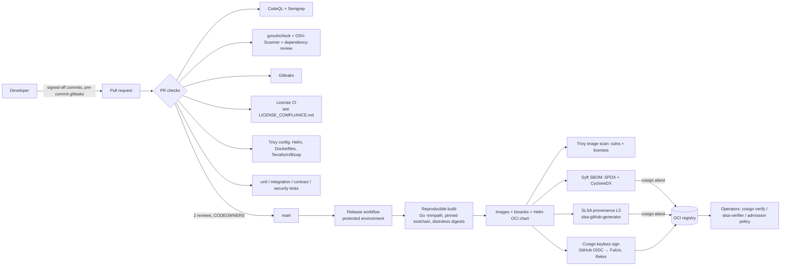

# Software Supply Chain Security

> **Status: DRAFT design.** Nothing here is implemented; no CI workflow exists yet. Delivered in Phase 03 (CI baseline), Phase 35–36 (plugin signing), Phase 38 (release gate). Requirements: NFR-SEC-005, NFR-LIC-001..003, AC-10, AC-11.
>
> **License compliance** (dependency license policy, SPDX headers, CLA/DCO, third-party notices) is specified in [docs/legal/LICENSE_COMPLIANCE.md](../legal/LICENSE_COMPLIANCE.md) and is not repeated here. This document covers integrity and vulnerability controls and references the license checks only where they share pipeline stages.

## 1. Pipeline overview



## 2. Controls

| ID | Control | Tooling (proposed) | Gate | Phase |
|---|---|---|---|---|
| SC-01 | **Dependency pinning:** `go.mod`/`go.sum` with `GOFLAGS=-mod=readonly`, `GOPROXY` + `GOSUMDB` enabled; `pnpm-lock.yaml` with `--frozen-lockfile`; Go toolchain pinned via `toolchain` directive; container base images pinned by digest. | Go, pnpm | Build fails on lockfile drift | 03 |
| SC-02 | **Install-script control:** pnpm `onlyBuiltDependencies` allow-list (lifecycle scripts blocked by default); no `curl \| sh` in Dockerfiles or workflows. | pnpm, Semgrep rule | PR | 03 |
| SC-03 | **Pinned GitHub Actions:** every `uses:` pinned to a full commit SHA with a version comment; enforced by a lint step (e.g. `zizmor`/`actionlint` + custom check). Third-party actions limited to an allow-list. | actionlint, zizmor | PR | 03 |
| SC-04 | **Least-privilege workflows:** top-level `permissions: read-all` (or `{}`), elevated per job only (`id-token: write` only on signing jobs, `contents: write` only on release); `pull_request_target` forbidden; no secrets available to fork PRs; optional egress monitoring (`step-security/harden-runner`). | GitHub settings | PR | 03 |
| SC-05 | **Signing:** Cosign keyless (GitHub OIDC identity → Fulcio certificate, Rekor transparency log) for container images, Helm OCI charts, release binaries and checksum files. Signature identity: the release workflow path on a tag ref. | Cosign | Release | 03, 38 |
| SC-06 | **SBOM:** Syft generates SPDX 2.3 JSON and CycloneDX 1.5+ JSON per image and per binary, including license data (shared with license CI); attached as Cosign attestations and release assets. | Syft, Cosign | Release | 03, 38 |
| SC-07 | **SLSA provenance, Build L3 target:** generated by `slsa-framework/slsa-github-generator` reusable workflows (isolated, non-forgeable provenance); attested to images and binaries; verified in release rehearsal with `slsa-verifier`. | slsa-github-generator | Release | 38 |
| SC-08 | **SAST:** CodeQL (Go, JavaScript/TypeScript; `security-extended` queries) and Semgrep with project rules: no string-built SQL; no `float32/float64` in finance packages (ADR-0007); no DB access outside `db/tx`; no `InsecureSkipVerify`; no `dangerouslySetInnerHTML` outside the sanitizer; no `http.Get` outside `safehttp`; no logging of `secret.Value` unwrapped. | CodeQL, Semgrep | PR (high/critical block) | 03 |
| SC-09 | **Secret scanning:** Gitleaks pre-commit hook and CI on full history for PRs; GitHub secret scanning + push protection; custom rules for `clt_`/`cls_`/`clscim_` token formats. | Gitleaks | PR | 03 |
| SC-10 | **Vulnerability scanning:** `govulncheck` (reachability-aware) for Go; OSV-Scanner for Go + pnpm lockfiles; Trivy for images (OS + language packages), filesystem and IaC config (Dockerfiles, Helm charts, Terraform, Bicep); `actions/dependency-review-action` on PRs (blocks new high/critical vulns and denied licenses). | govulncheck, OSV-Scanner, Trivy | PR + nightly + release | 03 |
| SC-11 | **Plugin artifact verification:** third-party plugin binaries/images must be Cosign-signed; operators configure a trust policy (allowed identities/issuers or public keys) per plugin source; checksum recorded in `plugins_installed`; manifest license validated per [PLUGIN_LICENSING.md](../legal/PLUGIN_LICENSING.md). | Cosign | Plugin install | 35, 36 |
| SC-12 | **Dependency updates:** Renovate as primary (grouped updates, digest pinning for Docker and Actions, `minimumReleaseAge` 3 days for npm and Go to reduce typosquat/compromised-release exposure, auto-merge only for patch-level dev tooling with green CI); Dependabot **security alerts** enabled as a second signal. | Renovate, Dependabot alerts | — | 03 |
| SC-13 | **Repository protection:** branch protection on `main` and release tags (required checks, 2 approvals, CODEOWNERS for `internal/authz`, `internal/identity`, `internal/platform/crypto`, `internal/audit`, `.github/`, `deploy/`, `compliance/`, legal files), linear history, no force-push, signed tags for releases. | GitHub | PR | 03 |
| SC-14 | **Reproducible builds:** `-trimpath`, `-buildvcs=true`, `SOURCE_DATE_EPOCH`, `ko` or GoReleaser with fixed base digests; nightly rebuild compares digests of binaries. | GoReleaser/ko | Nightly | 38 |
| SC-15 | **Base images:** distroless (`static` for Go, `nodejs` for web), non-root; rebuilt weekly for OS patches; no package managers in final images. | — | — | 03 |
| SC-16 | **VEX:** non-exploitable findings documented as OpenVEX statements attached to releases rather than silently ignored; exceptions expire. | OpenVEX, Trivy `--vex` | Release | 38 |
| SC-17 | **OpenSSF Scorecard** run weekly; score regressions reviewed. | Scorecard | — | 03 |
| SC-18 | **Release gate:** no open critical/high vulnerabilities without approved VEX, all artifacts signed with SBOM and provenance, license gate green (LICENSE_COMPLIANCE §5), security test suites green (AC-10, OQ-12). | — | Release | 38 |

## 3. Vulnerability handling SLAs

Aligned with [SECURITY.md](../../SECURITY.md): fix Critical within 30 days and High within 60 days of triage; dependency CVEs with reachable vulnerable code follow the same SLAs; unreachable ones are documented via VEX and fixed in the next scheduled update.

## 4. Operator verification (documented for users in Phase 39)

```bash
# Image signature (keyless): identity is the release workflow on a tag
cosign verify ghcr.io/<org>/cloudledger:<version> \
  --certificate-identity-regexp '^https://github.com/<org>/cloudledger/.github/workflows/release.yml@refs/tags/v' \
  --certificate-oidc-issuer https://token.actions.githubusercontent.com

# SBOM and provenance attestations
cosign verify-attestation --type spdxjson   ghcr.io/<org>/cloudledger:<version> --certificate-identity-regexp '…' --certificate-oidc-issuer https://token.actions.githubusercontent.com
slsa-verifier verify-image ghcr.io/<org>/cloudledger@sha256:<digest> --source-uri github.com/<org>/cloudledger --source-tag v<version>
```

`<org>` is a placeholder pending OQ-01. The Helm chart ships an optional Kyverno / Sigstore policy-controller policy enforcing these checks at admission (SEC-K8S-07).

## 5. Threats addressed

T-60 (malicious dependency), T-61 (compromised CI or artifact), T-62 (leaked secrets), T-65 (compromised plugin). See [THREAT_MODEL.md](THREAT_MODEL.md).
